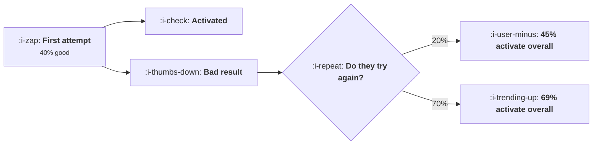

# Activation When the First Output Is Bad

```text
Level: Expert
Prerequisites: What Activation Means Here
Estimated difficulty: 3/5 | Estimated time: 35 min
```

## The idea in one minute

A model powered product gives an uneven first result, so activation is not the chance that one
attempt is good, it is the chance of reaching a good result anywhere in a sequence, and the share of
users who try again decides how long that sequence is. The arithmetic is decisive about where to
work: improving the model from 40 to 55 percent good output raises activation from 45 to 60 percent,
and raising the retry rate from 20 to 70 percent raises it from 45 to 69. The first is a model
upgrade with a cost per call attached; the second is interface work. And raising the retry rate
leaves the cost per activated user unchanged, which makes it the best trade in this topic.

## A picture



The model quality is in the first box. Everything that matters is in the gate.

## How it really works

### Activation is a sequence, not an event

Write it out: a user activates if the first attempt is good, or the first is bad and they retry and
the second is good, or so on. The probability of reaching a good result is therefore a function of
two numbers, the chance one attempt is good and the chance of a retry after a bad one.

That reframing is the whole lesson. A product with a 40 percent good output rate and a 90 percent
retry rate activates 85 percent of users; the same model with a 20 percent retry rate activates 45.

### Why the interface work beats the model work

Two reasons, one arithmetic and one practical.

The arithmetic: the table's rows and columns are not symmetric. At low good output rates the retry
rate dominates, because there are many bad results to recover from. Going from 20 to 70 percent
retry at a 40 percent good rate is worth 24 points; going from 40 to 55 percent good output at a 20
percent retry rate is worth 15.

The practical: a better model costs more per call and is somebody else's release schedule, while the
retry interface is yours and ships this week.

### Letting people try more times does nothing on its own

Raising the allowed attempts from six to nine changes activation by zero, because at a 20 percent
retry rate almost nobody reaches a fourth attempt. The limit was not binding.

This is worth knowing because raising the limit is the intervention teams reach for first, as it
requires no design. It is the one thing in the table that does nothing, and it only starts to matter
once the retry rate is high.

### The five things that raise a retry rate

* **Say what the output was based on.** A user who can see the inputs can fix them. A user who
  cannot has no next move except leaving.
* **Offer a specific next attempt, not a button.** "Try again" asks the user to work out what to
  change, which is the hard part. "Try again with more detail about X" does the work.
* **Make the second attempt free and instant.** Any friction here is fatal, including a usage
  counter visibly decrementing.
* **Show a known good example beside theirs.** It converts a vague sense of failure into a specific
  gap, which is actionable.
* **Never present a bad output as finished.** The framing decides whether a user reads it as the
  product's limit or as a first draft, and that is a copy and layout decision rather than a model
  one.

### The cost side is neutral, which is unusual

Attempts per signup rise from 1.14 to 1.71 as the retry rate goes from 20 to 70 percent, so the cost
per signup rises from 0.062 to 0.094. But activation rises in the same proportion, so the cost per
activated user stays at 0.137 across the whole range.

That means the retry work is free in unit terms. It is the only intervention in this topic that
raises activation without raising the cost per activated user, which makes it the thing to do first
and the thing to do before any model upgrade.

### Measuring it

Three numbers, and most teams have none of them. The share of first outputs that users treated as
good, which you infer from whether they kept or used the result rather than from a rating. The share
of users who make a second attempt after a bad first one. And attempts per activated user, which is
the cost side.

Instrument the second one as a funnel: bad first result, then second attempt within the session.
That single rate is the lever this lesson is about.

### What fills the box in 2026

Good output rates have risen, which has made the retry rate matter slightly less and has not changed
the ordering: at a 70 percent good rate, going from a 20 to a 70 percent retry rate is still worth
15 points. What has changed more is that users have become practised at prompting again, so baseline
retry rates are higher than they were, and products that have not updated their interface are
getting the benefit without having earned it. Measure yours rather than assuming the figure from two
years ago.

## Run the numbers

Vary both inputs and compare the two routes.

```go
// secondattempt.go: activation when the first output is often bad.
package main

import "fmt"

// A model powered product gives an uneven first result. A user who got a bad
// one activates only if they try again, so activation is the chance of a good
// output anywhere in a sequence of attempts, and the share who retry decides
// how long that sequence is.
type setup struct {
	name   string
	good   float64 // chance one attempt produces a result worth having
	retry  float64 // chance a user tries again after a bad result
	maxTry float64 // attempts the product allows or the user tolerates
}

// chance of reaching a good output at all
func (s setup) activate() float64 {
	reach, done := 1.0, 0.0
	for t := 0.0; t < s.maxTry; t++ {
		done += reach * s.good
		reach *= (1 - s.good) * s.retry
	}
	return done
}

func main() {
	fmt.Printf("%-16s %10s %10s %10s %10s\n",
		"good output", "retry 20%", "retry 45%", "retry 70%", "retry 90%")
	for _, g := range []float64{0.25, 0.40, 0.55, 0.70, 0.85} {
		fmt.Printf("%15.0f%%", 100*g)
		for _, r := range []float64{0.20, 0.45, 0.70, 0.90} {
			s := setup{"", g, r, 6}
			fmt.Printf(" %9.0f%%", 100*s.activate())
		}
		fmt.Println()
	}
	fmt.Println("\nRead the table two ways. Improving the model from 40% to 55% good")
	fmt.Println("output at a 20% retry rate takes activation from 45% to 60%.")
	fmt.Println("Improving the retry rate from 20% to 70% at 40% good output takes")
	fmt.Println("it from 45% to 69%. The first is a model upgrade with a cost per")
	fmt.Println("call attached and the second is interface work, and the interface")
	fmt.Println("work is worth more.")

	fmt.Println("\nwhat each thing costs to improve, and what it buys:")
	base := setup{"", 0.40, 0.20, 6}
	fmt.Printf("%-44s %16s %14s %s\n",
		"change", "activation", "gain", "how hard")
	for _, c := range []struct {
		name string
		s    setup
		hard string
	}{
		{"nothing", base, ""},
		{"a better model, 40% to 55% good", setup{"", 0.55, 0.20, 6}, "a model upgrade and more cost per call"},
		{"show why it was wrong and what to change", setup{"", 0.40, 0.45, 6}, "interface work"},
		{"offer one obvious retry, pre filled", setup{"", 0.40, 0.70, 6}, "interface work"},
		{"both the retry and a better model", setup{"", 0.55, 0.70, 6}, "both"},
		{"let them try nine times, not six", setup{"", 0.40, 0.20, 9}, "a cost decision"},
	} {
		fmt.Printf("%-44s %15.0f%% %13.0fpp %s\n",
			c.name, 100*c.s.activate(), 100*(c.s.activate()-base.activate()), c.hard)
	}

	fmt.Println("\nLetting people try nine times instead of six adds nothing, because")
	fmt.Println("at a 20% retry rate almost nobody reaches a fourth attempt. Raising")
	fmt.Println("the retry rate is the only change that makes extra attempts matter,")
	fmt.Println("which is why the two have to be done in that order.")

	fmt.Println("\nwhat actually raises the retry rate:")
	for _, r := range []struct{ change, why string }{
		{"say what the output was based on", "a user who sees the input can fix it"},
		{"offer a specific next attempt, not a button", "deciding what to change is the work"},
		{"make the second attempt free and instant", "any friction here is fatal"},
		{"show a known good example beside theirs", "a reference point converts failure into a gap"},
		{"never present a bad output as finished", "the framing decides whether they try again"},
	} {
		fmt.Printf("  %-46s %s\n", r.change, r.why)
	}

	fmt.Println("\nthe cost side, which is why this is not free:")
	const perCall = 0.055
	fmt.Printf("%-24s %14s %16s %16s\n",
		"retry rate", "attempts each", "cost per signup", "cost per activated")
	for _, r := range []float64{0.20, 0.45, 0.70, 0.90} {
		s := setup{"", 0.40, r, 6}
		att, reach := 0.0, 1.0
		for t := 0.0; t < s.maxTry; t++ {
			att += reach
			reach *= (1 - s.good) * r
		}
		fmt.Printf("%23.0f%% %14.2f %16.3f %16.3f\n",
			100*r, att, att*perCall, att*perCall/s.activate())
	}
	fmt.Println("\nGoing from a 20% to a 70% retry rate raises attempts per signup")
	fmt.Println("from 1.14 to 1.71 and leaves the cost per activated user at 0.137,")
	fmt.Println("because the extra attempts produce exactly enough activations to")
	fmt.Println("pay for themselves. So raising the retry rate buys 24 points of")
	fmt.Println("activation at no change in unit cost, which is the best trade")
	fmt.Println("available anywhere in this topic.")
}
```

The grid is the main result. Read along a row to see what the retry rate buys and down a column to
see what model quality buys, and notice that the rows are longer than the columns at the top of the
table, which is where most products are.

The change table prices the options: 15 points for a model upgrade, 9 for explaining the failure, 23
for a pre filled retry, 35 for both, and zero for allowing more attempts.

The cost table is the part that makes this easy to approve: cost per activated user of 0.138, 0.137,
0.137 and 0.138 across the whole range of retry rates. The intervention is free in unit terms.

Measure your own good output rate from whether users kept the result, not from a thumbs up control,
which measures something else and is answered by a self selected few.

## Sector lens

| Sector | What a bad first output looks like here |
|---|---|
| [Enterprise B2B SaaS](../../product-management/product-by-sector/01-enterprise-b2b-saas.md) | A report with the wrong grouping. Users retry readily if the inputs are visible, so showing them is most of the work |
| [Fintech](../../product-management/product-by-sector/02-fintech.md) | A misclassified transaction, where a wrong result is a trust event rather than an inconvenience. Correction has to be easy and auditable |
| [Ecommerce and D2C](../../product-management/product-by-sector/03-ecommerce-and-d2c.md) | A poor product description or image. Retries are cheap and the operator is a merchant rather than a consumer |
| [Marketplaces](../../product-management/product-by-sector/04-marketplaces.md) | A bad match, which wastes the other side's time as well, so the retry cost is borne by somebody not in the room |
| [Devtools and Infra](../../product-management/product-by-sector/05-devtools-and-infrastructure.md) | Code that does not compile, which is self evidently bad and therefore produces the highest retry rates anywhere |
| [Healthtech](../../product-management/product-by-sector/06-healthtech-and-regulated-care.md) | A wrong clinical summary, where retry is not the relevant response. Review before presentation is required |
| [Vertical SaaS](../../product-management/product-by-sector/07-vertical-saas.md) | A mis mapped import, where the user cannot tell it is wrong until much later. Showing the mapping is the whole fix |

## Remember this

* Activation is the chance of a good result anywhere in a sequence, not the chance that one attempt
  is good.
* Two inputs: the good output rate and the retry rate after a bad result.
* Raising the retry rate from 20 to 70 percent is worth 24 points of activation; a model upgrade
  from 40 to 55 percent good output is worth 15.
* The first is interface work you ship this week; the second costs more per call and waits on
  somebody else.
* Raising the allowed attempt count does nothing on its own, because nobody reaches the limit at a
  low retry rate.
* Five levers: show the inputs, offer a specific next attempt, make it instant and free, show a good
  example, never frame a bad output as finished.
* Cost per activated user is unchanged across the whole retry range, so this is free in unit terms.
* Measure the good output rate from whether the result was kept, not from a rating control.
* Instrument retry as a funnel: bad first result, then a second attempt in the same session.
* Baseline retry rates have risen as users got practised, so remeasure rather than reusing an old
  figure.

## Try it

1. Instrument the retry funnel this week: bad first output, then second attempt within the session.
   That one rate is the lever.
2. Add the specific next attempt to your retry path, pre filled, and measure the change in the retry
   rate rather than in activation.
3. Compute your cost per activated user before and after. If it is flat, the change was free and
   should be taken further.

## Check yourself

1. Your good output rate is 55 percent and your retry rate is 25 percent. Which would you rather
   improve by a third, and why?
2. Why does raising the allowed number of attempts change nothing at a low retry rate?
3. Your retry rate rose from 22 to 61 percent, activation rose 19 points, and your inference bill
   rose 40 percent. Was that a good trade?
