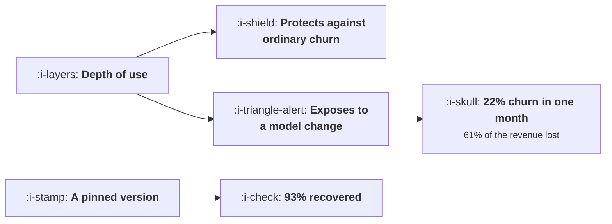

# Retention When the Model Changes

```text
Level: Expert
Prerequisites: Activation When the First Output Is Bad
Estimated difficulty: 4/5 | Estimated time: 40 min
```

## The idea in one minute

Users build workflows on top of a model's behaviour, so when the model changes some of those
workflows stop working and the user experiences a product that broke rather than one that improved.
The churn is concentrated exactly where no other churn is: the 7 percent of customers who built
something on your output have the lowest normal churn at 1.1 percent a month and the highest churn
in the month of a change at 22 percent, and they are 61 percent of the revenue lost. An
unannounced update cost 709 customers and 835,000 of annualised revenue. A pinned version recovers
93 percent of it.

## A picture



The same property makes a customer safe from everything else and exposed to this.

## How it really works

### Depth of use is protective against everything except this

Every churn model in this course says the same thing: users who have built more are less likely to
leave. That holds for price rises, competitors, bad support and declining quality.

It inverts for a model change. The user who saved a workflow, wrote a prompt they rely on, or built
a product on your output has the most to lose when the behaviour shifts, and the loss is immediate
rather than gradual. Normal churn of 1.1, 1.9, 3.1 and 5.8 percent across the four cohorts becomes
22.0, 17.5, 10.6 and 7.6 percent in the month of an unannounced change: the ordering reverses
completely.

### Why it reads as a breakage rather than an improvement

The change may well be an improvement on average. The user does not experience the average. They
experience one workflow, which worked and now does not, and they did not ask for anything to change.

That asymmetry is the whole management problem. The team sees a better model; a share of customers
see an unrequested regression they have to diagnose themselves, and the ones who diagnose it
fastest are the ones who built most.

### The loss is concentrated and invisible

Revenue lost by cohort: 2, 11, 25 and 61 percent. The cohort a growth team would call its best is
most of the damage.

And it is the cohort least likely to appear in a churn survey. A user who built a product on your
output does not complain, they rebuild on something else, because they are capable of that and
because they now know the dependency is unsafe. So the loss arrives as a quiet cancellation with no
reason attached, which is why teams frequently do not connect it to the release at all.

### Five mitigations, priced

* **Nothing.** 709 customers, 835,000 annualised.
* **A changelog entry.** Recovers 12 percent. Nobody reads a changelog in time.
* **An email two weeks before.** Recovers 41 percent. This is the cheapest meaningful step and it
  needs a notice list, which needs depth of use to be measured.
* **An email plus the old version available for ninety days.** Recovers 78 percent. This converts a
  breakage into a migration, which is a thing engineers know how to do.
* **A pinned version the customer chooses.** Recovers 93 percent. The most expensive to operate and
  the only one that removes the problem rather than cushioning it.

The ninety day window is the right default for most products: it recovers most of the loss at a
fraction of the operational cost of permanent pinning.

### The thing that turns this into an engineering problem

An evaluation set built from your customers' real workflows, run against a candidate model before it
ships. That one artefact changes everything downstream: you know which workflows break, which
accounts to warn, and whether to ship at all.

Building it is a privacy and consent question as well as a technical one, so the version that works
is usually opt in: customers who care most will give you their workflows precisely because they do
not want them broken. The 7 percent cohort will volunteer.

### What to instrument now

Three things, and none exists by default. A version identifier on every response, recorded with the
event, so that a behaviour change can be correlated with a release afterwards. A depth of use score
per account, from saved workflows, API volume and output reuse. And a churn reason field that
includes "the output changed", because without it this failure mode is invisible in your own
reporting.

### What fills the box in 2026

Silent updates behind a stable endpoint name remain common, which means a model can change without
any version number moving and without you knowing. Where a provider offers pinned versions, pinning
is worth the operational cost for anything your customers build on. And the deprecation windows
providers offer have been shortening, which compresses your own window: if your supplier gives you
ninety days, you cannot offer your customers ninety days from the day you find out.

## Run the numbers

Score your cohorts by depth, then price the mitigations.

```go
// modelchange.go: what a model update does to a habit, and what notice is worth.
package main

import "fmt"

// Users build workflows on top of a model's behaviour. When the model changes,
// some of those workflows stop working, and the user experiences a product
// that broke rather than a product that improved. The cost depends on how
// deeply they had built and on whether they were told.
type cohort struct {
	name     string
	share    float64 // share of the base
	depth    float64 // how much the user has built on the current behaviour
	value    float64 // monthly revenue each
	baseChur float64 // monthly churn before any change
}

const base = 10_000.0

// extra churn in the month of a change, given how much the user had built and
// what the company did about it
func excess(depth, mitigation float64) float64 {
	return depth * 0.22 * (1 - mitigation)
}

func main() {
	cohorts := []cohort{
		{"tried it once a week", 0.46, 0.08, 19, 0.058},
		{"uses it in a weekly routine", 0.31, 0.34, 34, 0.031},
		{"built a saved workflow on it", 0.16, 0.71, 71, 0.019},
		{"built a product on the output", 0.07, 0.95, 290, 0.011},
	}

	fmt.Printf("%.0f customers; a model update lands this month\n\n", base)
	fmt.Printf("%-34s %8s %9s %10s %14s %14s\n",
		"cohort", "share", "depth", "revenue", "normal churn", "churn now")
	for _, c := range cohorts {
		fmt.Printf("%-34s %7.0f%% %9.2f %10.0f %13.1f%% %13.1f%%\n",
			c.name, 100*c.share, c.depth, c.value,
			100*c.baseChur, 100*(c.baseChur+excess(c.depth, 0)))
	}

	fmt.Println("\nThe users who built the most churn the most, which is the reverse")
	fmt.Println("of every other churn pattern in this course. Depth of use is")
	fmt.Println("protective against everything except a change in the thing they")
	fmt.Println("built on.")

	fmt.Println("\nwhat one unannounced update costs:")
	fmt.Printf("%-44s %14s %16s %14s\n",
		"mitigation", "customers lost", "revenue lost/mo", "annualised")
	for _, m := range []struct {
		name string
		mit  float64
	}{
		{"nothing: it changed on a Tuesday", 0.00},
		{"a changelog entry", 0.12},
		{"an email two weeks before", 0.41},
		{"an email, plus the old version for 90 days", 0.78},
		{"a pinned version the customer chooses", 0.93},
	} {
		var lost, rev float64
		for _, c := range cohorts {
			n := base * c.share
			e := excess(c.depth, m.mit)
			lost += n * e
			rev += n * e * c.value
		}
		fmt.Printf("%-44s %14.0f %16.0f %14.0f\n", m.name, lost, rev, rev*12)
	}

	fmt.Println("\nAn unannounced update costs 709 customers and 69,593 of monthly")
	fmt.Println("revenue, which annualises to 835,000 from one Tuesday. An email two")
	fmt.Println("weeks ahead recovers 41% of it, keeping the old version for ninety")
	fmt.Println("days recovers 78%, and a pinned version recovers 93%. That is the")
	fmt.Println("difference between a migration and a breakage.")

	fmt.Println("\nwhere the loss is concentrated:")
	fmt.Printf("%-34s %14s %16s %14s\n",
		"cohort", "customers lost", "revenue lost", "share of loss")
	var totRev float64
	for _, c := range cohorts {
		totRev += base * c.share * excess(c.depth, 0) * c.value
	}
	for _, c := range cohorts {
		r := base * c.share * excess(c.depth, 0) * c.value
		fmt.Printf("%-34s %14.0f %16.0f %13.0f%%\n",
			c.name, base*c.share*excess(c.depth, 0), r, 100*r/totRev)
	}
	fmt.Println("\nThe 7% who built a product on the output are 61% of the revenue")
	fmt.Println("lost. They are also the cohort a growth team would describe as its")
	fmt.Println("best, and the one least likely to be in a churn survey, because")
	fmt.Println("they do not complain, they rebuild on something else.")

	fmt.Println("\nwhat to build before the next update, not after:")
	for i, s := range []string{
		"a version identifier in every response, recorded with the event",
		"a pinned version option for anybody building on the output",
		"a deprecation window with a date, published in advance",
		"an evaluation set of your customers' real workflows, run before release",
		"a notice list of the accounts whose depth of use is highest",
	} {
		fmt.Printf("  %d. %s\n", i+1, s)
	}
	fmt.Println("\nThe fourth is the one that turns this from a communications")
	fmt.Println("problem into an engineering one: if you can run your customers'")
	fmt.Println("workflows against a new model before shipping it, you know which")
	fmt.Println("accounts to warn and whether to ship at all.")
}
```

The first table is the inversion. Normal churn descends down the rows and churn in the month of a
change ascends, which is a pattern no other table in this course produces.

The mitigation table is the decision: 835,122, 734,907, 492,722, 183,727 and 58,459 of annualised
loss. The step from a changelog to an email is worth 242,000 a year and costs an email.

The concentration table is the one to show a leadership team: 61 percent of the loss in 7 percent of
customers, and those customers are the reference accounts.

Put your own depth scores in. The depth parameter is the input to estimate and the honest way is to
rank accounts by saved artefacts and output reuse, then assign depths by decile rather than trying
to measure it precisely.

## Sector lens

| Sector | What breaks when the model changes here |
|---|---|
| [Enterprise B2B SaaS](../../product-management/product-by-sector/01-enterprise-b2b-saas.md) | Saved reports and automations that somebody is accountable for. The complaint goes to whoever signs the renewal |
| [Fintech](../../product-management/product-by-sector/02-fintech.md) | Classification rules that feed reconciliation and reporting. A behaviour change can be an audit finding |
| [Ecommerce and D2C](../../product-management/product-by-sector/03-ecommerce-and-d2c.md) | Catalogue copy and image pipelines run in bulk, so a change produces thousands of inconsistent items at once |
| [Marketplaces](../../product-management/product-by-sector/04-marketplaces.md) | Matching behaviour, where a change reallocates income between suppliers and generates complaints from the losers |
| [Devtools and Infra](../../product-management/product-by-sector/05-devtools-and-infrastructure.md) | Anything in a customer's build or deployment. These users will pin, and if you do not offer pinning they will leave |
| [Healthtech](../../product-management/product-by-sector/06-healthtech-and-regulated-care.md) | Validated workflows, where a change requires revalidation. Pinning is a governance requirement, not a courtesy |
| [Vertical SaaS](../../product-management/product-by-sector/07-vertical-saas.md) | Operational routines the business runs on. A change arrives as the product being broken on a working day |

## Remember this

* Depth of use protects against every kind of churn except a change in the thing the user built on.
* Normal churn runs 1.1 to 5.8 percent across cohorts and becomes 22.0 to 7.6 percent in the month
  of an unannounced change: the ordering reverses.
* The deepest 7 percent of customers were 61 percent of the revenue lost.
* They do not complain, they rebuild elsewhere, so the loss appears as a cancellation with no reason
  attached.
* Mitigations recover 12, 41, 78 and 93 percent. A changelog is worth almost nothing; an email two
  weeks ahead is worth 242,000 a year.
* A ninety day old version window is the right default: most of the recovery at a fraction of the
  cost of permanent pinning.
* Build an evaluation set from customers' real workflows and run it before shipping. It turns a
  communications problem into an engineering one.
* The deep cohort will volunteer their workflows, because they do not want them broken.
* Instrument three things: a version identifier on every response, a depth of use score per account,
  and a churn reason for output changing.
* Providers update silently behind stable names and their deprecation windows are shortening, which
  compresses the window you can offer.

## Try it

1. Build a depth of use score per account from saved artefacts, output reuse and API volume. Rank
   accounts and look at where your revenue sits.
2. Record the model version on every response and store it with the event, so the next behaviour
   change can be correlated with a release.
3. Ask your five deepest accounts for a handful of real workflows to use as an evaluation set before
   your next model change. Expect them to agree readily.

## Check yourself

1. Why does the cohort with the lowest normal churn have the highest churn in the month of a model
   change?
2. Your cancellations rose and no reason given rose with them, two weeks after a model upgrade. What
   happened and what is missing from your reporting?
3. Your provider gives you 60 days of notice before deprecating a model. What can you offer your
   customers, and what does that imply about pinning?
