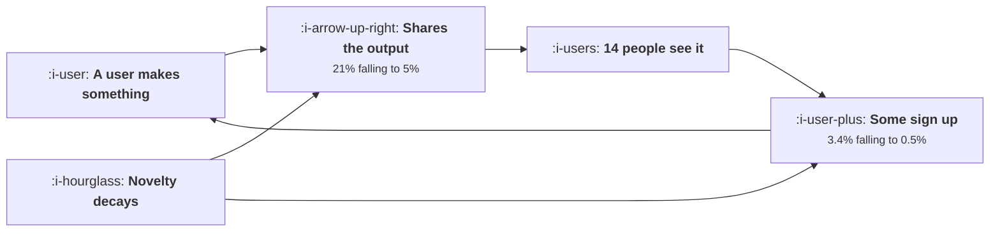

# The Demo Loop

```text
Level: Expert
Prerequisites: The Viral Coefficient in Plain Words
Estimated difficulty: 3/5 | Estimated time: 35 min
```

## The idea in one minute

A product whose output is interesting enough to show somebody has a loop nothing else has: the
artefact is the advertisement, and it costs nothing. It also has a property no other loop has, which
is that it decays on its own. The coefficient falls from 0.100 to 0.004 over ten quarters with no
product change at all, because the output stopped being remarkable, so fewer people share it and
fewer of those who see it are surprised enough to act. In the worked case total users peak in
quarter seven and then fall. Nothing in the funnel broke; the company started shrinking because one
coefficient decayed.

## A picture



Novelty feeds two of the three terms, which is why the decay is faster than it looks from any single
number.

## How it really works

### Three terms, and novelty is in two of them

The coefficient is the share of users who share an output, times the people who see each one, times
the share of those who sign up.

The middle term is stable: a shared artefact reaches about as many people this year as last. The
first and third both depend on how remarkable the output is, and remarkability is relative to what
everybody has already seen.

So as a category becomes ordinary, two of three terms fall together and the coefficient falls
roughly as the square of the novelty. That is why demo loops collapse faster than teams expect.

### The decay is easy to miss while it is happening

Loop signups in the worked case run 7,997, 6,902, 4,211, 2,172, 1,037 and 707 across ten quarters,
while the user base rises and then falls. The loop's share of new users runs 66, 62, 50, 34, 20 and
14 percent.

Two things make this hard to see in time. The absolute numbers stay respectable for several
quarters, because the base is growing. And the share of new users falls gradually, so there is no
quarter in which anybody says the channel broke.

By the time the loop's share has halved it has been declining for a year and a half, which is the
practical warning: watch the coefficient, not the signups.

### What holds the coefficient up

The durable interventions all act on the viewer's side rather than the sharer's.

* **Let the viewer use the thing they are looking at, without an account.** The strongest and most
  durable intervention available, because it converts a demonstration into a trial with no signup
  in between. This is the collaboration loop mechanism from
  [Collaboration Loops](../virality-and-referral/03-collaboration-loops.md) applied to an artefact.
* **Make the output about the viewer.** An artefact that mentions or includes the person looking at
  it has a different conversion rate from one that does not, and the effect does not decay.
* **Put your name on the artefact.** Durable while the category is novel and worth little once it is
  not, because attribution only converts if the viewer wonders how it was made.

And the ones that do not hold.

* **Making sharing easier.** A real one off gain with a ceiling, because the people who wanted to
  share already did.
* **Incentivising sharing.** Brief, and it selects for people whose audience does not care, which is
  the referral problem in
  [Why Referral Programmes Do Nothing](../virality-and-referral/02-why-referral-programmes-do-nothing.md).
* **Making the output better.** Does not help, because novelty is relative. A better output in a
  category everybody has seen is still not remarkable.

### What to do about the decay

Plan for the replacement from the start, because the decay is a property of the category rather than
a failure of execution.

Three practical moves. Measure the coefficient quarterly rather than the signups, so the decline is
visible early. Compute the equivalent paid spend the loop is providing, which in the worked case
falls from 303,878 a quarter to 26,862, so that the replacement has a budget attached. And build the
durable interventions before the decay rather than in response to it, because the viewer side
changes take longer to ship than the quarter in which somebody notices.

### Where this loop is strongest

Products whose output is public by nature: anything that produces an image, a document, a page, a
piece of music, a chart. Products whose output is private by nature do not have this loop at all,
and the common mistake is to try to manufacture one by encouraging users to share things they have
no reason to share.

If your output is private, the loop you have is the collaboration loop rather than the demo loop,
and they behave differently: collaboration does not decay with novelty because it is driven by the
work rather than by the surprise.

### What fills the box in 2026

The decay has been fast across every category that opened in the last three years, and the reason is
that the supply side of remarkable output grew faster than audiences adjusted. The practical
consequence is that a demo loop is now a launch mechanism rather than a growth strategy: it is worth
building, it is worth measuring, and a plan that assumes it persists for three years is assuming
something that has not happened to anybody recently.

## Run the numbers

Decay the coefficient and watch the growth curve turn over.

```go
// demoloop.go: sharing the output as a channel, and why it decays.
package main

import "fmt"

// A product whose output is interesting enough to show somebody has a loop
// nothing else has: the artefact is the advertisement. It works while the
// output is novel and decays as the category becomes ordinary, so its
// coefficient has a half life rather than a steady state.
type loop struct {
	quarter   int
	share     float64 // share of users who share an output
	seen      float64 // people who see each shared output
	signupPer float64 // share of viewers who sign up
	cycleWks  float64
}

func (l loop) k() float64 { return l.share * l.seen * l.signupPer }

func main() {
	fmt.Printf("%-10s %10s %10s %12s %10s %12s\n",
		"quarter", "share", "seen each", "sign up", "k", "cycle weeks")
	// novelty decays: fewer people share, and fewer of those who see it act
	ls := []loop{}
	share, signup := 0.21, 0.034
	for q := 1; q <= 10; q++ {
		ls = append(ls, loop{q, share, 14, signup, 3})
		share *= 0.86
		signup *= 0.81
	}
	for _, l := range ls {
		if l.quarter%2 == 1 || l.quarter == 10 {
			fmt.Printf("%10d %9.0f%% %10.0f %11.2f%% %10.3f %12.0f\n",
				l.quarter, 100*l.share, l.seen, 100*l.signupPer, l.k(), l.cycleWks)
		}
	}

	fmt.Println("\nThe coefficient starts at 0.100 and ends at 0.004. Nothing about")
	fmt.Println("the product got worse: the output stopped being remarkable, so")
	fmt.Println("fewer people showed it to anybody and fewer of those people were")
	fmt.Println("surprised enough to act.")

	fmt.Println("\nwhat that does to growth, from 20,000 users:")
	fmt.Printf("%-10s %14s %16s %16s %s\n",
		"quarter", "k", "from the loop", "total users", "share from loop")
	users := 20_000.0
	const paid = 4_200.0 // signups a quarter from everything else
	for _, l := range ls {
		// each quarter has about four cycles in it
		fromLoop := users * l.k() * 4
		users += fromLoop + paid
		users *= 0.88 // churn
		if l.quarter%2 == 1 || l.quarter == 10 {
			fmt.Printf("%10d %14.3f %16.0f %16.0f %14.0f%%\n",
				l.quarter, l.k(), fromLoop, users, 100*fromLoop/(fromLoop+paid))
		}
	}

	fmt.Println("\nIn the first quarter the loop supplies 66% of new users and by the")
	fmt.Println("tenth it supplies 14%. Total users peak in quarter seven and then")
	fmt.Println("fall, which is the part to notice: nothing in the funnel broke and")
	fmt.Println("the company started shrinking because one coefficient decayed.")

	fmt.Println("\nwhat holds the coefficient up, and what does not:")
	fmt.Printf("%-44s %-22s %s\n", "intervention", "effect on k", "durable?")
	for _, r := range []struct{ name, eff, dur string }{
		{"make the output easier to share", "raises share", "yes, once"},
		{"put your name on the artefact", "raises sign up", "yes, while novel"},
		{"make the output about the viewer", "raises sign up", "yes"},
		{"let the viewer edit it without an account", "raises sign up a lot", "yes"},
		{"add an incentive to share", "raises share briefly", "no, and it selects badly"},
		{"make the output better", "raises share", "no, novelty is relative"},
	} {
		fmt.Printf("%-44s %-22s %s\n", r.name, r.eff, r.dur)
	}

	fmt.Println("\nThe durable interventions all move the viewer's side rather than")
	fmt.Println("the sharer's. Making it easier to share runs out; letting a viewer")
	fmt.Println("use the thing they are looking at does not, because it converts a")
	fmt.Println("demonstration into a trial with no signup in between.")

	fmt.Println("\nwhat a demo loop is worth, against paid acquisition:")
	fmt.Printf("%-12s %16s %20s\n", "quarter", "loop signups", "equivalent paid spend")
	users = 20_000.0
	const cpa = 38.0
	for _, l := range ls {
		fromLoop := users * l.k() * 4
		users += fromLoop + paid
		users *= 0.88
		if l.quarter == 1 || l.quarter == 5 || l.quarter == 10 {
			fmt.Printf("%12d %16.0f %20.0f\n", l.quarter, fromLoop, fromLoop*cpa)
		}
	}
	fmt.Println("\nThe loop is free and the equivalent paid spend falls from 303,878")
	fmt.Println("a quarter to 26,862 over two and a half years. Budget for the")
	fmt.Println("replacement before the decay rather than after it, because by the")
	fmt.Println("time the loop's share of new users has halved it has already been")
	fmt.Println("declining for a year and a half.")
}
```

The first table decays the two novelty dependent terms at 14 and 19 percent a quarter, which are
plausible rates and are the inputs to argue about. The coefficient falls from 0.100 to 0.004.

The growth table is the consequence: total users of 28,333, 41,075, 46,762, 47,447, 45,774 and
44,599. A peak in quarter seven from a funnel in which nothing changed.

The intervention table separates durable from temporary, and the equivalent spend table gives the
replacement its budget.

Set the two decay rates to zero and the curve grows forever, which is the model everybody implicitly
uses when a demo loop first works. Set them to your own measured values, which you can get by
comparing the share rate and viewer conversion of cohorts a year apart.

## Sector lens

| Sector | Whether a demo loop exists here |
|---|---|
| [Enterprise B2B SaaS](../../product-management/product-by-sector/01-enterprise-b2b-saas.md) | Rarely. Output is confidential, so the loop is collaboration inside the account rather than a public demo |
| [Fintech](../../product-management/product-by-sector/02-fintech.md) | No. Nobody shares their financial output, and any attempt to encourage it is a privacy problem |
| [Ecommerce and D2C](../../product-management/product-by-sector/03-ecommerce-and-d2c.md) | Strongly, for anything that generates a product image or a customisation somebody is proud of |
| [Marketplaces](../../product-management/product-by-sector/04-marketplaces.md) | Listings are public by construction, which makes the artefact a channel without anybody deciding |
| [Devtools and Infra](../../product-management/product-by-sector/05-devtools-and-infrastructure.md) | Strongly and durably, because the artefact is code in a public repository and attribution persists |
| [Healthtech](../../product-management/product-by-sector/06-healthtech-and-regulated-care.md) | No, and attempting it would be a disclosure problem rather than a growth tactic |
| [Vertical SaaS](../../product-management/product-by-sector/07-vertical-saas.md) | Occasionally, where the output is customer facing: a quote, a schedule, a report a client sees |

## Remember this

* Three terms: share rate, viewers per share, and viewer conversion. Novelty drives two of them.
* So the coefficient falls roughly as the square of novelty, which makes demo loops decay faster
  than teams expect.
* It fell from 0.100 to 0.004 over ten quarters with no product change, and total users peaked in
  quarter seven.
* The decay is hard to see because absolute signups stay respectable while the base grows.
* Watch the coefficient quarterly, not the signups.
* Durable interventions act on the viewer: let them use the artefact without an account, make the
  output about them, name the source while the category is novel.
* Temporary ones act on the sharer: easier sharing has a ceiling, incentives select badly, and a
  better output does not help because novelty is relative.
* Compute the equivalent paid spend the loop provides, so the replacement has a budget before it is
  needed.
* The loop only exists where output is public by nature. A private output product has a
  collaboration loop instead, which does not decay with novelty.
* Treat a demo loop as a launch mechanism rather than a three year growth strategy.

## Try it

1. Measure your share rate and viewer conversion for a cohort from a year ago and one from this
   quarter. The ratio gives you your decay rates.
2. Compute the equivalent paid spend your loop currently provides and put that number in next year's
   plan as a line that has to be replaced.
3. Build the strongest durable intervention: let somebody who sees an output use it without creating
   an account.

## Check yourself

1. Why does a demo loop's coefficient fall faster than the novelty of the output?
2. Your loop signups are flat year on year and your user base doubled. What has happened to the
   coefficient, and what should you do?
3. Your product's output is private. What loop do you actually have, and why does it behave
   differently?
