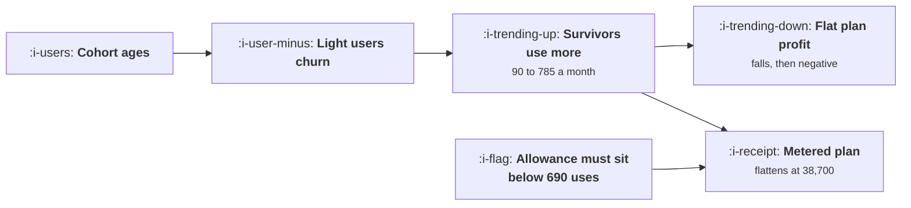

# Usage Growth That Destroys Margin

```text
Level: Expert
Prerequisites: The Demo Loop
Estimated difficulty: 4/5 | Estimated time: 40 min
```

## The idea in one minute

A cohort's usage rises every month because churn removes the lightest users and the survivors do
more, so with a per use cost and a flat price the cohort's gross profit falls while its revenue is
perfectly stable. The worked cohort's monthly profit falls from month six and is negative by month
thirty six. One response fixes it permanently, which is charging for use beyond an allowance, and
the allowance has to be below your breakeven use count: a generous allowance of 900 against a
breakeven of 690 produces a plan indistinguishable from the flat one for three years, because it
never binds until the margin has already gone.

## A picture



Identical cohorts, identical revenue, and the difference is entirely where the allowance sits
relative to the breakeven count.

## How it really works

### Revenue is flat and cost is not, so the healthiest cohort goes first

Monthly revenue per customer on a flat plan does not change. Cost per customer rises with usage, and
usage rises for two compounding reasons: individual users do more over time, and churn removes the
ones who do least.

In the worked cohort, uses per surviving customer go from 90 to 785 a month over three years on a
2.9 percent monthly churn rate. The flat plan's breakeven is 690 uses, so the cohort crosses it
around month thirty three.

The cohort a growth team would describe as its best, highest retention and highest engagement, is
the one that crosses first.

### The allowance has to sit below the breakeven count

This is the specific result worth taking away. A metered plan with 400 included and 9 pence beyond
it flattens the cohort's profit at 38,700 a month rather than letting it go negative. A metered plan
with 900 included is indistinguishable from the flat plan for three years, because the margin is
already gone by the time the allowance binds.

So the design rule is: compute the breakeven use count, and set the included allowance meaningfully
below it. An allowance chosen for how generous it sounds, which is how allowances are usually
chosen, provides no protection at all if it lands above the breakeven.

### The six responses, and only one of them is a fix

* **Raise the flat price.** Buys time, causes churn now, and does not change the slope. The cohort
  still crosses, later.
* **Cap usage on the flat plan.** Works, and your best users hit a wall, which is the paywall
  problem from [Paywalls](../monetisation-and-conversion/03-paywalls.md) applied to paying
  customers, who take it much worse.
* **Charge for use beyond an allowance.** The only permanent fix. Costs a pricing migration, which
  means talking to existing customers about their bill.
* **Route heavy users to a cheaper model.** Partly, and it degrades quality for exactly the users
  who notice most.
* **Cache and batch repeated work.** Partly, with an engineering cost and a ceiling.
* **Do nothing and grow.** Produces the cohort curve above.

### What the technical fixes buy, precisely

Routing half the calls to a cheaper model takes the breakeven count from 690 to 1,046 and the
headroom from 34 months to 41. Caching a third of repeated work does about the same. Both together
take it to 1,569 uses and 48 months.

Fourteen extra months. That is genuinely useful and it is not a solution, and the distinction
matters because teams routinely treat the technical work as the answer and are surprised a year
later. Use the fourteen months to run the pricing migration.

### How to run the migration

Four things, in order. Grandfather existing customers on their current plan for a stated period,
which is usually a year, so nobody's bill changes without notice. Introduce the metered plan for new
customers immediately, so the problem stops growing. Publish the allowance and the overage rate in
units customers understand, not tokens. And give existing customers a reason to move voluntarily,
usually a higher allowance than they would get by waiting.

The common error is to migrate everybody at once to stop the bleeding, which converts a margin
problem into a churn event and a public complaint.

### What to put on the dashboard

Gross profit per cohort by cohort month, next to the retention curve. Those two charts tell opposite
stories in this kind of product, and a team looking at only the second will be pleased with itself
while the first goes negative.

Also uses per surviving customer by cohort month, which is the input that drives everything and is
the earliest warning available.

### What fills the box in 2026

Falling model prices raise the breakeven count, which has bought real headroom for products built
two or three years ago. Two cautions. The fall is somebody else's pricing decision, so the headroom
is borrowed rather than earned. And usage per customer has risen at least as fast as prices have
fallen in most products, because a cheaper and better product gets used more, which means the
crossing point has moved later and the cohorts have moved towards it at a similar rate. Recompute
your breakeven count and your usage growth rate together, quarterly, because only the ratio matters.

## Run the numbers

Follow a cohort for three years on three plans.

```go
// marginkiller.go: what to do when the best cohort is the most expensive.
package main

import "fmt"

// Usage grows within a cohort because the users who stay are the ones who use
// it most and they use it more over time. With a per use cost and a flat
// price, that means a cohort's gross profit falls while its revenue is
// perfectly stable, and the healthiest looking cohort goes negative first.
type plan struct {
	name   string
	price  float64 // monthly
	incl   float64 // uses included
	over   float64 // charged per use beyond the allowance
	perUse float64 // what a use costs you
}

func (p plan) profit(uses float64) float64 {
	rev := p.price
	if uses > p.incl {
		rev += (uses - p.incl) * p.over
	}
	return rev - uses*p.perUse
}

const (
	fixedPrice = 49.0
	perUse     = 0.071
)

func main() {
	flat := plan{"flat 49 a month", fixedPrice, 1e9, 0, perUse}
	metered := plan{"49 a month, 400 included, 0.09 over", fixedPrice, 400, 0.09, perUse}
	generous := plan{"49 a month, 900 included, 0.09 over", fixedPrice, 900, 0.09, perUse}

	fmt.Printf("a use costs %.3f; the flat plan breaks even at %.0f uses\n\n",
		perUse, fixedPrice/perUse)
	fmt.Printf("%-18s %14s %22s %22s\n",
		"uses a month", "flat plan", "400 included", "900 included")
	for _, u := range []float64{120, 400, 690, 900, 1_400, 2_200} {
		fmt.Printf("%18.0f %14.2f %22.2f %22.2f\n",
			u, flat.profit(u), metered.profit(u), generous.profit(u))
	}

	fmt.Println("\nThe flat plan is profitable to 690 uses and then falls away. The")
	fmt.Println("plan with 400 included keeps rising, because beyond the allowance")
	fmt.Println("the price per use exceeds the cost per use. The plan with 900")
	fmt.Println("included is identical to the flat plan until 900 uses, by which")
	fmt.Println("point it is already losing 15 a month: an allowance set above your")
	fmt.Println("breakeven count is not a metered plan in the region that matters.")

	fmt.Println("\na cohort of 4,000, followed for three years:")
	fmt.Printf("%-10s %10s %12s %14s %14s %14s\n",
		"month", "alive", "uses each", "flat profit", "400 incl", "900 incl")
	alive, uses := 4_000.0, 90.0
	for m := 1; m <= 36; m++ {
		alive *= 0.971
		uses *= 1.062
		if m%6 == 0 {
			fmt.Printf("%10d %10.0f %12.0f %14.0f %14.0f %14.0f\n",
				m, alive, uses, alive*flat.profit(uses),
				alive*metered.profit(uses), alive*generous.profit(uses))
		}
	}

	fmt.Println("\nThe flat cohort's profit falls from month six onward and is")
	fmt.Println("negative by month thirty six. The cohort on 400 included follows it")
	fmt.Println("down while usage is inside the allowance and then flattens out at")
	fmt.Println("38,700 rather than going negative. The cohort on 900 included is")
	fmt.Println("indistinguishable from the flat one for three years, because its")
	fmt.Println("allowance never binds before the margin is already gone.")

	fmt.Println("\nwhat each response actually does:")
	fmt.Printf("%-44s %18s %s\n", "response", "fixes the margin", "what it costs")
	for _, r := range []struct{ name, fixes, cost string }{
		{"raise the flat price", "for a while", "churn now, and the slope is unchanged"},
		{"cap usage on the flat plan", "yes", "your best users hit a wall"},
		{"charge for use beyond an allowance", "yes, permanently", "a pricing migration"},
		{"route heavy users to a cheaper model", "partly", "quality where it is noticed most"},
		{"cache and batch repeated work", "partly", "engineering, and it has a ceiling"},
		{"do nothing and grow", "no", "the cohort curve above"},
	} {
		fmt.Printf("%-44s %18s %s\n", r.name, r.fixes, r.cost)
	}

	fmt.Println("\nOnly one row fixes it permanently, and it is the one that requires")
	fmt.Println("talking to existing customers about their bill. Every other row")
	fmt.Println("buys time, which is worth buying, and none of them changes the")
	fmt.Println("slope of the curve.")

	fmt.Println("\nhow much time the technical fixes buy, on the flat plan:")
	fmt.Printf("%-40s %16s %18s\n", "change", "breakeven uses", "months of headroom")
	for _, r := range []struct {
		name string
		cost float64
	}{
		{"nothing", perUse},
		{"route half the calls to a cheaper model", perUse * 0.66},
		{"cache a third of repeated work", perUse * 0.67},
		{"both", perUse * 0.44},
	} {
		be := fixedPrice / r.cost
		// months until a cohort starting at 90 uses reaches that level
		months := 0.0
		u := 90.0
		for u < be && months < 240 {
			u *= 1.062
			months++
		}
		fmt.Printf("%-40s %16.0f %18.0f\n", r.name, be, months)
	}
	fmt.Println("\nDoing both technical fixes takes a cohort from 34 months of")
	fmt.Println("headroom to 48, so it buys fourteen months. That is a real and")
	fmt.Println("useful amount of time and it ends. Use it to run the pricing")
	fmt.Println("migration rather than to postpone it.")
}
```

The first table is the per customer picture at six usage levels. Note that the flat plan and the 900
allowance plan are identical in every row where it matters, which is the result to internalise
before setting an allowance.

The cohort table is the operational consequence: flat plan profit of 133,541, 100,729, 70,962,
43,287, 16,815 and minus 9,313 across three years, with the 400 allowance plan flattening at 38,700.

The headroom table prices the technical fixes: breakeven counts of 690, 1,046, 1,030 and 1,569, and
headroom of 34, 41, 41 and 48 months.

Put your own usage growth rate in. It is the input that matters most, it is measurable from your own
cohorts, and in most products nobody has computed it.

## Sector lens

| Sector | How the margin problem presents here |
|---|---|
| [Enterprise B2B SaaS](../../product-management/product-by-sector/01-enterprise-b2b-saas.md) | Annual contracts mean no price lever until renewal, so the margin falls for up to twelve months with no response available |
| [Fintech](../../product-management/product-by-sector/02-fintech.md) | Per transaction cost against per transaction revenue, which is a better shape, until classification volume outgrows transaction volume |
| [Ecommerce and D2C](../../product-management/product-by-sector/03-ecommerce-and-d2c.md) | Cost is per catalogue item and revenue is per order, so the two scale independently and the problem is mild |
| [Marketplaces](../../product-management/product-by-sector/04-marketplaces.md) | Cost scales with activity and revenue with transactions, so a market with lots of browsing and few deals has the worst version of this |
| [Devtools and Infra](../../product-management/product-by-sector/05-devtools-and-infrastructure.md) | Usage based pricing is already normal, so the curves track. The best position of any sector |
| [Healthtech](../../product-management/product-by-sector/06-healthtech-and-regulated-care.md) | Per site pricing against per encounter cost, with no ability to meter clinical use. Model choice is the only lever |
| [Vertical SaaS](../../product-management/product-by-sector/07-vertical-saas.md) | Flat per location pricing against usage growing with the customer's business, which is the worst combination in this table |

## Remember this

* Revenue per customer is flat and cost rises with usage, so cohort gross profit falls while
  retention looks excellent.
* Usage rises twice over: individuals do more, and churn removes the lightest users.
* The cohort with the best retention and engagement crosses into loss first.
* The permanent fix is charging for use beyond an allowance, and the allowance must sit below your
  breakeven use count.
* An allowance above the breakeven, chosen for how generous it sounds, provides no protection at
  all.
* Raising the flat price buys time and does not change the slope. Capping usage works and punishes
  your best customers.
* Routing and caching together bought fourteen months of headroom, from 34 to 48. Useful, and not a
  solution.
* Run the migration by grandfathering existing customers, metering new ones immediately, publishing
  units customers understand, and giving a reason to move early.
* Put gross profit per cohort next to the retention curve. They tell opposite stories here.
* Falling model prices are borrowed headroom, and usage per customer has risen about as fast.
  Recompute the ratio quarterly.

## Try it

1. Compute your breakeven use count and your usage growth rate per surviving customer. Those two
   numbers give you the month your current cohorts cross.
2. Check where your included allowance sits relative to the breakeven count. If it is above, your
   metered plan is a flat plan.
3. Produce the gross profit per cohort chart and put it beside the retention chart in the same
   review.

## Check yourself

1. Your plan is 60 a month, a use costs 0.05, and you include 1,500 uses. What is wrong?
2. Why does the cohort with the best retention become unprofitable before the others?
3. Routing and caching bought you a year of headroom. What should you do with the year?
