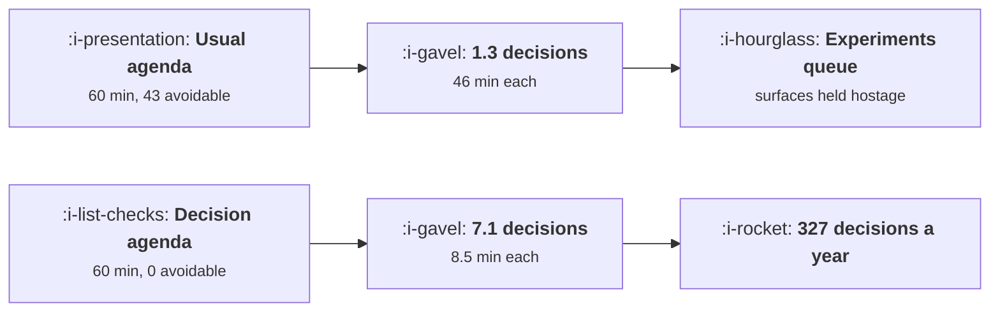

# The Weekly Growth Meeting

```text
Level: Advanced
Prerequisites: Experiment Velocity
Estimated difficulty: 2/5 | Estimated time: 30 min
```

## The idea in one minute

The output of a growth meeting is decisions, and the usual agenda produces 1.3 of them an hour
because 43 of its 60 minutes go on things that could have been read: metrics narrated aloud, status
per person, experiment state one by one. An agenda built only from decisions produces 7.1 in the
same hour, which is 327 decisions a year against 60, from the same people in the same room. This
matters beyond tidiness, because decision capacity is a hard constraint on the pipeline: at eight
concluded experiments a week, a meeting that decides seven builds a backlog of eleven experiments a
quarter, each one holding a surface and its traffic while it waits.

## A picture



The same hour, the same people. The only difference is what is said aloud rather than read.

## How it really works

### The one rule: nothing is said aloud that could be read

Metrics, experiment status, who did what. All of it goes in a document circulated beforehand, and
the meeting starts on the assumption that everyone has read it. That rule alone recovers 43 of 60
minutes in the worked agenda.

The objection is always that people will not read it. The answer is that they will if the meeting
is unusable without having done so, which it becomes the second time somebody asks a question
answered on page one. This is a two week transition with one uncomfortable meeting in it.

### What belongs on the agenda

Four items, in this order.

**Anything off plan, named, with an owner.** Not a metric review. Specifically the things that are
not where they should be, who owns each, and what they will do. Eight minutes.

**Concluded experiments, decide each.** The main event. Every experiment that finished gets a
decision: ship, kill, iterate, or extend with a stated reason. No experiment leaves the meeting
undecided, which is the rule that keeps the pipeline moving. Twenty six minutes.

**Next experiments, confirm or cut.** What starts this week, with its expected effect written down,
which feeds the calibration record from [The Backlog](../the-experiment-machine/06-the-backlog.md).
Sixteen minutes.

**One thing we got wrong, and why.** Ten minutes on a single misprediction, chosen in advance. This
is the only item whose purpose is learning rather than deciding, and it is the first thing cut when
the meeting runs long, which is why it goes last and is protected.

### What should never be on it

* **A metric walkthrough.** If a number needs explaining, it needs a document or a diagnosis
  session, not twelve people.
* **Debating a new idea.** Ideas go into the backlog with an effort estimate and get ordered. A
  meeting is the worst possible place to evaluate an idea, because the loudest advocate wins and the
  arithmetic in [The Backlog](../the-experiment-machine/06-the-backlog.md) says the ordering matters
  more than the advocacy.
* **Analysis.** If the result is ambiguous, the decision is to extend or to kill, and the analysis
  happens afterwards with two people.
* **Anything requiring a document nobody has read.** Postpone it a week rather than reading it
  together.

### Decision capacity is a real constraint

This is the part teams miss. Experiment throughput is limited by the slowest stage, and once
building gets cheap, the slowest stage is deciding. The last table shows it: at six experiments a
week nothing queues, at eight a quarter accumulates eleven waiting experiments.

A queued experiment is not free. It holds its surface, so no other test can run there; it holds its
traffic allocation; and its result ages, which matters because the longer a result sits undecided
the more likely something else has changed underneath it.

If your pipeline exceeds your decision capacity, the fix is a second meeting or a written decision
rule that lets clear cases bypass the meeting entirely, which is
[From Idea to Ship](02-from-idea-to-ship.md).

### Who is in the room

Small enough that everybody speaks. The people who can decide: whoever owns the metric, whoever
owns the surfaces being changed, and whoever will do the work. Anybody present only to be informed
should be reading the document instead.

A standing invitation list grows by one person a quarter and never shrinks, so review it twice a
year and remove anybody who has not spoken.

### What fills the box in 2026

The pre read is now cheap to produce automatically from your results engine and your metrics
pipeline, which removes the main practical objection to the rule above: that somebody has to write
it. A generated pre read with the metrics, the concluded experiments and the pipeline state takes
no human time and is the single highest return process change available here. What it cannot do is
make the decisions, and a team that automates the document and keeps narrating it aloud has gained
nothing.

## Run the numbers

Two agendas, same hour.

```go
// meeting.go: what an hour a week buys, depending on what is on the agenda.
package main

import "fmt"

// The output of a growth meeting is decisions. Everything else on the agenda
// is either an input to a decision or a substitute for one, and the
// substitutes are more comfortable.
type item struct {
	name      string
	minutes   float64
	decides   float64 // decisions this item actually produces
	elsewhere bool    // could be done in writing before the meeting
}

const weeks = 46.0 // working weeks a year

func run(agenda []item) (mins, decisions, wasted float64) {
	for _, i := range agenda {
		mins += i.minutes
		decisions += i.decides
		if i.elsewhere {
			wasted += i.minutes
		}
	}
	return mins, decisions, wasted
}

func main() {
	bad := []item{
		{"metric review, read aloud", 14, 0.0, true},
		{"what each person did last week", 16, 0.0, true},
		{"experiment status, one by one", 13, 0.2, true},
		{"a result discussed in detail", 9, 0.8, false},
		{"new ideas raised and debated", 8, 0.3, false},
	}
	good := []item{
		{"metrics and status read in advance", 0, 0.0, false},
		{"anything off plan, named, with an owner", 8, 1.1, false},
		{"concluded experiments, decide each", 26, 3.4, false},
		{"next experiments, confirm or cut", 16, 2.2, false},
		{"one thing we got wrong, and why", 10, 0.4, false},
	}

	for _, a := range []struct {
		name   string
		agenda []item
	}{{"the usual agenda", bad}, {"an agenda that decides things", good}} {
		m, d, w := run(a.agenda)
		fmt.Printf("%s: %.0f minutes, %.1f decisions, %.0f minutes avoidable\n",
			a.name, m, d, w)
		fmt.Printf("%-44s %10s %10s\n", "item", "minutes", "decisions")
		for _, i := range a.agenda {
			fmt.Printf("%-44s %10.0f %10.1f\n", i.name, i.minutes, i.decides)
		}
		fmt.Printf("%-44s %10.0f %10.1f\n\n", "total", m, d)
	}

	mb, db, _ := run(bad)
	mg, dg, _ := run(good)
	fmt.Printf("%-34s %14s %14s %14s\n",
		"", "per meeting", "per quarter", "per year")
	fmt.Printf("%-34s %14.1f %14.0f %14.0f\n",
		"decisions, usual agenda", db, db*weeks/4, db*weeks)
	fmt.Printf("%-34s %14.1f %14.0f %14.0f\n",
		"decisions, better agenda", dg, dg*weeks/4, dg*weeks)
	fmt.Printf("\n%-34s %14.1f\n", "minutes per decision, usual", mb/db)
	fmt.Printf("%-34s %14.1f\n", "minutes per decision, better", mg/dg)

	fmt.Printf("\nThe same hour produces %.1f decisions or %.1f. Over a year that is\n", db, dg)
	fmt.Printf("%.0f decisions against %.0f, from the same people in the same room.\n",
		db*weeks, dg*weeks)
	fmt.Println("The difference is entirely that the second agenda removes everything")
	fmt.Println("that can be read rather than said.")

	fmt.Println("\nwhat a decision backlog does to the experiment pipeline:")
	fmt.Printf("%-24s %16s %16s %16s\n",
		"experiments a week", "decisions needed", "decisions made", "queue after a quarter")
	for _, e := range []float64{2, 4, 6, 8} {
		need := e
		made := dg
		q := (need - made) * 12
		if q < 0 {
			q = 0
		}
		fmt.Printf("%24.0f %16.1f %16.1f %16.0f\n", e, need, made, q)
	}
	fmt.Println("\nAt six experiments a week the better agenda still only decides 7.1,")
	fmt.Println("so nothing queues. At eight, a quarter builds a backlog of eleven")
	fmt.Println("experiments, each holding a surface and its traffic while waiting.")
	fmt.Println("Decision capacity is a real constraint and it is set by the agenda.")
}
```

The two agendas are the comparison and the decisions column is the one to read. In the usual agenda
three of five items produce no decisions at all and consume 43 minutes. In the better one every
item produces decisions and nothing is avoidable.

The summary is 1.3 decisions an hour against 7.1, and 46 minutes per decision against 8.5. Over a
year, 60 decisions against 327. Those are not efficiency gains, they are a different team.

The queue table is the constraint. Put your own concluded experiments per week in. If it exceeds
your decisions per meeting, you are accumulating a backlog whether or not anybody has noticed, and
the symptom is experiments that ran weeks ago still showing as live in the registry.

Adjust the `decides` figures to your own meeting. The honest way to get them is to count the
decisions in your last four meetings from the notes, and if there are no notes, that is the first
finding.

## The AI layer

The pre read is the application, and it is unusually clean because the inputs are all structured.

Metrics from the pipeline, concluded experiments from the results engine, pipeline state from the
registry, and a short summary of what changed since last week. That document is the thing that
makes the agenda rule enforceable, it takes no human time, and generating it weekly is a small
scheduled job rather than a project.

Two refinements worth having. Flag anything off plan with its owner, which is the first agenda item
produced automatically. And flag concluded experiments whose results contradict a previous result on
the same surface, from the results store, because that is the most valuable thing to discuss and
nobody remembers to look.

What a model should not do is produce the decision or the recommendation for each experiment. The
decision is the meeting's only output and the reason the people are in the room; a recommendation in
the pre read reliably becomes the decision by default, which converts the meeting back into a
status update with extra steps. Put the evidence in the document and leave the decision column
blank.

## Sector lens

| Sector | What the cadence has to accommodate here |
|---|---|
| [Enterprise B2B SaaS](../../product-management/product-by-sector/01-enterprise-b2b-saas.md) | Few experiments, so the meeting is about named accounts and qualitative signals. Weekly is too often; fortnightly with a monthly review works |
| [Fintech](../../product-management/product-by-sector/02-fintech.md) | Compliance has to be in the room or the decisions get reversed later. Invite them to the decision item only |
| [Ecommerce and D2C](../../product-management/product-by-sector/03-ecommerce-and-d2c.md) | High volume means decision capacity binds first. Two meetings a week, or a written rule for the clear cases |
| [Marketplaces](../../product-management/product-by-sector/04-marketplaces.md) | Both sides need representation or decisions optimise one side. Two owners in the room, always |
| [Devtools and Infra](../../product-management/product-by-sector/05-devtools-and-infrastructure.md) | Long adoption cycles mean few concluded experiments weekly. Make the meeting monthly and spend it on the funnel and the docs |
| [Healthtech](../../product-management/product-by-sector/06-healthtech-and-regulated-care.md) | Clinical governance decisions cannot be made in a growth meeting. Separate the two and record which is which |
| [Vertical SaaS](../../product-management/product-by-sector/07-vertical-saas.md) | Small team, so the meeting is the whole process. Keep the learning item, because it is the only mechanism you have |

## Remember this

* The output is decisions. The usual agenda produces 1.3 an hour and a decision agenda produces 7.1.
* The rule that does it: nothing is said aloud that could be read. That recovers 43 of 60 minutes.
* Four items: what is off plan, decide every concluded experiment, confirm what starts next, and one
  thing we got wrong.
* No experiment leaves the meeting undecided. Ship, kill, iterate or extend with a reason.
* Never debate a new idea in the meeting. Ideas go to the backlog with an effort estimate.
* Decision capacity is a hard constraint. At eight concluded experiments a week against seven
  decisions, a quarter accumulates eleven queued experiments.
* A queued experiment holds its surface, its traffic and an ageing result.
* Keep the room small enough that everybody speaks, and remove anybody who has not spoken in six
  months.
* Generate the pre read automatically from the results engine and the registry. It makes the rule
  enforceable at no cost.
* Do not put a recommended decision in the pre read, or it becomes the decision by default.

## Try it

1. Count the decisions in your last four growth meetings from the notes. If there are no notes,
   start taking them as a list of decisions and owners only.
2. Move every status and metric item into a document circulated 24 hours before, and hold one
   uncomfortable meeting where you decline to narrate it.
3. Count your concluded experiments per week against your decisions per meeting. If the first is
   larger, add a written rule for the clear cases this month.

## Check yourself

1. Your meeting runs an hour and produces two decisions. Where is the time going, and what is the
   first thing you remove?
2. Why is a queued experiment more expensive than an experiment that has not started?
3. Your automatically generated pre read includes a recommended decision per experiment and the
   meeting now takes twenty minutes. Is that an improvement?
