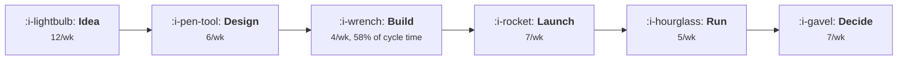

# From Idea to Ship

```text
Level: Advanced
Prerequisites: The Weekly Growth Meeting
Estimated difficulty: 3/5 | Estimated time: 35 min
```

## The idea in one minute

A growth pipeline is a queueing system and it behaves like one, which means two things most teams
get wrong. Waiting time rises without limit as a stage approaches its capacity: at 75 percent load
on the narrowest stage the cycle time is 2.4 weeks, at 98 percent it is 12.2, and the extra
throughput bought is 41 experiments a year while work in progress goes from 7 to 47. And the
waiting is concentrated: 58 percent of cycle time sits at one stage, nine tenths of it as queue
rather than work. Hiring at any other stage changes nothing. The only two moves are widening the
narrowest stage or putting less into the pipeline.

## A picture



Five of the six stages are irrelevant to how long anything takes. The arithmetic says so.

## How it really works

### Throughput is set by the narrowest stage and nothing else

The pipeline cannot deliver more than its narrowest stage, which in the worked model is building at
four a week. Every other capacity is decoration from a throughput point of view: you could triple
the design stage and ship exactly as many experiments.

This is obvious when stated and routinely violated in practice, because the visible symptom of a
bottleneck is a backlog at the stage in front of it, and the natural instinct is to add capacity
where the mess is.

### Waiting rises without limit near capacity

The second property is the one that surprises people. A stage running at 50 percent of capacity has
a small queue; at 90 percent the queue is nine times larger; at 98 percent it is forty nine times
larger. The relationship is one over one minus the load, and it has a vertical asymptote.

So a pipeline run at 98 percent of its capacity delivers 179 experiments a year with a 12.2 week
cycle time, and the same pipeline run at 75 percent delivers 138 with a 2.4 week cycle time. The
extra 41 experiments cost ten weeks of latency on every single one.

That trade is sometimes worth making and usually is not, for a reason the arithmetic does not show:
a 12 week cycle time means the context around an experiment has changed before it concludes, and
the result is less decision relevant even when it is statistically sound.

### Work in progress is a symptom, not a lever

Work in progress is the arrival rate multiplied by the cycle time, which is Little's law and is not
negotiable. So you cannot choose work in progress directly: push more in and cycle time rises until
the identity holds.

The practical implication is that a work in progress limit is a cycle time policy. Capping concurrent
experiments at ten, in the worked pipeline, holds the cycle time near three weeks and the
throughput near 150 a year. That is a defensible choice made explicitly, and it is better than the
same outcome arrived at by everybody feeling overwhelmed.

### Widening a stage relocates the queue

The last table shows this clearly. Doubling the build stage raises throughput by a quarter, and the
constraint moves to running experiments to a conclusion. Widening build by only a quarter raises
throughput the same amount and makes the cycle time worse, because the new constraint is now the one
loaded at 90 percent.

So the sequence matters: widen the narrowest stage, then re measure, then decide whether to fill the
new capacity or keep the slack. Filling it immediately is what produces the familiar pattern of a
team that invested in tooling and feels no better.

### Where to put the effort, in order

* **Find the narrowest stage by measuring queue time, not work time.** Ask how long items wait
  before each stage, which most teams have never recorded. The stage with the longest wait is the
  constraint, and it is rarely the one people name.
* **Reduce the work at that stage rather than adding people.** For building, that means component
  reuse, flags that make the control path free, and smaller variants.
* **Decouple the stages with explicit buffers.** A small ready queue in front of the constraint
  keeps it fed without letting work in progress grow everywhere.
* **Set a work in progress limit and hold it.** The number should come from the cycle time you want,
  via Little's law, not from how busy people feel.
* **Let clear cases bypass stages.** A copy change with a pre agreed decision rule does not need the
  design stage or the meeting from
  [The Weekly Growth Meeting](01-the-weekly-growth-meeting.md).

### What fills the box in 2026

Build capacity has risen for most teams, which moves the constraint. In the worked pipeline,
doubling build moves it to running experiments to a conclusion, and that stage cannot be bought
with tooling: it is set by your traffic and your effect sizes, which is the arithmetic in
[Assignment and Exposure](../the-experiment-machine/03-assignment-and-exposure.md). A team whose
constraint has moved there should stop investing in build speed and start investing in testing
bigger changes or upstream surfaces with more traffic.

## Run the numbers

Find the constraint, then see what each intervention is actually worth.

```go
// pipeline.go: where the pipeline jams, and why adding work in progress makes
// it slower rather than faster.
package main

import "fmt"

// Each stage of the pipeline can process so many experiments a week. Work
// arrives at some rate. Waiting time at a stage rises with how close the
// arrival rate is to the capacity, and it rises without limit, which is why a
// pipeline run at 95% of capacity feels broken while one at 70% feels calm.
type stage struct {
	name     string
	capacity float64 // experiments this stage can finish per week
}

var pipeline = []stage{
	{"idea written down with an effort estimate", 12},
	{"designed and specified", 6},
	{"built behind a flag", 4},
	{"checked and launched", 7},
	{"run to a conclusion", 5},
	{"decided", 7},
}

// weeks spent at a stage: the work itself plus the wait in front of it
func weeksAt(s stage, arrival float64) (work, wait float64) {
	work = 1 / s.capacity
	u := arrival / s.capacity
	if u >= 1 {
		return work, -1 // the queue grows without bound
	}
	return work, u / (s.capacity * (1 - u))
}

func cycle(arrival float64) (total float64, ok bool) {
	for _, s := range pipeline {
		w, q := weeksAt(s, arrival)
		if q < 0 {
			return 0, false
		}
		total += w + q
	}
	return total, true
}

func main() {
	fmt.Printf("%-44s %12s\n", "stage", "per week")
	narrow := pipeline[0]
	for _, s := range pipeline {
		if s.capacity < narrow.capacity {
			narrow = s
		}
		fmt.Printf("%-44s %12.0f\n", s.name, s.capacity)
	}
	fmt.Printf("\nthe pipeline cannot exceed %.0f a week: %s\n\n",
		narrow.capacity, narrow.name)

	fmt.Printf("%-18s %14s %14s %16s %14s\n",
		"ideas a week", "load on build", "cycle time", "in progress", "shipped/yr")
	for _, a := range []float64{1.0, 2.0, 3.0, 3.6, 3.9} {
		c, ok := cycle(a)
		if !ok {
			fmt.Printf("%18.1f %13.0f%% %14s %16s %14s\n",
				a, 100*a/narrow.capacity, "never finishes", "grows", "0")
			continue
		}
		// Little's law: work in progress is arrival rate times cycle time
		fmt.Printf("%18.1f %13.0f%% %12.1fw %16.1f %14.0f\n",
			a, 100*a/narrow.capacity, c, a*c, a*46)
	}
	fmt.Println("\nGoing from 3.0 to 3.9 ideas a week raises throughput by 41 shipped")
	fmt.Println("experiments a year and raises cycle time from 2.4 weeks to 12.2.")
	fmt.Println("Work in progress goes from 7 to 47, so at any moment there are")
	fmt.Println("forty seven experiments part done and nobody can say which.")

	fmt.Println("\nwhere the waiting actually is, at 3.6 ideas a week:")
	fmt.Printf("%-44s %10s %10s %10s\n", "stage", "work", "wait", "share")
	var tot float64
	type row struct {
		name string
		w, q float64
	}
	var rows []row
	for _, s := range pipeline {
		w, q := weeksAt(s, 3.6)
		rows = append(rows, row{s.name, w, q})
		tot += w + q
	}
	for _, r := range rows {
		fmt.Printf("%-44s %9.2fw %9.2fw %9.0f%%\n",
			r.name, r.w, r.q, 100*(r.w+r.q)/tot)
	}
	fmt.Println("\nBuilding is 58% of the cycle time and nine tenths of that is")
	fmt.Println("waiting rather than working. Hiring a designer or adding a decision")
	fmt.Println("meeting changes nothing, because neither is the constraint.")

	fmt.Println("\nwhat each intervention is worth, from 3.6 a week:")
	fmt.Printf("%-40s %14s %14s %14s\n",
		"change", "throughput/yr", "cycle time", "in progress")
	base, _ := cycle(3.6)
	fmt.Printf("%-40s %14.0f %12.1fw %14.1f\n", "nothing", 3.6*46, base, 3.6*base)
	_ = base
	for _, c := range []struct {
		name  string
		stage int
		cap   float64
	}{
		{"double the build stage", 2, 8},
		{"double the design stage", 1, 12},
		{"double the decision stage", 5, 14},
		{"raise build capacity by a quarter", 2, 5},
	} {
		old := pipeline[c.stage].capacity
		pipeline[c.stage].capacity = c.cap
		// throughput is still capped by the narrowest stage
		cap2 := pipeline[0].capacity
		for _, s := range pipeline {
			if s.capacity < cap2 {
				cap2 = s.capacity
			}
		}
		// run every configuration at 90% of whatever its narrowest stage allows
		a := cap2 * 0.9
		cc, _ := cycle(a)
		fmt.Printf("%-40s %14.0f %12.1fw %14.1f\n", c.name, a*46, cc, a*cc)
		pipeline[c.stage].capacity = old
	}
	fmt.Println("\nDoubling the build stage raises throughput by a quarter. Doubling")
	fmt.Println("design or decisions changes it not at all, because neither is the")
	fmt.Println("constraint. Widening build only a quarter raises throughput the same")
	fmt.Println("amount and makes the cycle time worse, because the constraint has")
	fmt.Println("moved to running experiments to a conclusion and that stage is now")
	fmt.Println("the one at 90% load. Widening a stage relocates the queue; it does")
	fmt.Println("not remove it.")
}
```

The first table is the capacities and the narrowest one. Four a week for building, which caps the
whole pipeline at 184 a year even at full load.

The load table is the one to internalise: cycle times of 1.2, 1.6, 2.4, 4.3 and 12.2 weeks at 25,
50, 75, 90 and 98 percent load. The work in progress column rises from 1.2 to 47.4. A team at the
bottom row has forty seven part finished experiments and feels permanently behind, and the
difference from the 75 percent row is 41 experiments a year.

The breakdown at 3.6 a week attributes the time: 58 percent at build, of which 2.25 weeks is waiting
and 0.25 is working. That ratio, nine to one, is the signature of a constraint, and if your longest
stage does not have it then it is not your constraint.

The interventions table shows what moves what. Put your own capacities in, estimated by counting how
many experiments each stage actually completed per week over a quarter rather than by asking people
how many they could do.

## The AI layer

The honest reading is that a model widens one stage substantially, which moves the constraint, and
teams should plan for that rather than celebrate it.

Build is the stage it widens, by the mechanism in
[Experiment Velocity](../the-experiment-machine/05-experiment-velocity.md). The worked table says
doubling it raises throughput by a quarter and then the constraint becomes running experiments to a
conclusion, which no model shortens: the time to significance is set by traffic and effect size.

So the sequence for a team adopting model assisted build is: widen build, re measure the queues, and
expect the answer to be that the constraint is now statistical. The investments that help then are
different in kind. Test bigger changes, test upstream surfaces where traffic is larger, use
sequential testing to stop early on clear results, and accept wider intervals on lower stakes
decisions.

Two smaller applications. Drafting the specification from an idea, which widens the design stage and
is useful only if design was the constraint. And triaging the intake queue against the results store
to drop ideas already tested, which reduces the work at every subsequent stage and is the cheapest
intervention in the lesson.

The thing to avoid is raising intake because ideas are now cheap to write. Intake is not the
constraint and raising it only raises the queue, and the arithmetic above says the queue is where
the cycle time comes from.

## Sector lens

| Sector | Where the pipeline jams here |
|---|---|
| [Enterprise B2B SaaS](../../product-management/product-by-sector/01-enterprise-b2b-saas.md) | At running to a conclusion, because account counts are small. Build speed is almost irrelevant |
| [Fintech](../../product-management/product-by-sector/02-fintech.md) | At compliance review, which is a stage nobody draws on the diagram and which is usually the narrowest |
| [Ecommerce and D2C](../../product-management/product-by-sector/03-ecommerce-and-d2c.md) | At build and at decision, since traffic makes the statistical stage fast. The only sector where build speed is the main lever |
| [Marketplaces](../../product-management/product-by-sector/04-marketplaces.md) | At running to a conclusion, because geographic assignment reduces the unit count by orders of magnitude |
| [Devtools and Infra](../../product-management/product-by-sector/05-devtools-and-infrastructure.md) | At adoption, which sits inside the run stage and takes weeks. Shorten by testing the website and docs instead |
| [Healthtech](../../product-management/product-by-sector/06-healthtech-and-regulated-care.md) | At governance approval, which is lumpy, so batching approvals beats any other intervention |
| [Vertical SaaS](../../product-management/product-by-sector/07-vertical-saas.md) | At deciding, because the same few people do every stage and the decision competes with customer work |

## Remember this

* Throughput equals the narrowest stage. Every other capacity is irrelevant to it.
* Queue time rises as one over one minus the load, so it has no upper limit near capacity.
* 75 percent load gives a 2.4 week cycle; 98 percent gives 12.2 weeks for 41 more experiments a
  year.
* A long cycle time makes results less decision relevant even when they are statistically sound.
* Work in progress is arrival rate times cycle time and cannot be chosen directly. A work in
  progress limit is a cycle time policy.
* Find the constraint by measuring queue time, not work time. The signature is roughly nine parts
  waiting to one part working.
* Widening a stage relocates the queue. Re measure before filling the new capacity.
* Reduce work at the constraint before adding people to it, and let clear cases bypass stages
  entirely.
* A model widens build, which moves the constraint to running experiments to a conclusion, and that
  stage cannot be bought.
* Do not raise intake because ideas got cheap. Intake is not the constraint and the extra ideas
  become queue.

## Try it

1. For your last twenty experiments, record the date they entered each stage. Compute wait time per
   stage and find the one with the nine to one ratio.
2. Compute your current load on that stage and your cycle time, then decide explicitly what cycle
   time you want and set the work in progress limit from it.
3. Write the bypass rule for your cheapest category of change, so that it skips design and the
   meeting with a pre agreed decision rule.

## Check yourself

1. Your design stage has a visible backlog and your build stage does not. Which is more likely to be
   the constraint, and how would you check?
2. Your cycle time is nine weeks and throughput is near capacity. What would you give up to get the
   cycle time to four, and what would it cost?
3. Build capacity doubles. What do you expect to become the constraint, and what investment helps
   then?
