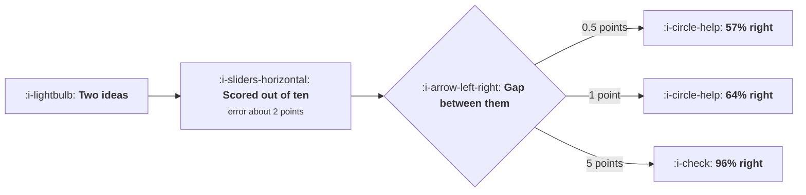

# Scoring Ideas

```text
Level: Advanced
Prerequisites: From Idea to Ship
Estimated difficulty: 3/5 | Estimated time: 35 min
```

## The idea in one minute

Scoring frameworks are worth having and their numbers are worth much less than the decimal points
suggest. If people estimate an idea's value to within about two points on a ten point scale, which
is generous, then a one point gap in score means a 64 percent chance the ranking is right and a
half point gap means 57 percent. And scores always cluster: twenty four ideas squeezed into the
six to nine range sit 0.13 points apart, where adjacent pairs are ordered correctly 52 percent of
the time. The ordering of a clustered list is noise with a decimal point. Score into three bands,
put the signal in the effort estimate, and publish the error so that nobody argues about a gap
smaller than it.

## A picture



Only the bottom branch supports a decision. The other two are the gaps teams actually argue about.

## How it really works

### The arithmetic of a score gap

Two ideas, each scored with an independent error. The difference between the scores carries both
errors, so the chance the ranking is correct is a function of the gap divided by the error, and it
rises slowly.

At a two point error: a 0.5 point gap is 57 percent, one point is 64, two points is 76, three is
86, five is 96. To be 80 percent confident you need a 2.4 point gap and for 95 percent you need
4.7.

On a ten point scale that means there are three or four genuinely distinguishable levels. Anything
finer is reporting precision you do not have, and the decimal point is actively harmful because it
makes the number look measured.

### What the error actually is

Nobody knows their estimate error, which is why this argument is usually unwinnable. It is
measurable, and measuring it is the single most useful thing in this lesson.

Record the expected effect before each test, with a range. After twenty experiments you have twenty
pairs of predicted and actual, and the spread between them is your error. Teams that do this find
an error larger than they expected, and the conversation about scoring changes permanently, because
it is no longer about whose judgement is better.

This is the same calibration record as in
[The Backlog](../the-experiment-machine/06-the-backlog.md) and
[Writing the Result](../the-experiment-machine/07-writing-the-result.md), which is why the
expectation has to be written before the result and not after.

### Clustering makes it worse than the table suggests

People do not use the whole scale. They avoid 1 and 2 because it looks dismissive and avoid 9 and
10 because it looks naive, and any idea that made it onto the list is by definition worth
considering, so the practical range is about three points wide.

Twenty four ideas in a three point range are 0.13 apart on average. At a two point error, adjacent
pairs are ordered correctly 52 percent of the time, which is a coin flip with extra ceremony.

The fix is not to insist people use the whole scale, which they will not. It is to stop asking for a
number fine enough to cluster.

### Three bands

Do now, do later, not now. Three bands with explicit criteria, and anything in the first band gets
ordered by effort, because effort is the term that carries real signal and is the one engineers can
supply.

This loses almost nothing relative to a ten point score, because the ten point score only
distinguished three or four levels anyway, and it gains three things: the discussion moves to which
band rather than which decimal, the bands have criteria that can be written down and argued with,
and nobody can game a band as easily as a weighted sum.

### Gaming, which happens to every formula

Once the formula is known, scores drift upwards on whichever input is least checkable. Confidence
is the usual target, because nobody can disprove a confidence estimate, and reach is a close second
because the definition is elastic.

Three defences. Make effort the denominator and have it estimated by whoever will do the work, not
by whoever proposed the idea. Define reach as a measurable population with a query behind it rather
than a judgement. And publish the calibration record, because the only real check on an optimistic
estimate is a visible history of optimistic estimates.

### What the scoring ritual is for

Not the number. Three things.

It makes somebody state an expected effect, which makes them capable of being wrong, which is how a
team learns anything. It makes an effort estimate exist, which is the dominant term in the ordering
arithmetic. And it creates a queue that anybody can add to, which produces a wider set of ideas
than the senior person would have generated.

A framework that delivers those three and produces a crude ordering is doing its job. A framework
that produces a precise ordering and no calibration record is doing the opposite of its job.

### What fills the box in 2026

Prioritisation features in product tools now compute weighted scores automatically and display them
to two decimal places, which is a presentation choice that makes this problem worse. If your tool
does that, round the display to a band in the view everybody looks at. It is a cosmetic change with
a real effect on how the list gets discussed.

## Run the numbers

Work out what a gap in your scores can and cannot tell you.

```go
// scoring.go: how much a score difference means, given how wrong the scores are.
package main

import (
	"fmt"
	"math"
)

// Two ideas, scored out of ten by people who are guessing within some margin.
// The chance the higher scored idea is genuinely the better one depends on the
// gap between the scores and on how large the guessing error is.
func phi(z float64) float64 { return 0.5 * (1 + math.Erf(z/math.Sqrt2)) }

// the two scores each carry an independent error, so their difference carries
// the errors added in quadrature
func rankRight(gap, sigma float64) float64 {
	if sigma == 0 {
		return 1
	}
	return phi(gap / (sigma * math.Sqrt2))
}

func main() {
	fmt.Println("the chance the higher scored idea is really the better one:")
	fmt.Printf("%-18s %12s %12s %12s %12s\n",
		"gap in score", "error 0.5", "error 1.0", "error 2.0", "error 3.0")
	for _, gap := range []float64{0.5, 1.0, 2.0, 3.0, 5.0} {
		fmt.Printf("%18.1f", gap)
		for _, sd := range []float64{0.5, 1.0, 2.0, 3.0} {
			fmt.Printf(" %11.0f%%", 100*rankRight(gap, sd))
		}
		fmt.Println()
	}
	fmt.Println("\nWith a typical estimate error of two points, a one point gap in")
	fmt.Println("score means a 64% chance the ranking is right, which is barely")
	fmt.Println("better than a coin. Teams argue for an hour about gaps of half a")
	fmt.Println("point, and a half point gap at that error is 57%.")

	fmt.Println("\nthe gap you need before the ranking is worth defending:")
	fmt.Printf("%-20s %16s %16s\n", "estimate error", "for 80% sure", "for 95% sure")
	for _, sd := range []float64{0.5, 1.0, 2.0, 3.0} {
		g80, g95 := 0.0, 0.0
		for g := 0.0; g < 20; g += 0.01 {
			if g80 == 0 && rankRight(g, sd) >= 0.80 {
				g80 = g
			}
			if g95 == 0 && rankRight(g, sd) >= 0.95 {
				g95 = g
				break
			}
		}
		fmt.Printf("%20.1f %16.1f %16.1f\n", sd, g80, g95)
	}
	fmt.Println("\nAt a two point error you need a 2.4 point gap to be 80% sure and")
	fmt.Println("a 4.7 point gap to be 95% sure. On a ten point scale that means")
	fmt.Println("only three or four genuinely distinguishable bands exist, which is")
	fmt.Println("the argument for scoring into bands rather than into numbers.")

	fmt.Println("\nwhat happens when scores cluster, as they always do:")
	fmt.Printf("%-26s %12s %16s %18s\n",
		"scores actually used", "range", "typical gap", "ranking right")
	for _, c := range []struct {
		name   string
		lo, hi float64
		n      float64
	}{
		{"the whole scale, 1 to 10", 1, 10, 24},
		{"people avoid the extremes", 3, 8, 24},
		{"everything is important", 6, 9, 24},
	} {
		span := c.hi - c.lo
		gap := span / (c.n - 1)
		fmt.Printf("%-26s %6.0f to %-4.0f %15.2f %17.0f%%\n",
			c.name, c.lo, c.hi, gap, 100*rankRight(gap, 2.0))
	}
	fmt.Println("\nTwenty four ideas on a range of three points are 0.13 apart on")
	fmt.Println("average, and adjacent ideas are ordered correctly 52% of the time.")
	fmt.Println("The ordering of a clustered list is noise with a decimal point.")

	fmt.Println("\nwhat to do instead:")
	for i, s := range []string{
		"score into three bands, not ten points: do now, do later, not now",
		"require an effort estimate, which is the term that carries the signal",
		"record the expected effect before the test, and build a calibration record",
		"reserve a fifth of capacity for ideas somebody believes in regardless",
		"never discuss a gap smaller than the error, and publish the error",
	} {
		fmt.Printf("  %d. %s\n", i+1, s)
	}
}
```

The first table is the one to put on the wall next to the scoring rubric. Find your error along the
top and your typical gap down the side. Most teams are in the two point error column, where nothing
under a two point gap is worth defending.

The required gap table turns it round: 2.4 points for 80 percent confidence at a two point error,
4.7 for 95. That is the argument for three bands, and it is arithmetic rather than preference.

The clustering table is the part that is usually missed. Even on the full one to ten scale, twenty
four ideas average 0.39 points apart and adjacent pairs are ordered correctly 56 percent of the
time. Clustering into the six to nine range takes that to 52.

Measure your own error by comparing predicted against actual on your last twenty experiments. If
you have never recorded predictions, that is the task, and it takes one line added to a template.

## The AI layer

Two uses, and the first is the one that addresses the actual problem.

Estimating effort consistently is where a model helps most, for the reason in
[The Backlog](../the-experiment-machine/06-the-backlog.md): a uniformly biased estimate preserves
the ordering, and human effort estimates are inconsistently biased rather than uniformly so. A model
with the codebase and a history of similar changes gives you the dominant term with less noise,
which raises the quality of the ordering more than any refinement to the value side.

The second is detecting gaming. Comparing each person's submitted scores against the outcomes of
their previous ideas is exactly a calibration analysis, it is tedious, and it is the kind of thing
nobody wants to do by hand about their colleagues. Produced as a routine report about everybody, it
is a tool; produced on request about one person, it is a weapon. Make it routine.

The use to decline is a model scoring the value of ideas. It will produce consistent, plausible,
confident numbers anchored on what is typical for that kind of change, which has two bad effects:
the scores will cluster harder than human ones, making the ordering problem worse, and the unusual
ideas will be systematically down ranked because they are unusual. The unusual ideas are the ones
that carry information, which is the argument in
[Experiment Velocity](../the-experiment-machine/05-experiment-velocity.md) for running them.

## Sector lens

| Sector | What scoring must account for here |
|---|---|
| [Enterprise B2B SaaS](../../product-management/product-by-sector/01-enterprise-b2b-saas.md) | Reach is measured in accounts and revenue, not users, so the same idea scores very differently by segment |
| [Fintech](../../product-management/product-by-sector/02-fintech.md) | Compliance effort belongs in the denominator and varies tenfold, which reorders the list more than any value estimate |
| [Ecommerce and D2C](../../product-management/product-by-sector/03-ecommerce-and-d2c.md) | Value is seasonal, so a score needs a date window or the ordering is wrong half the year |
| [Marketplaces](../../product-management/product-by-sector/04-marketplaces.md) | An idea's reach differs per side and a one sided win can be negative overall. Score both sides or do not score |
| [Devtools and Infra](../../product-management/product-by-sector/05-devtools-and-infrastructure.md) | Effort includes docs and client libraries, which are routinely larger than the change itself |
| [Healthtech](../../product-management/product-by-sector/06-healthtech-and-regulated-care.md) | Governance effort is lumpy and dominates, so grouping by approval category beats ordering individually |
| [Vertical SaaS](../../product-management/product-by-sector/07-vertical-saas.md) | Value is often known from customer requests, so the value estimate is unusually good and effort is the whole decision |

## Remember this

* The chance a score ranking is right depends on the gap divided by the estimate error, and it
  rises slowly.
* At a two point error, a one point gap is 64 percent right and a half point gap is 57.
* You need a 2.4 point gap for 80 percent confidence and 4.7 for 95, so a ten point scale holds
  three or four real levels.
* Scores cluster into about three points of range, where adjacent ideas are ordered correctly 52
  percent of the time.
* Measure your estimate error by recording expected effects before tests. It is almost always larger
  than people think.
* Use three bands with written criteria, then order the first band by effort.
* Every formula gets gamed on its least checkable input, which is confidence, then reach.
* Have effort estimated by whoever will do the work, define reach as a query, and publish the
  calibration record.
* The ritual exists to make an expectation stateable, an effort estimate exist, and a queue anybody
  can add to.
* A model should estimate effort and produce routine calibration reports, and should not score the
  value of ideas.

## Try it

1. Add a predicted effect with a range to your next ten experiment plans, then compare against the
   results. That spread is your error and it settles every argument about scoring.
2. Plot the distribution of scores in your current backlog. Measure the range actually used and
   compute the average gap between adjacent ideas.
3. Replace your numeric score with three bands and written criteria for one quarter, keeping the
   effort estimate. Compare the quality of the discussions, not the quality of the list.

## Check yourself

1. Two ideas score 7.4 and 7.1. What do you know, and what should the meeting spend on the
   difference?
2. Why does insisting people use the full one to ten scale not fix the clustering problem?
3. A team member's ideas consistently score highest and their results are average. What is the
   mechanism, and what do you change about the process rather than about the person?
