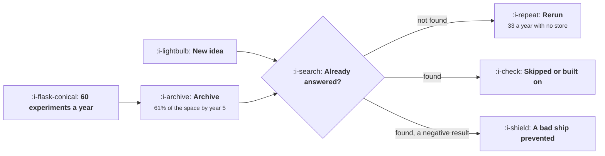

# Writing Down What You Learned

```text
Level: Advanced
Prerequisites: Scoring Ideas
Estimated difficulty: 2/5 | Estimated time: 30 min
```

## The idea in one minute

There are only so many things to try on any given product, so a team that concludes 60 experiments
a year has covered 43 percent of them by year three and three fifths by year five. From that point
on, three new ideas in five are questions somebody in the company has already answered. Whether
that gets caught depends entirely on findability: a team with nothing written down reruns 33 of its
60 experiments in year five, at 249,000 a year, and a searchable results store costing 6,500 takes
that to 8. The larger value is the one nobody counts, which is the bad ships a recorded negative
result prevents, worth 163,000 a year on the same figures.

## A picture



The two green boxes are the return. Only one of them appears in any report.

## How it really works

### The idea space is finite and you are consuming it

This is the premise that makes the archive urgent rather than tidy. A product has a bounded number
of surfaces, flows and levers, so the set of distinct testable questions is bounded too. Call it
roughly three hundred for a product of moderate complexity.

Then an experimentation programme consumes that space. Coverage of 17 percent after a year, 43
after three, 61 after five. And unlike the early years, where almost every idea is new, a mature
programme's default assumption should be that an idea has been tried and the burden is on
establishing that it has not.

### Two distinct returns, and the bigger one is invisible

**Avoided reruns.** The visible return. With nothing written down, 33 of 60 experiments in year five
are repeats, which is 249,000 of engineering and traffic spent rediscovering the team's own
results. A searchable store takes it to 8.

**Prevented bad ships.** The larger return. A recorded negative result stops somebody shipping
something a previous test already showed to be harmful, and those decisions are worth more than an
experiment because they would have been shipped rather than tested. On the worked figures, a
searchable store prevents 8.6 of them a year, worth 163,000.

The second return is invisible by construction: a bad ship that did not happen leaves no trace, no
incident report and no line in a review. So the archive is consistently undervalued by the
organisation, and the argument for it has to be made with arithmetic rather than with examples.

### What makes a result findable

Six properties, and they are all about retrieval rather than about writing.

* **One entry per experiment, in one place.** Never a slide. Slides are not searchable and are
  rewritten for an audience.
* **Indexed by the surface it touched**, not by the quarter it ran in. Somebody with an idea about
  the checkout page needs every result about the checkout page, regardless of when.
* **The decision in the title.** So that a list of titles is itself readable, which is how people
  actually scan an archive.
* **The question written as a question.** Matching a new idea against a list of questions works;
  matching it against a list of feature names does not.
* **Null results kept with the same prominence as wins.** This is the property that decays first,
  and the nulls are where the expensive knowledge is.
* **Searched automatically when an idea enters the backlog.** The only mechanism that does not
  depend on somebody remembering to look.

### Why a store of wins is worse than nothing

A results archive that drifts into holding only the successes becomes a marketing document, and it
has two failure modes. It cannot prevent a bad ship, because the evidence against bad ideas lives
in the nulls. And it misrepresents the programme's win rate, which corrupts the calibration record
and the arithmetic in [Writing the Result](../the-experiment-machine/07-writing-the-result.md).

The practical test: pick a surface and count the entries. If more than about a third of them are
wins, entries are being lost, because the win rates in
[Experiment Velocity](../the-experiment-machine/05-experiment-velocity.md) say most experiments do
not win.

### The retrospective that is worth holding

One item a week, from
[The Weekly Growth Meeting](01-the-weekly-growth-meeting.md): one thing we got wrong, and why. Not a
quarterly retrospective about process, which produces generalities. A specific misprediction, with
the prediction and the outcome, recorded in the archive alongside the experiment.

That is also the only reliable source for the estimate error in
[Scoring Ideas](03-scoring-ideas.md), and it is the item most likely to be dropped when the meeting
overruns, which is why it should be scheduled rather than left to the end.

### What fills the box in 2026

The entry itself is now cheap to generate from the results engine, which removes the usual
objection that writing it up takes too long. The remaining work is retrieval, and that is where the
genuine change is: matching a new idea against a corpus of past results is a semantic search
problem rather than a keyword one, and it works well enough to automate the sixth property on the
list above. That single integration, idea intake searching the archive, moves a team from the
second row of the table to something near the fourth.

## Run the numbers

Compute what the archive is worth in reruns avoided and ships prevented.

```go
// archive.go: what an experiment archive is worth, and what it costs to not
// have one.
package main

import (
	"fmt"
	"math"
)

// As a team tests more of its product, a growing share of any new idea has
// already been tried. Whether that is caught depends entirely on whether the
// previous result can be found.
const (
	perYear   = 60.0  // experiments concluded a year
	ideaSpace = 320.0 // roughly how many distinct things there are to try
	costEach  = 7_400.0
)

// share of the idea space already covered after this many experiments
func covered(n float64) float64 { return 1 - math.Exp(-n/ideaSpace) }

type store struct {
	name     string
	findable float64 // chance a previous result on this question is found
	cost     float64 // cost a year of keeping it up
}

func main() {
	stores := []store{
		{"nothing written down", 0.08, 0},
		{"notes in whatever document", 0.34, 1_200},
		{"a searchable results store", 0.78, 6_500},
		{"results store, matched on intake", 0.94, 9_800},
	}

	fmt.Printf("%.0f experiments a year, about %.0f distinct things to try\n\n",
		perYear, ideaSpace)
	fmt.Printf("%-10s %14s %18s\n", "year", "archive", "share already tried")
	for _, y := range []float64{1, 2, 3, 5} {
		n := perYear * y
		fmt.Printf("%10.0f %14.0f %17.0f%%\n", y, n, 100*covered(n))
	}
	fmt.Println("\nBy year three 43% of what there is to try has been tried, and by")
	fmt.Println("year five three fifths of it. So by year five, three new ideas in")
	fmt.Println("five are questions somebody in the company has already answered.")

	fmt.Println("\nexperiments rerun a year, by what the team keeps:")
	fmt.Printf("%-36s %10s %10s %10s %12s\n",
		"what the team keeps", "year 1", "year 3", "year 5", "cost in y5")
	for _, s := range stores {
		fmt.Printf("%-36s", s.name)
		var y5 float64
		for _, y := range []float64{1, 3, 5} {
			dup := covered(perYear * y)
			rerun := perYear * dup * (1 - s.findable)
			if y == 5 {
				y5 = rerun
			}
			fmt.Printf(" %9.1f", rerun)
		}
		fmt.Printf(" %11.0f\n", y5*costEach+s.cost)
	}
	fmt.Println("\nWith nothing written down, a team in year five reruns 33 experiments")
	fmt.Println("of its 60: more than half the programme is spent rediscovering its")
	fmt.Println("own results, at 249,000 a year. A searchable store costs 6,500 and")
	fmt.Println("takes that to 8 reruns.")

	fmt.Println("\nthe second thing the archive is for:")
	fmt.Printf("%-40s %14s %14s\n", "situation", "ships blocked", "value")
	// a recorded negative result stops somebody shipping the same bad idea
	const (
		badIdeas = 11.0   // ideas a year that a past result already ruled out
		shipHarm = 19_000 // cost of shipping one of them and reversing it
	)
	for _, s := range stores {
		blocked := badIdeas * s.findable
		fmt.Printf("%-40s %14.1f %14.0f\n", s.name, blocked, blocked*shipHarm)
	}
	fmt.Println("\nThat is the larger number and it is the one nobody counts, because")
	fmt.Println("a bad ship that did not happen leaves no trace. A results store that")
	fmt.Println("blocks ten of those a year is worth 196,000 before any reruns are")
	fmt.Println("considered.")

	fmt.Println("\nwhat makes a result findable:")
	for i, s := range []string{
		"one entry per experiment, in one place, never in a slide",
		"indexed by the surface it touched, not by the quarter it ran in",
		"the decision in the title, so a list of titles is readable",
		"the question it answered written as a question",
		"null results kept with the same prominence as wins",
		"searched automatically when a new idea enters the backlog",
	} {
		fmt.Printf("  %d. %s\n", i+1, s)
	}
	fmt.Println("\nThe fifth is the one that decays first. A store of wins is a")
	fmt.Println("marketing document; the nulls are where the expensive knowledge is.")
}
```

The coverage table is the premise: 17, 31, 43 and 61 percent of the idea space tried after one, two,
three and five years. Put your own idea space estimate in; it is a guess, and the conclusion holds
for any value within a factor of two, which is the useful property.

The rerun table is the visible cost: 33.6, 24.1, 8.0 and 2.2 reruns a year in year five, costing
248,517, 179,484, 65,928 and 26,008 including the cost of running the store itself. A searchable
store pays for itself about thirty times over on reruns alone.

The prevented ships table is the larger return and the harder sell: 0.9, 3.7, 8.6 and 10.3 bad ships
blocked a year, worth up to 196,460. Those are the decisions nobody will ever thank the archive for,
because they look like decisions that were simply made correctly.

Change `badIdeas` to something you can defend. The honest way to estimate it is to count, over the
last year, the times somebody proposed something that had already been tested and ruled out, and
multiply by what you think you missed.

## The AI layer

This is one of the strongest applications in the course, because the task is retrieval over a corpus
the team wrote itself.

The valuable integration is matching a new idea against the archive at the moment it enters the
backlog, semantically rather than by keyword, and surfacing the three most similar past experiments
with their decisions. That automates the sixth findability property, which is the only one that does
not depend on human discipline, and on the worked figures it is the difference between 8 reruns a
year and 2.2.

Generating the archive entry from the results engine is the second, and it removes the main reason
entries go missing. The important detail: generate from the experiment configuration and the results
output, not from a human summary, so that null results get written up with the same care as wins.
The usual mechanism for losing nulls is that nobody feels like writing them up.

The third, and least obvious, is periodically asking what the archive as a whole implies. A corpus
of two hundred results contains patterns no individual result shows, such as a surface where nothing
has ever worked, or a category of change that consistently underperforms its predictions. That is a
quarterly exercise, it costs very little, and it occasionally changes a roadmap.

What to be careful about: a model asked whether a new idea has been tested will answer confidently
either way, and a false negative is the expensive direction because it clears an idea for rerunning.
Present the matches and let a person judge, rather than returning a yes or no.

## Sector lens

| Sector | What the archive must hold here |
|---|---|
| [Enterprise B2B SaaS](../../product-management/product-by-sector/01-enterprise-b2b-saas.md) | Which accounts a result came from, because a finding from two large customers does not generalise |
| [Fintech](../../product-management/product-by-sector/02-fintech.md) | The compliance determination alongside the result, since the same idea may be newly permissible or newly not |
| [Ecommerce and D2C](../../product-management/product-by-sector/03-ecommerce-and-d2c.md) | The trading period, because a result from November does not apply in February and the archive will be misread otherwise |
| [Marketplaces](../../product-management/product-by-sector/04-marketplaces.md) | The market and its liquidity at the time, since a result from a thin market and a liquid one are different findings |
| [Devtools and Infra](../../product-management/product-by-sector/05-devtools-and-infrastructure.md) | Client versions and the adoption state, because the same change behaves differently as the installed base turns over |
| [Healthtech](../../product-management/product-by-sector/06-healthtech-and-regulated-care.md) | The governance approval and the clinical reviewer. The archive is part of the regulatory record and has retention obligations |
| [Vertical SaaS](../../product-management/product-by-sector/07-vertical-saas.md) | Named customers and their circumstances, since with few accounts the archive is closer to a case file than a dataset |

## Remember this

* The idea space is finite. Coverage reaches 43 percent by year three and 61 by year five at 60
  experiments a year.
* So a mature programme should assume an idea has been tried and require evidence that it has not.
* With nothing written down, 33 of 60 experiments in year five are reruns, costing 249,000 a year.
* A searchable store takes that to 8 reruns and costs 6,500.
* The larger return is bad ships prevented, worth up to 196,000 a year, and it is invisible because
  a ship that did not happen leaves no trace.
* Findability rules: one entry per experiment in one place, indexed by surface, decision in the
  title, question written as a question, nulls kept equally, searched on intake.
* A store of only wins is worse than nothing: it cannot prevent a bad ship and it corrupts the win
  rate.
* Audit it by checking the share of entries that are wins. Above about a third means entries are
  being lost.
* Hold the weekly one thing we got wrong item. It is the only reliable source of your estimate
  error.
* Automate matching on intake and generate entries from the results engine, and present matches for
  a human to judge rather than a yes or no.

## Try it

1. Pick one surface and count the archive entries for it, splitting wins from nulls. If wins exceed
   a third, you have found your first problem.
2. Count the times in the last year somebody proposed something already ruled out. Run `archive.go`
   with that figure for `badIdeas`.
3. Add the archive search to your idea intake, even manually at first: every new idea gets three
   similar past results attached before it is scored.

## Check yourself

1. Why does the value of an archive rise over a product's life rather than staying constant?
2. Your results store holds 140 entries of which 90 are wins. What has happened, and what has it
   cost you?
3. Which of the two returns from an archive is larger, and why is it the harder one to get funded?
