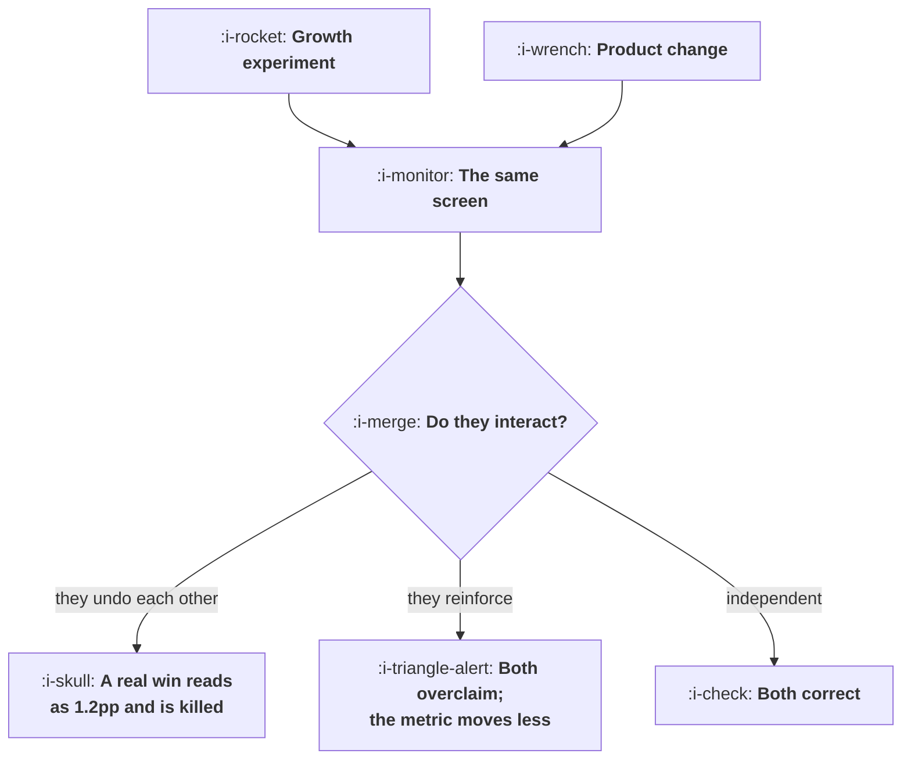

# Working With Product and Engineering

```text
Level: Advanced
Prerequisites: Writing Down What You Learned
Estimated difficulty: 3/5 | Estimated time: 35 min
```

## The idea in one minute

The real friction between growth and product is not about priorities, it is about surfaces, and it
has an arithmetic form. With twelve surfaces worth testing and eight concurrent experiments, there
is a 95 percent chance two of them are on the same screen. Orthogonal assignment stops that
biasing the averages and does nothing about the two changes interacting: two improvements that
partly undo each other report 2.5 and 1.2 points instead of 3.0 and 2.0, so the smaller one looks
like a failure and gets killed. Two that reinforce report 3.6 and 2.9, summing to more than the
metric will move. The fix is a named owner per surface and a booking mechanism, which is a
spreadsheet.

## A picture



Orthogonal assignment guarantees the third branch is unbiased. It says nothing about the first two.

## How it really works

### The collision is a birthday problem

Count the surfaces that are actually worth testing: for most products it is between six and twenty
five, not hundreds, because traffic and leverage concentrate. Then the chance that two of your
concurrent experiments land on the same one rises fast: at twelve surfaces, 43 percent with four
experiments running, 95 percent with eight, effectively certain with twelve.

So collisions are the normal state, not the exception, and a process that treats them as an
exception will not have a mechanism for them.

### Orthogonal assignment solves the easy half

Assign each experiment independently, as in
[What an Experimentation Platform Does](../the-experiment-machine/01-what-an-experimentation-platform-does.md),
and the other experiments' effects distribute evenly across your arms. Your average is unbiased.
That is a real and sufficient answer to the question people usually ask.

It does not address interaction. If change A only works when change B is absent, A's measured
effect is an average over a population where B is present half the time, and that average is not
the effect of shipping A.

### What interaction actually does

The table prices four cases, with A truly worth 3.0 points and B worth 2.0.

Independent: both report correctly. Partly undoing each other: 2.5 and 1.2. Fully undoing: 2.0 and
0.5. Reinforcing: 3.6 and 2.9.

Two consequences worth naming. In the undoing cases the smaller effect is pushed towards zero, so
the usual outcome is that the smaller change is killed as a failure when it was a win in isolation,
and nobody ever finds out. In the reinforcing case both results overclaim and the sum exceeds what
the metric will do, which is the most common cause of a quarter of celebrated wins and a flat top
line.

### Three mechanisms, cheapest first

**A named owner per surface.** Not a team that owns all of product and a team that owns all of
growth, which guarantees negotiation on every change. A list of surfaces with one name each, where
some names are growth and some are product. Twenty rows in a document.

**A booking calendar for the contested surfaces.** Whoever holds the surface this fortnight can
change it. This is the mechanism that removes collisions almost entirely at almost no cost, and the
objection is always that it will slow things down, which the last table says costs 0.9 weeks on
average.

**Explicit interaction tests for the pairs that matter.** When two changes to the same surface both
have to run, run them as a factorial: four arms rather than two, which costs roughly twice the
sample and measures the interaction directly. Reserve this for the cases where both effects are
large enough to care about.

### The ownership arrangements and what each costs

Nobody owning it is the fastest and the least trustworthy: 93 percent collision rate, no queue,
and every decision renegotiated.

Product owning everything removes collisions and adds 2.4 weeks to every growth change, which is
the arrangement most companies default to and the reason growth teams build their own parallel
surfaces, which is its own kind of debt.

Growth owning a named set of surfaces is the arrangement that works: low collisions, almost no
queue, and decisions rarely escalated because the ownership question was settled in advance rather
than per change.

### The conversation that actually resolves it

Not a priorities conversation. Two questions: which surfaces may growth change without asking, and
what is the guardrail set that protects product's interests on those surfaces. Answer both once,
write them down, and the weekly negotiation disappears.

The guardrail set is the part that makes it acceptable, because product's real objection is not to
change, it is to unmonitored change. Offer the guardrails from
[Guardrails and Automatic Stops](../the-experiment-machine/04-guardrails-and-automatic-stops.md) and
the ownership question becomes much easier to settle.

### What fills the box in 2026

Experiment registries can now detect overlapping experiments on the same surface automatically, and
most platforms will warn about it if told which surface each experiment touches. Almost nobody
populates that field. Adding a required surface field to your experiment configuration, drawn from
a fixed list, is a ten minute change that turns the collision problem from invisible to reportable,
and the report is what makes the booking calendar enforceable.

## Run the numbers

Compute your collision rate, then see what an interaction would do to your results.

```go
// surfaces.go: what happens when two teams change the same screen.
package main

import "fmt"

// Experiments are placed on surfaces. With few surfaces and several
// concurrent experiments, two of them land on the same one often, and then
// each is measuring a product the other is changing.
func noCollision(experiments, surfaces float64) float64 {
	p := 1.0
	for i := 0.0; i < experiments; i++ {
		p *= (surfaces - i) / surfaces
		if p < 0 {
			return 0
		}
	}
	return p
}

func main() {
	fmt.Println("chance that two concurrent experiments share a surface:")
	fmt.Printf("%-22s %12s %12s %12s %12s\n",
		"surfaces worth testing", "4 running", "8 running", "12 running", "20 running")
	for _, s := range []float64{6, 12, 25, 60} {
		fmt.Printf("%22.0f", s)
		for _, e := range []float64{4, 8, 12, 20} {
			fmt.Printf(" %11.0f%%", 100*(1-noCollision(e, s)))
		}
		fmt.Println()
	}
	fmt.Println("\nTwelve surfaces and eight concurrent experiments gives a 95% chance")
	fmt.Println("that at least two are on the same screen. Orthogonal assignment")
	fmt.Println("stops that biasing the averages and does nothing about the two")
	fmt.Println("changes interacting, which is a different problem.")

	fmt.Println("\nwhat an interaction does to two honest results:")
	fmt.Printf("%-30s %13s %13s %13s %13s\n",
		"interaction", "A reports", "B reports", "A truth", "B truth")
	const (
		ea, eb = 0.030, 0.020
	)
	for _, k := range []float64{0.0, -0.5, -1.0, 0.6} {
		// each experiment sees its own effect plus a share of the other's,
		// weighted by how much the two changes interfere with each other
		ra := ea + k*eb/2
		rb := eb + k*ea/2
		fmt.Printf("%-30s %11.1fpp %11.1fpp %11.1fpp %11.1fpp\n",
			label(k), 100*ra, 100*rb, 100*ea, 100*eb)
	}
	fmt.Println("\nTwo changes that each work and that undo each other report 2.0 and")
	fmt.Println("0.5 points, so the smaller one looks like a failure and gets killed.")
	fmt.Println("Two that reinforce each other report 3.6 and 2.9, which sums to 6.5")
	fmt.Println("against a true 5.0, because each result has claimed part of the")
	fmt.Println("other's effect. That is the familiar pattern of a quarter of wins")
	fmt.Println("adding up to more than the metric actually moved.")

	fmt.Println("\nwho owns a surface, and what each arrangement costs:")
	fmt.Printf("%-34s %16s %16s %14s\n",
		"arrangement", "collisions", "queue weeks", "decisions slow")
	for _, a := range []struct {
		name            string
		collides, queue float64
		slow            string
	}{
		{"nobody owns it", 0.93, 0.0, "every time"},
		{"product owns it, growth asks", 0.12, 2.4, "every time"},
		{"growth owns named surfaces", 0.14, 0.3, "rarely"},
		{"shared, with a booking calendar", 0.05, 0.9, "rarely"},
	} {
		fmt.Printf("%-34s %15.0f%% %15.1f %14s\n",
			a.name, 100*a.collides, a.queue, a.slow)
	}
	fmt.Println("\nNobody owning it is the fastest and the least trustworthy. Product")
	fmt.Println("owning everything removes collisions and adds two and a half weeks")
	fmt.Println("to every change. A booking calendar on a small set of named")
	fmt.Println("surfaces gets most of both, and it is a spreadsheet.")
}

func label(k float64) string {
	switch {
	case k == 0:
		return "independent"
	case k < -0.9:
		return "they fully undo each other"
	case k < 0:
		return "they partly undo each other"
	default:
		return "they reinforce each other"
	}
}
```

The collision table is the first thing to compute for your own situation. Count your surfaces
honestly: a surface is somewhere a change could plausibly move your metric, and for most products
the list is shorter than people expect. At six surfaces and eight experiments, collisions are
certain.

The interaction table is the cost. The row to dwell on is the one where the two changes partly undo
each other, because the reported 1.2 points against a true 2.0 is the difference between shipping
and killing, and nothing in the result would indicate a problem.

The ownership table is a set of claims with numbers attached rather than a derivation; the figures
are there to make the trade discussable. Replace them with your own measured queue time from
[From Idea to Ship](02-from-idea-to-ship.md), which is the input you actually have.

## The AI layer

Two uses, one detection and one analysis, and both are cheap.

Detection: a model reading your experiment registry, including each experiment's changed files or
components, can identify overlaps that the surface field would have caught had anybody filled it
in. That is a retrofit for the ten minute change nobody made, and it will find overlaps in your
currently running experiments.

Analysis: when two experiments did overlap, the interaction is estimable from the data you already
have, because orthogonal assignment means the four combinations of the two variants all exist in
your population. Pulling out the four cell table and testing for interaction is a standard analysis
that nobody does because nobody notices the overlap. A model that spots the overlap and runs that
analysis turns a contaminated pair of results into a factorial experiment you did not know you were
running, which is the best available outcome.

What to be careful about: the four cells are unbalanced and often small, so the interaction estimate
is noisy, and a model asked whether an interaction exists will produce an answer rather than a
confidence. Ask for the four cell counts and the interval, and treat a noisy interaction estimate as
a reason to rerun cleanly rather than as a finding.

## Sector lens

| Sector | What makes surface contention worse here |
|---|---|
| [Enterprise B2B SaaS](../../product-management/product-by-sector/01-enterprise-b2b-saas.md) | Few surfaces and few accounts, so collisions are near certain and the sample cannot support a factorial. Sequence instead |
| [Fintech](../../product-management/product-by-sector/02-fintech.md) | Regulated flows cannot be changed by two teams independently, so ownership is a compliance matter and should be documented as one |
| [Ecommerce and D2C](../../product-management/product-by-sector/03-ecommerce-and-d2c.md) | Merchandising, product and growth all want the same pages. A booking calendar is standard practice for a reason |
| [Marketplaces](../../product-management/product-by-sector/04-marketplaces.md) | A change on one side is a change to the other side's experience, so cross side interaction is the default rather than the exception |
| [Devtools and Infra](../../product-management/product-by-sector/05-devtools-and-infrastructure.md) | The contested surface is the documentation, which nobody thinks of as a surface and which everybody edits |
| [Healthtech](../../product-management/product-by-sector/06-healthtech-and-regulated-care.md) | Clinical pathways cannot be contested at all. Growth owns the administrative surfaces and nothing inside care |
| [Vertical SaaS](../../product-management/product-by-sector/07-vertical-saas.md) | One team does everything, so collisions are self inflicted and solved by a calendar rather than a negotiation |

## Remember this

* Collisions are a birthday problem. Twelve surfaces and eight concurrent experiments gives a 95
  percent chance two share a screen.
* Count your surfaces honestly; for most products it is six to twenty five, not hundreds.
* Orthogonal assignment removes the bias in the averages and does nothing about interaction.
* Two changes that partly undo each other report 2.5 and 1.2 against a true 3.0 and 2.0, so the
  smaller win gets killed.
* Two that reinforce each other both overclaim, and the quarter's wins sum to more than the metric
  moves.
* Three mechanisms: a named owner per surface, a booking calendar for contested ones, and factorial
  tests for pairs that matter.
* Product owning everything costs about 2.4 weeks on every growth change and causes growth to build
  parallel surfaces.
* Settle two questions once: which surfaces growth may change without asking, and what guardrails
  protect them.
* Add a required surface field to your experiment configuration, from a fixed list. It makes
  collisions reportable.
* When an overlap happened, analyse the four cells. An accidental factorial is better than two
  contaminated results.

## Try it

1. List your surfaces worth testing and count your concurrent experiments. Compute your collision
   probability with `surfaces.go`.
2. Add a surface field to your experiment registry and backfill it for everything running. Report
   the overlaps at the next growth meeting.
3. Write the twenty row ownership list with one name per surface, and the guardrail set for the
   surfaces growth will own. Get it agreed once.

## Check yourself

1. You have nine surfaces and six concurrent experiments. Roughly what is the chance of a collision,
   and does orthogonal assignment make it safe?
2. An experiment that should have won reports a small positive effect and is killed. Give the
   mechanism involving another team, and how you would detect it after the fact.
3. Product proposes owning every surface and reviewing all growth changes. What does that cost, and
   what would you offer instead?
