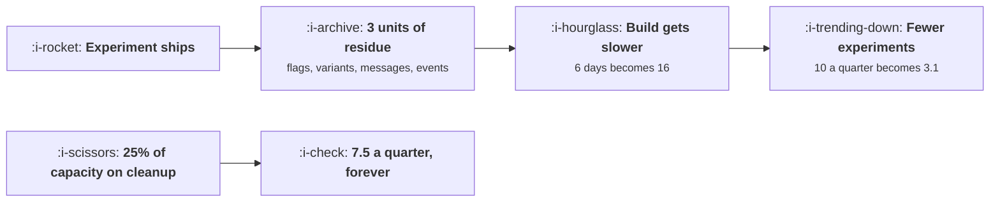

# Growth Debt

```text
Level: Advanced
Prerequisites: Working With Product and Engineering
Estimated difficulty: 3/5 | Estimated time: 35 min
```

## The idea in one minute

Every shipped experiment leaves residue: a flag nobody removed, a losing variant still in the code,
a message still sending, an event nobody reads. That residue makes the next experiment slower, so
a team that spends nothing on clearing it ships 10 experiments in its first quarter and 3.1 in its
twenty fourth, totalling 115 over six years. A team that spends a quarter of its capacity on
cleanup ships 7.5 every quarter, never slows, and totals 180. The crossover is in year two, which
is longer than most planning horizons and shorter than most products' lives, and saving the cleanup
up for dedicated quarters is worse than doing it steadily on both the total and the politics.

## A picture



The loop on the top is self reinforcing and the box on the bottom is the only thing that breaks it.

## How it really works

### What growth debt is made of

Six kinds, and they are specific rather than metaphorical.

* **Flags left on at 100 percent.** The combinatorial problem from
  [Flags, Rollouts and Experiments](../the-experiment-machine/02-flags-rollouts-and-experiments.md),
  plus a code path everybody has to reason about.
* **Losing variants left in the code.** Nobody deletes the variant that lost, because deleting
  feels like extra work on a change that did not pay.
* **Messages still sending.** A campaign from a concluded experiment that nobody switched off,
  consuming the attention budget from
  [The Shared Attention Budget](../lifecycle-messaging/05-the-shared-attention-budget.md).
* **Events nobody reads.** Instrumentation for a surface that no longer exists, which makes every
  query on that area harder and feeds the catalogue problem in
  [Designing an Event Taxonomy](../instrumentation-and-the-event-model/02-designing-an-event-taxonomy.md).
* **Surfaces nobody owns.** A page created for an experiment that is now live and unloved, which
  slows every decision touching it.
* **Dashboards nobody trusts.** Built for one experiment, left on a wall, quoted in meetings by
  people who do not know it is stale.

The last one is the cheapest to create and among the most expensive, because it costs credibility
rather than days.

### Why the decay is self reinforcing

Debt makes experiments slower. Slower experiments mean less capacity to clear debt. So the system
has positive feedback and the decline accelerates: 10 experiments in quarter one, 5.0 by quarter
eight, 3.7 by sixteen, 3.1 by twenty four.

The important consequence is that debt is not a constant tax that you can decide to accept. It is a
compounding one, and a team that decides the backlog of cleanup is not urgent this quarter is
deciding to have less capacity to do it next quarter.

### Steady beats batched, on the numbers and on the politics

Three full cleanup quarters out of twenty four ships 144 experiments against 180 for a standing 25
percent allocation, and it leaves three quarters with no shipped output at all.

The arithmetic reason is the compounding above: debt accumulated between cleanups slows everything
in between, so the average level is higher than under steady paydown even though the end state is
similar.

The political reason is larger. A quarter with no output has to be approved by somebody, and in
practice it gets approved once and then cancelled when the metric is behind, which is exactly when
debt is highest. A standing allocation never requires that conversation, because it is invisible in
the plan.

### Make it part of shipping, not a separate activity

The most effective version does not look like an allocation at all. The definition of done for an
experiment includes removing its own residue: the losing variant deleted, the flag removed, the
message switched off, the dashboard archived or promoted.

That way the cost is paid by the experiment that created it, at the moment the context is still
fresh, which is also when it is cheapest. A team that does this has a much smaller standing
allocation because the debt per shipped experiment falls rather than the clearance rate rising.

The practical mechanism is a checklist on the experiment's archive entry from
[Writing Down What You Learned](04-writing-down-what-you-learned.md), with the entry not considered
complete until the residue is gone.

### The debt register

One list, reviewed quarterly, with four columns: what it is, what it slows, who owns it, and when it
will go. Anything on the list for more than two quarters either gets removed or gets accepted
explicitly as permanent, which converts invisible drag into a decision somebody made.

Expect the register to be dominated by flags on first construction. That is normal and it is the
cheapest category to clear.

### What fills the box in 2026

Faster build has an uncomfortable interaction with this lesson: shipping more experiments generates
debt faster, in direct proportion. A team that doubles its experiment count without changing its
cleanup practice doubles its debt accumulation rate, and the decay curve steepens accordingly. So
the correct accompaniment to faster building is a higher standing allocation, not a lower one, and
that is the opposite of how the saving usually gets spent.

## Run the numbers

Simulate six years under four cleanup policies.

```go
// growthdebt.go: what the leftovers of a year of experimenting cost the next
// year's experiments.
package main

import "fmt"

// Every shipped experiment leaves something behind: a flag nobody removed, a
// message still sending, a surface nobody owns, an event nobody reads. That
// residue makes the next experiment slower, so velocity decays unless some
// capacity goes on removing it.
const (
	capacity   = 60.0  // engineering days a quarter
	baseDays   = 6.0   // days per experiment with no debt at all
	debtPerWin = 3.0   // units of residue left by one shipped experiment
	drag       = 150.0 // debt units that double the days per experiment
	clearCost  = 0.55  // days to remove one unit of debt
)

func daysPer(debt float64) float64 { return baseDays * (1 + debt/drag) }

// one quarter: spend some share of capacity clearing debt, the rest shipping
func quarter(debt, paydown float64) (shipped, newDebt float64) {
	clearing := capacity * paydown
	building := capacity - clearing
	shipped = building / daysPer(debt)
	debt += shipped * debtPerWin
	debt -= clearing / clearCost
	if debt < 0 {
		debt = 0
	}
	return shipped, debt
}

func main() {
	fmt.Printf("%.0f days a quarter, %.0f days an experiment with no debt\n\n",
		capacity, baseDays)

	fmt.Printf("%-24s %9s %9s %9s %9s %14s\n",
		"capacity on paydown", "q1", "q8", "q16", "q24", "24q total")
	for _, p := range []float64{0.00, 0.05, 0.15, 0.25} {
		debt := 0.0
		var total float64
		fmt.Printf("%23.0f%%", 100*p)
		for q := 1; q <= 24; q++ {
			s, d := quarter(debt, p)
			debt = d
			total += s
			switch q {
			case 1, 8, 16, 24:
				fmt.Printf(" %8.1f", s)
			}
		}
		fmt.Printf(" %13.0f\n", total)
	}
	fmt.Println("\nSpending nothing on paydown ships 10 experiments in the first")
	fmt.Println("quarter and 3.1 in the twenty fourth: 115 over six years. Spending")
	fmt.Println("a quarter of capacity on cleanup ships 7.5 every quarter, never")
	fmt.Println("slows down, and ships 180. The team that cleans up less ships fewer")
	fmt.Println("experiments in total, and the crossover is in year two.")

	fmt.Println("\nwhere the debt sits, and what each kind costs:")
	fmt.Printf("%-34s %14s %18s\n", "kind of residue", "units each", "what it slows")
	for _, r := range []struct {
		name  string
		units float64
		slows string
	}{
		{"a flag left on at 100%", 0.8, "every build touching it"},
		{"a losing variant left in the code", 0.9, "every build on that surface"},
		{"a message still sending", 0.5, "the attention budget"},
		{"an event nobody reads", 0.3, "every query on that surface"},
		{"a surface nobody owns", 0.4, "every decision about it"},
		{"a dashboard nobody trusts", 0.1, "every discussion of the metric"},
	} {
		fmt.Printf("%-34s %14.1f %18s\n", r.name, r.units, r.slows)
	}
	fmt.Printf("\ntotal per shipped experiment: %.1f units\n", debtPerWin)

	fmt.Println("\nsteady paydown against saving it all up:")
	fmt.Printf("%-38s %12s %16s %14s\n",
		"policy", "24q total", "worst quarter", "debt at q24")
	type pol struct {
		name   string
		steady float64
		burst  bool
	}
	for _, p := range []pol{
		{"nothing, ever", 0.00, false},
		{"25% every quarter", 0.25, false},
		{"nothing, then three cleanup quarters", 0.00, true},
	} {
		debt, total, worst := 0.0, 0.0, 99.0
		for q := 1; q <= 24; q++ {
			pay := p.steady
			if p.burst && (q == 7 || q == 14 || q == 21) {
				pay = 1.0
			}
			s, d := quarter(debt, pay)
			debt = d
			total += s
			if s < worst {
				worst = s
			}
		}
		fmt.Printf("%-38s %12.0f %16.1f %14.0f\n", p.name, total, worst, debt)
	}
	fmt.Println("\nThree full cleanup quarters out of twenty four ships 144 against")
	fmt.Println("180 for steady paydown, and leaves three quarters with no output at")
	fmt.Println("all. Steady wins on the total and wins by much more politically,")
	fmt.Println("because nobody has to approve a quarter that ships nothing.")
}
```

The first table is the whole argument. Experiments in quarter 1, 8, 16 and 24, and the six year
total: 115, 124, 155 and 180 for paydown allocations of 0, 5, 15 and 25 percent.

Look at the quarter one column, because it is why nobody does this: the no cleanup policy ships 10
and the 25 percent policy ships 7.5, so for the first year the discipline looks like a 25 percent
tax with no return. The crossover is in year two.

The 25 percent row is flat at 7.5 forever, which means the debt is held at zero: the allocation is
exactly enough to clear what gets created. That is the number to find for your own product, and it
is the honest answer to how much cleanup capacity you need.

The policy table prices batching: 144 against 180, with three quarters of zero output. Put your own
`debtPerWin` and `clearCost` in, estimated from one real cleanup: count what one experiment leaves
behind and time how long removing it takes.

## The AI layer

Two uses, and the first is the one with real leverage.

Identifying the debt is the task. A model with your flag registry, your codebase, your message
configuration and your event catalogue can produce the debt register: flags at 100 percent for over
a month, variant code with no live flag referencing it, scheduled messages whose experiments
concluded, events with no query against them in six months, dashboards not opened in a quarter.
That list is tedious to assemble by hand, which is why it never gets assembled, and it is the
prerequisite for everything else in this lesson.

Removing it is the second and is more constrained. Deleting a losing variant is a mechanical
refactor and a good fit; switching off a message or an event is a configuration change with a
blast radius and should be proposed rather than applied. The useful division is that a model
produces the pull request and a person approves it, which keeps the economics while keeping the
accountability.

The thing to watch is the interaction named above. If model assisted building raises your experiment
count, your debt accumulation rises in proportion, and the same tooling that created the extra
throughput should be pointed at the residue in the same quarter. A team that uses the saving
entirely on more experiments will find the saving gone within two years, which is the compounding
in the first table arriving by a different route.

## Sector lens

| Sector | What accumulates fastest here |
|---|---|
| [Enterprise B2B SaaS](../../product-management/product-by-sector/01-enterprise-b2b-saas.md) | Per customer configurations and exceptions, which cannot be deleted without asking and so never are |
| [Fintech](../../product-management/product-by-sector/02-fintech.md) | Code paths that cannot be removed without compliance sign off, so the register needs a review column as well as an owner |
| [Ecommerce and D2C](../../product-management/product-by-sector/03-ecommerce-and-d2c.md) | Landing pages and promotional mechanics, which accumulate fastest of any sector and are easiest to delete |
| [Marketplaces](../../product-management/product-by-sector/04-marketplaces.md) | Supply side messaging, because switching off a message that affects somebody's earnings needs notice |
| [Devtools and Infra](../../product-management/product-by-sector/05-devtools-and-infrastructure.md) | Public API surface and documented behaviour, which cannot be removed once anybody depends on it. Treat an experiment on the API as permanent |
| [Healthtech](../../product-management/product-by-sector/06-healthtech-and-regulated-care.md) | Validated configurations, where removal requires revalidation. Budget cleanup as a governance activity |
| [Vertical SaaS](../../product-management/product-by-sector/07-vertical-saas.md) | Customer specific features from one account's request, which become undeletable once that account relies on them |

## Remember this

* Each shipped experiment leaves residue, and the residue makes the next experiment slower, so
  decay compounds.
* Nothing on cleanup ships 115 experiments over six years; a quarter of capacity ships 180.
* The crossover is in year two, which is why the discipline looks like a pure tax for the first
  twelve months.
* Six kinds of residue: live flags, losing variants, running messages, unread events, unowned
  surfaces, untrusted dashboards.
* An untrusted dashboard is the cheapest to create and among the most expensive, because it costs
  credibility.
* Steady paydown beats batched cleanup on the total, 180 against 144, and avoids quarters with no
  output.
* The batched version gets cancelled exactly when the metric is behind, which is when debt is
  highest.
* Best of all, pay it at ship time: the experiment's definition of done includes removing its own
  residue.
* Keep a debt register with what, what it slows, who owns it, and when it goes. Two quarters on the
  list means remove it or accept it as permanent.
* Faster building raises debt accumulation proportionally, so it calls for a larger cleanup
  allocation rather than a smaller one.

## Try it

1. Build the debt register this week from your flag registry, your scheduled messages and your event
   catalogue. Count the units; flags will dominate.
2. Time one real cleanup to get your own `clearCost`, and count what one experiment leaves behind to
   get `debtPerWin`. Run `growthdebt.go` with both.
3. Add residue removal to your experiment definition of done, and check it on the archive entry
   rather than in a separate cleanup backlog.

## Check yourself

1. Why is growth debt a compounding cost rather than a constant tax, and what does that imply about
   deferring it for one quarter?
2. Your team proposes a dedicated cleanup quarter next year. What is the arithmetic objection, and
   what is the political one?
3. Your build cost halves and your experiment count doubles. What happens to your debt, and what
   should you do with part of the saving?
