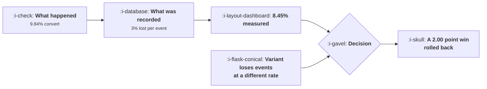

# Why Growth Work Dies Without Instrumentation

```text
Level: Advanced
Prerequisites: Drawing Your Own Loop
Estimated difficulty: 3/5 | Estimated time: 35 min
```

## The idea in one minute

Everybody accepts a three percent event loss and nobody would accept a fourteen percent error, and
those are the same thing: five steps at three percent each understates a funnel by fourteen
percent. Worse, the loss is rarely symmetric. A variant that fires one extra event reports a 2.00
point lift as 0.71, a variant that loads faster reports it as 2.25, and a variant that quietly
breaks an event reports it as minus 5.24 and gets rolled back as a regression. A team with
mediocre instrumentation does not experience a data problem. It experiences every question taking
three times as long, every result being argued with, and a slow drift towards making decisions
from opinion because the numbers never settle anything.

## A picture



The first arrow costs you accuracy. The second one costs you the decision.

## How it really works

### Losses multiply along a funnel

Each step of a funnel is measured by an event, each event captures some share of what actually
happened, and the end to end number is the product. A single event at 97 percent is excellent. Five
of them is 86 percent, so your 9.84 percent funnel reports as 8.45.

That bias is consistent, which is why teams live with it: trends are still readable and comparisons
between weeks are fair. The trouble starts when the error stops being consistent.

### Asymmetric loss destroys experiments specifically

An experiment compares two arms, so it is only valid if both arms lose events at the same rate.
That assumption fails routinely and invisibly, for reasons that are properties of the variant
rather than of the tracking:

* **The variant has a different number of events.** More steps, more loss, lower measured
  conversion.
* **The variant is faster or slower.** Page speed changes how many events survive the user
  navigating away, especially for events that fire late in a page lifecycle.
* **The variant uses a different component.** A new library, a different render path, an event that
  fires on a handler that the variant removed.
* **The variant is on a different platform mix.** If a change only ships to one client, the arms
  differ by that client's loss profile.

The table below prices four of these. The true lift is 2.00 points in all four and the measured
figures run 1.72, 0.71, 2.25 and minus 5.24. The last row is the dangerous one, because a
regression gets rolled back quickly and nobody investigates a rollback.

The practical defence is a sample ratio check and an event count check per arm before reading any
result, which is covered in
[Assignment and Exposure](../the-experiment-machine/README.md). Two arms whose event counts per
user differ by more than a couple of percent are not comparable, whatever the conversion numbers
say.

### Why the team feels it as slowness

A typical growth question needs about three events to be sound: a population, an action and an
outcome. If each event is 90 percent trustworthy the question is answerable first time 73 percent
of the time. At 75 percent event quality it is 42 percent.

The other half of the questions are not unanswerable, they are expensive: somebody investigates
the discrepancy, writes a query that works around it, asks engineering to check, and comes back
with a caveated number a week later. Out of forty questions a quarter, that is 23 investigations
at 75 percent quality.

No one logs this as a data quality incident. It is experienced as the analytics team being slow
and the growth team being indecisive, and it is the most common reason growth programmes
underperform their plan in year one.

### The three failure modes, named

**Missing.** The event does not fire. Caught by comparing against a server side count of the same
action, which is why the next lessons recommend both.

**Ambiguous.** The event fires but nobody knows exactly what it means, so two teams compute
different numbers from it and the meeting is about the discrepancy rather than the decision. This
is the most expensive failure and the cheapest to prevent, and it is the subject of
[Designing an Event Taxonomy](02-designing-an-event-taxonomy.md).

**Wrong.** The event fires in cases it should not, usually after a refactor moved it. Caught only
by monitoring, which is
[Data Quality and the Slow Rot](06-data-quality-and-the-slow-rot.md).

### What to do before anything else

Pick your five most important events. For each, compare the client count against an independent
count of the same thing from your database or your server logs for one week. The ratio is your
loss rate per event, and it is usually the first time anybody in the company has seen it.

That exercise takes a day, needs nobody's permission, and produces the number that tells you
whether the rest of this topic is urgent.

### What fills the box in 2026

Client side event loss has got worse rather than better. Browser tracking protection, extension
based blocking and mobile platform restrictions remove a share of client events that varies by
audience from a few percent to over a third for technical products. That is the strongest practical
argument for server side collection of anything that matters, which is
[Client, Server or Both](05-client-server-or-both.md). The loss is also not random: it correlates
with technical sophistication, privacy awareness and geography, so it biases your population as
well as shrinking it.

## Run the numbers

Multiply the losses, then apply them unevenly and watch an experiment invert.

```go
// badevents.go: what a small measurement error does to a funnel and to an
// experiment run on it.
package main

import "fmt"

// Every step of a funnel is measured by an event, and every event loses some
// share of what happened. The losses multiply, so a funnel looks worse than
// it is by an amount that grows with its length.
func observed(truth []float64, loss float64) []float64 {
	out := make([]float64, len(truth))
	for i, t := range truth {
		out[i] = t * (1 - loss)
	}
	return out
}

func endToEnd(rates []float64) float64 {
	c := 1.0
	for _, r := range rates {
		c *= r
	}
	return c
}

func main() {
	truth := []float64{0.82, 0.64, 0.55, 0.71, 0.48}
	fmt.Printf("a five step funnel, true conversion %.2f%%\n\n", 100*endToEnd(truth))

	fmt.Printf("%-16s %14s %16s %14s\n",
		"loss per event", "measured", "understated by", "relative")
	for _, l := range []float64{0.00, 0.01, 0.03, 0.06, 0.12} {
		m := endToEnd(observed(truth, l))
		fmt.Printf("%15.0f%% %13.2f%% %15.2fpp %13.0f%%\n",
			100*l, 100*m, 100*(endToEnd(truth)-m), 100*(1-m/endToEnd(truth)))
	}
	fmt.Println("\nA 3% loss on each of five events understates the funnel by 14%.")
	fmt.Println("Nobody would accept a 14% error and everybody accepts 3%.")

	fmt.Println("\nthe same error, applied unevenly to an experiment:")
	fmt.Printf("%-34s %12s %12s %12s %10s\n",
		"case", "control", "variant", "measured lift", "truth")
	const trueLift = 0.020
	base := endToEnd(truth)
	cases := []struct {
		name         string
		lossC, lossV float64
	}{
		{"both arms measured the same", 0.03, 0.03},
		{"variant adds one new event", 0.03, 0.05},
		{"variant is a faster page", 0.03, 0.02},
		{"variant breaks one event entirely", 0.03, 0.23},
	}
	keep := func(loss float64) float64 {
		k := 1.0
		for i := 0; i < len(truth); i++ {
			k *= 1 - loss
		}
		return k
	}
	for _, c := range cases {
		ctl := base * keep(c.lossC)
		vnt := (base + trueLift) * keep(c.lossV)
		fmt.Printf("%-34s %11.2f%% %11.2f%% %11.2fpp %9.2fpp\n",
			c.name, 100*ctl, 100*vnt, 100*(vnt-ctl), 100*trueLift)
	}

	fmt.Println("\nThe true lift is 2.00 points in every row and no row reports it.")
	fmt.Println("Equal loss in both arms still shrinks the lift, because the loss is")
	fmt.Println("proportional. A variant that fires one extra event reports 0.71. A")
	fmt.Println("variant that loads faster, and so loses fewer events to people")
	fmt.Println("navigating away, reports 2.25 and will be called a bigger win than")
	fmt.Println("it is. A variant that quietly breaks an event reports minus 5.24 and")
	fmt.Println("will be rolled back as a regression.")

	fmt.Println("\nhow many decisions a quarter survive, by share of events trusted:")
	fmt.Printf("%-18s %16s %20s %14s\n",
		"events trusted", "questions asked", "answered first time", "rework")
	const asked = 40.0
	for _, t := range []float64{0.98, 0.90, 0.75, 0.55} {
		// a question needs about three events, all of them sound
		ok := t * t * t
		fmt.Printf("%17.0f%% %16.0f %20.0f %14.0f\n",
			100*t, asked, asked*ok, asked*(1-ok))
	}
	fmt.Println("\nA question needs about three events to be sound. At 90% event")
	fmt.Println("quality that is 73% of questions, and at 75% it is 42%. The team")
	fmt.Println("does not experience this as a data problem; it experiences it as")
	fmt.Println("everything taking longer than it should.")
}
```

The first table is the compounding. One percent per event is a 5 percent relative error, three
percent is 14, six percent is 27. The right hand column is the one to quote, because nobody
intuits that a three percent event problem is a fourteen percent funnel problem.

The experiment table is the serious one. Note the first row: even when both arms lose events
identically, the measured lift is 1.72 rather than 2.00, because proportional loss shrinks
absolute differences. Every experiment you have ever run understated its effect by roughly your
loss rate, which is a reason to fix instrumentation rather than a reason to despair.

The last table converts event quality into working days. Going from 90 to 98 percent event quality
takes answered first time questions from 29 to 38 out of 40, which is nine investigations a quarter
that do not happen. That is the business case for instrumentation work, stated in the only unit
that gets budget.

Replace `truth` with your own funnel and `loss` with the ratio you measured against an independent
count. If you have not measured it, that is the exercise above and it takes a day.

## The AI layer

Three things worth separating, because they are often sold as one.

A model is genuinely useful at finding instrumentation defects. Comparing event volumes against
expected patterns, flagging an event whose properties changed shape after a release, and
identifying two events that appear to measure the same thing are all pattern recognition over data
you already hold, and they are cheap. That is monitoring, and it is covered in lesson 06.

A model cannot recover a missing event. This needs saying because it is frequently implied:
modelled conversions, inferred journeys and attribution reconstructions all produce a number where
there was no number, and the number is an estimate whose error is unknown and correlated with
exactly the things you care about. It is defensible for aggregate reporting with the uncertainty
stated. It is not defensible as an experiment readout, because the model was fitted on the world
before your change.

And a model raises the cost of bad instrumentation, which is the part to plan for. Any system that
acts on your event data, a targeting model, a propensity score, an agent that triages accounts,
inherits every defect in the events and amplifies it, because it will find and exploit systematic
patterns in your measurement error as readily as patterns in user behaviour. A product team with
plans for model driven growth work should treat the tracking plan as a prerequisite rather than a
parallel workstream.

## Sector lens

| Sector | Where the events go missing here |
|---|---|
| [Enterprise B2B SaaS](../../product-management/product-by-sector/01-enterprise-b2b-saas.md) | Corporate networks and browser policies block client collection unevenly by customer, so your loss rate varies by account |
| [Fintech](../../product-management/product-by-sector/02-fintech.md) | Much of the funnel happens in verification systems you do not own, so the gaps are structural rather than technical |
| [Ecommerce and D2C](../../product-management/product-by-sector/03-ecommerce-and-d2c.md) | Ad blockers and tracking protection remove a large share of client events, and the share differs by traffic source |
| [Marketplaces](../../product-management/product-by-sector/04-marketplaces.md) | Two sides, two apps, two loss profiles, and any cross side metric multiplies both |
| [Devtools and Infra](../../product-management/product-by-sector/05-devtools-and-infrastructure.md) | Your users block tracking at the highest rate of any audience. Server and API side collection is the only reliable route |
| [Healthtech](../../product-management/product-by-sector/06-healthtech-and-regulated-care.md) | Clinical systems may prohibit client analytics entirely, so the measurable surface is defined by policy |
| [Vertical SaaS](../../product-management/product-by-sector/07-vertical-saas.md) | Small volumes mean a few percent of loss is indistinguishable from noise, so defects persist for years |

## Remember this

* Event losses multiply. Three percent on each of five events understates the funnel by fourteen
  percent.
* Consistent loss is survivable. Asymmetric loss between experiment arms is not, and it is created
  by ordinary properties of a variant.
* A 2.00 point lift reads as 1.72, 0.71, 2.25 or minus 5.24 depending on how the variant affects
  event delivery.
* Check event counts per user per arm before reading any experiment. A couple of percent difference
  invalidates the comparison.
* A question needs about three sound events. At 90 percent event quality, 27 percent of questions
  need investigation; at 75 percent, 58 percent do.
* Teams experience bad instrumentation as slowness and indecision, never as a data incident.
* Three failure modes: missing, ambiguous and wrong. Ambiguous is the most expensive and the
  cheapest to prevent.
* Measure your loss rate by comparing five key client events against independent server counts for
  a week. It takes a day.
* Client loss is growing and is correlated with sophistication and geography, so it biases the
  population as well as shrinking it.
* A model can find instrumentation defects and cannot recover a missing event. Anything that acts
  on your events amplifies their defects.

## Try it

1. Take your five most important events and compare a week of client counts against an independent
   count from your database. Record the ratio per event.
2. Run `badevents.go` with your real funnel and measured loss, and compute how much your last
   reported funnel conversion understated the truth.
3. For your last three experiments, pull events per user per arm. If any pair differs by more than
   two percent, re read that result.

## Check yourself

1. Your six step funnel reports 4.2 percent conversion and each event loses 4 percent. What is the
   true figure, and does the error matter for a week on week comparison?
2. An experiment shows a variant losing by 3 points. What would you check before rolling it back,
   and why is a rollback the most dangerous outcome to get wrong?
3. Why does a team with 75 percent event quality describe its problem as the analytics team being
   slow rather than as a data quality problem?
