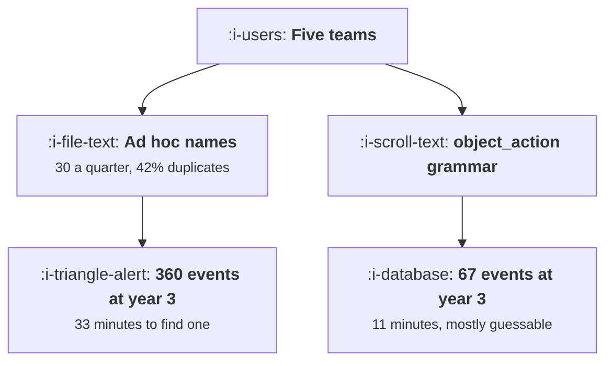

# Designing an Event Taxonomy

```text
Level: Advanced
Prerequisites: Why Growth Work Dies Without Instrumentation
Estimated difficulty: 4/5 | Estimated time: 40 min
```

## The idea in one minute

An event catalogue without a naming grammar grows with the number of teams multiplied by the number
of quarters, and roughly two fifths of it restates something that already exists. After three years
that is 360 events of which 151 are duplicates, and the time to find the right one and be sure it
is the right one reaches half an hour. With an object and action grammar, the catalogue grows with
the product's nouns instead: 67 events after the same three years, and eleven minutes. The
difference is 31 working days a year for a team of eight, spent entirely on deciding which of two
similarly named events means what you think it means.

## A picture



Same product, same teams, same three years. The only difference is whether names are predictable.

## How it really works

### The grammar: object, action, properties

One rule covers almost everything. An event is a noun from your product and a verb that happened to
it, in past tense, lowercase, with underscores: `document_created`, `workspace_shared`,
`integration_failed`.

Everything that varies goes in properties rather than in the name. Not `document_created_from_
template` and `document_created_blank`, but `document_created` with a `source` property. This is
the single most important rule, and it is the one most often broken, because putting the variation
in the name feels more explicit at the moment of writing and makes every future question harder.

The test: if you would ever want to count the two things together, they are one event with a
property. You almost always want to count them together.

### Why the catalogue size matters more than it looks

A big catalogue is not just untidy, it is a search problem with a correctness penalty. Finding an
event in 360 options is slower than in 67, and the real cost is the ambiguity: when two events
plausibly mean the same thing, the analyst has to determine which one is correct, which means
reading code or asking an engineer.

A typical growth question needs about four lookups: the population, the action, the outcome and a
filter. At 40 questions a quarter that is 160 lookups, and the difference between a 33 minute and
an 11 minute lookup is 59 hours a quarter.

### Rules that prevent the common disasters

* **Past tense, always.** `document_created`, never `create_document`. Events record what happened,
  not what the code does. Mixed tense in a catalogue is the first sign nobody owns it.
* **No feature names, no project names, no team names.** `onboarding_v2_step3_complete` is
  unreadable in eighteen months and wrong in twelve, when onboarding v3 ships and the event keeps
  the old name.
* **Never put a value in a name.** `plan_upgraded_to_pro` becomes four events when you add four
  plans. One event, a `to_plan` property.
* **One event per thing that happened, not per place it happened.** If a document can be created
  from three places, that is one event with a `surface` property. Otherwise every funnel query
  needs a union and somebody will forget one.
* **Name the failure as well as the success.** `export_failed` alongside `export_completed`, with a
  `reason`. Products instrument success and then cannot explain a drop.
* **Fix the property vocabulary too.** `source`, `surface`, `plan`, `role`, `reason`, used the same
  way everywhere, with a fixed set of allowed values per property. Free text properties become
  unqueryable within a year.

### Deciding what to instrument at all

A grammar tells you how to name things, not what to record. The rule that works: instrument the
objects in your product's domain model and the state changes they can undergo. That list is short,
stable, and it is the same list the product's data model already contains.

What not to instrument: clicks on individual interface elements. They are numerous, they change
with every redesign, and the question they answer is almost always better answered by the state
change the click was trying to cause. A catalogue dominated by `button_clicked` variants is a
catalogue that will be rewritten.

### Migrating an existing mess

You cannot rename 360 events, and you do not need to. The approach that works: define the grammar,
define the twenty events that answer your most important questions, implement those correctly
alongside what exists, and point every dashboard and every query at the new ones. Then stop
maintaining the old catalogue and let it decay. Deprecate loudly, delete after a year.

Doing this for twenty events takes a few weeks. Attempting a full migration takes a year and does
not finish, which is why most companies have two generations of events and no plan.

### What fills the box in 2026

Analytics platforms and customer data platforms all offer a schema registry or tracking plan
feature that can reject events not matching a declared shape. That mechanism is the difference
between a convention and a rule, and it is usually available and switched off. Turning it on is the
other half of [The Tracking Plan as a Contract](04-the-tracking-plan-as-a-contract.md). Where it is
available, enforce in a staging environment first and in production within a quarter.

## Run the numbers

Watch both catalogues grow, then convert the difference into working days.

```go
// taxonomy.go: what a naming convention is worth, measured in catalogue size
// and in the time it takes to answer a question.
package main

import (
	"fmt"
	"math"
)

// Without a convention every team names events for its own feature, so the
// catalogue grows with teams multiplied by quarters and a large share of it
// duplicates something that already exists. With an object and action
// convention the catalogue grows with the product's nouns instead.
const (
	teams      = 5.0
	perTeamQtr = 6.0  // new events a team ships in a quarter
	dupRate    = 0.42 // share of ad hoc events that restate an existing one
	actions    = 7.0  // created, viewed, updated, deleted, shared, exported, failed
	objectsQtr = 1.6  // new nouns the product gains in a quarter
	density    = 0.34 // share of object and action pairs that really exist
	objects0   = 9.0
)

// minutes to find the right event and be sure it is the right one
func lookupMinutes(catalogue, ambiguous float64) float64 {
	return 2.5 * math.Log(catalogue) * (1 + 3*ambiguous)
}

func main() {
	fmt.Printf("%-10s %12s %12s %12s %14s %14s\n",
		"quarter", "ad hoc", "convention", "duplicates", "ad hoc lookup", "conv lookup")
	for q := 1; q <= 12; q++ {
		adhoc := teams * perTeamQtr * float64(q)
		dups := adhoc * dupRate
		objects := objects0 + objectsQtr*float64(q)
		conv := objects * actions * density
		if q%2 == 1 || q == 12 {
			fmt.Printf("%10d %12.0f %12.0f %12.0f %13.0fm %13.0fm\n",
				q, adhoc, conv, dups,
				lookupMinutes(adhoc, dupRate), lookupMinutes(conv, 0.02))
		}
	}

	fmt.Println("\nAfter three years the ad hoc catalogue has 360 events of which")
	fmt.Println("151 restate something that already existed, and finding the right")
	fmt.Println("one takes 33 minutes. The convention has 67 events and takes 11.")

	fmt.Println("\nwhat that costs a team of eight, at 40 questions a quarter:")
	fmt.Printf("%-22s %16s %16s %16s\n",
		"catalogue", "lookups/quarter", "hours/quarter", "days a year")
	for _, c := range []struct {
		name      string
		size, amb float64
	}{
		{"ad hoc, year 3", 360, dupRate},
		{"ad hoc, year 1", 120, dupRate},
		{"convention, year 3", 66, 0.02},
	} {
		// a question needs about four lookups: population, action, outcome, filter
		hours := 40 * 4 * lookupMinutes(c.size, c.amb) / 60
		fmt.Printf("%-22s %16.0f %16.1f %16.1f\n",
			c.name, 40*4.0, hours, 4*hours/7.5)
	}

	fmt.Println("\nThe difference between the two year three rows is 59 hours a")
	fmt.Println("quarter, which is 31 working days a year spent deciding which of")
	fmt.Println("two similarly named events is the one that means what you think.")

	fmt.Println("\nthe convention, as a grammar:")
	objs := []string{"document", "workspace", "member", "integration", "export"}
	acts := []string{"created", "viewed", "updated", "shared", "deleted"}
	for _, o := range objs[:3] {
		for _, a := range acts[:3] {
			fmt.Printf("  %s_%s\n", o, a)
		}
	}
	fmt.Println("  ...")
	fmt.Printf("\n%.0f objects by %.0f actions, of which about %.0f%% exist: %.0f events\n",
		objects0+objectsQtr*12, actions, 100*density,
		(objects0+objectsQtr*12)*actions*density)
	fmt.Println("Every name is predictable from the product, so a new analyst")
	fmt.Println("guesses correctly instead of searching.")
}
```

The first table is the divergence. Both catalogues are around the same size at the end of quarter
one, 30 against 25, which is why this problem is invisible at the start and why the convention
feels like unnecessary process in a young company. By quarter twelve it is 360 against 67.

The lookup columns move much less than the catalogue sizes, because search time grows with the
logarithm of the catalogue. The ambiguity multiplier is doing most of the work: 42 percent
duplicates nearly quadruples the time per lookup, and that is the term a grammar removes.

The cost table converts it. Year three ad hoc is 88.7 hours a quarter of lookups against 29.6 for
the convention. The difference, 31 working days a year, is roughly a sixth of an analyst, spent
permanently on a problem that a one page document would have prevented.

Change `dupRate` to your own estimate, which you can get by sampling thirty events from your
catalogue and asking whether each one duplicates another. Teams consistently guess low before they
sample and high afterwards.

## The AI layer

Two uses that are genuinely good and one claim worth rejecting.

Auditing an existing catalogue is a strong fit. Give a model the list of event names and their
property schemas and ask which pairs plausibly measure the same thing, which names violate the
grammar, and which events have no corresponding failure event. That is a few minutes and pennies,
and it produces the deprecation list that would otherwise take an analyst a fortnight.

Generating the instrumentation for a new feature against a declared grammar is also a good fit,
because the task is mechanical and the grammar is the specification. A model that is given the
tracking plan and the diff can propose the events a change should fire, which catches the most
common defect of all, which is a feature shipping with no events.

The claim to reject is that a model removes the need for a taxonomy by querying raw, unstructured
event data in natural language. It will produce an answer. The answer will be computed from
whichever of your 360 events the model's retrieval surfaced, including the duplicates, and the
error will be invisible because the output is a confident sentence rather than a query somebody can
read. Ambiguity in the catalogue becomes ambiguity in the answer, with the audit trail removed.

The practical consequence: if you intend to let anybody ask questions of your data in natural
language, the taxonomy matters more rather than less, because the human check on which event was
used has been taken out.

## Sector lens

| Sector | What the objects are here |
|---|---|
| [Enterprise B2B SaaS](../../product-management/product-by-sector/01-enterprise-b2b-saas.md) | Account, workspace, seat, project, document. Every event needs an account property or cross account analysis is impossible |
| [Fintech](../../product-management/product-by-sector/02-fintech.md) | Account, transaction, card, application, verification. Names and properties may themselves be sensitive and need review |
| [Ecommerce and D2C](../../product-management/product-by-sector/03-ecommerce-and-d2c.md) | Product, basket, order, shipment, return. Largely standardised by the commerce platform, which is a gift worth accepting |
| [Marketplaces](../../product-management/product-by-sector/04-marketplaces.md) | Listing, enquiry, booking, payout, review, and a side property on everything. One grammar across both sides |
| [Devtools and Infra](../../product-management/product-by-sector/05-devtools-and-infrastructure.md) | Key, request, build, deployment, environment. The API surface is the object list, already named and documented |
| [Healthtech](../../product-management/product-by-sector/06-healthtech-and-regulated-care.md) | Encounter, order, record, message. Event names and properties fall inside data governance and need approval, not just review |
| [Vertical SaaS](../../product-management/product-by-sector/07-vertical-saas.md) | The trade's own nouns: job, route, shift, invoice. Use the customer's vocabulary, which makes the catalogue self documenting |

## Remember this

* The grammar is object and action in past tense, lowercase with underscores, and everything that
  varies goes in a property.
* If you would ever count two things together, they are one event with a property. You almost
  always would.
* Ad hoc catalogues grow with teams times quarters and are about two fifths duplicates. Grammar
  based ones grow with the product's nouns.
* 360 events against 67 at year three, and 33 minutes against 11 to find the right one.
* That gap is 59 hours a quarter for a team of eight, or 31 working days a year.
* No feature names, no version numbers, no values in names, and one event per thing that happened
  rather than per place.
* Instrument the state changes of your domain objects, not clicks on interface elements.
* Fix the property vocabulary and the allowed values, or free text properties become unqueryable.
* Migrate by implementing twenty correct events alongside the mess and repointing dashboards, not
  by a full rewrite.
* A model is good at auditing a catalogue and generating events against a grammar, and natural
  language querying makes the taxonomy more important rather than less.

## Try it

1. Sample thirty events from your catalogue at random and mark each as duplicating another, having
   a value in its name, or having no failure counterpart. The three rates are your diagnosis.
2. Write your grammar on one page: the object list, the action list, the property vocabulary and
   the allowed values. Circulate it before writing any code.
3. Pick the twenty events that answer your five most important questions, implement them to the
   grammar alongside what exists, and repoint one dashboard.

## Check yourself

1. Your product has `signup_completed`, `user_registered` and `account_created`. What went wrong,
   what does it cost, and what do you do now?
2. Why is `document_created` with a `source` property better than three separate events, given that
   the three events are easier to read in a dashboard?
3. Your company wants to let anybody ask questions of the event data in natural language. What has
   to be true first, and why does this raise the stakes on the taxonomy?
