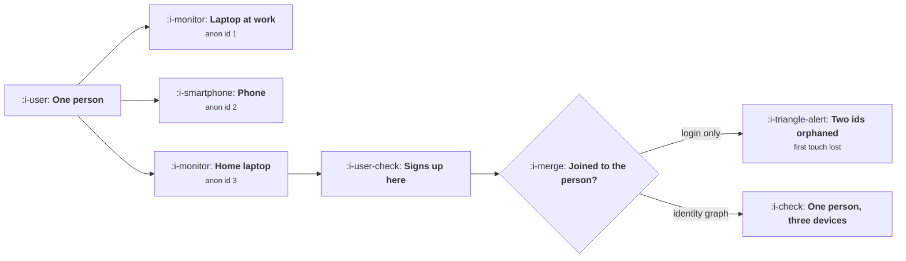

# Identity

```text
Level: Advanced
Prerequisites: Designing an Event Taxonomy
Estimated difficulty: 4/5 | Estimated time: 40 min
```

## The idea in one minute

A visitor count is a count of browsers, not people, and the gap between the two breaks your two
most quoted numbers. People use 1.53 devices each before they sign up, so ten thousand people
appear as 15,300 visitors and a true 10 percent conversion rate reports as 6.5. Stitching on login
does not fix it, because the inflation happened before anybody logged in. And 42 percent of people
have their first touch credited to the wrong channel, with the error moving credit systematically
away from discovery channels towards the ones people return through. Then for anything sold to a
company there is a second identity entirely, the account, and an event without an account property
cannot be analysed at that level at all.

## A picture



The first touch happened on the laptop at work. Login based stitching never learns that.

## How it really works

### Three identities, not one

**Anonymous.** An identifier per browser or app install, created on first visit. It is the only
identity you have before signup and it is the one every acquisition number is built on.

**User.** A person, known after they authenticate. Stable, durable, and the right unit for
retention and activation.

**Account.** The organisation that pays. The right unit for revenue, churn and expansion in
anything sold to a company, and a completely different population from users.

Most analytics setups handle the first two and treat the third as a lookup table. That is the
mistake that cannot be fixed retrospectively, because an event recorded without an account property
cannot be attributed to an account later if the user has since moved between accounts, which they
do.

### Why login based stitching does not solve the funnel

When somebody signs in, you can join that browser's anonymous history to their user record. That
is correct and necessary and it does nothing for the inflation, because the devices they used
before signing up on this one are never joined.

In the worked model, stitching on login produces the identical visitor count to doing nothing:
15,300. It fixes the post signup picture and leaves the acquisition picture exactly as wrong as it
was.

### What actually joins devices

* **Email links.** A click from an email identifies the recipient on whatever device they opened it
  on. This is the single most valuable deterministic signal available and most products already
  have the mechanism and do not use it for identity.
* **An authenticated session that persists.** Logging in on the phone later joins the phone, and
  the earlier anonymous sessions on it can be back joined if you retained them.
* **A shared link with a token.** An invitation or a share link carries an identifier through
  whatever device opens it.
* **Login on the same provider.** Single sign on makes a device join reliable where it is used.

Note what is not on that list: probabilistic matching on device characteristics. It exists, it
works moderately, and in most jurisdictions it is now a consent question rather than an engineering
one, which is [Consent and What You May Collect](07-consent-and-what-you-may-collect.md).

### Back joining is the part teams forget

Joining a device going forward is easy. The value is in going backwards: when a device is
identified, attributing its prior anonymous events to the person. That requires retaining the
anonymous event history and having a merge operation that rewrites or aliases the identifier.

Every analytics platform has an alias or merge call. Many implementations never make it, or make it
once at signup and never again, which captures a third of the available joining. Make the call
every time an anonymous device becomes identified, not only at registration.

### What gets reported wrongly, specifically

**Visitor counts, inflated by the device multiple.** So every per visitor rate is deflated.

**Conversion rate, deflated by the same factor.** A 10 percent rate reports as 6.5, which is a 35
percent relative understatement, and it makes every channel look worse than it is in a way that
cannot be compared against external benchmarks.

**First touch attribution, wrong for 42 percent of people.** And wrong directionally: the channel
that first introduced somebody is disproportionately the one lost, because discovery happens on a
different device from purchase. This is the mechanism behind a large share of the disagreements in
[Attribution](../acquisition-channels/06-attribution.md).

**Retention, overstated.** If a returning person appears as a new anonymous id, your returning user
count falls and your new user count rises, which flatters acquisition and punishes retention.

### What fills the box in 2026

Third party cookies are effectively gone and first party identifiers have shortened lifetimes under
browser storage policies, with some capped at a few days of inactivity. The consequence is that the
device multiple has gone up rather than down: the same person on the same browser can now generate
several anonymous identifiers over a month. Deterministic joining through email and authenticated
sessions has gone from being the best option to being very nearly the only one, and server side
identity resolution, where the join happens in your own systems rather than in a browser, is now
the standard pattern for anybody who needs the numbers to be right.

## Run the numbers

Compute the device multiple, then watch it move your headline figures.

```go
// identity.go: what unstitched identities do to your two most quoted numbers.
package main

import "fmt"

// One person can arrive on several devices before they ever sign in. Each
// device is a separate anonymous identifier, so a visitor count is a count of
// browsers and a conversion rate has browsers in its denominator.
var devices = []struct {
	n     float64 // devices this person uses before signing up
	share float64
}{
	{1, 0.58}, {2, 0.31}, {3, 0.11},
}

type strategy struct {
	name     string
	stitched float64 // share of extra devices correctly joined to the person
}

func avgDevices() float64 {
	t := 0.0
	for _, d := range devices {
		t += d.n * d.share
	}
	return t
}

func main() {
	const (
		people  = 10_000.0
		signups = 1_000.0
	)
	trueConv := signups / people
	fmt.Printf("%.0f people visit, %.0f sign up: true conversion %.1f%%\n", people, signups, 100*trueConv)
	fmt.Printf("they use %.2f devices each before signing up\n\n", avgDevices())

	strats := []strategy{
		{"nothing: one id per browser", 0.00},
		{"stitch on login, same device only", 0.00},
		{"stitch on login plus email links", 0.46},
		{"deterministic graph across devices", 0.88},
	}

	fmt.Printf("%-38s %14s %14s %16s\n",
		"strategy", "visitors", "conversion", "understated by")
	for _, s := range strats {
		extra := (avgDevices() - 1) * (1 - s.stitched)
		visitors := people * (1 + extra)
		conv := signups / visitors
		fmt.Printf("%-38s %14.0f %13.1f%% %15.0f%%\n",
			s.name, visitors, 100*conv, 100*(1-conv/trueConv))
	}
	fmt.Println("\nThe first two rows are the same number, which is the point: stitching")
	fmt.Println("on login only joins a device to a person after they signed in on it,")
	fmt.Println("and the inflation happened before that.")

	fmt.Println("\nwhat the same gap does to first touch attribution:")
	fmt.Printf("%-38s %18s %18s\n", "strategy", "first touch right", "credited wrongly")
	for _, s := range strats {
		// a person's real first touch is on a device you joined, or it is lost
		single := devices[0].share
		multi := 1 - single
		right := single + multi*s.stitched
		fmt.Printf("%-38s %17.0f%% %17.0f%%\n", s.name, 100*right, 100*(1-right))
	}
	fmt.Println("\nWith no cross device joining, 42% of people have their first touch")
	fmt.Println("credited to the wrong channel, and the error is not random: it moves")
	fmt.Println("credit from discovery channels to the ones people return through.")

	fmt.Println("\nthe account layer, for anything sold to a company:")
	const (
		users    = 4_200.0
		accounts = 760.0
		payUsers = 390.0
		payAccts = 118.0
	)
	fmt.Printf("%-30s %14s %14s\n", "unit", "population", "conversion")
	fmt.Printf("%-30s %14.0f %13.1f%%\n", "users", users, 100*payUsers/users)
	fmt.Printf("%-30s %14.0f %13.1f%%\n", "accounts", accounts, 100*payAccts/accounts)
	fmt.Printf("%-30s %14.1f %13s\n", "users per account", users/accounts, "")
	fmt.Println("\nThe same business converts at 9% or 16% depending on the unit, and")
	fmt.Println("both are correct. An event without an account property cannot")
	fmt.Println("produce the second number at all, which is why the account id")
	fmt.Println("belongs on every event rather than on a user table somewhere.")
}
```

The first table is the headline. Visitors of 15,300 against 10,000 people, and conversion of 6.5
percent against a true 10. The understated column runs 35, 35, 22 and 6 percent, and the fact that
the first two rows are identical is the most useful line in the lesson: login based stitching, which
is what nearly everybody has, buys nothing on the acquisition funnel.

The attribution table shows the second cost. First touch is correct for 58 percent of people with
no joining, 77 percent with email links, 95 percent with a real graph. The 42 percent error is the
reason channel reports disagree with each other, and it is systematic rather than noisy.

The account table is a different point. The same business converts at 9.3 percent per user and 15.5
percent per account, both correct, answering different questions. The per account figure is the one
a board cares about and the one you cannot produce unless the account identifier is on the events
themselves.

Replace the device distribution with your own, which you can estimate from users who have
authenticated on more than one device in a month. It is a lower bound, because it misses people who
only ever signed in on one of theirs.

## The AI layer

The temptation here is probabilistic identity resolution and it deserves a direct answer.

A model can predict which anonymous identifiers belong to the same person from behavioural and
technical signals, with reasonable accuracy. Three problems make it a poor choice for the uses in
this lesson. The errors are correlated with the thing you are measuring, because people with
unusual device patterns are also unusual users, so the correction biases the population. The
accuracy cannot be validated without ground truth you do not have, since the cases you can check
are the ones already joined deterministically. And in most jurisdictions inferring that two devices
are one person is processing personal data for a purpose the user has not consented to, which makes
it a legal question before it is a technical one.

Where a model genuinely helps is the inverse task: finding the deterministic joins you are not
making. Pointing it at your event stream to identify sessions that should have been aliased and were
not, or email click events that carry an identifier your implementation discards, routinely finds
real gaps and costs nothing. That is the work to do first, and it is usually enough to get the
device multiple down near the deterministic ceiling.

For reporting, if you must correct the visitor count without a graph, do it as a stated adjustment
factor computed from your authenticated multi device population, published alongside the raw
number. An explicit factor somebody can argue with is better than an inferred join nobody can see.

## Sector lens

| Sector | What the identity problem is here |
|---|---|
| [Enterprise B2B SaaS](../../product-management/product-by-sector/01-enterprise-b2b-saas.md) | The account is the unit and users move between accounts. Record the account on the event, not by lookup, or history becomes unreadable |
| [Fintech](../../product-management/product-by-sector/02-fintech.md) | Verified identity is strong and arrives late, so the pre verification funnel is anonymous and the post is unusually clean |
| [Ecommerce and D2C](../../product-management/product-by-sector/03-ecommerce-and-d2c.md) | Guest checkout breaks the person into one identity per order. Email is the only durable join and it is already in your hands |
| [Marketplaces](../../product-management/product-by-sector/04-marketplaces.md) | One human can be both sides, and conflating them corrupts both funnels. Role is a property of a session, not of a person |
| [Devtools and Infra](../../product-management/product-by-sector/05-devtools-and-infrastructure.md) | Identity is an API key, which may be shared by a team or a CI system. Key is not person and treating it as one inflates everything |
| [Healthtech](../../product-management/product-by-sector/06-healthtech-and-regulated-care.md) | Identity is regulated and linking identifiers across contexts may be prohibited. Design the analysis around what you may join |
| [Vertical SaaS](../../product-management/product-by-sector/07-vertical-saas.md) | Shared logins on a shop floor terminal are normal, so the user identity is a location rather than a person. Measure accounts and devices |

## Remember this

* Three identities: anonymous, user and account. Most setups handle two and treat the account as a
  lookup, which cannot be fixed later.
* Put the account identifier on every event. Users move between accounts and lookups then rewrite
  history.
* People use about 1.5 devices before signup, so visitor counts are inflated by half and conversion
  rates deflated by a third.
* Login based stitching produces the same visitor count as doing nothing, because the inflation
  happened before login.
* Email link clicks are the most valuable deterministic join available and most products already
  have the mechanism unused.
* Back join: alias prior anonymous history every time a device becomes identified, not only at
  registration.
* First touch is wrong for 42 percent of people without cross device joining, and wrong
  directionally against discovery channels.
* Unjoined returning people inflate new users and deflate retention, which flatters acquisition.
* Shortened first party storage lifetimes have raised the device multiple, so deterministic server
  side joining is now the only reliable route.
* Use a model to find the deterministic joins you are missing, not to infer identities you cannot
  validate or lawfully assume.

## Try it

1. Estimate your device multiple from users who authenticated on more than one device in a month,
   and run `identity.go` with it. Compare the corrected conversion rate against what you report.
2. Check whether your implementation makes an alias or merge call every time an anonymous device
   becomes identified, or only at signup. Fix it if it is the second.
3. Pick your three most important events and verify that each carries an account identifier in the
   payload rather than relying on a join. Add it where it is missing.

## Check yourself

1. Your reported conversion is 4.8 percent and your users average 1.7 devices before signup. What
   is the likely true figure, and what does that change about your channel comparisons?
2. Why does stitching on login fail to correct the acquisition funnel, when it correctly identifies
   every logged in user?
3. A vendor offers probabilistic cross device matching that would raise your reported conversion by
   a third. Give the two strongest reasons to decline, and what you would do instead.
