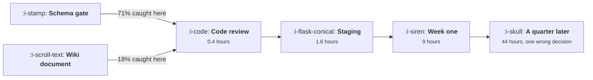

# The Tracking Plan as a Contract

```text
Level: Advanced
Prerequisites: Identity
Estimated difficulty: 3/5 | Estimated time: 35 min
```

## The idea in one minute

An instrumentation defect costs 0.4 hours to fix at code review and 44 hours plus a wrong decision
when it surfaces a quarter later. Where defects get caught is decided entirely by what the tracking
plan is: a document in a wiki catches 18 percent at review and costs 62,109 a quarter, and a schema
enforced in the pipeline catches 71 percent and costs 5,979. The wiki version removes two fifths of
the cost and still costs ten times what enforcement costs, because a plan nobody is required to
read moves defects from production to staging rather than to review. The plan has to be a gate, not
a reference.

## A picture



The same four stages in every company. What differs is the share of defects that never leave the
first box.

## How it really works

### What a tracking plan has to contain

For each event: its name under the grammar, exactly what user action causes it to fire, the
properties with their types and allowed values, whether it is collected client side or server side,
which team owns it, and which questions it exists to answer.

That last field is the one usually missing and the one that makes the plan maintainable, because an
event with no question attached is an event nobody will notice breaking, and it is also the test for
whether the event should exist at all.

### The four stages and why the curve is so steep

**Code review, 0.4 hours.** The engineer who wrote it is still in the context. The fix is a line.

**Staging, 1.6 hours.** Somebody noticed a missing or malformed event in a test environment. A
small amount of investigation, then the same line.

**First week in production, 9 hours.** Somebody noticed a number look wrong, investigated, found the
cause, fixed it, and backfilled or annotated the gap. Plus a 15 percent chance a decision was
already taken on the bad number.

**A quarter later, 44 hours plus a wrong decision.** The number has been in dashboards and reports.
The investigation is archaeology, the fix cannot recover the missing data, and at least one decision
was made on it. This is also where trust damage happens: once a team has been wrong in a review,
every number is questioned for a year.

The steepness is not mostly about engineering time. It is that late defects corrupt decisions, and a
decision made on a wrong number costs more than any amount of instrumentation work.

### Enforcement mechanisms, cheapest first

* **The plan lives next to the code.** A file in the repository, not a page in a wiki. It can then
  be diffed, reviewed and required.
* **New or changed events require a plan change in the same pull request.** This is the single
  highest value rule and it needs no tooling: a review checklist item and a willingness to block.
* **A schema check in continuous integration.** Validate that events fired in tests match the
  declared shape. Catches type changes, missing properties and renames.
* **Runtime validation at the collection point.** Reject or quarantine events that do not match the
  schema, in staging first and production later. This is what takes the catch rate to 71 percent,
  and most analytics platforms support it already.
* **A smoke test for the critical events.** An automated check that the twenty events that matter
  fire in a representative session, run on every deploy.

None of this is expensive. The obstacle is organisational: it means instrumentation can block a
release, which has to be agreed before it is needed rather than during the first incident.

### Who signs it

The plan needs two signatures and both are load bearing. Whoever owns the questions, usually growth
or analytics, signs that the events answer them. Whoever owns the code, engineering, signs that the
events describe what the code does. A plan signed by only the first party is a wish list; signed by
only the second it is documentation of whatever was convenient.

Then one named person owns the plan as a whole, with the authority to refuse an event that does not
fit the grammar. Without that, the catalogue degrades into the ad hoc case from
[Designing an Event Taxonomy](02-designing-an-event-taxonomy.md) regardless of what the document
says.

### What happens when engineering ships without it

Treat it as a defect rather than a process violation, because that framing is both fairer and more
effective. The feature works; the measurement does not. So it goes on the defect list with a
severity, it gets fixed in the next cycle, and the question at the retrospective is why the gate did
not catch it.

The alternative framing, which is to treat it as a failure of discipline, reliably produces events
added quietly to avoid the conversation, which is worse than no plan.

### What fills the box in 2026

Schema registries are standard in analytics and customer data platforms, and the validation they
offer can block, quarantine or merely warn. The default is almost always warn, which produces a
dashboard of violations nobody reads. Moving from warn to quarantine in staging and then in
production is a configuration change with a political cost and no engineering cost, and it is the
single action that moves a company from the third row of the table below to the fourth.

## Run the numbers

Put your own defect rate in and price the four regimes.

```go
// trackingplan.go: what it costs to find an instrumentation defect late.
package main

import "fmt"

// A defect in an event costs almost nothing to fix at review and a great deal
// to fix after decisions have been made on it. Where defects are caught is
// decided by whether the tracking plan is a document or a gate.
type stage struct {
	name  string
	hours float64 // engineering and analyst hours to resolve one defect here
	bad   float64 // decisions made on the wrong number before it was found
}

var stages = []stage{
	{"code review", 0.4, 0.00},
	{"staging check", 1.6, 0.00},
	{"first week in production", 9.0, 0.15},
	{"a quarter later", 44.0, 1.00},
	{"never found", 0.0, 2.40},
}

// where defects end up, by what the tracking plan actually is
type regime struct {
	name  string
	where [5]float64 // share caught at each stage
}

const (
	defects      = 26.0    // instrumentation defects shipped per quarter
	hourCost     = 70.0    // blended cost of an engineering or analyst hour
	decisionCost = 2_400.0 // cost of one decision made on a wrong number
)

func (r regime) cost() (hours, bad, total float64) {
	for i, s := range stages {
		n := defects * r.where[i]
		hours += n * s.hours
		bad += n * s.bad
	}
	return hours, bad, hours*hourCost + bad*decisionCost
}

func main() {
	regimes := []regime{
		{"no plan: events written as needed", [5]float64{0.04, 0.06, 0.22, 0.38, 0.30}},
		{"a plan document in a wiki", [5]float64{0.18, 0.14, 0.31, 0.25, 0.12}},
		{"the plan reviewed on every change", [5]float64{0.46, 0.21, 0.21, 0.09, 0.03}},
		{"schema enforced in the pipeline", [5]float64{0.71, 0.19, 0.08, 0.02, 0.00}},
	}

	fmt.Printf("%.0f defects a quarter, an hour costs %.0f, a wrong decision %.0f\n\n",
		defects, hourCost, decisionCost)
	fmt.Printf("%-38s %8s %8s %8s %8s %8s\n",
		"regime", "review", "staging", "week one", "quarter", "never")
	for _, r := range regimes {
		fmt.Printf("%-38s", r.name)
		for _, w := range r.where {
			fmt.Printf(" %7.0f%%", 100*w)
		}
		fmt.Println()
	}

	fmt.Println("\nwhat each regime costs a quarter:")
	fmt.Printf("%-38s %12s %14s %14s\n", "regime", "hours", "bad decisions", "total")
	var baseline float64
	for i, r := range regimes {
		h, b, t := r.cost()
		if i == len(regimes)-1 {
			baseline = t
		}
		fmt.Printf("%-38s %12.0f %14.1f %14.0f\n", r.name, h, b, t)
	}
	fmt.Printf("\n%-38s %14s\n", "regime", "vs enforced")
	for _, r := range regimes {
		_, _, t := r.cost()
		fmt.Printf("%-38s %13.1fx\n", r.name, t/baseline)
	}

	fmt.Println("\nThe wiki document removes two fifths of the cost and still costs")
	fmt.Println("ten times what enforcement costs. A plan nobody is required to read")
	fmt.Println("moves defects from production to staging, which is the cheap half of")
	fmt.Println("the saving; the expensive half is moving them to review.")

	fmt.Println("\nwhere the cost actually sits, under the wiki regime:")
	w := regimes[1]
	_, _, tot := w.cost()
	fmt.Printf("%-30s %12s %12s %12s\n", "stage", "defects", "cost", "share")
	for i, s := range stages {
		n := defects * w.where[i]
		c := n*s.hours*hourCost + n*s.bad*decisionCost
		fmt.Printf("%-30s %12.1f %12.0f %11.0f%%\n", s.name, n, c, 100*c/tot)
	}
	fmt.Println("\nThe two late stages are 37% of the defects and 86% of the cost.")
	fmt.Println("Everything in this topic is an argument about moving defects from")
	fmt.Println("those two rows into the first one.")
}
```

The first table is where defects get caught under each regime. Read down the "quarter" column: 38,
25, 9 and 2 percent. That column is most of the cost in every row.

The cost table gives the totals: 104,937, 62,109, 23,668 and 5,979 a quarter. The ratios are 17.6,
10.4, 4.0 and 1.0 times. The gap between the second and third rows, between having a document and
reviewing against it, is the largest single step and requires no tooling at all.

The breakdown under the wiki regime is the argument to take to a planning meeting. The two late
stages hold 37 percent of the defects and 86 percent of the cost. Any proposal that moves defects
earlier is worth more than it looks, and any proposal that merely documents them is worth less.

Change `defects` to your own rate, which you can estimate by counting instrumentation fixes in your
issue tracker over two quarters, and `decisionCost` to something defensible for your company. The
ordering of the regimes does not change under any plausible inputs, which is the useful property of
this model.

## The AI layer

Three applications, and the first is the one to build.

Generating the plan entry and the instrumentation code together from a feature diff is a mechanical
task with a clear specification, and it directly addresses the most common defect, which is a
feature shipping with no events. A model reading a pull request and proposing the events it should
fire, checked against the grammar, catches a large share of omissions at review, which is exactly
the stage the cost curve rewards.

Reviewing a pull request against the declared schema is similar and slightly easier: does this
change rename, remove or alter the type of any declared event. This is a lint rule a model can
apply where writing the lint rule would be fiddly, and it costs pennies per review.

Explaining a discrepancy after the fact is the third and is the one to be careful with. A model
given a dashboard anomaly and a deploy log will produce a plausible cause, and plausible is
dangerous here because the investigation is the part that distinguishes a measurement artefact from
a real change in behaviour. Use it to generate candidate explanations to check, never to close the
investigation.

The underlying point is that a model lowers the cost of the gate, which changes the economics of
enforcement rather than replacing it. The reason most companies do not validate schemas is the
effort of writing and maintaining the declarations, and that effort is now small.

## Sector lens

| Sector | What the contract has to cover here |
|---|---|
| [Enterprise B2B SaaS](../../product-management/product-by-sector/01-enterprise-b2b-saas.md) | Account properties on every event, and the rule that a customer specific deployment cannot drift from the plan |
| [Fintech](../../product-management/product-by-sector/02-fintech.md) | Which properties may be collected at all. The plan is also a data protection record and is audited |
| [Ecommerce and D2C](../../product-management/product-by-sector/03-ecommerce-and-d2c.md) | Commerce event schemas are largely standardised by the platform. Adopt the standard rather than inventing one |
| [Marketplaces](../../product-management/product-by-sector/04-marketplaces.md) | A side property on everything, and two client applications that must not diverge. One plan, two implementations |
| [Devtools and Infra](../../product-management/product-by-sector/05-devtools-and-infrastructure.md) | API events are your product's own telemetry, so the plan overlaps with observability. Share the schema rather than duplicating it |
| [Healthtech](../../product-management/product-by-sector/06-healthtech-and-regulated-care.md) | The plan requires governance approval before implementation, so the gate is external and the lead time is weeks |
| [Vertical SaaS](../../product-management/product-by-sector/07-vertical-saas.md) | Small teams, so the plan is one file and the gate is one review. The risk is nobody owning it after the first hire leaves |

## Remember this

* A defect costs 0.4 hours at review and 44 hours plus a wrong decision a quarter later.
* The plan must say what fires the event, the property types and allowed values, where it is
  collected, who owns it, and which question it answers.
* An event with no question attached will not be noticed when it breaks and probably should not
  exist.
* Four regimes cost 17.6, 10.4, 4.0 and 1.0 times. Having a document rather than a gate buys the
  cheap part of the saving.
* The biggest single step, from document to reviewed on every change, needs no tooling, only a
  willingness to block.
* Keep the plan in the repository so it can be diffed and required in the same pull request as the
  code.
* Runtime schema validation takes the catch rate to 71 percent and is usually already available and
  set to warn.
* Two signatures: whoever owns the questions and whoever owns the code. One named owner with the
  authority to refuse an event.
* Treat a missing event as a defect, not a discipline failure, or events get added quietly to avoid
  the conversation.
* A model should generate plan entries and instrumentation from a diff and review changes against
  the schema, which makes enforcement cheap enough to adopt.

## Try it

1. Count instrumentation fixes in your issue tracker over the last two quarters and classify each
   by where it was caught. Run `trackingplan.go` with your real distribution.
2. Move your tracking plan into the repository this week, and add one checklist item to pull request
   review: does this change add or alter an event, and is the plan updated.
3. Find your analytics platform's schema validation setting and check whether it is off, warning or
   enforcing. Propose moving it one step, in staging first.

## Check yourself

1. Why is the step from a wiki document to a reviewed plan worth more than the step from a reviewed
   plan to enforced schemas, when enforcement catches far more defects?
2. An engineer ships a feature with no events. What is the right response, and what is the response
   that makes the problem worse?
3. Your schema validation is set to warn and produces 40 violations a week that nobody reads. What
   do you do first, and what will the objection be?
