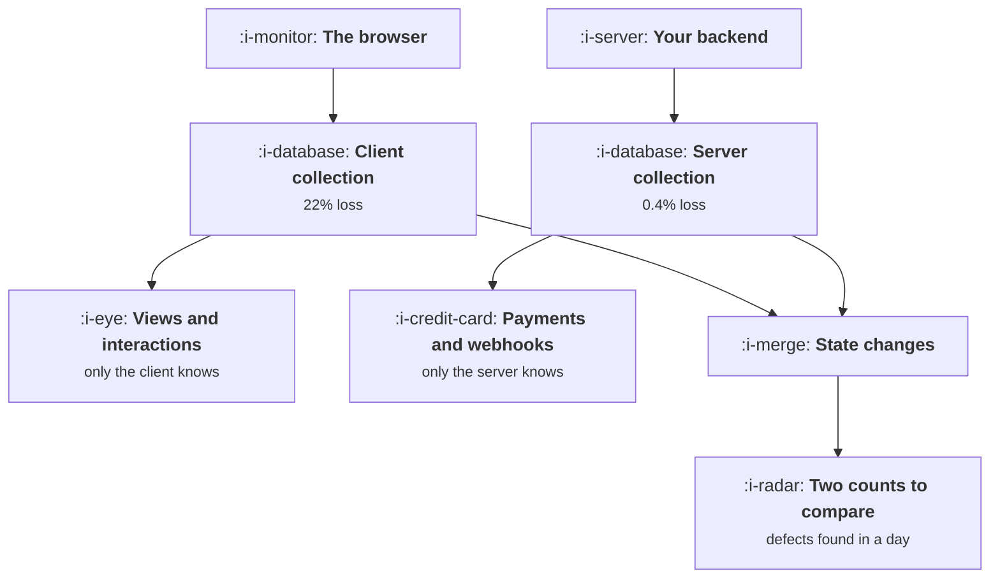

# Client, Server or Both

```text
Level: Advanced
Prerequisites: The Tracking Plan as a Contract
Estimated difficulty: 3/5 | Estimated time: 35 min
```

## The idea in one minute

Neither collection route can answer all your questions and most companies are using one of them by
accident. Client only collection sees 498 million events a month and captures 66 percent of the
events a decision depends on, missing payments entirely. Server only captures 100 percent of those
and is blind to 600 million events about what people looked at and clicked. The right answer is
both, split by what each route can actually see, and then deliberately overlapping the events that
matter so the two counts can be compared. That overlap costs 1,596 a month in the worked case and
turns a five week defect detection time into a one day one.

## A picture



The overlap in the middle is not waste. It is the only cheap monitoring you will get.

## How it really works

### Split by what each route can see

Not by preference, and not by whichever your analytics vendor makes easiest.

**Client only, because the server cannot see it.** Screen and page views, scrolling, interface
interactions, which element was clicked, time on screen, client side errors. These are the majority
of your event volume and none of them exist as far as your backend is concerned.

**Server only, because the client should not be trusted with it.** Payments, subscription changes,
entitlement grants, anything from a third party webhook, anything a determined user could suppress
or forge. Also anything that happens with no user present, such as a scheduled job or a background
sync.

**Both, deliberately.** Object state changes: created, updated, deleted, shared. The server count
is authoritative and the client count is the monitor.

### The loss rates are not comparable

Client side loss runs around a fifth for a general audience, and much higher for technical ones:
blocking extensions, tracking protection, network failure, offline sessions, and users navigating
away before the request completes. Server side loss is a pipeline problem and runs in fractions of
a percent.

That difference is not a reason to abandon client collection, because most of what a client sees
has no server equivalent. It is a reason never to put a decision critical number on a client only
event where a server alternative exists.

### The overlap is your monitoring

This is the part most implementations skip and it is the highest value element in the design. When
the same thing is counted twice by independent routes, their ratio is a health check: it should be
stable, and when it moves, something broke.

Without that, an event that stops firing is detected when somebody notices a chart looks wrong,
which in practice is around five weeks, and that is the 44 hour defect from
[The Tracking Plan as a Contract](04-the-tracking-plan-as-a-contract.md). With it, the ratio alarm
fires the next day.

Only overlap the events that matter. In the worked case that is 38 million of 670 million events,
and the extra cost is under two thousand a month.

### Where the identity problem lands

Server side events know the user and often do not know the anonymous identifier, and client side
events are the reverse. So the join between them is the identity work from
[Identity](03-identity.md), and it has to be done deliberately: pass the anonymous identifier to
the server with authenticated requests and record it on server emitted events, or the two halves
of your funnel cannot be connected.

This is the single most common implementation gap in a dual collection setup, and it is cheap to
fix at design time and awkward afterwards.

### Practical rules

* **One event, one source of truth.** Where both routes see something, declare which one is
  authoritative in the tracking plan and use it everywhere. Two teams reporting from two sources is
  the ambiguity failure under a different name.
* **Never derive revenue from the client.** It is the number most likely to be wrong and most likely
  to be noticed.
* **Server side for anything you will bill or report externally.** Including usage counts for a
  usage based plan, which are a billing input rather than an analytics one.
* **Keep the schemas identical across routes.** Same name, same properties, same allowed values, so
  the comparison is trivial and a migration is possible.
* **Batch and retry on the client.** A meaningful share of client loss is recoverable with a send
  queue that survives navigation, and it is a small amount of work.

### What fills the box in 2026

Server side tagging and collection have become the default recommendation, partly for reliability
and partly because consent and cookie restrictions make the client route less dependable every
year. The tooling is mature and the hosting cost is modest. Two cautions. Moving collection server
side does not change your consent obligations, which attach to the purpose rather than to the
mechanism, and that is the subject of
[Consent and What You May Collect](07-consent-and-what-you-may-collect.md). And a server side
pipeline concentrates risk: one misconfiguration loses everything rather than a fifth of it, so it
needs the monitoring that the overlap provides.

## Run the numbers

Split your event categories by what can see them, then price the three strategies.

```go
// clientserver.go: what each collection route can see, and what it misses.
package main

import "fmt"

// Some things only the browser knows and some things only the server knows.
// Where both can see an event, the server sees it far more reliably, and the
// disagreement between the two is the only cheap way to detect a defect.
type category struct {
	name     string
	volume   float64 // events per month, millions
	client   bool    // the client can see it
	server   bool    // the server can see it
	critical bool    // a decision depends on getting it right
}

const (
	clientLoss = 0.22  // blocked, navigated away, offline, filtered
	serverLoss = 0.004 // dropped in the pipeline
	clientCost = 42.0  // cost per million events collected client side
	serverCost = 58.0  // cost per million, including the engineering to emit them
)

func main() {
	cats := []category{
		{"screen and page views", 420, true, false, false},
		{"interface interactions", 180, true, false, false},
		{"object state changes", 38, true, true, true},
		{"payments and subscription changes", 2, false, true, true},
		{"third party and webhook events", 5, false, true, true},
		{"email opens and clicks", 25, false, true, false},
	}

	fmt.Printf("%-36s %9s %8s %8s %10s\n",
		"category", "per month", "client", "server", "critical")
	for _, c := range cats {
		y := func(b bool) string {
			if b {
				return "yes"
			}
			return "no"
		}
		fmt.Printf("%-36s %8.0fM %8s %8s %10s\n",
			c.name, c.volume, y(c.client), y(c.server), y(c.critical))
	}

	type strategy struct {
		name                 string
		useClient, useServer bool
	}
	strats := []strategy{
		{"client only", true, false},
		{"server only", false, true},
		{"both, overlapping where it matters", true, true},
	}

	fmt.Println("\nwhat each strategy captures:")
	fmt.Printf("%-36s %12s %14s %16s %12s\n",
		"strategy", "captured", "of critical", "blind to", "cost/month")
	for _, s := range strats {
		var got, crit, critTotal, cost, blind float64
		for _, c := range cats {
			critTotal += boolf(c.critical) * c.volume
			onC := c.client && s.useClient
			onS := c.server && s.useServer
			switch {
			case onS:
				got += c.volume * (1 - serverLoss)
				crit += boolf(c.critical) * c.volume * (1 - serverLoss)
				cost += c.volume * serverCost
				if onC {
					// paying twice, to have two counts to compare
					cost += c.volume * clientCost
				}
			case onC:
				got += c.volume * (1 - clientLoss)
				crit += boolf(c.critical) * c.volume * (1 - clientLoss)
				cost += c.volume * clientCost
			default:
				blind += c.volume
			}
		}
		fmt.Printf("%-36s %11.0fM %13.0f%% %15.0fM %12.0f\n",
			s.name, got, 100*crit/critTotal, blind, cost)
	}

	fmt.Println("\nServer only is blind to 600 million events a month, which is every")
	fmt.Println("question about what people looked at and clicked. Client only gets")
	fmt.Println("66% of the events a decision depends on and cannot see payments at")
	fmt.Println("all. Neither is a position anybody chose; both are what a team ends")
	fmt.Println("up with by default, depending on who built the first implementation.")

	fmt.Println("\nthe second reason to collect overlapping events on both sides:")
	fmt.Printf("%-34s %-26s %14s\n", "defect in one route", "detected by", "time to detect")
	rows := []struct {
		what, how string
		days      float64
	}{
		{"client event stops firing", "server comparison", 1},
		{"client event stops firing", "somebody notices a chart", 34},
		{"server event double counts", "client comparison", 1},
		{"server event double counts", "a quarterly review", 61},
	}
	for _, r := range rows {
		fmt.Printf("%-34s %-26s %9.0f days\n", r.what, r.how, r.days)
	}
	fmt.Printf("\nOverlapping the %.0f million state changes costs an extra %.0f a\n",
		cats[2].volume, cats[2].volume*clientCost)
	fmt.Println("month and turns a five week detection time into a one day one. That")
	fmt.Println("is the whole argument for paying twice for the events that matter,")
	fmt.Println("and it is why the third row costs more than the second two combined")
	fmt.Println("would suggest.")
}

func boolf(b bool) float64 {
	if b {
		return 1
	}
	return 0
}
```

The first table is the design exercise and it is worth doing with your own categories, because the
answer is usually obvious once the three columns are filled in and is never written down anywhere.

The strategy table shows the trade. Client only captures 498 million events and 66 percent of the
critical ones, which is the configuration most product analytics implementations arrive at. Server
only captures the critical events perfectly and is blind to 600 million, which is the configuration
a data engineering team arrives at. The costs are 26,796 and 4,060, so the cheap option is also the
one that cannot answer a product question.

Both, with the critical events overlapped, costs 30,856 and has no blind spot. The increment over
client only is 4,060, which is the price of being able to answer a revenue question and detect a
defect in a day.

Put your own volumes and your own measured client loss in. The client loss figure is the one to
measure rather than assume, by the comparison exercise in
[Why Growth Work Dies Without Instrumentation](01-why-growth-work-dies-without-instrumentation.md),
and for a developer audience it is routinely above a third.

## The AI layer

Two things, one operational and one about the events a model powered product produces.

The operational one is monitoring the overlap. The ratio between two independent counts of the same
event is a time series with seasonality, deploy effects and genuine behaviour changes in it, and
distinguishing a defect from a real change is exactly the sort of pattern work a model does well
and a static threshold does badly. This is a small, cheap, high value application and it is the
reason to build the overlap in the first place.

The second is more specific to this decade. A product with a model inside it generates events that
only the server knows: which model served the request, how many tokens it used, what it cost, how
long it took, whether a guardrail fired, whether the output was regenerated. Those are the events
that connect growth to margin, they are the input to
[What These Loops Cost to Run](../ai-in-growth/README.md), and they do not exist on the client at
all.

Treat them as first class events in the tracking plan rather than as logs. The usual failure is
that they live in an observability system with a two week retention and a different identity model,
so no cohort analysis is possible and nobody can answer what an activated user costs. Emit them
with the same user and account identifiers as everything else, into the same warehouse, from day
one.

## Sector lens

| Sector | What forces the split here |
|---|---|
| [Enterprise B2B SaaS](../../product-management/product-by-sector/01-enterprise-b2b-saas.md) | Corporate networks block client collection unevenly, so server side is the only consistent route across customers |
| [Fintech](../../product-management/product-by-sector/02-fintech.md) | Anything touching money or verification is server side by obligation, not by preference |
| [Ecommerce and D2C](../../product-management/product-by-sector/03-ecommerce-and-d2c.md) | Order and payment events server side, browsing client side. The join between them is the whole funnel |
| [Marketplaces](../../product-management/product-by-sector/04-marketplaces.md) | Transactions and payouts server side; two client apps for the browsing half, with separate loss rates |
| [Devtools and Infra](../../product-management/product-by-sector/05-devtools-and-infrastructure.md) | Client loss exceeds a third and much of the product has no client. API side collection is the primary route |
| [Healthtech](../../product-management/product-by-sector/06-healthtech-and-regulated-care.md) | Client analytics may be prohibited in clinical contexts, making server side collection the only lawful route |
| [Vertical SaaS](../../product-management/product-by-sector/07-vertical-saas.md) | Shared devices and poor connectivity on site raise client loss and make offline queueing genuinely important |

## Remember this

* Split by what each route can see, not by preference. Views and interactions are client only;
  payments, webhooks and background jobs are server only.
* Client loss runs around a fifth and much higher for technical audiences. Server loss is fractions
  of a percent.
* Never put a decision critical number on a client only event where a server alternative exists,
  and never derive revenue from the client.
* Overlap the events that matter on purpose. The ratio between two independent counts is your only
  cheap defect monitor.
* Overlap turns a five week detection time into one day and cost under two thousand a month in the
  worked case.
* Client only captures 66 percent of critical events; server only is blind to 600 million
  behavioural events. Both is an increment of 4,060 over client only.
* Pass the anonymous identifier to the server and record it on server emitted events, or the two
  halves of the funnel cannot be joined.
* Declare one authoritative source per event in the plan, and keep schemas identical across routes.
* Server side collection does not change your consent obligations and does concentrate your risk.
* Model serving events are server only and belong in the tracking plan, not in a short retention
  observability system.

## Try it

1. List your event categories and mark which route can see each. The gaps in that table are your
   blind spots, and most teams have never drawn it.
2. Measure your client loss by comparing one client event against an independent server count for a
   week, then run `clientserver.go` with the real figure.
3. Pick your three most decision critical events, emit them from both routes with identical schemas,
   and put a ratio alarm on each.

## Check yourself

1. Which of these belong on the server: a subscription upgrade, a scroll depth, a document shared,
   a webhook from a payment provider, a button click? Say why for each.
2. Why is deliberately collecting the same event twice worth paying for, when the server count is
   authoritative anyway?
3. Your product calls a model on every request and the cost data lives in your observability tool
   with 14 day retention. What question can you not answer, and what do you change?
