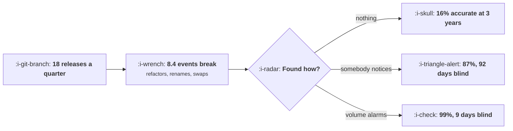

# Data Quality and the Slow Rot

```text
Level: Advanced
Prerequisites: Client, Server or Both
Estimated difficulty: 3/5 | Estimated time: 35 min
```

## The idea in one minute

A clean implementation decays at a steady rate through nobody's fault. At eighteen releases a
quarter and a 0.4 percent chance of breaking any given event per release, 8.4 events of a 120 event
plan break every quarter. With no checking, 16 percent of the plan is still accurate after three
years, and the team stopped believing any of it long before that. Volume alarms hold it at 99
percent, cost less than half of a quarterly hand audit to operate, and leave three and a half times
fewer defects standing, because any control that depends on somebody remembering to run it degrades
on the same curve as the thing it was meant to protect.

## A picture



The breakage rate is not the variable. How much of it you find is.

## How it really works

### The breakage is ordinary

Nothing on this list involves carelessness. A component is replaced and the new one does not call
the tracking function. A handler is moved and the event now fires before the state change rather
than after. An upstream system renames a field and a property arrives empty. A library upgrade
changes when a lifecycle hook runs. A feature flag removal deletes the branch that contained the
event.

Each is a correct change to the product that happens to be an incorrect change to the measurement,
which is why code review catches some of it and never all of it, and why the plan as a gate from
[The Tracking Plan as a Contract](04-the-tracking-plan-as-a-contract.md) is necessary and not
sufficient.

### Rot compounds and trust collapses faster than accuracy

Accuracy declines smoothly: 93, 86, 72, 44, 16 percent over twelve quarters with no checking.
Trust does not decline smoothly. It falls off a cliff the first time a number presented in a review
turns out to be wrong, and after that every number is questioned regardless of whether it is
sound.

The practical consequence is that the cost of rot is not proportional to the share of broken
events. A plan at 87 percent accuracy with no way to tell which 13 percent is broken is worth much
less than 87 percent of a clean plan, because every query now needs a verification step.

### What to alarm on

Six checks, in order of what they catch and how cheap they are.

* **Volume against the same day last week, per event.** Catches an event that stopped firing. The
  single most valuable alarm and the easiest to build.
* **Volume per platform and per app version.** Catches a break in one client while the aggregate
  looks fine, which is the most common way a break hides.
* **Share of events missing a required property.** Catches a renamed or dropped field, which does
  not change volume at all.
* **Share of property values outside the allowed set.** Catches an upstream vocabulary change and a
  free text property creeping in.
* **Client count over server count, for overlapping events.** Catches a break in either route, which
  is the payoff from
  [Client, Server or Both](05-client-server-or-both.md).
* **Events per user per session.** Catches double firing, which is the hardest defect to see and the
  only one that makes a number look better rather than worse, so nobody investigates it.

### Why the hand audit loses

A quarterly audit by hand catches 80 percent of what is currently broken and costs 4,200 a quarter,
which is more than twice what alarms cost to operate, and leaves 2.1 defects standing against 0.6.

It also has a 46 day average blind period, which matters more than the catch rate. A defect found
in nine days affects one sprint's decisions; a defect found in 46 days affects a quarter's.

And audits are skipped. The quarter the team is busy is the quarter the audit does not happen,
which is reliably the quarter with the most releases. An alarm does not have that failure mode,
which is the real argument rather than the cost.

### Treat an event break as a product incident

The organisational half of this. A broken event should raise a ticket with an owner and a severity,
appear in the same place as other defects, and be discussed at the same meeting. If instrumentation
defects live in a separate backlog owned by the analytics team, they are prioritised against each
other rather than against product work, which means they are never urgent.

The team that gets this right usually got it right by having one bad quarter where a decision was
reversed, which is an expensive way to learn it.

### What fills the box in 2026

Anomaly detection on event volumes is available in most analytics platforms and in every data
observability product, and the thresholds are the hard part rather than the detection: a seasonal
product with weekly cycles and release spikes produces enough false alarms on a naive threshold
that the alarms get muted within a month. Budget for tuning, start with your twenty most important
events rather than all of them, and measure alarm precision for the first quarter so that muting is
a decision rather than a drift.

## Run the numbers

Decay the plan under five regimes and price each one with its standing defects included.

```go
// rot.go: how a clean implementation decays, and what each kind of checking
// is worth against it.
package main

import "fmt"

// Events break as a side effect of ordinary work: a refactor moves a handler,
// a component is replaced, a property is renamed upstream. Nothing is
// negligent and the rate is steady, so the only variable is how much of the
// breakage you find.
const (
	events      = 120.0 // events in the tracking plan
	releases    = 18.0  // releases a quarter
	breakPerRel = 0.004 // chance one event breaks in one release
)

type checking struct {
	name    string
	found   float64 // share of currently broken events found each quarter
	days    float64 // typical days from break to detection
	costQtr float64 // cost of running this per quarter
}

func breaksPerQuarter() float64 {
	survive := 1.0
	for i := 0.0; i < releases; i++ {
		survive *= 1 - breakPerRel
	}
	return events * (1 - survive)
}

func main() {
	bpq := breaksPerQuarter()
	fmt.Printf("%.0f events, %.0f releases a quarter: %.1f break every quarter\n\n",
		events, releases, bpq)

	regimes := []checking{
		{"nothing", 0.00, 0, 0},
		{"somebody eventually notices", 0.35, 92, 0},
		{"a quarterly audit by hand", 0.80, 46, 4_200},
		{"volume alarms on every event", 0.93, 9, 1_800},
		{"volume alarms plus route comparison", 0.97, 2, 3_100},
	}

	fmt.Printf("%-38s", "quarter")
	for _, q := range []int{1, 2, 4, 8, 12} {
		fmt.Printf(" %8d", q)
	}
	fmt.Println()
	for _, r := range regimes {
		broken := 0.0
		fmt.Printf("%-38s", r.name)
		for q := 1; q <= 12; q++ {
			broken += bpq
			broken *= 1 - r.found
			for _, s := range []int{1, 2, 4, 8, 12} {
				if q == s {
					fmt.Printf(" %7.0f%%", 100*(events-broken)/events)
				}
			}
		}
		fmt.Println()
	}
	fmt.Println("\nShare of the tracking plan that is still accurate. With nothing,")
	fmt.Println("16% of it is right after three years and the team stopped believing")
	fmt.Println("any of it long before that. Volume alarms hold it at 99%.")

	fmt.Println("\nwhat each regime costs, including the defects it leaves standing:")
	fmt.Printf("%-38s %12s %12s %14s %12s\n",
		"regime", "broken", "days blind", "cost/quarter", "total")
	const defectCost = 1_900.0 // average cost of one broken event per quarter it persists
	for _, r := range regimes {
		broken := 0.0
		for q := 1; q <= 12; q++ {
			broken += bpq
			broken *= 1 - r.found
		}
		total := r.costQtr + broken*defectCost
		fmt.Printf("%-38s %12.1f %12.0f %14.0f %12.0f\n",
			r.name, broken, r.days, r.costQtr, total)
	}

	fmt.Println("\nVolume alarms are the cheapest regime on the total line and the")
	fmt.Println("second cheapest to run. The hand audit costs more than twice as much")
	fmt.Println("to operate and leaves three and a half times as many defects")
	fmt.Println("standing, which is the usual fate of any control that depends on")
	fmt.Println("somebody remembering to do it.")

	fmt.Println("\nwhat to alarm on, and what each catches:")
	rows := []struct{ what, catches string }{
		{"volume against the same day last week", "an event that stopped firing"},
		{"volume per platform and version", "a break in one client only"},
		{"share of events missing a property", "a renamed or dropped field"},
		{"share of property values outside the allowed set", "an upstream vocabulary change"},
		{"client count over server count", "a break in either route"},
		{"events per user per session", "double firing, the hardest to see"},
	}
	for _, r := range rows {
		fmt.Printf("  %-50s %s\n", r.what, r.catches)
	}
	fmt.Println("\nDouble firing is last because it is the only one that makes a")
	fmt.Println("number look better rather than worse, so nobody investigates it.")
}
```

The accuracy table is the shape to internalise. The "nothing" row and the "somebody notices" row
both look acceptable in quarter one, at 93 and 95 percent. They separate completely by quarter
eight. Any judgement about instrumentation health made in the first six months of a product is
uninformative.

The cost table includes standing defects at 1,900 a quarter each, which is a guess and is
conservative relative to the defect costs in lesson 04. Totals of 190,435, 29,304, 8,167, 2,994 and
3,591. Volume alarms win on the total and are second cheapest to operate.

Note that the most thorough regime, alarms plus route comparison, costs slightly more in total than
alarms alone. That is a real result rather than an argument against thoroughness: the extra
detection is worth less than the extra operating cost at this defect rate, and it becomes worth it
as volume or decision stakes rise. Put your own `defectCost` in and the ordering may change, which
is the point of computing it.

Replace `breakPerRel` with your own rate, estimated by counting instrumentation fixes over two
quarters and dividing by events times releases. Teams are usually surprised by how small the per
release number is and how large the annual consequence.

## The AI layer

This is one of the better uses of a model in the whole course, because the task is exactly pattern
recognition over time series with no decision authority.

The job is distinguishing a break from a real change. Event volume falls for many legitimate
reasons: a seasonal dip, a release that removed a surface, a successful onboarding change that
means fewer people reach a step. A static threshold cannot tell those from a defect and generates
the false alarms that get the alarms muted. A model with the release log, the day of week and the
historical pattern can, and it can also explain which it thinks it is, which is what makes the
alert actionable.

Two further uses worth having. Clustering property value distributions to spot an upstream
vocabulary change, which no volume alarm sees. And reading a release diff against the tracking plan
to predict which events are at risk from this deploy, which turns a detection problem into a
prevention one and is the highest value version of this.

The constraint: the model proposes, a human closes. An automatically resolved alarm teaches nobody
and the pattern of what breaks is the most useful thing the system produces, because it points at
the parts of the codebase where instrumentation is fragile. Keep a log of causes and read it
quarterly; it is usually three or four components doing most of the damage.

## Sector lens

| Sector | What rots fastest here |
|---|---|
| [Enterprise B2B SaaS](../../product-management/product-by-sector/01-enterprise-b2b-saas.md) | Customer specific configurations and single tenant deployments drift separately, so aggregate alarms miss per customer breaks |
| [Fintech](../../product-management/product-by-sector/02-fintech.md) | Upstream provider changes rename fields with little notice, so property validation matters more than volume |
| [Ecommerce and D2C](../../product-management/product-by-sector/03-ecommerce-and-d2c.md) | Seasonality defeats naive thresholds entirely. Compare against the same period last year as well as last week |
| [Marketplaces](../../product-management/product-by-sector/04-marketplaces.md) | Two apps released on different cadences, so per platform alarms are not optional |
| [Devtools and Infra](../../product-management/product-by-sector/05-devtools-and-infrastructure.md) | Client library versions persist in the wild for years, so a break affects one version slice and never the aggregate |
| [Healthtech](../../product-management/product-by-sector/06-healthtech-and-regulated-care.md) | Integration standards change on regulatory timelines, and an instrumentation break can also be a reporting obligation failure |
| [Vertical SaaS](../../product-management/product-by-sector/07-vertical-saas.md) | Low volumes make every alarm noisy, so compare weekly totals rather than daily and accept slower detection |

## Remember this

* Events break through ordinary correct changes to the product. The rate is steady and nobody is
  negligent.
* At 18 releases a quarter and 0.4 percent per release, 8.4 of 120 events break each quarter.
* With no checking the plan is 16 percent accurate after three years. Volume alarms hold 99 percent.
* Accuracy declines smoothly and trust collapses at once, the first time a number in a review turns
  out to be wrong.
* Alarm on volume week over week, volume per platform and version, missing properties, out of
  vocabulary values, route ratios, and events per user per session.
* Double firing is the hardest defect to see because it makes numbers look better.
* Hand audits cost more, catch less, and are skipped in exactly the quarters with the most releases.
* Blind days matter as much as catch rate: nine days affects a sprint, 46 affects a quarter.
* Put instrumentation defects in the same backlog as product defects, with owners and severities.
* Use a model to separate a break from a real change and to predict which events a diff puts at
  risk. Keep the log of causes; three or four components will account for most breaks.

## Try it

1. Count instrumentation fixes over two quarters and divide by events times releases to get your
   own break rate. Run `rot.go` with it.
2. Build the single most valuable alarm this week: volume per event against the same day last week,
   on your twenty most important events.
3. Audit ten events by reading the code that fires them and comparing against the plan. The share
   that disagree is your current accuracy, and it is the number that decides how urgent the rest is.

## Check yourself

1. Your plan was verified clean six months ago and nobody has checked since. Roughly what share do
   you expect to be accurate, and which defects will you not have noticed?
2. Why is double firing more dangerous than an event that stops firing, when the second loses all
   the data and the first loses none?
3. Why does a quarterly hand audit lose to automated alarms on both cost and defects, and what is
   the failure mode that the cost comparison does not capture?
