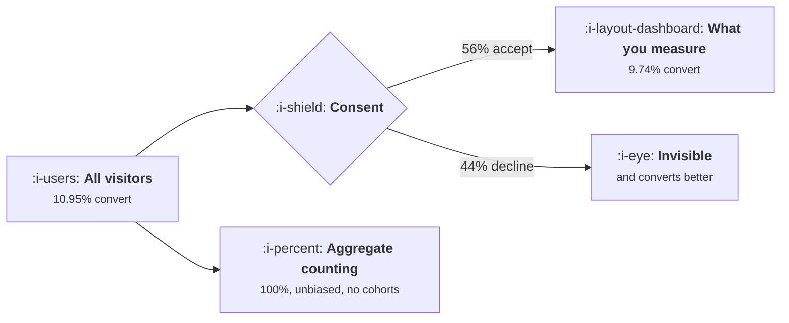

# Consent and What You May Collect

```text
Level: Advanced
Prerequisites: Data Quality and the Slow Rot
Estimated difficulty: 4/5 | Estimated time: 40 min
```

## The idea in one minute

Consent does not shrink your sample evenly, it changes who is in it, and in the direction that
hurts most: the people least likely to consent are often the ones who convert best. A plain opt in
banner shows you 56 percent of visitors and understates conversion by 11 percent. A well designed
one shows 67 percent and understates by 7. The structural answer is to separate purposes, because
counting conversions in aggregate frequently needs no consent at all while building a profile
always does, and to design your aggregates before the retention clock deletes the raw events,
because afterwards there is nothing to compute them from.

## A picture



Two legitimate routes. The left one answers more questions about fewer people, the right one
answers fewer questions about everybody.

## How it really works

### Consent is not a random sample

Three segments in the worked model: indifferent to tracking, who consent at 78 percent and convert
at 9 percent; cautious, 41 and 12; declines by default, 4 and 16.

The correlation is the problem. Privacy awareness tracks with technical sophistication, income and
deliberateness, all of which also track with being a good customer for many products. So the
consented sample is not a scaled down version of your audience, it is a different audience, and
every rate computed from it is biased rather than merely noisy.

Direction matters more than magnitude here: knowing your measured conversion understates the truth
by roughly a tenth is more useful than knowing nothing, and it is also enough to invalidate
comparisons against competitors or benchmarks measured under different consent regimes.

### Separate the purposes, because the legal basis differs by purpose

This is the practical lever and it is usually unused, because teams treat analytics as one thing
that either has consent or does not.

* **Counting visitors and conversions in aggregate**, with no identifiers retained, often requires
  no consent, because there is no personal data being processed. This is the route to an unbiased
  denominator.
* **Measuring a funnel per user** requires consent in most jurisdictions, because it needs an
  identifier that persists.
* **Running an experiment on your own product** is usually defensible under legitimate interest, if
  documented, proportionate and not used to build a profile. This matters enormously because it
  means your experiment platform need not inherit your analytics consent rate.
* **Building a profile for advertising** requires explicit consent, always.
* **Sharing identifiers with a third party** requires explicit consent naming the party.
* **Retaining raw events for years** requires a retention justification per purpose, not a blanket
  policy.

Getting this right typically recovers a large part of your measurement coverage without changing
your banner at all, and it is a conversation with whoever owns data protection rather than an
engineering project.

### Server side collection changes nothing legally

Worth stating plainly because it is widely misunderstood. Consent obligations attach to the purpose
and to the personal data, not to where the code runs. Moving collection server side improves
reliability, as in
[Client, Server or Both](05-client-server-or-both.md), and does not create a basis you did not
have. A server side implementation that ignores a withdrawn consent is a worse problem than a
client side one, because it is less visible.

### Design the banner honestly, which also performs better

A banner with a prominent accept and a buried reject is both a compliance risk in several
jurisdictions and a worse instrument, because the consent it collects is low quality and more likely
to be withdrawn. Equal prominence for accept and reject, a short plain explanation of what you
actually do, and granular purposes rather than one switch, is the design that holds up and it
reliably raises genuine consent among the cautious segment, which is the segment with the most room
to move.

The worked uplift of 0.25, which closes a quarter of the gap to full consent, takes coverage from 56
to 67 percent and halves the bias.

### Retention is the constraint people discover too late

A retention limit on raw events is normal and defensible. The consequence is arithmetic: a twelve
month retention curve needs more than twelve months of history, so fourteen months of raw retention
gives you exactly two monthly cohorts to look at.

The design that makes a short raw retention survivable: decide which aggregates you will need,
compute them continuously, and retain those instead. Cohort retention tables, funnel counts by
week, and activation rates by cohort and channel can all be kept as aggregates far longer than the
events they came from, because they are no longer personal data.

This has to be decided in advance. Once the raw events are deleted, the aggregate you did not think
of cannot be computed, and that is the single most common regret in this area.

### What fills the box in 2026

Enforcement has moved from banner design to the actual behaviour behind it, with regulators in
multiple jurisdictions issuing decisions about tracking that continues after a refusal and about
consent that is not genuinely free. Separately, consent management platforms now handle purpose
level signalling and downstream suppression reasonably well, which makes the purpose separation
above practical rather than theoretical. The specifics vary by jurisdiction and change; the
structural advice that does not change is to separate purposes, document the basis for each, and
design your aggregates early.

## Run the numbers

Measure the bias, not just the coverage.

```go
// consent.go: how much of the funnel you may measure, and how wrong the part
// you can see is.
package main

import "fmt"

// Consent is not granted at random. People who decline tracking differ from
// people who accept it, in ways that correlate with how they use products, so
// a consented sample is biased as well as small.
type segment struct {
	name    string
	share   float64 // share of visitors
	consent float64 // chance of consenting under a plain opt in banner
	conv    float64 // their true conversion rate
}

var segs = []segment{
	{"indifferent to tracking", 0.55, 0.78, 0.090},
	{"cautious", 0.30, 0.41, 0.120},
	{"declines by default", 0.15, 0.04, 0.160},
}

func trueConv() float64 {
	t := 0.0
	for _, s := range segs {
		t += s.share * s.conv
	}
	return t
}

// What the consented sample reports. A better banner or a lawful opt out
// basis closes some share of the gap between a segment's consent rate and
// one, so it helps the reluctant segments most.
func measured(uplift float64) (coverage, conv float64) {
	var num, den float64
	for _, s := range segs {
		c := s.consent + (1-s.consent)*uplift
		den += s.share * c
		num += s.share * c * s.conv
	}
	return den, num / den
}

func main() {
	fmt.Printf("true conversion across everybody: %.2f%%\n\n", 100*trueConv())
	fmt.Printf("%-30s %9s %10s %10s\n", "segment", "share", "consents", "converts")
	for _, s := range segs {
		fmt.Printf("%-30s %8.0f%% %9.0f%% %9.1f%%\n",
			s.name, 100*s.share, 100*s.consent, 100*s.conv)
	}
	fmt.Println("\nThe people least likely to consent convert best, which is the whole")
	fmt.Println("problem: the sample you may measure is not a small version of your")
	fmt.Println("audience, it is a different audience.")

	regimes := []struct {
		name   string
		uplift float64
		on     bool
	}{
		{"no banner, nothing collected", 0.00, false},
		{"plain opt in banner", 0.00, true},
		{"well designed opt in banner", 0.25, true},
		{"opt out, where lawful", 0.70, true},
		{"aggregate measurement, no identifiers", 1.00, true},
	}

	fmt.Println("\nwhat each regime lets you see:")
	fmt.Printf("%-40s %12s %14s %14s\n",
		"regime", "coverage", "measured conv", "understated by")
	for _, r := range regimes {
		if !r.on {
			fmt.Printf("%-40s %11.0f%% %14s %14s\n", r.name, 0.0, "nothing", "all of it")
			continue
		}
		cov, c := measured(r.uplift)
		fmt.Printf("%-40s %11.0f%% %13.2f%% %13.0f%%\n",
			r.name, 100*cov, 100*c, 100*(1-c/trueConv()))
	}

	fmt.Println("\nA plain opt in banner shows you 56% of visitors and understates")
	fmt.Println("conversion by 11%. A better banner shows you 67% and understates by")
	fmt.Println("7%. An opt out basis, where it is lawful, shows 87% and understates")
	fmt.Println("by 2%. Aggregate measurement with no identifiers sees everybody and")
	fmt.Println("is unbiased, and it cannot do cohorts, funnels or experiments.")

	fmt.Println("\nwhat each purpose actually needs:")
	rows := []struct{ purpose, basis string }{
		{"count visitors and conversions in aggregate", "often no consent, if no identifiers are kept"},
		{"measure a funnel per user", "consent, in most jurisdictions"},
		{"run an experiment on your own product", "usually legitimate interest, document it"},
		{"build a profile to target advertising", "explicit consent, always"},
		{"share identifiers with a third party", "explicit consent, named party"},
		{"keep raw events for three years", "a retention justification, per purpose"},
	}
	for _, r := range rows {
		fmt.Printf("  %-46s %s\n", r.purpose, r.basis)
	}

	fmt.Println("\nwhat a retention limit costs a cohort analysis:")
	fmt.Printf("%-22s %22s  %s\n",
		"raw event retention", "monthly cohorts with a", "can you answer")
	fmt.Printf("%-22s %22s\n", "", "full year of history")
	for _, m := range []float64{3, 14, 26, 38} {
		cohorts := m - 12
		if cohorts < 0 {
			cohorts = 0
		}
		ans := "annual retention, yes"
		if m < 14 {
			ans = "no twelve month retention curve at all"
		}
		fmt.Printf("%19.0fm %22.0f  %s\n", m, cohorts, ans)
	}
	fmt.Println("\nA fourteen month retention gives you two monthly cohorts with a")
	fmt.Println("full year of history. Aggregated derivatives can be kept longer")
	fmt.Println("than the raw events, and that is the design that makes a short raw")
	fmt.Println("retention survivable: decide which aggregates you will need before")
	fmt.Println("the raw data is deleted, because afterwards is too late.")
}
```

The segment table is the input to argue about. The share and consent columns you can measure. The
conversion column for people who declined is the one you cannot, by construction, which is the
central difficulty: the bias is unmeasurable from the data that produced it. Estimate it from a
period before consent was required, from a jurisdiction with a different regime, or from an
aggregate count that includes everybody.

The regime table shows coverage of 56, 67, 87 and 100 percent and understatement of 11, 7, 2 and 0.
The last row is the useful one to have in your head: an aggregate count with no identifiers sees
everybody and is unbiased, and it cannot do cohorts, funnels or experiments. So the right
architecture is usually both, with the aggregate count serving as the unbiased denominator and the
consented detail serving the questions that need a user.

The purposes list is the thing to take to your data protection colleague. Most teams have one
consent decision covering all six rows, which is both more restrictive than necessary and less
defensible than it looks.

The retention table is the planning exercise. Put your own retention period in and count the
cohorts you can actually read.

## The AI layer

Three points, and the first is a genuine conflict worth naming rather than smoothing over.

Training or fine tuning on user data is a distinct purpose from measuring your product, needs its
own basis, and in most frameworks needs explicit consent if the data is personal. A consent for
analytics does not cover it. This catches teams by surprise because the data is already in the
warehouse and using it feels like a technical decision; it is not, and retrofitting consent is not
possible.

Second, inference can recreate what consent removed, and that is not a loophole. Predicting a
declining user's attributes, or modelling the behaviour of the unconsented population from the
consented one, is processing personal data for a new purpose, and a model that reconstructs what
somebody declined to share is the clearest version of the problem rather than a clever route around
it. The defensible use of modelling here is aggregate correction with the method documented and the
uncertainty stated, not per user reconstruction.

Third, and more usefully, a model with your tracking plan and your consent configuration is good at
finding the inconsistencies: events collected under a purpose the banner does not mention,
identifiers flowing to a destination not named in the consent, retention exceeding what is
declared. That is a compliance audit of a kind nobody enjoys doing by hand, it costs very little,
and it finds real problems. Run it before a regulator does.

## Sector lens

| Sector | What governs collection here |
|---|---|
| [Enterprise B2B SaaS](../../product-management/product-by-sector/01-enterprise-b2b-saas.md) | Your customer is the controller and you are often the processor, so the contract decides what you may do with their users' data |
| [Fintech](../../product-management/product-by-sector/02-fintech.md) | Financial data is special category in effect, retention is mandated upwards rather than limited, and the two obligations conflict |
| [Ecommerce and D2C](../../product-management/product-by-sector/03-ecommerce-and-d2c.md) | Advertising purposes dominate and need the strictest basis, so separating measurement from marketing consent is worth real money |
| [Marketplaces](../../product-management/product-by-sector/04-marketplaces.md) | Two sides with different relationships to you, and supply side data is often commercial rather than personal |
| [Devtools and Infra](../../product-management/product-by-sector/05-devtools-and-infrastructure.md) | Your users decline at the highest rate of any audience and will inspect your network requests. Transparency is a product feature here |
| [Healthtech](../../product-management/product-by-sector/06-healthtech-and-regulated-care.md) | Health data is special category, consent is not usually the basis, and analytics on clinical records may be prohibited outright |
| [Vertical SaaS](../../product-management/product-by-sector/07-vertical-saas.md) | Sector specific rules often apply on top of general data protection, and customers will ask about them in procurement |

## Remember this

* Consent changes who is in your sample, not just how many. The least consenting segment often
  converts best.
* A plain opt in banner gives 56 percent coverage and an 11 percent understatement; a well designed
  one gives 67 and 7.
* The bias is unmeasurable from consented data. Estimate it from an aggregate count, an earlier
  period, or another jurisdiction.
* Separate the purposes. Aggregate counting often needs no consent; per user funnels do; profiling
  for advertising always does.
* Experimenting on your own product is usually defensible under legitimate interest, so your
  experiment platform need not inherit your analytics consent rate.
* Server side collection changes reliability and not your legal basis, and makes ignoring a
  withdrawal less visible.
* Equal prominence for accept and reject raises genuine consent in the segment with the most room
  to move.
* Twelve month retention curves need more than twelve months of raw history. Fourteen months gives
  you two cohorts.
* Decide which aggregates you need before retention deletes the events. Afterwards there is nothing
  to compute them from.
* Training on user data is a separate purpose needing its own basis, and reconstructing declined
  data by inference is the problem rather than a way round it.

## Try it

1. Estimate your consent rate by segment, and your conversion rate from an aggregate source that
   includes non consenters. The gap between that and your consented figure is your bias.
2. Write the six purposes out with the basis you currently rely on for each, and take the list to
   whoever owns data protection. Expect to find you are more restricted than you need to be in two
   places and less covered than you think in one.
3. Compute how many monthly cohorts with twelve months of history your current retention allows,
   then list the aggregates you would need if retention halved.

## Check yourself

1. Your consent rate rose from 54 to 71 percent after a banner redesign and measured conversion
   rose slightly. What are the two explanations, and how would you tell them apart?
2. Why does moving your analytics collection to your own servers not change what you are allowed to
   collect?
3. Your legal team sets raw event retention at six months. What can you no longer answer, and what
   do you build before the policy takes effect?
