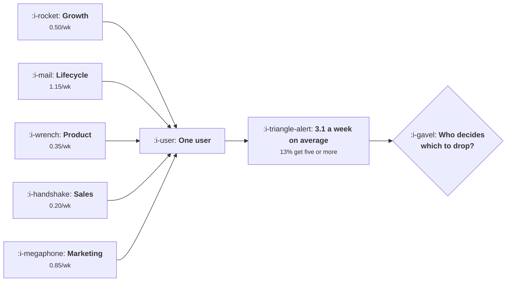

# The Message Map

```text
Level: Intermediate
Prerequisites: What Not to Send
Estimated difficulty: 3/5 | Estimated time: 35 min
```

## The idea in one minute

A message map is usually drawn as a grid of segments and stages, and that drawing hides the only
thing that matters, which is how many messages one person gets. Ten triggers, each owned by a
different team and each firing at a modest rate nobody would object to, produce an average of 3.1
messages a week and send five or more to 13 percent of users. No team can see that from its own
dashboard, because each dashboard shows one row of the map. The map has to be built per user rather
than per campaign, and it needs a single owner who holds a cap, because the question a cap forces is
which messages to drop, and that question has no answer inside any one team.

## A picture



Five teams with five reasonable rates and one recipient. Every arrow is defensible and the sum is
not.

## How it really works

### Build the map per user, not per campaign

The conventional map has stages across the top and segments down the side, with a message in each
cell. It is a useful inventory and it answers the wrong question, because a single user occupies
several cells at once: they are a new user and a trial user and a team admin and somebody who just
hit a limit.

The map that matters has one row per user and one column per week, and the cell contains the count.
Build it from your actual send logs for a representative month. Most teams have never produced this
view, and the first time they do, the distribution is a surprise rather than a confirmation.

### The arithmetic of independently reasonable rates

Each trigger fires at some probability per user per week. Those probabilities add to an expected
count, and the distribution around that count is what produces the complaints.

The convolution in the program below is the honest calculation, and it makes no assumption the
teams have not already made: it treats the triggers as independent, which is what you are
implicitly assuming when each team sets its own rate without reference to the others.

In the worked case: 3.1 expected, 32 percent of users get exactly three, 36 percent get four or
more, and 13 percent get five or more. The heaviest recipients are not a fringe. They are a
seventh of your users, and they are disproportionately your most engaged ones, because engagement
is what most triggers key off.

### Why the overlap lands on your best users

This is the part worth dwelling on. Triggers fire on activity: a user who creates things trips the
feature discovery message, the usage limit warning and the upgrade prompt. A dormant user trips
almost nothing except the re engagement message.

So the message load is positively correlated with engagement, which means your messaging programme
applies the most pressure to the users with the most to lose, and the opt outs it generates are
disproportionately valuable ones. A programme that looks fine on average opt out rate can be
removing exactly the wrong people, and the only way to see it is to cross the per user message
count with a value segment.

### A cap, and then the hard question

A cap of three per user per week suppresses about a sixth of the queue in the worked case, and all
of that suppression lands on the 36 percent of users who were receiving four or more. That is the
easy part.

The hard part is which messages get dropped, and this is where ownership becomes unavoidable.
Without a decision rule the answer is determined by job scheduling: whichever system runs first
spends the budget. That is the worst possible allocation, because it is uncorrelated with value.

Three rules that work, in order of preference. Rank by net value per send, which is the table in
[What Not to Send](../engagement-and-resurrection/06-what-not-to-send.md), and fill the cap from
the top. Reserve slots by category, typically one transactional, one triggered and one
discretionary, which is cruder and much easier to agree. Or give each team a quota and let them
choose within it, which is the most politically achievable and the least efficient.

### What the owner owns

One person or team should own the per user message budget, and the authority has to be real: they
can suppress another team's send. That is an uncomfortable arrangement and the alternative is the
scheduler deciding, so the discomfort is the price. The owner's accountability is for the three
numbers from
[Habits Without Dark Patterns](../engagement-and-resurrection/03-habits-without-dark-patterns.md):
reachability retained, opt outs per period, and value per unit of reachability spent.

### What fills the box in 2026

Customer engagement platforms all support frequency capping and most teams have it switched off or
set per channel rather than per user, which defeats it: a user capped at three emails and three
pushes receives six messages. Set the cap across channels, which usually requires treating the
platforms as one system and is the single highest value configuration change available in this
topic.

The other development worth knowing is that these platforms increasingly offer send time and
channel optimisation driven by a model. That is genuinely useful for the messages you have decided
to send and it does nothing about how many there are, and it is frequently sold as if it did.

## Run the numbers

Add up your own triggers and look at the distribution rather than the average.

```go
// messagemap.go: what a map of independently sensible triggers adds up to.
package main

import (
	"fmt"
	"math"
)

// Each team owns a trigger that fires at its own modest rate. Nobody owns the
// sum, so the number of messages a single user receives in a week is a
// distribution nobody has looked at.
type trigger struct {
	owner string
	name  string
	rate  float64 // chance this fires for a given user in a given week
}

// probability of exactly k of the triggers firing, by convolution: no
// independence assumptions beyond the ones the teams already made
func distribution(ts []trigger) []float64 {
	d := []float64{1}
	for _, t := range ts {
		next := make([]float64, len(d)+1)
		for k, p := range d {
			next[k] += p * (1 - t.rate)
			next[k+1] += p * t.rate
		}
		d = next
	}
	return d
}

func main() {
	ts := []trigger{
		{"growth", "onboarding nudge", 0.30},
		{"growth", "feature discovery", 0.20},
		{"lifecycle", "weekly summary", 1.00},
		{"lifecycle", "re engagement", 0.15},
		{"product", "release note", 0.25},
		{"product", "usage limit warning", 0.10},
		{"sales", "upgrade prompt", 0.20},
		{"support", "satisfaction survey", 0.08},
		{"marketing", "webinar invite", 0.35},
		{"marketing", "content newsletter", 0.50},
	}

	fmt.Printf("%-12s %-26s %10s\n", "owner", "trigger", "per week")
	total := 0.0
	for _, t := range ts {
		total += t.rate
		fmt.Printf("%-12s %-26s %9.2f\n", t.owner, t.name, t.rate)
	}
	fmt.Printf("%-12s %-26s %9.2f\n", "", "expected messages/week", total)

	d := distribution(ts)
	fmt.Println("\nwhat one user actually receives in a week:")
	fmt.Printf("%-12s %14s %14s\n", "messages", "share of users", "at least this")
	tail := 1.0
	for k, p := range d {
		if k > 7 {
			break
		}
		fmt.Printf("%12d %13.1f%% %13.1f%%\n", k, 100*p, 100*tail)
		tail -= p
	}

	over := 0.0
	for k, p := range d {
		if k >= 5 {
			over += p
		}
	}
	fmt.Printf("\n%.0f%% of users get five or more messages in a week, which no team\n", 100*over)
	fmt.Println("intended and no team can see from its own dashboard.")

	fmt.Println("\nthe same ten triggers under a cap of three per user per week:")
	kept, capped := 0.0, 0.0
	for k, p := range d {
		kept += p * math.Min(float64(k), 3)
		capped += p * math.Max(float64(k)-3, 0)
	}
	fmt.Printf("delivered: %.2f per user per week\n", kept)
	fmt.Printf("suppressed: %.2f per user per week (%.0f%% of the queue)\n",
		capped, 100*capped/total)
	fmt.Println("\nA cap of three suppresses a sixth of the queue, and the suppression")
	fmt.Println("lands entirely on the 36% of users who were already getting the most.")
	fmt.Println("Which sixth gets dropped is the whole question, and it has to be")
	fmt.Println("answered by one owner rather than by whichever job runs first.")
}
```

The first table is an inventory nobody would reject. The highest single rate is a weekly summary at
one a week and everything else is between 0.08 and 0.5, which is to say every team is being
reasonable.

The second table is what that reasonableness produces. The "at least this" column is the one to
read in a meeting: 67.9 percent of users get three or more, 35.9 percent get four or more, 13.1
percent get five or more. The team that proposes an eleventh trigger at 0.2 per week is proposing to
move about 3 percent of users into the five plus bucket, and now that sentence can be said with a
number attached.

The cap figures show the shape of the trade: delivering 2.60 per user per week against a queue of
3.13, so a sixth is suppressed. The suppression is concentrated rather than spread, which is the
right property, because the users who were getting one message a week are unaffected.

Put your own triggers in from your send logs rather than from your campaign documentation. The two
usually disagree, and the logs are right.

## The AI layer

The useful application is allocation, and it is a genuinely good fit.

Deciding which three of the five eligible messages this particular user should receive this week is
a ranking problem with a small candidate set, per user features you already have, and a clear
objective. It is the same shape as the contextual prompt selection in
[Checklists and Tours](../activation-and-onboarding/06-checklists-and-tours.md), and it converts a
crude category reservation into something closer to value ranked allocation at a cost of fractions
of a penny per user per week.

Two requirements before it is safe. The candidate set has to be generated by deterministic
eligibility rules, so the model is choosing among messages that are all legitimate rather than
inventing reasons to contact somebody. And the cap has to be enforced outside the model, because a
ranking model asked to choose the best three will reliably find three worth sending even in a week
when nothing happened.

The failure mode here is subtle and worth naming: a model optimising per message engagement will
learn to allocate the most messages to the most responsive users, which is exactly the
concentration problem described above, amplified. Constrain it on per user volume, not just on
total volume, and check the distribution of messages per user by value segment after any change to
the allocation logic.

## Sector lens

| Sector | What the map has to account for here |
|---|---|
| [Enterprise B2B SaaS](../../product-management/product-by-sector/01-enterprise-b2b-saas.md) | Several people in one account each receive their own stream, and the account experiences the sum. Cap per account as well as per user |
| [Fintech](../../product-management/product-by-sector/02-fintech.md) | Regulatory and transactional messages are uncappable, so the discretionary budget is whatever is left after they are counted |
| [Ecommerce and D2C](../../product-management/product-by-sector/03-ecommerce-and-d2c.md) | Promotional cadence is the business model, so caps are higher and the distribution tail is where the unsubscribes come from |
| [Marketplaces](../../product-management/product-by-sector/04-marketplaces.md) | Two maps with different tolerances. Supply side operational messages should not share a budget with demand side promotion |
| [Devtools and Infra](../../product-management/product-by-sector/05-devtools-and-infrastructure.md) | Alerts share an inbox with marketing. Separate the domains so that a capped marketing programme cannot affect alert delivery |
| [Healthtech](../../product-management/product-by-sector/06-healthtech-and-regulated-care.md) | Clinical messages take absolute priority and must never be displaced by a cap. Put them outside the budget entirely |
| [Vertical SaaS](../../product-management/product-by-sector/07-vertical-saas.md) | Few enough customers that the map can be reviewed by hand, and small enough markets that overlap is noticed and discussed |

## Remember this

* The map that matters is per user per week, not per segment per stage. Build it from send logs.
* Ten modest triggers produce 3.1 messages a week and send five or more to 13 percent of users.
* Compute the distribution by convolution, not the average. The average conceals the recipients who
  complain.
* Message load correlates with engagement, so the pressure lands on your most valuable users and the
  opt outs are the expensive ones.
* Cap across channels, not per channel. A per channel cap doubles the real limit.
* A cap forces the question of which messages to drop, and without a rule the job scheduler decides.
* Rank by net value, reserve by category, or allocate quotas, in that order of preference.
* One owner must be able to suppress another team's send, and should be accountable for
  reachability, opt outs and value per unit spent.
* A model is well suited to allocation within a cap, and must not be allowed to set the cap or
  generate the candidates.

## Try it

1. Build the per user per week message count for one month from your send logs, and produce the
   distribution. Note the share of users above four.
2. Cross that count with a value segment. If your top value decile receives more messages than the
   median, you have found the result that matters most in this lesson.
3. Check whether your frequency cap is set per channel or per user across channels. If it is per
   channel, compute the real maximum a user can receive.

## Check yourself

1. Six triggers fire at 0.4, 0.3, 0.25, 0.2, 0.15 and 1.0 per user per week. What is the expected
   count, and why is that number insufficient for setting a cap?
2. Why does a messaging programme tend to apply the most pressure to its most engaged users, and
   what does that do to the value of the opt outs it generates?
3. Your cap is three emails and three push notifications per week. A user complains about being
   messaged constantly. What is the most likely configuration error?
