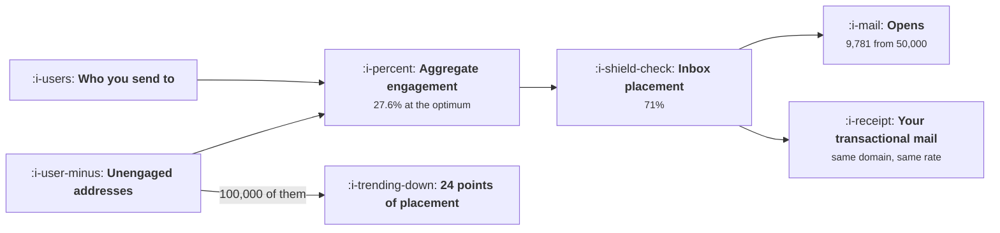

# Email That Is Not Ignored

```text
Level: Intermediate
Prerequisites: The Message Map
Estimated difficulty: 3/5 | Estimated time: 35 min
```

## The idea in one minute

Email's binding constraint is not writing and it is not design, it is placement, and placement is
decided by how your recipients have treated your mail rather than by anything in the message.
Because the decision is made on your sending domain as a whole, people who ignore you tax the
people who do not: sending to a 200,000 address list delivers 7,658 opens, and sending to the
50,000 who have opened something in the last quarter delivers 9,781. The curve has an interior
maximum, so pruning too far loses as well. List hygiene is therefore an arithmetic problem with a
computable answer, and the cost of getting it wrong lands on your receipts and password resets as
well as on your campaigns.

## A picture



Placement is one number for the whole domain, which is why the bottom left box damages the box on
the right.

## How it really works

### Placement is a verdict on your recipients, not your content

Mailbox providers infer wanted from behaviour: opens, replies, moves out of spam, deletions without
reading, complaints. Those signals are aggregated at the sending domain and subdomain level, which
means your mail is judged as a body of work.

The practical implication is counter intuitive for anybody used to thinking in campaign terms.
Improving a subject line changes the engagement of one send. Removing an unengaged segment changes
the placement of every send, including the ones you have no control over, which is why it is the
higher leverage action by a wide margin.

### The interior maximum

Opens are the product of three things: how many people you send to, what share of that mail lands in
the inbox, and how likely each recipient is to open mail that lands. Expanding the list raises the
first and lowers the second.

The worked example has four segments and the best policy is the third one: send to the 50,000 who
opened in the last quarter. Sending to everybody delivers 22 percent fewer opens from four times the
volume. Sending only to the most engaged 20,000 also delivers fewer, because placement is capped near
the top and you have discarded reachable people for nothing.

So the answer is neither "send to everybody" nor "send only to your best", and both of those are
positions people hold. It is a computation, and it moves as your segments change, so it needs
redoing quarterly.

### Subdomain separation is the other half

Since the verdict attaches to the sending domain, separate the mail that must arrive from the mail
you would like to arrive. Transactional mail on one subdomain, lifecycle and marketing on another.
Then a marketing programme that damages its own reputation does not take your password resets with
it.

This is a one off piece of infrastructure work, it requires authentication records to be set up
correctly for each subdomain, and it is the single most valuable thing on this list for a product
whose transactional mail matters. Do it before optimising anything.

### Re engagement before removal, with a hard stop

Addresses that have gone quiet get one short sequence, two or three messages over a few weeks, with
a single clear question. Whoever does not respond is suppressed from marketing permanently. Keep
them for transactional mail, which they will still receive and may still open, and which is why
suppression is not deletion.

The hard stop matters because a re engagement campaign sent repeatedly to the same unresponsive
list is exactly the behaviour that caused the problem. One attempt, then suppression.

### What still works in the message itself

Short list, because the mechanism side above dominates and the content side is mostly folklore.

* **A real sender.** From a person at your company, replies monitored. Replies are among the
  strongest positive placement signals there are.
* **Plain text or near it.** Fewer images, fewer tracking artefacts, no heavy template. Deliverability
  and comprehension both improve.
* **One subject, one action.** A message with three asks is a message with no action.
* **A visible unsubscribe.** Hiding it produces complaints, and a complaint costs far more in
  placement than an unsubscribe does.
* **Send because something happened.** The materiality test from
  [What Not to Send](../engagement-and-resurrection/06-what-not-to-send.md), which is the same rule
  arriving through the deliverability door.

### What fills the box in 2026

Authentication is now mandatory in practice rather than advisory: the major providers require
sender authentication and a working unsubscribe mechanism for bulk senders, and enforce complaint
rate thresholds. Falling foul of those is not a gradual reputation decline, it is bulk mail being
rejected. Separately, opens have become a less reliable signal than they were, because privacy
features in mail clients prefetch images and fire open events without a human reading anything, so
build your engagement segments on clicks and replies where you can and treat the open rate as a
weak indicator.

## Run the numbers

Find the policy that maximises opens rather than the one that maximises reach.

```go
// email.go: why a smaller list delivers more opens.
package main

import "fmt"

// Mailbox providers decide placement largely on how recipients treat your
// mail, so the engagement of the whole send sets the inbox rate for every
// part of it. Sending to people who ignore you therefore taxes the people
// who do not.
type segment struct {
	name string
	size float64
	eng  float64 // share who open, when the mail reaches the inbox
}

// Inbox placement as a function of the send's aggregate engagement. The shape
// is the point, not the coefficients: placement rises steeply with how your
// recipients behave, and no provider publishes the real curve.
func placement(agg float64) float64 {
	p := 0.35 + 1.3*agg
	if p > 0.98 {
		p = 0.98
	}
	if p < 0.10 {
		p = 0.10
	}
	return p
}

func send(segs []segment) (size, agg, place, opens float64) {
	var interested float64
	for _, s := range segs {
		size += s.size
		interested += s.size * s.eng
	}
	agg = interested / size
	place = placement(agg)
	return size, agg, place, interested * place
}

func main() {
	all := []segment{
		{"opened in the last month", 20_000, 0.42},
		{"opened in the last quarter", 30_000, 0.18},
		{"opened in the last year", 50_000, 0.05},
		{"never opened anything", 100_000, 0.004},
	}

	fmt.Printf("%-30s %12s %12s\n", "segment", "size", "engagement")
	for _, s := range all {
		fmt.Printf("%-30s %12.0f %11.1f%%\n", s.name, s.size, 100*s.eng)
	}

	fmt.Println("\nwhat each sending policy delivers:")
	fmt.Printf("%-30s %12s %12s %12s %12s\n",
		"send to", "list size", "aggregate", "inbox rate", "opens")
	policies := []struct {
		name string
		segs []segment
	}{
		{"everybody", all},
		{"opened in the last year", all[:3]},
		{"opened in the last quarter", all[:2]},
		{"opened in the last month", all[:1]},
	}
	best, bestOpens := "", 0.0
	for _, p := range policies {
		size, agg, place, opens := send(p.segs)
		if opens > bestOpens {
			best, bestOpens = p.name, opens
		}
		fmt.Printf("%-30s %12.0f %11.1f%% %11.0f%% %12.0f\n",
			p.name, size, 100*agg, 100*place, opens)
	}

	fmt.Printf("\nthe best policy is to send to %s: %.0f opens\n", best, bestOpens)
	_, _, _, allOpens := send(all)
	fmt.Printf("sending to everybody delivers %.0f opens from four times the list\n", allOpens)

	fmt.Println("\nNote the last row. Pruning past the optimum also loses opens, because")
	fmt.Println("placement is capped and you have thrown away reachable people. The")
	fmt.Println("curve has an interior maximum, which is why list hygiene is an")
	fmt.Println("arithmetic question rather than a virtue.")

	fmt.Println("\nwhat one bad send costs the next one:")
	fmt.Printf("%-26s %14s %14s %14s\n",
		"this send's audience", "aggregate", "inbox rate", "effect on all mail")
	for _, extra := range []float64{0, 25_000, 50_000, 100_000} {
		segs := append([]segment{}, all[:2]...)
		if extra > 0 {
			segs = append(segs, segment{"unengaged addresses", extra, 0.004})
		}
		_, agg, place, _ := send(segs)
		base := placement(0.276)
		delta := 100 * (place - base)
		if delta > -0.5 {
			delta = 0
		}
		fmt.Printf("%-26s %13.1f%% %13.0f%% %13.0fpp\n",
			fmt.Sprintf("engaged plus %.0f", extra), 100*agg, 100*place, delta)
	}
	fmt.Println("\nAdding 100,000 unengaged addresses to a good send costs 24 points of")
	fmt.Println("inbox placement, and that placement applies to your password resets")
	fmt.Println("and receipts as well as to the campaign that caused it.")
}
```

The placement function is a model and the coefficients are invented, which is stated in the
comment and is worth repeating here: no provider publishes the real curve, and anybody who claims
a precise one is guessing. What is not in doubt is the shape, that placement rises steeply with how
recipients behave, and the shape is what produces the result.

The policy table is the output to act on. Opens run 7,658, 9,159, 9,781, 7,526 as the list shrinks
from 200,000 to 20,000. The maximum is interior, the difference between the best and worst policy
is 30 percent of your opens, and the best policy sends to a quarter of your list.

The last table is the externality. Adding 100,000 unengaged addresses to a healthy send costs 24
points of inbox placement, and that applies to every message from the domain. If your transactional
mail shares the domain, a marketing decision has just reduced the delivery rate of your password
resets by a quarter, which is an availability incident caused by a campaign.

Replace the segments with your own, built on clicks rather than opens, and recompute each quarter.
The optimum moves.

## The AI layer

The honest position is that the highest leverage work in email has nothing to do with a model, and
the model shaped work is a modest improvement on the second order problem.

Useful and real: generating subject line and body variants for testing, which is cheap and
marginally raises engagement, and that engagement feeds placement, so the benefit is slightly larger
than it appears. Also useful: classifying replies at volume, which matters because replies are a
strong placement signal and a product that invites replies and ignores them is wasting the asset.

Not useful: a model cannot improve placement directly, and any tool promising to is selling either
subject line optimisation or address validation under a different name. Address validation is worth
buying and is not a model problem.

The failure mode specific to generated email is volume. The cost of producing a campaign was the
only thing limiting how many campaigns a small team ran, and removing it raises send volume to
unengaged segments, which lowers placement, which lowers the performance of every message. The
signature is rising sends, flat total opens and falling inbox rate, and it is the deliverability
version of the pattern in
[Habits Without Dark Patterns](../engagement-and-resurrection/03-habits-without-dark-patterns.md).

## Sector lens

| Sector | What constrains email here |
|---|---|
| [Enterprise B2B SaaS](../../product-management/product-by-sector/01-enterprise-b2b-saas.md) | Corporate filters are stricter than consumer ones and operate per recipient domain. A single customer's filter can block your whole account's mail |
| [Fintech](../../product-management/product-by-sector/02-fintech.md) | Statements and alerts must arrive, so subdomain separation is a compliance requirement rather than a nicety |
| [Ecommerce and D2C](../../product-management/product-by-sector/03-ecommerce-and-d2c.md) | High volume promotional sending, so placement is the whole game and list hygiene is a weekly operational task |
| [Marketplaces](../../product-management/product-by-sector/04-marketplaces.md) | Transactional volume is enormous and engagement is high, which protects placement. Keep promotional mail off that subdomain to keep it that way |
| [Devtools and Infra](../../product-management/product-by-sector/05-devtools-and-infrastructure.md) | Alert mail cannot be delayed or filtered. Separate domains, and consider a different provider entirely for alerting |
| [Healthtech](../../product-management/product-by-sector/06-healthtech-and-regulated-care.md) | Content may not be permitted in email at all. Notification of a message waiting in a portal is often the only compliant pattern |
| [Vertical SaaS](../../product-management/product-by-sector/07-vertical-saas.md) | Customers often share a handful of mail providers, so one complaint pattern can affect a large share of your base at once |

## Remember this

* Placement is decided by how recipients treat your mail, aggregated at the domain, not by the
  content of a given send.
* So unengaged recipients tax engaged ones. The best policy in the worked case sends to a quarter of
  the list and delivers 30 percent more opens.
* The curve has an interior maximum. Pruning too far also loses opens.
* Separate transactional and marketing mail onto different subdomains before optimising anything
  else.
* One re engagement sequence for quiet addresses, then permanent suppression from marketing while
  keeping them for transactional.
* A complaint costs far more placement than an unsubscribe, so make the unsubscribe easy to find.
* Build engagement segments on clicks and replies. Open events are now fired by mail clients without
  a human involved.
* Authentication and a working unsubscribe are enforced requirements for bulk senders, not best
  practice.
* Cheap generation raises send volume, which lowers placement. Watch sends up, opens flat, inbox
  rate down.

## Try it

1. Build your own segment table from click data and run `email.go`. Compare the optimum against the
   list your campaigns currently go to.
2. Check whether your transactional and marketing mail share a sending domain. If they do, write the
   plan to separate them and price it against the 24 point figure in the last table.
3. Take your last quarter's sends and compute inbox placement per send if your provider reports it.
   Correlate it with the share of each send's audience that had not clicked in 90 days.

## Check yourself

1. Your list is 400,000 and 60,000 have clicked in the last quarter. Why might sending to the 60,000
   produce more total opens, and what would make that wrong?
2. Why is subdomain separation more valuable than any subject line work, and what exactly does it
   protect?
3. Your sends per month doubled, total opens stayed flat and inbox placement fell four points. What
   is happening and what do you stop doing?
