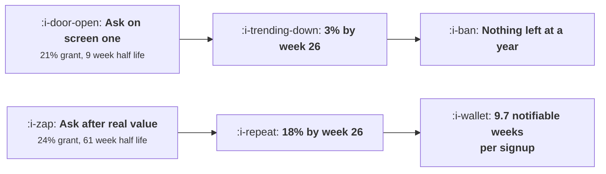

# Push and Notifications

```text
Level: Intermediate
Prerequisites: Email That Is Not Ignored
Estimated difficulty: 3/5 | Estimated time: 35 min
```

## The idea in one minute

Push permission is granted once, revoked permanently, and the decision about when to ask is worth
more than every subsequent decision about what to send. The counter intuitive part is that the
grant rate barely matters: asking on the first screen gets 21 percent of a cohort and asking after
the product has actually done something gets 24 to 28 percent, which is a rounding error. What
differs is how long the grant survives. An early prompt produces permission with a nine week half
life and a late one produces permission with a half life of a year, so the same starting number is
worth three and a half times as many notifiable weeks over twelve months. Permission is not a
conversion event, it is a stock with a decay rate you choose.

## A picture



Nearly the same grant rate, two completely different assets. The difference is entirely in the
decay.

## How it really works

### The grant rate is a distraction

Four timings, four grant rates between 21 and 78 percent, and four reach rates between 100 and 31
percent of the cohort. Multiply them and the share of the cohort who grant permission lands
between 20 and 28 percent in every case, because reaching fewer people and persuading more of
them nearly cancel out.

Teams optimise the grant rate because it is the number the prompt reports. It is the least
important number in the system.

### Half life is the asset

A user who allows notifications before the product has done anything for them has made a decision
with no information. The first notification that is not obviously worth having gets the permission
revoked, and that happens quickly. Measured as a half life, early prompts come in around nine to
eleven weeks and prompts shown after a genuine event come in around 34 to 61.

Cumulate the reachable share over a year and the comparison is stark: 2.7 notifiable weeks per
signup for the first screen prompt against 9.7 for the real event prompt. Same product, same
messages, three and a half times the channel.

This is the same stock logic as
[Habits Without Dark Patterns](../engagement-and-resurrection/03-habits-without-dark-patterns.md),
applied to the moment of acquisition rather than to the rate of spending.

### Ask after an event that justifies the ask

The rule that follows: the prompt should appear immediately after something happened which the user
would want to be told about next time. Not after an arbitrary value moment, after a repeatable
event. Somebody commented on your document, your build finished, your order shipped. Then the
prompt is self justifying, because the thing it is asking to tell you about is the thing that just
happened.

Two mechanics that help. Precede the system prompt with your own in product explanation, so a no
costs you nothing: the system dialogue can only be shown once, and your own screen can be shown
again later. And name the specific notification in the explanation rather than describing
notifications in general.

### What to do with the users who said no

Most of your cohort, in every scenario above. Three things.

Email remains available and is not subject to the same one shot grant, which is why
[Email That Is Not Ignored](02-email-that-is-not-ignored.md) matters more than push for most
products. In product messaging reaches anybody who returns, which is the subject of the next
lesson. And a later re ask is possible if the first prompt was your own screen rather than the
system one, which is the practical payoff of the two step pattern.

### Reading the decay to find bad sends

Permission revocation is a per message signal if you instrument it. Compute mute and revoke events
in the 24 hours after each notification type, divided by sends. That gives a cost per thousand for
each notification, and it is the input the send queue arithmetic in
[What Not to Send](../engagement-and-resurrection/06-what-not-to-send.md) needs.

Teams almost never have this number per notification type, only in aggregate, and the aggregate
hides the one or two notifications doing most of the damage.

### What fills the box in 2026

The platform rules are the constraint. On iOS the permission is explicit and users have become
practised at declining it; provisional authorisation, where notifications arrive quietly without a
prompt until the user decides, is available and is the better default for most products precisely
because it defers the irreversible decision until there is evidence. On Android permission is also
explicit for recent versions, having previously been granted by default, which means historical
benchmarks for grant rates are useless. Web push grant rates are low enough that the channel is
marginal for most products and should be assessed on its own rather than assumed.

## Run the numbers

Price the four timings on notifiable weeks rather than on grant rate.

```go
// push.go: when to ask for permission, and what the answer is worth.
package main

import "fmt"

// Push permission is granted once and revoked permanently. When you ask
// decides both how many say yes and how long the grant survives, and the two
// pull in opposite directions from what is convenient to build.
type ask struct {
	when     string
	reached  float64 // share of signups who get as far as the prompt
	grant    float64 // share of those prompted who allow notifications
	halfLife float64 // weeks until half of the grants are revoked or muted
}

func (a ask) granted() float64 { return a.reached * a.grant }

// share of the original cohort still reachable by push after n weeks
func (a ask) reachableAt(weeks float64) float64 {
	r := a.granted()
	for w := 0.0; w < weeks; w++ {
		r *= 1 - 0.693/a.halfLife
	}
	return r
}

func main() {
	asks := []ask{
		{"on the first screen", 1.00, 0.21, 9},
		{"after the signup form", 0.78, 0.26, 11},
		{"at the first moment of value", 0.44, 0.63, 34},
		{"when the first real event happens", 0.31, 0.78, 61},
	}

	fmt.Printf("%-36s %9s %8s %10s %11s\n",
		"when you ask", "reached", "grant", "of cohort", "half life")
	for _, a := range asks {
		fmt.Printf("%-36s %8.0f%% %7.0f%% %9.0f%% %9.0fw\n",
			a.when, 100*a.reached, 100*a.grant, 100*a.granted(), a.halfLife)
	}

	fmt.Println("\nreachable share of the cohort over time:")
	fmt.Printf("%-36s %10s %10s %10s %10s\n",
		"when you ask", "week 0", "week 12", "week 26", "week 52")
	for _, a := range asks {
		fmt.Printf("%-36s %9.0f%% %9.0f%% %9.0f%% %9.0f%%\n", a.when,
			100*a.reachableAt(0), 100*a.reachableAt(12),
			100*a.reachableAt(26), 100*a.reachableAt(52))
	}

	fmt.Println("\nAll four start between 20% and 28%, so the grant rate decides almost")
	fmt.Println("nothing. By week 26 the first screen can reach 3% of the cohort and")
	fmt.Println("waiting for a real event can reach 18%, six times as many, and by")
	fmt.Println("week 52 the early prompts have nothing left at all.")

	fmt.Println("\ncumulative notifiable weeks per signup, over a year:")
	fmt.Printf("%-36s %18s %14s\n", "when you ask", "notifiable weeks", "vs first screen")
	base := 0.0
	for i, a := range asks {
		t := 0.0
		for w := 0.0; w <= 52; w++ {
			t += a.reachableAt(w)
		}
		if i == 0 {
			base = t
		}
		fmt.Printf("%-36s %18.1f %13.1fx\n", a.when, t, t/base)
	}

	fmt.Println("\nThe grant is not the asset. The grant multiplied by how long it")
	fmt.Println("survives is the asset, and a prompt shown before the product has")
	fmt.Println("done anything produces a grant with a nine week half life.")
}
```

The first table is where the intuition breaks. The "of cohort" column reads 21, 20, 28, 24
percent. Four timings that feel very different produce almost the same number of permissions,
because the funnel losses and the persuasion gains offset.

The second table is the real comparison. By week 26 the early prompts are at 3 and 4 percent and
the late ones at 16 and 18. By week 52 the early prompts are at 0 and 1. A channel that is gone
within a year is not a channel.

The third table is the figure to put in a brief: 2.7 against 9.7 notifiable weeks per signup. If
your push programme's value is roughly linear in how long you can reach people, moving the prompt
is worth three and a half times everything else you could do to it.

Measure your own half lives by cohort of permission grant, which most analytics will not do for you
and which is a short query against your permission change events. If you do not record permission
revocation as an event, that is the first thing to fix, because without it none of this is
measurable.

## The AI layer

Push is the channel where generated content is most dangerous and the reason is the asymmetry
already described: the cost of a bad notification is a permanent loss of the channel, and no other
channel has that property.

The legitimate use is selection and timing. Deciding which of the eligible notifications to send
and when the user is most likely to want it is a small ranking problem, costs almost nothing, and
materially extends the half life by reducing the number of notifications that arrive as
intrusions. That is the highest value model application in this topic.

Generation of the notification text is of marginal benefit, because a push notification is forty
characters of a factual statement about something that happened, and there is little room for
craft. Where generation is genuinely tempting is in manufacturing reasons to notify, which is the
thing that destroys the half life, and the brake has to be a deterministic eligibility rule rather
than a model's judgement about whether something is interesting.

The failure mode and its signature: a model driven notification programme raises taps per
notification, because it has learned which users respond, while raising revocations among the users
it keeps selecting. The aggregate opt out rate can stay flat while the reachable base shrinks in
your most valuable segment. Track reachable share by value decile, not in aggregate.

## Sector lens

| Sector | What push is for here |
|---|---|
| [Enterprise B2B SaaS](../../product-management/product-by-sector/01-enterprise-b2b-saas.md) | Mentions, approvals and assignments. Anything that is not somebody waiting on this person belongs in email |
| [Fintech](../../product-management/product-by-sector/02-fintech.md) | Money moved. The highest value notification in any product, and reason enough to protect the channel absolutely |
| [Ecommerce and D2C](../../product-management/product-by-sector/03-ecommerce-and-d2c.md) | Delivery status, which users want, and promotions, which cost the channel. Separating the two into categories users can choose is worth the build |
| [Marketplaces](../../product-management/product-by-sector/04-marketplaces.md) | Supply side: a job is available, and latency decides earnings, so push is load bearing. Demand side: order status only |
| [Devtools and Infra](../../product-management/product-by-sector/05-devtools-and-infrastructure.md) | Build and incident status, usually to a chat tool rather than a phone. Treat the chat integration as the push channel |
| [Healthtech](../../product-management/product-by-sector/06-healthtech-and-regulated-care.md) | Appointment and medication reminders, with content restrictions on what may appear on a lock screen |
| [Vertical SaaS](../../product-management/product-by-sector/07-vertical-saas.md) | Job dispatch and schedule changes for field staff. The notification is the product for that user, so permission is granted readily |

## Remember this

* Permission is granted once and revoked permanently, so when you ask matters more than everything
  you send afterwards.
* Grant rate is nearly constant across timings, 20 to 28 percent of a cohort, because reach and
  persuasion offset.
* Half life is the asset. Nine weeks for an early prompt, up to a year for one shown after a real
  event.
* Measured in notifiable weeks per signup over a year: 2.7 for the first screen, 9.7 for a real
  event.
* Ask immediately after a repeatable event the user would want to hear about next time, and name
  that notification specifically.
* Show your own screen before the system prompt, so a no is recoverable.
* Instrument revocation per notification type within 24 hours of send. The aggregate hides the one
  notification doing the damage.
* Provisional or quiet delivery defers the irreversible decision and is the better default for most
  products.
* A model should select and time notifications, never invent reasons for them, and watch reachable
  share by value decile.

## Try it

1. Find where your push prompt appears and what fraction of signups reach it. Run `push.go` with
   your real grant rate and an estimated half life, then with the prompt moved after your first
   repeatable event.
2. Compute revocations within 24 hours per notification type for last quarter. Rank your
   notifications by cost per thousand sends.
3. If you do not record permission revocation as an event, specify it this week. Nothing in this
   lesson is measurable without it.

## Check yourself

1. Prompt A grants 34 percent of those who see it and is shown to everybody; prompt B grants 71
   percent and is shown to 38 percent. Which produces more permissions, and which produces more
   notifiable weeks?
2. Why does moving the push prompt later barely change the number of permissions you hold on day
   one, and change the channel's value by several times?
3. Your taps per notification rose after a model started selecting sends, and your reachable base
   in the top value decile fell. What is happening and what do you constrain?
