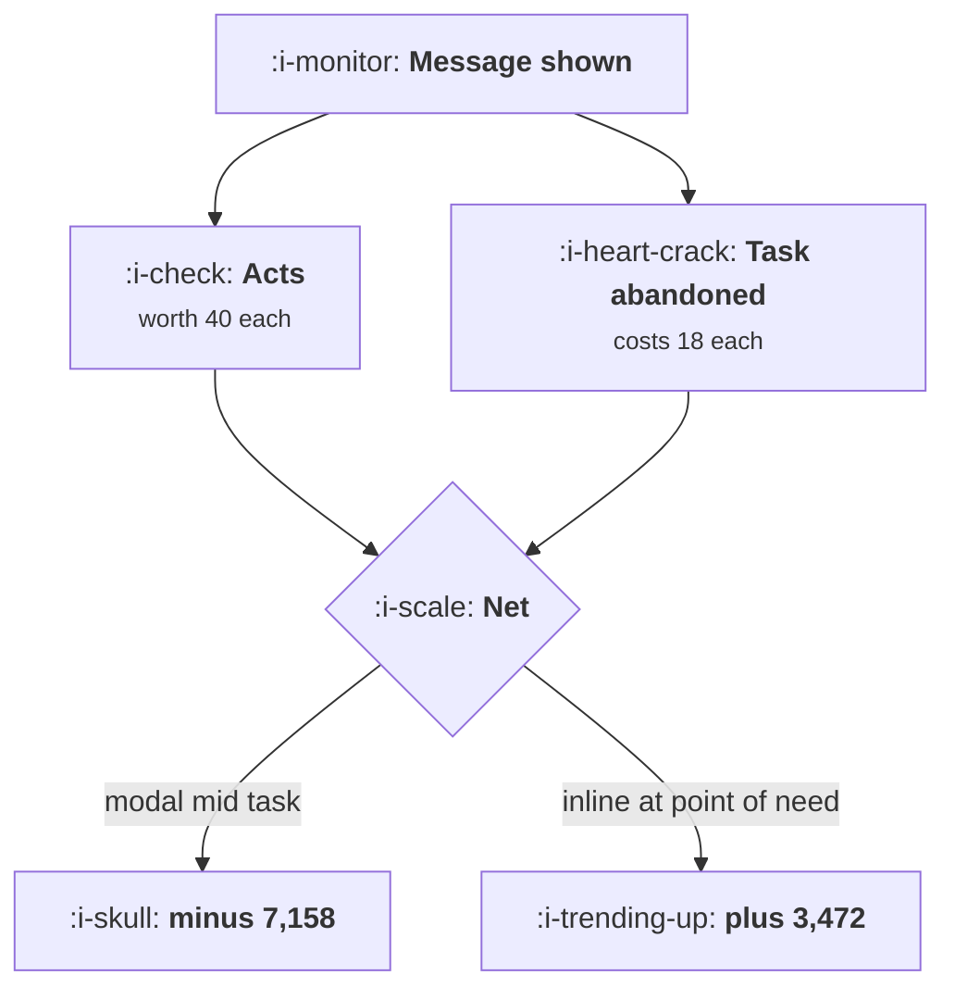

# In Product Messaging

```text
Level: Intermediate
Prerequisites: Push and Notifications
Estimated difficulty: 3/5 | Estimated time: 35 min
```

## The idea in one minute

Every in product message has three terms and most reports contain two of them. Reach and act rate
are measured; the cost of interrupting whatever the user was doing is not, and it is the term that
decides the answer. Put a number on it and the ranking inverts: the two modal placements have the
best reach in the worked table and the only negative net values, with a mid task modal destroying
7,158 of value per thousand eligible users while reporting 74 conversions. A modal is not a
stronger version of an inline message. It is a different trade, and it needs an act rate three
times higher than it will ever achieve.

## A picture



The left branch is on every dashboard. The right branch is on none of them, and it is larger.

## How it really works

### Put a number on the interrupted task

The user was doing something. A share of those interrupted do not come back to it in that session,
and the value of that abandoned work is a real loss: a document not finished, a purchase not
completed, a question not answered.

Estimating it is easier than it sounds. Take the conversion rate of the task in sessions with no
interruption and in sessions with one, and the difference multiplied by the value of a completed
task is your disruption cost. It is a correlation rather than a causal estimate, which is adequate
here because the direction is not in doubt and the magnitude only needs to be right to within a
factor of two to change the decision.

Most teams discover a number between a third and two thirds of in flight tasks for a mid task
modal, which is the figure used below.

### The breakeven act rate

A placement pays when its act rate exceeds its disruption rate multiplied by the ratio of task
value to act value. That single expression is the whole lesson in operational form.

A mid task modal with a 61 percent disruption rate, where a completed task is worth 18 and an act
is worth 40, needs an act rate of 27 percent. Real modals get 5 to 12 percent. The gap is not a
copywriting problem and it does not close.

A modal on entry disrupts less, 34 percent, so it needs 15 percent and achieves 11, which is close
enough that it is worth arguing about and worth measuring properly for your own product rather
than taking the table's word for it.

### Where messages belong instead

Ranked by net value in the worked table, and the ordering is stable across plausible inputs.

* **Inline at the point of need.** Lowest reach of the useful placements at 28 percent, highest net
  at 3,472, because it reaches the user exactly when the message is relevant and interrupts nothing.
* **In the empty state.** 44 percent act rate, the highest in the table, because an empty state is a
  user who has not started a task and therefore has nothing to interrupt. This is why
  [Empty States and First Run](../activation-and-onboarding/05-empty-states-and-first-run.md) is
  the most valuable screen you own.
* **A tooltip on the control.** Low reach, no disruption, reliably positive. Good for the thing
  that only matters once the user is looking at a specific control.
* **A banner.** Low act rate, near zero disruption, mildly positive. The honest use is
  announcements that nobody needs to act on today.

### When a modal is the right answer

Three cases, and they share a property: the task is not worth protecting.

The user has just arrived and has no task yet, which is the entry modal and is marginal. Something
must be acknowledged before continuing, such as a legal change or a destructive action warning,
where the interruption is the point. Or the message is more valuable than any task the user could
be doing, which in practice means a service incident or a data loss warning, and nothing else.

"We launched a feature" is not in that list, and neither is an upgrade prompt, which is the
placement question in
[The Upgrade Moment](../monetisation-and-conversion/04-the-upgrade-moment.md).

### The assumption behind every modal in production

The last table recomputes everything at four values for an abandoned task. In the column where a
task is worth nothing, the entry modal is the best placement available and the mid task modal is
second. That column is the implicit assumption behind most in product messaging, and nobody has
ever written it down, because writing it down is the same thing as rejecting it.

Making the assumption explicit is the whole intervention. Teams that put a number on task value
stop shipping mid task modals without anybody needing to make a design argument.

### What fills the box in 2026

Product adoption platforms make modals, tours, banners and tooltips equally cheap to build, which
removes the only thing that used to bias teams towards the cheaper and less intrusive options.
Their reporting shows impressions, clicks and completion, and none of them report the task the user
abandoned, because the platform cannot see your conversion events. That is a reporting gap you have
to close yourself, by joining the platform's impression log to your own task completion events.

## Run the numbers

Add the third term and read the ranking again.

```go
// inproduct.go: what an interruption costs, against what it returns.
package main

import "fmt"

// An in product message is seen by some share of users, acted on by some
// share of those, and interrupts whatever they were doing. The third term is
// the one no placement report contains.
type placement struct {
	name    string
	seen    float64 // share of eligible users who see it
	act     float64 // share of those who do what it asks
	disrupt float64 // share of those whose current task it costs you
}

const (
	eligible  = 1000.0
	actWorth  = 40.0 // value of one user doing what the message asked
	taskWorth = 18.0 // value of the task the user came to do, lost if abandoned
)

func (p placement) acts() float64 { return eligible * p.seen * p.act }
func (p placement) lost() float64 { return eligible * p.seen * p.disrupt }
func (p placement) net() float64  { return p.acts()*actWorth - p.lost()*taskWorth }
func (p placement) needed() float64 {
	return p.disrupt * taskWorth / actWorth
}

func main() {
	fmt.Printf("%.0f eligible users, an act is worth %.0f, an abandoned task costs %.0f\n\n",
		eligible, actWorth, taskWorth)

	ps := []placement{
		{"modal on entry", 0.96, 0.11, 0.34},
		{"modal mid task", 0.92, 0.08, 0.61},
		{"banner across the top", 0.41, 0.06, 0.02},
		{"tooltip on the control", 0.12, 0.22, 0.00},
		{"in the empty state", 0.19, 0.44, 0.00},
		{"inline at the point of need", 0.28, 0.31, 0.00},
	}

	fmt.Printf("%-32s %7s %7s %9s %8s %10s %10s\n",
		"placement", "seen", "act", "disrupt", "acts", "tasks lost", "net")
	for _, p := range ps {
		fmt.Printf("%-32s %6.0f%% %6.0f%% %8.0f%% %8.0f %10.0f %10.0f\n",
			p.name, 100*p.seen, 100*p.act, 100*p.disrupt,
			p.acts(), p.lost(), p.net())
	}

	fmt.Println("\nThe two modals have the best reach in the table and the only")
	fmt.Println("negative net values. The mid task modal destroys 7158 of value per")
	fmt.Println("thousand eligible users while reporting 74 conversions, which is what")
	fmt.Println("the dashboard will show.")

	fmt.Println("\nwhat each placement's act rate would have to be to break even:")
	fmt.Printf("%-32s %14s %14s %s\n", "placement", "needs", "has", "verdict")
	for _, p := range ps {
		verdict := "pays"
		if p.act < p.needed() {
			verdict = "cannot pay at this disruption"
		}
		fmt.Printf("%-32s %13.0f%% %13.0f%% %s\n",
			p.name, 100*p.needed(), 100*p.act, verdict)
	}

	fmt.Println("\nA mid task modal needs a 27% act rate to justify itself and achieves")
	fmt.Println("8%. No copy change closes a gap of that size; only moving the message")
	fmt.Println("does.")

	fmt.Println("\nthe same comparison at four values of an abandoned task:")
	fmt.Printf("%-32s %12s %12s %12s %12s\n",
		"placement", "task 0", "task 6", "task 18", "task 40")
	for _, p := range ps {
		fmt.Printf("%-32s", p.name)
		for _, tw := range []float64{0, 6, 18, 40} {
			fmt.Printf(" %11.0f", p.acts()*actWorth-p.lost()*tw)
		}
		fmt.Println()
	}
	fmt.Println("\nAt a task worth nothing, the modal on entry is the best placement in")
	fmt.Println("the table. That column is the implicit assumption behind every modal")
	fmt.Println("in production, and it is the assumption worth arguing about.")
}
```

The first table ranks six placements and the ranking is almost exactly inverse to reach. Modals see
96 and 92 percent of eligible users and return minus 1,651 and minus 7,158. The inline message sees
28 percent and returns 3,472.

Look at the acts column on its own, because that is what a platform report shows: 106, 74, 25, 26,
84, 87. On that column the entry modal is the best performer in the table. Everything that makes it
the worst is in the column next to it.

The breakeven table is the one to use in a review. The two modals need 15 and 27 percent act rates
and have 11 and 8. Those gaps are structural, and the verdict column states it without requiring
anybody to have an opinion about modals.

Put your own numbers in, and spend the effort on `taskWorth` rather than on the act rates, because
the act rates are measured and the task value is the one that is currently assumed to be zero. If
your product's core task is worth more than an act, which is true for most products that charge for
the task, every modal in your product is losing money.

## The AI layer

Two uses, and the second is where the value is.

Targeting is the obvious one: deciding which users should see a given message, which reduces
impressions without reducing acts and therefore cuts the disruption term proportionally. A message
shown to the 20 percent of users most likely to act returns most of the acts and a fifth of the
disruption, which is the one way to make a borderline placement pay. It costs almost nothing.

The more interesting use is replacing the message with an action. Much in product messaging exists
because the product cannot do the thing it is asking the user to do: configure this, connect that,
try this feature. Where a model can perform the task on request, the message becomes an offer to do
it rather than an instruction to go and do it, and the act rate rises sharply while the disruption
stays the same, because the user does not leave what they were doing. This is the only intervention
in the table that moves the act rate by enough to change a verdict.

The failure mode is a model powered assistant that interrupts. A proactive suggestion panel that
appears mid task carries the full disruption cost of a modal with a lower act rate, and because it
is generated it appears more often than any designed message would. If you ship one, instrument the
task abandonment rate in sessions where it fired, and treat that as the primary metric rather than
suggestion acceptance.

## Sector lens

| Sector | What the interrupted task is worth here |
|---|---|
| [Enterprise B2B SaaS](../../product-management/product-by-sector/01-enterprise-b2b-saas.md) | The user is at work and the task is their job. Disruption cost is high and complaints reach the person who renews |
| [Fintech](../../product-management/product-by-sector/02-fintech.md) | Interrupting a payment flow is a conversion loss and possibly a regulatory question about clear communication |
| [Ecommerce and D2C](../../product-management/product-by-sector/03-ecommerce-and-d2c.md) | The task is the purchase, so task value is directly measurable and usually exceeds anything a message could achieve |
| [Marketplaces](../../product-management/product-by-sector/04-marketplaces.md) | Supply side tasks are time critical, so disruption costs somebody money. Demand side browsing is cheaper to interrupt |
| [Devtools and Infra](../../product-management/product-by-sector/05-devtools-and-infrastructure.md) | The task is often outside your interface entirely, so in product messaging reaches people who are not working. Documentation is the real surface |
| [Healthtech](../../product-management/product-by-sector/06-healthtech-and-regulated-care.md) | Interrupting a clinical workflow is a safety matter. Modals in a care pathway need clinical review, not design review |
| [Vertical SaaS](../../product-management/product-by-sector/07-vertical-saas.md) | Users are often mid job with a customer in front of them. Treat every interruption as expensive by default |

## Remember this

* Three terms: reach, act rate, and the cost of the interrupted task. Reports contain the first two.
* Estimate disruption from the task's conversion rate with and without an interruption. Within a
  factor of two is enough.
* Breakeven act rate is disruption rate times task value over act value. A mid task modal needs
  about 27 percent and gets 8.
* Modals have the best reach and the worst net value. The ranking is nearly inverse to reach.
* Inline at the point of need, the empty state, a tooltip on the control, then a banner. In that
  order.
* Modals are right only when there is no task to protect: a fresh arrival, a required
  acknowledgement, or a service incident.
* Every modal in production assumes an interrupted task is worth nothing. Writing that assumption
  down is the intervention.
* Adoption platforms cannot see your task completions, so the disruption term has to be joined in
  by you.
* A model is best used to target narrowly and to turn the message into an offer to do the task,
  which is the only thing that moves the act rate enough to matter.

## Try it

1. Estimate your disruption cost for one modal by comparing task completion in sessions with and
   without it. Run `inproduct.go` with that figure and your real act rate.
2. Compute the breakeven act rate for every in product message you currently show. Any message
   below its breakeven is a candidate for relocation rather than rewriting.
3. Take your highest volume modal and write the inline version: where it would appear, what would
   trigger it, and what reach you would lose. Ship it as a test against the modal.

## Check yourself

1. A banner has 45 percent reach and a 5 percent act rate; a modal has 95 percent reach and a 12
   percent act rate. What would you need to know before choosing, and which would you expect to
   win?
2. Why is the empty state the highest act rate placement in the table, and what does that imply
   about where onboarding messages belong?
3. Your new assistant panel has a 19 percent suggestion acceptance rate and appears during editing.
   What is the primary metric to check, and why is acceptance rate not it?
