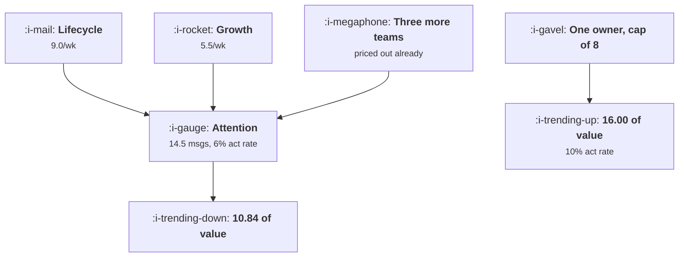

# The Shared Attention Budget

```text
Level: Intermediate
Prerequisites: In Product Messaging
Estimated difficulty: 4/5 | Estimated time: 40 min
```

## The idea in one minute

Attention is a commons and messaging programmes fail in the way commons fail. Every team sees the
return on its own sends and bears only a share of the cost, so five teams each behaving rationally
produce 14.5 messages a week where the company's optimum is 8, with an act rate of 6 percent
against 10 and 48 percent less total value. The important structural point is that the optimum is
not everybody sending slightly less: it is the low value sends going to zero while the highest
value sender barely changes. And because at least one team is genuinely worse off under the
optimum, this cannot be settled by agreement between the teams. It needs an owner measured on the
total.

## A picture



The same five teams and the same product. The only difference is who decides the total.

## How it really works

### Why the commons structure is exact, not a metaphor

Three conditions make a commons, and messaging meets all three. The resource is rivalrous: a
message that uses a user's attention this week leaves less for the next one, which is the
saturation in the act rate. Access is open: each team can send. And the cost is shared while the
benefit is private, because the act rate decline caused by your send falls on everybody's sends
including your own, so you internalise only your share of it.

The consequence is the standard one. Each team's private optimum exceeds the collective optimum,
the gap grows with the number of teams, and no amount of good intention closes it, because each
team is behaving correctly given what it is measured on.

### What the collective optimum actually looks like

This is the part that surprises people. The intuition is that a cap means everyone trims a bit.
The arithmetic says something different: the highest value sender keeps almost all its volume,
dropping from 9.0 to 8.0 messages a week, and the second highest goes to zero.

The reason is that under scarcity the marginal message should be the most valuable one available,
every time. There is no principle by which a lower value message deserves a share. That is the
same conclusion the send queue reached in
[What Not to Send](../engagement-and-resurrection/06-what-not-to-send.md), arriving here from the
allocation side rather than the per send side.

It also means the political framing of "fair shares for each team" produces a worse outcome than
either the free for all or the optimum, because it caps the volume without reallocating it towards
value.

### Three allocation mechanisms, and what each one costs

**Value ranked allocation.** One owner holds the cap and fills it from a ranked list of net value
per send. Efficient, and it requires every team to supply a value estimate that the owner can
compare, which is the hard part and is worth doing.

**Category reservation.** Slots reserved by type, typically transactional, triggered and
discretionary. Much easier to agree, loses perhaps a fifth of the available value, and is the right
starting point for a team that does not yet have comparable value estimates.

**Team quotas.** Each team gets a share and allocates within it. Politically easiest, least
efficient, and it produces the fair shares outcome described above. Treat it as a transition
arrangement rather than a design.

### The owner needs the authority and the measure

The owner must be able to suppress another team's send, and must be measured on something that
makes them want to. Three numbers, which are the same three from the rest of this level:
reachability retained, opt outs per period, and value per unit of attention spent.

The failure mode is an owner with the measure and not the authority, which produces a quarterly
report describing a problem nobody can fix, and it is the most common arrangement in practice.

### Make the externality visible in the request

The practical mechanism that works without reorganising anybody: every request for a new recurring
send comes with three figures, which are its expected value per thousand sends, its expected opt
outs per thousand, and the share of users it would push over the cap. The third one is the
externality, it is computable from the distribution in
[The Message Map](01-the-message-map.md), and putting it in the request form changes behaviour
before any decision is made, because a team has to write it down.

### What fills the box in 2026

Most engagement platforms support a global frequency cap and a priority field per campaign, which
is the machinery for value ranked allocation. It is usually unconfigured, with every campaign at
default priority, which means the cap is enforced by arrival order. Setting priorities properly is
a one afternoon configuration change that captures a large share of the gap in the table below,
and it is the single highest return action in this topic.

## Run the numbers

Solve it both ways and compare the totals.

```go
// attentionbudget.go: five teams, one inbox, two different answers.
package main

import "fmt"

// Attention saturates: the more messages a user receives in a week, the less
// any one of them returns. Each team sees its own return and pays only a
// share of the cost, so the sum of five sensible decisions is not a sensible
// decision.
type team struct {
	name  string
	value float64 // what one acted on message is worth to this team
	sends float64 // messages per user per week it chooses to send
}

const (
	yield0 = 0.30 // act rate on a message when the user receives nothing else
	scale  = 4.0  // volume at which the act rate has halved
	cost   = 1.00 // cost of a send: production, plus a share of the permission
)

func total(ts []team) float64 {
	v := 0.0
	for _, t := range ts {
		v += t.sends
	}
	return v
}

// act rate per message, given everything else in the user's week
func yield(v float64) float64 { return yield0 / (1 + v/scale) }

func teamReturn(t team, v float64) float64 {
	return t.sends*yield(v)*t.value - t.sends*cost
}

func welfare(ts []team) float64 {
	v, w := total(ts), 0.0
	for _, t := range ts {
		w += teamReturn(t, v)
	}
	return w
}

// each team picks the volume that is best for itself, taking the others as given
func nash(ts []team) []team {
	out := append([]team{}, ts...)
	for round := 0; round < 60; round++ {
		for i := range out {
			best, bestR := 0.0, -1e18
			for v := 0.0; v <= 20.0; v += 0.02 {
				out[i].sends = v
				if r := teamReturn(out[i], total(out)); r > bestR {
					best, bestR = v, r
				}
			}
			out[i].sends = best
		}
	}
	return out
}

// one owner picks every volume to maximise the total
func optimum(ts []team) []team {
	out := append([]team{}, ts...)
	for i := range out {
		out[i].sends = 0.5
	}
	for round := 0; round < 60; round++ {
		for i := range out {
			best, bestW := 0.0, -1e18
			for v := 0.0; v <= 20.0; v += 0.02 {
				out[i].sends = v
				if w := welfare(out); w > bestW {
					best, bestW = v, w
				}
			}
			out[i].sends = best
		}
	}
	return out
}

func main() {
	base := []team{
		{"lifecycle", 30, 0},
		{"growth", 22, 0},
		{"product marketing", 14, 0},
		{"sales", 9, 0},
		{"content", 6, 0},
	}

	free, one := nash(base), optimum(base)

	fmt.Printf("%-20s %10s %14s %14s %14s\n",
		"team", "value", "free for all", "one owner", "change")
	for i := range base {
		fmt.Printf("%-20s %10.0f %13.2f %13.2f %13.2f\n",
			base[i].name, base[i].value, free[i].sends, one[i].sends,
			one[i].sends-free[i].sends)
	}

	fv, ov := total(free), total(one)
	fmt.Printf("\n%-20s %10s %13.2f %13.2f\n", "messages per week", "", fv, ov)
	fmt.Printf("%-20s %10s %12.0f%% %12.0f%%\n", "act rate per message", "",
		100*yield(fv), 100*yield(ov))
	fmt.Printf("%-20s %10s %13.2f %13.2f\n", "total value per user", "",
		welfare(free), welfare(one))

	fmt.Printf("\nOne owner sends %.0f%% fewer messages and produces %.0f%% more value.\n",
		100*(1-ov/fv), 100*(welfare(one)/welfare(free)-1))

	fmt.Println("\nwho loses when the cap arrives:")
	fmt.Printf("%-20s %16s %16s %s\n", "team", "own return free", "own return capped", "verdict")
	for i := range base {
		rf := teamReturn(free[i], fv)
		ro := teamReturn(one[i], ov)
		verdict := "better off"
		switch {
		case rf == 0 && ro == 0:
			verdict = "priced out either way"
		case ro < rf:
			verdict = "worse off, and will say so"
		}
		fmt.Printf("%-20s %16.2f %16.2f %s\n", base[i].name, rf, ro, verdict)
	}

	fmt.Println("\nNotice what the optimum is not. It is not every team sending a bit")
	fmt.Println("less. Lifecycle loses one message a week and growth goes to zero,")
	fmt.Println("because when attention is scarce the right answer is to send only the")
	fmt.Println("most valuable thing. Three teams never cleared the bar at all, which")
	fmt.Println("is worth knowing before anybody argues about a cap.")
	fmt.Println("\nThe last column is why this cannot be settled by agreement. Growth")
	fmt.Println("is genuinely worse off under the arrangement that is best for the")
	fmt.Println("company, so the cap has to be held by somebody who owns the total")
	fmt.Println("and is measured on it rather than on their own sends.")
}
```

The first table is the comparison. Under the free for all, lifecycle sends 9.0 messages a week and
growth sends 5.5, for a total of 14.5. Under one owner, lifecycle sends 8.0 and growth sends
nothing. The act rate per message goes from 6 to 10 percent and total value per user from 10.84 to
16.00.

Three of the five teams send nothing in either case, which is worth noticing before a cap
discussion. Their messages do not clear the cost of sending even when attention is free, so they
were never the problem, and a negotiation that gives them a quota makes things worse rather than
better.

The second table is the political problem in one column. Growth is worse off under the company
optimum, by 2.35 per user. It will say so, and it will be right. Any mechanism that depends on
growth volunteering to stop is not a mechanism.

Change the number of teams and the values to match your own organisation. The gap between the two
columns widens as teams are added, which is why this problem appears suddenly at a particular
company size rather than growing smoothly.

## The AI layer

Allocation within a cap is a genuinely good model application and it is covered in
[The Message Map](01-the-message-map.md). What belongs here is the second order effect, which is
larger and less discussed.

A model changes each team's private optimum by lowering the cost of producing a send. In the model
above, `cost` is what sets how much each team wants to send, and the three teams currently priced
out are priced out by it. Halve the cost of producing a message and those teams enter, the free for
all total rises, and the act rate falls for everybody including the teams that were already there.

So the arrival of cheap generation does not simply let existing programmes do more. It changes the
number of participants in the commons, which is the variable the whole problem scales with. A
company that had two teams sending and now has five has a structurally worse problem and usually
has not noticed, because each new programme looked individually positive at the moment it launched.

The practical response is to set the cap before the capability arrives rather than after, and to
treat any claim that a new programme is nearly free as a reason for more scrutiny rather than less.
A free send still consumes the scarce resource, and the scarce resource was never the production
cost.

## Sector lens

| Sector | Who else is spending the budget here |
|---|---|
| [Enterprise B2B SaaS](../../product-management/product-by-sector/01-enterprise-b2b-saas.md) | Account management and customer success send outside the platform entirely, so the real total is higher than any system reports |
| [Fintech](../../product-management/product-by-sector/02-fintech.md) | Mandatory regulatory communications take priority and are uncappable, so the discretionary budget is small and should be stated explicitly |
| [Ecommerce and D2C](../../product-management/product-by-sector/03-ecommerce-and-d2c.md) | Merchandising, retention and brand all have revenue attached, so value estimates are comparable and value ranked allocation is achievable |
| [Marketplaces](../../product-management/product-by-sector/04-marketplaces.md) | Two sides and two budgets. Operational messages to supply must be outside the cap or earnings suffer |
| [Devtools and Infra](../../product-management/product-by-sector/05-devtools-and-infrastructure.md) | Alerting shares the channel and must never be displaced. Put it outside the budget rather than high in the priority order |
| [Healthtech](../../product-management/product-by-sector/06-healthtech-and-regulated-care.md) | Clinical communications sit outside any growth budget by governance, not by preference. Document the boundary |
| [Vertical SaaS](../../product-management/product-by-sector/07-vertical-saas.md) | Few teams, so the commons problem is mild. The risk is a single enthusiastic founder sending whatever they like |

## Remember this

* Attention is a rivalrous resource with open access and a shared cost, which makes it a commons in
  the exact sense.
* Five teams behaving rationally send 14.5 messages a week where the optimum is 8, with a 6 percent
  act rate against 10 and 48 percent less value.
* The optimum is not everyone trimming. The highest value sender barely changes and the next one
  goes to zero.
* Fair shares by team produces a worse outcome than either extreme, because it caps volume without
  reallocating towards value.
* Value ranked allocation, then category reservation, then team quotas. Quotas are a transition, not
  a design.
* The owner needs authority to suppress another team's send, and the measure to want to.
* Put the externality in the request form: value per thousand, opt outs per thousand, and the share
  of users pushed over the cap.
* Set the global cap and per campaign priorities in your platform. They are usually unconfigured,
  so arrival order decides.
* Cheap generation adds participants to the commons rather than just volume, which is the variable
  the problem scales with.

## Try it

1. Count the teams and systems that can send to a user in your company, including the ones outside
   the engagement platform. Run `attentionbudget.go` with that many teams.
2. Check your platform's global frequency cap and the priority field on every live campaign. Note
   how many are at default.
3. Draft the three figure request form for new recurring sends, and apply it retrospectively to the
   last three that launched.

## Check yourself

1. Why does each team's private optimum exceed the collective one even when every team is acting in
   good faith and has accurate data about its own sends?
2. Your company decides on equal message quotas for five teams. Why might that be worse than having
   no cap at all?
3. A new programme claims its sends cost almost nothing to produce. Why is that an argument for more
   scrutiny rather than less?
