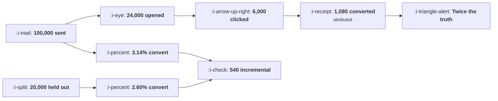

# Measuring a Campaign Honestly

```text
Level: Intermediate
Prerequisites: The Shared Attention Budget
Estimated difficulty: 4/5 | Estimated time: 40 min
```

## The idea in one minute

A campaign funnel report measures the campaign's audience, not the campaign. Opens tell you about
subject lines and mail clients; clicks tell you who was already interested; conversions after a
click include everybody who would have converted without the message. In the worked example
attribution claims 1,080 conversions and a holdout shows 540, an overstatement of exactly two
times that is not a tracking error and cannot be fixed by better attribution. The only instrument
that measures a message is a group that did not receive it, and because most individual campaigns
produce lifts too small to detect, the right structure is one permanent holdout measuring the
programme rather than a holdout per campaign.

## A picture



The top path is the campaign report. The bottom path is the answer, and the two differ by a factor
of two without anything being broken.

## How it really works

### What each number in the funnel report actually measures

**Open rate.** Measures your subject line, your sender reputation, and increasingly your
recipients' mail clients, which prefetch images and fire open events with no human involved. It is
a weak diagnostic for deliverability and it is not a measure of anything the campaign achieved.

**Click rate.** Measures how many of your recipients were already interested enough to act. It is
the most useful number in the report for comparing two versions of the same message to each other,
and it says nothing about whether the message was needed.

**Conversion after click.** Measures the landing experience and the pre existing intent of the
people who clicked, mixed together in unknown proportions. This is the number that gets reported as
the campaign's result, and it is the sum of what the campaign caused and what it merely witnessed.

### The overstatement has a mechanism

The gap between attributed and incremental is not noise and it is not bad tracking. It is a
specific population: users who were going to convert in this window anyway, and who passed through
your email on the way because it was in front of them.

That population is large precisely because your targeting is good. A campaign sent to the users
most likely to convert will attribute most of their conversions to itself, and the better the
targeting the larger the overstatement. This is why improving targeting can raise attributed
performance and lower incremental performance at the same time, which is the most confusing
pattern in lifecycle reporting and is entirely explicable.

### The holdout is the only instrument

Hold back a random sample, measure total conversion in both groups over the same window, and take
the difference. Everything else is inference from the treated group alone, which cannot separate
cause from coincidence.

Three details that matter. Randomise rather than using a convenient segment, or the holdout differs
from the treated group in exactly the way that produces the bias you are trying to remove. Measure
conversions from any route, not just from the email, or you will miss the user who ignored the
message and bought directly. And use the same window for both groups, starting at the send.

### Most campaigns are too small to measure individually

Detecting the worked campaign's 0.54 point lift on a 2.6 percent base needs about 15,000 users per
arm. A 0.30 point lift needs 46,653 and a 0.15 point lift needs 181,663.

Most individual campaigns produce lifts in the lower rows. So a holdout per campaign is either
unaffordable or underpowered, and the structure that works is a single permanent holdout: one or
two percent of users who receive no lifecycle messaging at all, measured continuously. That gives
you the programme's total value, which is the question that actually matters for budget and
headcount, and it costs the revenue those users would have produced.

The objection is always that the holdout is unfair to those users. That objection assumes the
programme works, which is the thing being measured, and if it is true then the cost is small and
known while the benefit of knowing is large.

### What to report

Four numbers per campaign, and only one of them is from the funnel. Incremental conversions against
a holdout where available, click rate for comparing variants, opt outs per thousand sends, and the
share of recipients pushed over the weekly cap. The last two are the costs, and a report without
them is a report of revenue with no expenses.

### What fills the box in 2026

Marketing mix modelling and multi touch attribution are both being sold as solutions to this
problem and neither is. Multi touch attribution redistributes credit among channels and still
cannot see the counterfactual; mix modelling works at an aggregate level and needs variation in
spend over time that lifecycle programmes do not usually have. Incrementality testing, which is the
holdout under a newer name, is the method, and the platforms increasingly support it directly.
Where a platform offers a built in holdout, the thing to verify is whether it holds out
continuously or re randomises per campaign, because the second gives you a per campaign measurement
that is almost always underpowered.

## Run the numbers

Compute both and compare them, then check whether your holdout can see the effect at all.

```go
// campaign.go: what the funnel report says, and what the holdout says.
package main

import "fmt"

const (
	sent      = 100_000.0
	heldOut   = 20_000.0
	openRate  = 0.24
	clickRate = 0.06   // of those sent
	convClick = 0.18   // of those who clicked
	convAll   = 0.0314 // conversion among everybody sent, from any route
	convHold  = 0.0260 // conversion among the holdout, same window
	orderVal  = 46.0
	sendCost  = 0.004
)

// users per arm to detect an absolute lift, 80% power, 95% two sided
func perArm(base, lift float64) float64 {
	p := base + lift/2
	return 15.7 * p * (1 - p) / (lift * lift)
}

func main() {
	fmt.Printf("%.0f sent, %.0f held out, window the same for both\n\n", sent, heldOut)

	fmt.Println("the funnel report:")
	fmt.Printf("%-34s %14.0f\n", "sent", sent)
	fmt.Printf("%-34s %14.0f  (%.0f%%)\n", "opened", sent*openRate, 100*openRate)
	fmt.Printf("%-34s %14.0f  (%.0f%%)\n", "clicked", sent*clickRate, 100*clickRate)
	attributed := sent * clickRate * convClick
	fmt.Printf("%-34s %14.0f  (%.0f%% of clickers)\n",
		"converted after clicking", attributed, 100*convClick)
	fmt.Printf("%-34s %14.0f\n", "attributed revenue", attributed*orderVal)

	fmt.Println("\nthe holdout:")
	fmt.Printf("%-34s %13.2f%%\n", "conversion among those sent", 100*convAll)
	fmt.Printf("%-34s %13.2f%%\n", "conversion among the holdout", 100*convHold)
	lift := convAll - convHold
	incremental := lift * sent
	fmt.Printf("%-34s %13.2fpp\n", "lift", 100*lift)
	fmt.Printf("%-34s %14.0f\n", "incremental conversions", incremental)
	fmt.Printf("%-34s %14.0f\n", "incremental revenue", incremental*orderVal)

	fmt.Printf("\nattribution claims %.0f conversions, the holdout shows %.0f.\n",
		attributed, incremental)
	fmt.Printf("the overstatement is %.1fx, and it is not an error in the tracking:\n",
		attributed/incremental)
	fmt.Println("the difference is people who clicked the email and would have")
	fmt.Println("converted without it.")

	fmt.Println("\nis the campaign worth running?")
	cost := sent * sendCost
	fmt.Printf("%-34s %14.0f\n", "send cost", cost)
	fmt.Printf("%-34s %14.0f\n", "attributed profit", attributed*orderVal-cost)
	fmt.Printf("%-34s %14.0f\n", "incremental profit", incremental*orderVal-cost)
	fmt.Println("\nBoth are positive here, so the campaign survives either way. The")
	fmt.Println("decision it changes is the next one: on attribution this looks like")
	fmt.Println("a 493 per thousand sends programme worth expanding, and on the")
	fmt.Println("holdout it is 244.")

	fmt.Println("\nhow large a holdout you need, at this baseline:")
	fmt.Printf("%-18s %16s %18s\n", "lift to detect", "users per arm", "verdict at 20,000")
	for _, l := range []float64{0.0100, 0.0054, 0.0030, 0.0015} {
		n := perArm(convHold, l)
		verdict := "detectable"
		if n > heldOut {
			verdict = "too small to see"
		}
		fmt.Printf("%17.2fpp %16.0f %18s\n", 100*l, n, verdict)
	}
	fmt.Println("\nA 20,000 holdout can see this campaign's 0.54 point lift and cannot")
	fmt.Println("see a 0.30 point one. Most individual campaigns are in the second")
	fmt.Println("category, which is the argument for one permanent holdout measuring")
	fmt.Println("the programme rather than a holdout per campaign.")
}
```

The funnel report is the one that gets presented: 24 percent open, 6 percent click, 18 percent of
clickers convert, 49,680 of attributed revenue. Every number is correct.

The holdout section is the same campaign measured against a counterfactual: 3.14 percent conversion
among those sent, 2.60 among the holdout, a 0.54 point lift, 540 incremental conversions, 24,840 of
incremental revenue. Also correct, and half as large.

Note what the difference does not change. The campaign is profitable on both measures, 49,280
against 24,440 after send costs, so nothing about this campaign's existence is in question. What
changes is every decision that follows: whether to expand the programme, whether to hire for it,
and whether it beats the alternative use of the attention. On attribution this is a 493 per
thousand sends programme and on the holdout it is 244, and a budget argument settled with the wrong
one of those is settled wrongly.

The holdout sizing table is the practical constraint. Put your own baseline conversion rate and
your plausible lift in, and if the verdict column says too small to see for everything you would
realistically achieve, stop sizing per campaign holdouts and build the permanent one.

## The AI layer

The useful thing a model does here is make the honest analysis cheap, and the dangerous thing it
does is make the dishonest number better.

Cheap honest analysis is real. Writing the holdout query, checking for randomisation failures,
computing the lift with a confidence interval and drafting the result are each hours that become
minutes, and that changes how many campaigns get measured properly from a handful a year to all of
them. A model is also good at the pre flight check on a measurement plan, which is pattern matching
against a catalogue of known failures.

The dangerous side is targeting. A model that selects the recipients most likely to convert will
raise attributed conversions substantially and may lower incremental ones, because it is selecting
people who did not need the message. The attributed number will look like a large win and the
holdout will not move. If your reporting is attributed, a targeting model will reliably show
improvement regardless of whether the programme got better, which is the worst possible combination
of a confident metric and a plausible mechanism.

So the order matters: build the holdout first, then let a model optimise against incremental lift
rather than against attributed conversions. Optimising a model against an attributed metric trains
it to find people who were going to convert anyway, which it will do very well.

## Sector lens

| Sector | What makes honest measurement hard here |
|---|---|
| [Enterprise B2B SaaS](../../product-management/product-by-sector/01-enterprise-b2b-saas.md) | Conversions are too few for a user level holdout. Hold out accounts and accept a long measurement window |
| [Fintech](../../product-management/product-by-sector/02-fintech.md) | Some messages are mandatory, so they cannot be held out. Measure only the discretionary programme and say so |
| [Ecommerce and D2C](../../product-management/product-by-sector/03-ecommerce-and-d2c.md) | Volume makes holdouts easy and the overstatement is largest here, because targeting is best. Permanent holdout is standard practice |
| [Marketplaces](../../product-management/product-by-sector/04-marketplaces.md) | Holding out one side changes the market for the other, so the control is contaminated. Randomise by geography |
| [Devtools and Infra](../../product-management/product-by-sector/05-devtools-and-infrastructure.md) | Conversion happens in a terminal weeks later, so the attribution window is long and the holdout window must match it |
| [Healthtech](../../product-management/product-by-sector/06-healthtech-and-regulated-care.md) | Withholding a clinical message is not a measurement decision. Holdouts apply only to non clinical communications and may need review |
| [Vertical SaaS](../../product-management/product-by-sector/07-vertical-saas.md) | Too few customers for any statistical measurement. Judge the programme on whether customers say it is useful, labelled as the weak evidence it is |

## Remember this

* The funnel report measures the campaign's audience. Opens measure mail clients, clicks measure
  pre existing interest.
* Attributed conversions include everybody who would have converted anyway. In the worked case that
  is half of them.
* Better targeting increases the overstatement, so attributed performance can rise while
  incremental performance falls.
* A holdout is the only instrument. Randomise it, count conversions from any route, and use the
  same window for both groups.
* Detecting a 0.54 point lift on a 2.6 percent base needs about 15,000 per arm. Smaller lifts need
  tens or hundreds of thousands.
* So run one permanent holdout of one or two percent measuring the whole programme, not a holdout
  per campaign.
* The objection that a holdout is unfair assumes the programme works, which is the thing being
  measured.
* Report four numbers: incremental conversions, click rate for variant comparison, opt outs per
  thousand, and share pushed over the cap.
* Build the holdout before letting a model optimise targeting, or it will learn to find people who
  needed no message.

## Try it

1. Take your last campaign's funnel report and run `campaign.go` with its real numbers plus your
   overall conversion rate for the same window. Compute the overstatement factor.
2. Size the holdout you would need to detect the lift you believe your programme produces. If it is
   larger than any single campaign's audience, write the proposal for a permanent holdout.
3. Add opt outs per thousand and share pushed over the cap to your standard campaign report
   template. Note which campaigns look different once the costs are present.

## Check yourself

1. A campaign reports 2,400 conversions attributed to its emails. The treated group converted at
   4.1 percent and a random holdout at 3.6 percent on 60,000 sent. What is the campaign actually
   worth in conversions?
2. Your new targeting model raised attributed conversions by 40 percent and incremental lift did not
   move. What has it learned to do, and is the programme better?
3. Why is a permanent programme level holdout usually more useful than a holdout on each campaign,
   even though it answers a less specific question?
