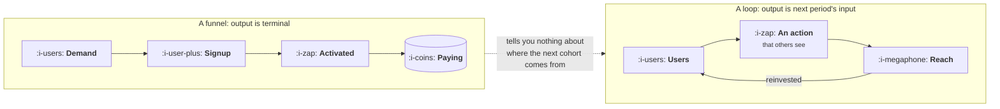

# Funnels Leak, Loops Compound

```text
Level: Foundations
Prerequisites: What a Growth Team Actually Does
Estimated difficulty: 2/5 | Estimated time: 35 min
```

## The idea in one minute

A funnel describes what happens to one group of people on their way through your product. A loop
describes where the next group comes from. They answer different questions, and the reason the
funnel is the wrong default picture is that it has no reinvestment step: its output is terminal,
so it can tell you how efficiently you convert demand and never whether you have a business that
grows on its own. The practically important case is also the one most treatments skip. Almost no
company has a loop that sustains itself, and a loop that cannot is still extremely valuable: it
multiplies every other channel you have by one divided by one minus the loop factor, which is a
number worth knowing precisely because it is small enough to ignore and large enough to decide a
budget.

## A picture



The funnel has four boxes and three arrows. The loop has three boxes and three arrows, and the
third arrow is the entire difference: it points backwards.

## How it really works

### The two pictures answer different questions

| Question | The picture that answers it |
|---|---|
| Where are we losing people, and at which step? | Funnel |
| What is the cheapest step to improve? | Funnel |
| Where will next month's users come from? | Loop |
| Does this get easier or harder as we get bigger? | Loop |
| What is a user worth beyond the money they pay? | Loop |

Neither is a better picture. The error is using the first to answer the second, which is what
happens by default because funnels are what analytics tools draw.

The tell that a company is doing this is a growth plan that consists entirely of conversion rate
improvements. Such a plan can only ever make a fixed amount of demand convert better, so it has a
ceiling equal to perfect conversion of the demand you already buy, and it will describe a company
that grows exactly as fast as its marketing budget forever.

### The loop factor

Call it **k**: the number of new users each user brings, within some period you have to state.
Every argument in this topic is about this number.

A loop with k of 1.0 or more sustains itself, and the arithmetic becomes exponential. This is rare
and usually temporary, for reasons that are the subject of lesson 05. A loop with k below 1.0 does
not sustain itself, and the standard treatment stops there, as though the number were a failing
grade. It is not. It is a multiplier.

If you acquire some users from a channel each month, and each of those brings k more, and each of
those brings k more again, the series converges. Total intake settles at your channel intake
multiplied by:

**1 / (1 minus k)**

That formula is the most useful thing in this lesson. A k of 0.4 is not "a weak loop", it is a
67 percent discount on every pound of acquisition you will ever spend, permanently, on every
channel at once.

### Why the formula surprises people

It is not linear, and intuition handles it badly. Going from k of 0.4 to 0.8 doubles the loop
factor and triples the amplification. Going from 0.8 to 0.9 is a ten percent improvement in k and
doubles the amplification again. All the value is crowded into the last stretch before 1.0.

This has a direct consequence for where a growth team spends its time. If your k is 0.2,
doubling it is hard work for a change from 1.25x to 1.43x, and your channels are almost certainly
the better investment. If your k is 0.75, a modest improvement to 0.85 takes you from 4x to 6.7x,
and almost nothing else available to you is worth that. The same project is a bad idea in the
first company and the best available idea in the second, which is why "invest in your loops" is
advice with no information in it.

### What a funnel improvement does to a loop

The two pictures are not independent, and this is the part that makes the loop view pay for
itself. Activation rate appears in the funnel as one stage conversion. It also appears inside k,
because a user who never activates never invites anyone.

So an activation improvement is worth more than the funnel says. The funnel credits it with the
users who get through that stage. The loop credits it with those users plus the fact that the
amplification applies to a larger base and k itself rises. Teams that only read the funnel
systematically underinvest in the stages that sit inside their loop, and systematically overinvest
in the ones that sit after it, such as checkout optimisation, which has no loop consequence at all.

### What fills the box in 2026

Analytics tools draw funnels by default and loops almost never, which is a real contributor to
this error rather than a trivial one. Amplitude, Mixpanel and PostHog all build funnel charts in a
few clicks and none of them has a loop view, so computing k is a query you write yourself against
the warehouse or a spreadsheet you maintain by hand. Expect it to be manual, and expect that to be
the reason most companies do not know their own number.

## Run the numbers

The claim is that a loop below 1.0 is an amplifier rather than an engine, and that the
amplification is non linear. This computes it.

```go
// amplify.go: what a loop is worth when it cannot sustain itself on its own.
package main

import "fmt"

// Each month the product acquires `paid` users from a channel, and every user
// acquired last month brings `k` more this month. k is the loop factor.
func run(paid, k float64, months int) (perMonth, cumulative float64) {
	newUsers := paid
	for m := 0; m < months; m++ {
		cumulative += newUsers
		perMonth = newUsers
		newUsers = paid + k*newUsers
	}
	return
}

func main() {
	const (
		paid   = 1_000.0
		months = 24
	)
	fmt.Printf("%.0f users a month bought from a channel, for %d months\n\n", paid, months)
	fmt.Printf("%-12s %14s %16s %14s\n",
		"loop factor", "ceiling", "month 24 intake", "total users")
	for _, k := range []float64{0.0, 0.2, 0.4, 0.6, 0.8, 0.9, 0.95} {
		per, cum := run(paid, k, months)
		fmt.Printf("%11.2f %13.1fx %16.0f %14.0f\n", k, 1/(1-k), per, cum)
	}

	fmt.Println("\nthe same channel, with and without the loop:")
	_, none := run(paid, 0, months)
	for _, k := range []float64{0.4, 0.8} {
		_, with := run(paid, k, months)
		fmt.Printf("  k=%.1f buys you %.0f extra users, or %.1fx the channel alone\n",
			k, with-none, with/none)
	}

	fmt.Println("\nA loop below 1.0 is an amplifier on your channels, not an engine.")
	fmt.Println("Doubling k from 0.4 to 0.8 does not double the amplification: it")
	fmt.Printf("goes from %.2fx to %.2fx, because the ceiling is 1/(1-k).\n", 1/(1-0.4), 1/(1-0.8))
}
```

Read the ceiling column first. It rises slowly and then not slowly at all: 1.2x, 1.7x, 2.5x, 5.0x,
10.0x, 20.0x. The step from k of 0.9 to 0.95 is worth as much as everything from zero to 0.9 put
together, which is the convexity that makes loop investment so stage dependent.

Then read the total users column against the first row. The same channel, buying the same thousand
users a month for two years, produces 24,000 users with no loop and 100,094 with a k of 0.8. The
loop did not acquire anybody by itself at any point; every single user in that table traces back
to a channel purchase. It multiplied what the channel bought by 4.2 times.

The month 24 intake column is the one to take to a budget meeting. With no loop you are acquiring
1,000 users a month in month 24, exactly as you were in month one, because that is what buying
users does. With a k of 0.8 you are acquiring 4,976 and still paying for a thousand of them.

## The AI layer

Two things change, and they point in opposite directions.

A model lowers the cost of the action at the centre of most content loops, which raises the
achievable k for anyone whose loop runs on produced artifacts: pages, templates, summaries, shared
outputs. Generating a shareable artifact for every user costs cents rather than minutes of
somebody's time, and products whose loop was previously limited by how much content a team could
make are no longer limited by that.

Working the other way, the same change applies to everybody, and loops that depend on being seen
compete for a fixed quantity of attention. A content loop whose output is one of ten thousand
similar pages has a lower acceptance rate than the same loop had when the page was one of fifty,
and acceptance rate is a multiplicative term inside k. The cost of producing loop output has
fallen faster than the value of the output, which means k for produced content loops has mostly
gone down since 2023 even as production volume has risen.

The practical consequence is that the loops which have strengthened are the ones whose output
cannot be mass produced: output that is specific to the user's own data, or that requires another
person to have done something. The loops that have weakened are the ones whose output is text that
anybody could have generated. Before investing in a loop, ask which of those two it is, because
the answer has changed since the playbooks were written.

## Sector lens

| Sector | What changes about the picture |
|---|---|
| [Enterprise B2B SaaS](../../product-management/product-by-sector/01-enterprise-b2b-saas.md) | The loop runs on accounts rather than users, and k is measured over years. Within an account there is a second, much faster loop worth measuring separately |
| [Fintech](../../product-management/product-by-sector/02-fintech.md) | Payment products have a genuine structural loop, because a transaction has two sides and one of them is not yet a customer |
| [Ecommerce and D2C](../../product-management/product-by-sector/03-ecommerce-and-d2c.md) | Mostly funnel, honestly. Loops are weak and the amplification is small, which is why the sector is so paid heavy and why it should be |
| [Marketplaces](../../product-management/product-by-sector/04-marketplaces.md) | Two loops that feed each other, so the relevant number is the product of two factors and either side can cap it |
| [Devtools and Infra](../../product-management/product-by-sector/05-devtools-and-infrastructure.md) | The strongest loops in software, because the output is code that other developers read, and it persists and keeps recruiting for years |
| [Healthtech](../../product-management/product-by-sector/06-healthtech-and-regulated-care.md) | Privacy makes most loop mechanics unavailable, so k is near zero by design and the growth model has to be channel led |
| [Vertical SaaS](../../product-management/product-by-sector/07-vertical-saas.md) | Small dense markets mean high k and a low ceiling: the loop works brilliantly and then runs out of people, which is lesson 05 arriving early |

## Remember this

* A funnel describes one cohort's journey. A loop describes where the next cohort comes from. The
  funnel has no reinvestment step.
* A growth plan made only of conversion improvements grows exactly as fast as the marketing budget,
  forever.
* A loop below 1.0 is an amplifier, not a failure. It multiplies every channel by 1/(1 minus k).
* That multiplier is convex. All the value sits in the last stretch before 1.0, so the same loop
  project is a bad idea at k of 0.2 and the best available idea at k of 0.75.
* Improvements to stages inside the loop are worth more than the funnel credits them with.
  Improvements after the loop, such as checkout, are worth exactly what the funnel says.
* Analytics tools draw funnels by default and loops never. Computing k will be manual.

## Try it

1. Run `amplify.go`, then set `paid` to your real monthly acquisition and try the k values either
   side of your guess. The gap between k of 0.3 and k of 0.5 in the total column is the cost of
   not knowing your own number.
2. Take your last growth plan and mark each item as a funnel improvement or a loop improvement.
   If everything is in the first column, compute what the plan's ceiling is at perfect conversion.
3. Name the stage of your funnel that sits inside your loop. Work out what the funnel credited
   your last improvement there with, then add the loop effect. Was the project justified on the
   smaller number?

## Check yourself

1. Why can a company with an excellent funnel and no loop never grow faster than its marketing
   budget, no matter how good the funnel gets?
2. Your k is 0.85 and a project would take it to 0.9. Your colleague calls that a six percent
   improvement and declines to fund it. What is the actual figure, and why is their arithmetic the
   natural mistake to make?
3. A checkout optimisation and an activation improvement both add the same number of paying
   customers this month. Which is worth more over two years, and what single property decides it?
