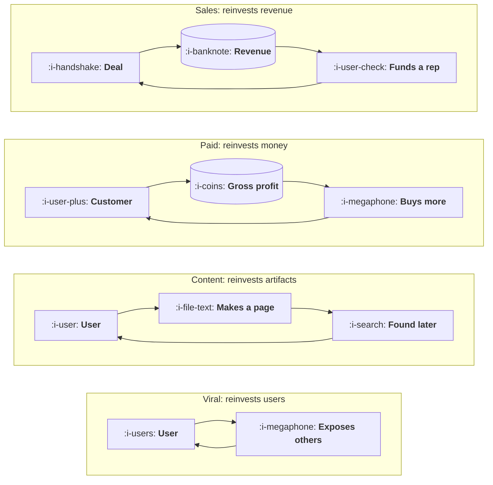

# The Four Loop Types

```text
Level: Foundations
Prerequisites: Funnels Leak, Loops Compound
Estimated difficulty: 2/5 | Estimated time: 30 min
```

## The idea in one minute

There are four loops, and they are distinguished by what gets reinvested rather than by which
channel they look like from outside. A viral loop reinvests users, a content loop reinvests
artifacts that keep working after they are made, a paid loop reinvests money, and a sales loop
reinvests revenue into people who close more revenue. Confusing them is not a vocabulary problem:
each reinvests a different currency, so each has a different cycle time, a different ceiling and
a completely different failure, and the single most common planning error in growth is calling a
channel a loop when nothing is being reinvested at all.

## A picture



Each loop has exactly one store in it, and what sits in that store is what the loop reinvests.
If you cannot point at the store in your own loop, you are looking at a channel.

## How it really works

### The four, side by side

| Loop | Reinvests | Typical cycle | Ceiling is set by | What kills it |
|---|---|---|---|---|
| **Viral** | Users | Hours to weeks | How many people each user can plausibly reach | The reachable pool runs out, or the invitation stops being welcome |
| **Content** | Artifacts that persist | Weeks to months | How much search or feed demand exists for the topic | A ranking change, or everyone producing the same artifact |
| **Paid** | Money | As fast as your payback period | Auction prices and your payback tolerance | Rising prices, or a payback period longer than your financing |
| **Sales** | Revenue, as headcount | One sales cycle plus ramp | How many qualified accounts exist and how fast people ramp | Running out of accounts, or ramp time exceeding tenure |

The cycle column is the one to read twice. A viral loop can turn in days and a sales loop takes
three quarters, and that difference matters more in practice than the loop factor does, for
reasons lesson 04 makes precise.

### Viral loops reinvest users

A user does something, other people see it, some of them become users. The crucial distinction
inside this category is between loops where sharing is the point and loops where sharing is a
favour.

**Collaboration loops** work because the product does not function alone. Sending a document for
review, splitting a bill, assigning a task: the invitation is how the user gets what they came
for. These have the highest acceptance rates in software and they are nearly impossible to retrofit,
because they are a property of what the product is rather than of what it offers.

**Incentive loops** pay people to invite. They work when the reward matches what the user already
wanted and fail when it does not, and they attract fraud in exact proportion to the reward, which
is a fixed cost of running one.

**Exposure loops** are neither. A badge on a published page, a watermark on an export, a default
signature. The acceptance rate is tiny and the volume is enormous, and for products with wide free
usage this is frequently the largest loop in the business.

### Content loops reinvest artifacts

The reinvested thing is an artifact that keeps working after it is made. The defining property is
not that content is involved; it is that a unit of work made today is still acquiring users in two
years, so the inventory accumulates.

That accumulation is what makes it a loop and it is also why the loop is slow. An artifact made
this week will not be found for months, and the cycle time of a content loop is measured from
creation to the point the artifact is producing its own users.

Two sub types are worth separating because they fail differently. **Company produced** content has
a ceiling set by what the team can make and a failure mode of being outproduced. **User produced**
content, where the users' own activity creates the artifacts, is the stronger version by a wide
margin: the inventory grows with usage rather than with headcount, and the artifacts are
specific in ways that generic production cannot match.

### Paid loops reinvest money

Paid acquisition is a loop only if the customers it buys generate the money that buys the next
ones, within a period you can finance. The test is arithmetic rather than definitional, and it has
two parts: the gross profit per customer must exceed what it cost to acquire them, and the time
until that profit arrives must be shorter than the time until you need to spend it again.

A paid channel that fails either test is not a loop. It is a drip, and the number goes up while
the money flows and stops the day it does not. Both are legitimate; the distinction matters
because the growth model treats them completely differently, one as a term that compounds and the
other as a line item that scales with budget.

The payback arithmetic itself belongs to
[Revenue and Efficiency](../../product-management/revenue-and-efficiency/README.md), which is
where acquisition cost and payback period are defined.

### Sales loops reinvest revenue

Revenue funds a salesperson who closes revenue. It is a real loop and the slowest of the four, with
a cycle of one sales cycle plus the ramp time of the person you hired with the proceeds, which in
practice means three to four quarters before a reinvestment produces anything.

Its distinctive failure is that the cycle time can exceed the tenure of the thing being
reinvested. If a representative takes nine months to ramp and stays twenty, you are reinvesting
into an asset that depreciates faster than it compounds, and the loop quietly becomes a treadmill.

### The error that costs the most

Calling something a loop when nothing is reinvested. The test is one question: **what does this
produce that becomes an input to itself?** If the answer is a vague gesture at awareness or brand,
there is no store in the diagram and no loop in the business.

This matters because the growth model forecasts the two differently. A loop term compounds and
needs a ceiling. A channel term is linear in spend and needs a budget. A plan that models a
channel as a loop produces a forecast that is wrong in a specific and expensive direction: it
promises acceleration that was never structurally available, and it usually does so for exactly
as long as it takes to hire against the promise.

### What fills the box in 2026

Viral mechanics are mostly built rather than bought, and the tooling that exists is for the
incentive variety: referral platforms, reward fulfilment, fraud screening. Content loops lean on
whatever the publishing stack is, with the user produced variety requiring real product work and
no tooling at all. Paid loops are the only one with a mature measurement stack, which is a large
part of why they are over represented in growth plans relative to their value.

## Sector lens

| Sector | Which loop is actually available |
|---|---|
| [Enterprise B2B SaaS](../../product-management/product-by-sector/01-enterprise-b2b-saas.md) | Sales, with a weak collaboration loop inside each account. The within account loop is the one that gets ignored and the one you own |
| [Fintech](../../product-management/product-by-sector/02-fintech.md) | Viral, structurally: a payment has a recipient who is not yet a customer, which is the rare retrofittable collaboration loop |
| [Ecommerce and D2C](../../product-management/product-by-sector/03-ecommerce-and-d2c.md) | Paid, almost always, with content as a slow second. Honest treatment of this is more useful than hunting for virality |
| [Marketplaces](../../product-management/product-by-sector/04-marketplaces.md) | Content, usually: supply creates pages, pages attract demand, demand attracts supply. Most marketplaces are content loops that do not know it |
| [Devtools and Infra](../../product-management/product-by-sector/05-devtools-and-infrastructure.md) | User produced content and collaboration together. Public code, issues and answers accumulate and keep recruiting for a decade |
| [Healthtech](../../product-management/product-by-sector/06-healthtech-and-regulated-care.md) | Sales, plus referral between practitioners that you may observe but mostly cannot instrument |
| [Vertical SaaS](../../product-management/product-by-sector/07-vertical-saas.md) | Word of mouth inside a small professional community, which behaves like a viral loop with a very high factor and a very low ceiling |

## Remember this

* Four loops, distinguished by what is reinvested: users, artifacts, money, revenue.
* Every loop has exactly one store. If you cannot point at it, you have a channel.
* Collaboration loops beat incentive loops and cannot usually be retrofitted, because they are a
  property of what the product is.
* A content loop's defining feature is that a unit of work keeps acquiring users for years. User
  produced beats company produced, because inventory grows with usage rather than headcount.
* Paid is a loop only if gross profit exceeds acquisition cost and arrives before you need to
  spend again. Otherwise it is a drip, which is fine but forecasts differently.
* A sales loop fails when ramp time approaches tenure, at which point reinvestment depreciates
  faster than it compounds.
* Modelling a channel as a loop promises acceleration that was never available, usually for just
  long enough to hire against it.

## Try it

1. Draw your own loop and label the store. If there is no box that accumulates something, write
   down what you have instead and whether it is a channel or a wish.
2. For each of the four, write one sentence on whether it is available to your product and why.
   The ones that are unavailable for structural reasons are more useful to know than the ones that
   are merely unbuilt.
3. Find the within account or within team loop in your product, the one that runs faster than
   your headline loop. Most companies have one and almost nobody measures it.

## Check yourself

1. Two companies both say they have a referral loop. One built sharing into the core workflow, the
   other pays twenty pounds per invite. Name three ways their numbers will differ beyond the
   acceptance rate.
2. Why does a content loop made of user produced artifacts scale differently from one made of
   company produced artifacts, and which term in the loop factor is actually different?
3. Your paid channel returns its acquisition cost in fourteen months and you raise money every
   eighteen. Is it a loop? What changes your answer?
