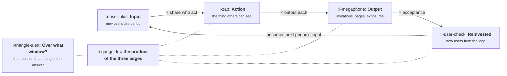

# Reading a Loop

```text
Level: Foundations
Prerequisites: The Four Loop Types
Estimated difficulty: 3/5 | Estimated time: 35 min
```

## The idea in one minute

Every loop has the same four parts: an input, an action some of those people take, an output that
reaches people who are not yet users, and a reinvestment step that turns that reach back into
input. Reading a loop means putting a measured number on each of the four, and the loop factor is
their product. The difficulty is not the arithmetic, it is the denominator: three perfectly honest
ways of computing your loop factor from the same events produce three different numbers, the gap
between them can be a factor of two in what your channels are worth, and one of the three figures
most commonly quoted is not a loop factor at all.

## A picture



The loop factor lives on the edges, not in the boxes. Three multiplications, and a window you have
to declare before any of them mean anything.

## How it really works

### The four parts

**Input** is the cohort you are measuring: users who arrived in a period, from anywhere. Keep it
as the users who arrived, not the users you have, because a loop factor computed against your
whole user base answers a different question and is almost always much smaller.

**Action** is the thing a user does that others can see. Sending an invitation, publishing a page,
sharing a result, making a payment to someone. Measure the share of the input cohort that does it
at least once, not the average number of actions, because the two get multiplied separately and
conflating them hides which half is broken.

**Output** is how many non users each acting user reaches. Invitations sent, pages published,
people exposed. This is the term with the longest tail: a small number of users produce most of
the output in nearly every loop, which means the average is a poor summary and you should look at
the distribution before trusting it.

**Reinvestment** is the share of that reach which becomes a new user. Acceptance rate. This is
the term that decays most reliably over time, for reasons in lesson 05.

Multiply the three edges and you have k.

### The window problem

Here is where it goes wrong. A cohort's loop activity does not all happen in the month they
arrived. Some invitations go out on day one, some in month four. So the question "what is our loop
factor" has no answer until somebody says over what period, and the two reasonable answers differ
by a lot.

**Lifetime k** counts everything a cohort will ever produce. It is the right number for asking
what a user is ultimately worth, and it has the obvious problem that you cannot know it for the
cohort you care about most, the recent one, without waiting.

**Period k** counts what the cohort produced in its first month. It is available immediately and
it understates the loop, and if you put it into the amplification formula from lesson 01 you will
materially undervalue every channel you run.

Neither is wrong. Using one and reporting it as the other is wrong, and the program below shows
what the gap costs.

### The number that is not a loop factor

The most frequently quoted figure in this area is the share of signups that came from referral.
It is a useful operational number and it is not k, and substituting it produces confident nonsense.

The difference is the denominator. The loop factor is invited signups divided by the **original**
users who did the inviting. The referral share is invited signups divided by **all** signups,
including the invited ones. The second has the loop's own output in its denominator, so it is
bounded above by 100 percent no matter how strong the loop gets, and a product with a k of 3.0,
which is explosive, would report a referral share of 75 percent, which sounds merely healthy.

If somebody quotes a referral percentage, the only safe response is to ask for the two raw counts.

### What to do when you cannot measure acceptance

Most loops have one unmeasurable edge. You can see invitations sent and signups created, but
linking a specific signup to a specific invitation requires attribution that is often missing,
blocked, or legally awkward.

Three workable substitutes, in descending order of quality. Use a holdout: suppress the loop
output for a small random share of users and compare their total downstream signups against the
rest, which measures the whole loop at once without needing to attribute anything. Use a natural
experiment: a period when the mechanism was broken is the cleanest measurement you will ever get,
so record those outages rather than only fixing them. Or bound it: compute k under the most and
least favourable attribution assumptions and carry both numbers, which is less satisfying and far
better than carrying one number that is quietly wrong.

### What fills the box in 2026

No analytics product computes this for you, which is worth saying plainly because people look.
Amplitude, Mixpanel and PostHog will all give you the component counts and none has a loop factor
view, so this is a warehouse query or a spreadsheet, rebuilt roughly quarterly. Write the
definition down next to the number, including the window, because the single most common
corruption of this metric is a later analyst recomputing it with a different denominator and
nobody noticing that the series has a discontinuity in it.

## Run the numbers

One product, one set of events, three honest ways to compute the loop factor.

```go
// loopfactor.go: one product, three honest measurements of k, three different answers.
package main

import "fmt"

func main() {
	const (
		cohort     = 10_000.0 // new users in January
		inviteRate = 0.45     // of them, the share who send at least one invite
		perInviter = 6.2      // invites each of those people sends, eventually
		accept     = 0.23     // invites that become a signup
		firstMonth = 0.40     // share of all that activity that happens in month one
	)

	lifetime := inviteRate * perInviter * accept
	month1 := lifetime * firstMonth
	shareOfSignups := lifetime / (1 + lifetime)

	fmt.Printf("%.0f new users, %.0f%% invite, %.1f invites each, %.0f%% accept\n\n",
		cohort, 100*inviteRate, perInviter, 100*accept)

	rows := []struct {
		name, denom string
		k           float64
		valid       bool
	}{
		{"k over the cohort's life", "invited signups / original users", lifetime, true},
		{"k in the first month", "month one invited / original users", month1, true},
		{"referral share of signups", "invited signups / all signups", shareOfSignups, false},
	}

	fmt.Printf("%-28s %-34s %8s %12s\n", "measured as", "denominator", "value", "ceiling")
	for _, r := range rows {
		ceiling := "n/a"
		if r.valid {
			ceiling = fmt.Sprintf("%.2fx", 1/(1-r.k))
		}
		fmt.Printf("%-28s %-34s %8.3f %12s\n", r.name, r.denom, r.k, ceiling)
	}

	fmt.Printf("\nThe first two are both correct and differ by %.1fx in the ceiling\n",
		(1/(1-lifetime))/(1/(1-month1)))
	fmt.Println("they imply. Which one you meant decides what the channel is worth.")
	fmt.Println("\nThe third is not a loop factor at all. It is the share of signups")
	fmt.Printf("that arrived by invitation (%.0f%%), a number that rises towards 100%%\n",
		100*shareOfSignups)
	fmt.Println("as the loop strengthens and tells you nothing about amplification.")
}
```

Lifetime k is 0.642 and first month k is 0.257. Both are computed correctly from the same four
inputs, and they imply ceilings of 2.79x and 1.35x respectively. That is a factor of 2.1 in what
every pound of acquisition spend is worth, arising entirely from a choice of window that nobody in
the meeting is likely to state out loud.

Which should you use? For deciding whether to spend on a channel, lifetime, because the users will
in fact go on producing invitations after the first month and the spend is permanent. For
forecasting next quarter, period k, because that is what will actually land inside the quarter.
Carrying both, labelled, is the only arrangement that survives contact with a planning cycle.

The third row is the trap. 39 percent of signups arrive by invitation, which sounds like a
moderately strong loop and is the number most likely to be on a slide. It is not comparable to the
other two, it cannot be put into the amplification formula, and it would read as 75 percent for a
product whose loop is genuinely explosive. Change `inviteRate` upwards in the program and watch
the first two columns move freely while the third one crawls towards 100.

## The AI layer

The measurement half of this lesson is one of the few places where a model helps directly and
cheaply. Classifying whether a user action was loop output is often a text problem: did this
shared document go to somebody outside the organisation, is this published page a genuine artifact
or a test, does this message read as an invitation. These are judgements that previously required
either a brittle rule or a person, and they run at a fraction of a cent each.

The place to be careful is attribution. A model asked to connect signups to probable sources will
produce an answer for every row, because that is what it does, and the resulting attribution has
no error bars and no way to express that it does not know. This is worse than the honest
alternatives above: a holdout gives you a number with a confidence interval, and a bounded
estimate tells you what you do not know. A generated attribution gives you a single clean figure
built from plausibility, and it will be defended in meetings precisely because it is clean.

Use a model to classify what you can observe. Do not use one to infer what you failed to record.

## Sector lens

| Sector | What changes about reading it |
|---|---|
| [Enterprise B2B SaaS](../../product-management/product-by-sector/01-enterprise-b2b-saas.md) | The cohort is accounts, and the lifetime window is years, so period k is the only measurable number and it badly understates the loop |
| [Fintech](../../product-management/product-by-sector/02-fintech.md) | Acceptance is directly observable because the recipient has to act on the payment, which makes this the easiest sector to measure a loop in |
| [Ecommerce and D2C](../../product-management/product-by-sector/03-ecommerce-and-d2c.md) | Short windows, so lifetime and period k nearly converge. The honest finding is usually that k is small |
| [Marketplaces](../../product-management/product-by-sector/04-marketplaces.md) | Two loop factors and a cross term, because supply recruits demand and the reverse. One number cannot represent it |
| [Devtools and Infra](../../product-management/product-by-sector/05-devtools-and-infrastructure.md) | Acceptance is unmeasurable in principle: the output is public and the reader never touches your analytics. Holdouts and outages are the only real evidence |
| [Healthtech](../../product-management/product-by-sector/06-healthtech-and-regulated-care.md) | Linking a referrer to a referred patient may be prohibited rather than merely difficult. Bound the estimate and say so |
| [Vertical SaaS](../../product-management/product-by-sector/07-vertical-saas.md) | Small cohorts, so the long tail in the output term dominates and the average is actively misleading. Look at the distribution |

## Remember this

* Four parts: input, action, output, reinvestment. k is the product of the three edges between
  them.
* Measure the share who act and the output per actor separately. Conflating them hides which half
  is broken.
* Output has a long tail in nearly every loop, so check the distribution before trusting the
  average.
* Lifetime k and period k are both correct and can differ by a factor of two in the ceiling they
  imply. Carry both, labelled.
* Referral share of signups is not a loop factor. Its denominator contains the loop's own output,
  so it crawls towards 100 percent and cannot enter the amplification formula.
* When acceptance is unmeasurable, use a holdout, record your outages as natural experiments, or
  carry a bounded estimate. Do not infer it.
* Write the definition next to the number, including the window.

## Try it

1. Run `loopfactor.go` and raise `inviteRate` from 0.45 to 0.90. Watch the two real columns move
   and the referral share barely budge. That divergence is the argument for never quoting the
   third number.
2. Compute all four parts for your own product from last quarter's events. The part you cannot
   measure is the finding; write down which of the three substitutes you are going to use.
3. Find the last outage of your loop mechanism. Pull signups for that window against the
   surrounding weeks. That is a free measurement of your whole loop and almost nobody collects it.

## Check yourself

1. Why does the referral share of signups approach 100 percent as a loop strengthens, while the
   loop factor has no upper bound at all?
2. Your period k is 0.26 and your lifetime k is 0.64. A colleague uses the first to argue a
   channel is unaffordable. What exactly is wrong with that, and what is right about it?
3. You can see invitations sent and total signups, but cannot link them. Describe the holdout you
   would run, and say what it measures that an attribution model cannot.
