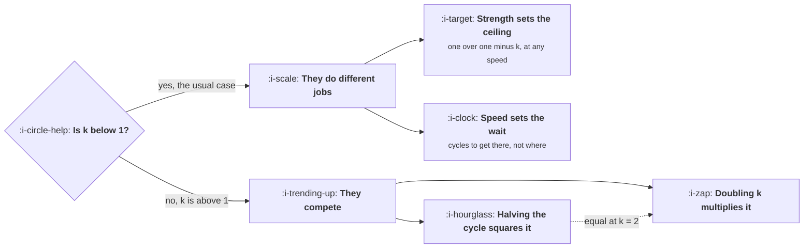

# Loop Speed and Loop Strength

```text
Level: Foundations
Prerequisites: Reading a Loop
Estimated difficulty: 3/5 | Estimated time: 35 min
```

## The idea in one minute

Growth writing is full of the claim that cycle time matters more than loop factor. It is true for
some loops and false for others, and the crossover is computable: for a self sustaining loop,
halving the cycle squares the result while doubling the factor multiplies it by two raised to the
number of cycles, so speed wins above a loop factor of 2 and strength wins below it. For the far
more common loop that cannot sustain itself, the two are not even competing: strength alone sets
the ceiling and speed alone sets how long you wait to reach it. Knowing which regime you are in
is the whole lesson, because the two regimes recommend opposite projects.

## A picture



The first question is not which to invest in. It is which side of the diagram you are on, and
almost every company is on the left while almost all the published advice describes the right.

## How it really works

### The common case: strength and speed do different jobs

When k is below 1 the loop converges, and lesson 01 gave the ceiling as one divided by one minus
k. Cycle time does not appear in that expression. A loop with k of 0.7 settles at 3.33 times your
channel intake whether it turns weekly or quarterly.

What cycle time decides is how long the convergence takes. The loop reaches most of its ceiling
in a handful of cycles, so the wait in calendar time is cycles multiplied by cycle length, and for
a strong slow loop that is a long time: a k of 0.9 needs about 22 cycles to get within 90 percent
of its ceiling, which is five months at a weekly cycle and nearly two years at a monthly one.

This has a planning consequence that teams get wrong in both directions. A slow strong loop is
undervalued, because the quarter you measure it in shows a fraction of what it will eventually be
worth. A fast weak loop is overvalued for the opposite reason: it reaches its ceiling inside the
quarter, so the number you see is all there is and there is no more coming.

### The rarer case: they genuinely compete

When k exceeds 1 there is no ceiling, growth is exponential, and the two levers trade off against
each other. Over a fixed horizon the number of cycles is the horizon divided by the cycle time, so
total growth is the loop factor raised to that count.

Halving the cycle doubles the exponent, which squares the result. Doubling the factor multiplies
the result by two raised to the cycle count. Those are equal when the loop factor equals 2, which
is the crossover, and it is exact rather than approximate.

Below 2, strength wins: a loop at 1.2 gains far more from going to 2.4 than from turning twice as
often. Above 2, speed wins and the margin widens quickly. Since the overwhelming majority of real
loops sit well below 2 even when they exceed 1, the popular advice to optimise for cycle time is
most often the worse of the two recommendations, and it became popular because the people who
wrote it worked on consumer products with unusually high loop factors.

### Why cycle time still deserves attention

Three reasons that survive the arithmetic above, and they are the real argument for caring about
speed.

**Learning rate.** Your ability to improve the loop at all depends on how often you can observe a
complete turn of it. A quarterly loop gives you four observations a year, which is not enough to
learn anything about a term with noise in it.

**Compounding interacts with retention.** The arithmetic above assumes users persist. If they
churn, a slow loop is pushing output from a base that is shrinking while it waits, and the
effective factor drops. For loops slower than the churn half life, cycle time stops being about
patience and starts being about whether the loop closes at all.

**Cash.** A paid loop's cycle time is its payback period, and that is a financing constraint
rather than a growth one. Halving it does not change the eventual size of the business and does
change how much money you need to get there, which is often the binding question.

### Finding your own cycle time

Measure it from the action to the acceptance, not from signup to signup. The common error is to
use the calendar period your reporting happens to run on, which makes every loop look like it
turns monthly because the dashboard is monthly.

For loops with a long tail, and most have one, the median is the number to use rather than the
mean. A content loop where half the acceptances arrive in three months and the rest over four
years has a mean cycle time that is dominated by artifacts still working from years ago, which
tells you about the inventory rather than about the turn.

### What fills the box in 2026

Nothing measures this either. Cycle time comes out of the same warehouse query as the loop factor,
and the thing to build once is a table of loop events with the action timestamp and the acceptance
timestamp on the same row, which makes both numbers and their distributions a single query
afterwards. Teams that do not build it end up re deriving the cycle time from first principles
every time somebody asks, and getting a slightly different answer each time.

## Run the numbers

Both regimes, with the crossover computed rather than asserted.

```go
// speed.go: loop strength sets the ceiling, cycle time sets when you get there.
package main

import (
	"fmt"
	"math"
)

// ceiling for a loop that cannot sustain itself: steady state intake is
// the channel intake multiplied by 1/(1-k), whatever the cycle time.
func ceiling(k float64) float64 { return 1 / (1 - k) }

// cyclesTo90 is how many loop cycles it takes to reach 90% of that ceiling.
func cyclesTo90(k float64) int {
	share := 0.0
	term := 1.0
	for n := 1; n <= 500; n++ {
		share += term
		term *= k
		if share/ceiling(k) >= 0.90 {
			return n
		}
	}
	return 500
}

func main() {
	fmt.Println("part one: a loop below 1.0, where the ceiling is fixed")
	fmt.Printf("%-8s %10s %10s %14s %14s\n",
		"k", "ceiling", "cycles", "at 7 day cycle", "at 30 day cycle")
	for _, k := range []float64{0.3, 0.5, 0.7, 0.9} {
		n := cyclesTo90(k)
		fmt.Printf("%8.1f %9.2fx %10d %12d d %12d d\n", k, ceiling(k), n, n*7, n*30)
	}
	fmt.Println("\nCycle time does not appear in the ceiling column. It only changes")
	fmt.Println("how long you wait, and the wait is in months for a slow strong loop.")

	fmt.Println("\npart two: a loop above 1.0, where there is no ceiling")
	fmt.Println("one year, a 30 day cycle, starting from one user")
	fmt.Printf("%-6s %14s %16s %16s %16s\n",
		"k", "as it is", "double k", "halve the cycle", "better move")
	for _, k := range []float64{1.2, 1.5, 2.0, 3.0} {
		const (
			horizon = 365.0
			cycle   = 30.0
		)
		basis := math.Pow(k, horizon/cycle)
		dbl := math.Pow(2*k, horizon/cycle)
		fast := math.Pow(k, horizon/(cycle/2))

		better := "the same"
		switch {
		case fast > dbl*1.001:
			better = "halve the cycle"
		case dbl > fast*1.001:
			better = "double k"
		}
		fmt.Printf("%6.1f %14.0f %16.0f %16.0f %16s\n", k, basis, dbl, fast, better)
	}
	fmt.Println("\nHalving the cycle squares the result. Doubling k multiplies it by")
	fmt.Println("2 raised to the number of cycles. The two are exactly equal at k = 2,")
	fmt.Println("speed wins above it and strength wins below, so the advice you have")
	fmt.Println("read is correct only for the loop its author happened to have.")
}
```

In part one the ceiling column is unchanged by anything to its right, which is the point: a
product with a k of 0.7 gets 3.33 times its channel intake whether the loop turns weekly or
monthly. The two columns on the right are the cost of slowness measured in patience. At a k of 0.9
you wait 154 days on a weekly cycle and 660 days on a monthly one for the same destination.

Those 660 days are the reason slow strong loops get killed. The loop is working, it is on track to
be worth ten times the channel, and at the end of the second quarter it has delivered a fraction
of that, which is indistinguishable in a review from a loop that does not work.

Part two prints the crossover rather than arguing about it. At a k of 1.2, doubling the factor
gets you 42,257 against 84 for halving the cycle, a difference of five hundred times in favour of
strength. At a k of 3.0 it reverses, with 407 billion against 2.9 billion in favour of speed. At
exactly 2.0 the two columns print identical numbers, which is the derivation confirming itself.

One honest caveat about the right hand side of that table: no real loop sustains a factor of 3.0
for a year, and the enormous numbers are the arithmetic telling you that the assumption has
broken rather than that you are about to acquire four hundred billion users. What actually happens
is lesson 05.

## The AI layer

A model shortens the cycle time of exactly one of the four loops and leaves the others alone,
which is worth knowing before anyone proposes a project.

Content loops get faster because the artifact can be produced immediately rather than queued
behind a person. The acceptance side of a content loop is unaffected: search indexing, feed
distribution and the time it takes a human to find the thing are all unchanged, and they are most
of the cycle. Production was rarely the bottleneck, so the achievable improvement is smaller than
it looks, usually days off a cycle measured in months.

Viral, paid and sales cycles are set by human and financial processes that a model does not touch.
A person decides whether to accept an invitation on their own schedule. Money arrives when the
customer pays. A representative ramps at human speed.

The place where a model genuinely changes this lesson is the learning rate argument above. You
cannot shorten a quarterly loop, but you can observe it much more cheaply: classifying and
summarising each turn's outputs, which used to be the reason nobody did the analysis, is now
inexpensive enough to do every week on a loop that turns every quarter. That does not speed up the
loop. It speeds up you, and on the left hand side of the diagram that is the more valuable of the
two anyway.

## Sector lens

| Sector | Which regime, and which lever |
|---|---|
| [Enterprise B2B SaaS](../../product-management/product-by-sector/01-enterprise-b2b-saas.md) | Deep on the left with a cycle in quarters. Strength, and patience, and the within account loop for learning rate |
| [Fintech](../../product-management/product-by-sector/02-fintech.md) | Left, with an unusually fast cycle because a payment resolves in days. One of the few places speed is cheap to buy |
| [Ecommerce and D2C](../../product-management/product-by-sector/03-ecommerce-and-d2c.md) | Left, low k, fast cycle. The loop reaches its ceiling inside the quarter, so what you see is all there is |
| [Marketplaces](../../product-management/product-by-sector/04-marketplaces.md) | Can cross to the right during a land grab, which is why the sector produced most of the speed advice. Usually temporary |
| [Devtools and Infra](../../product-management/product-by-sector/05-devtools-and-infrastructure.md) | Left, high k, very slow cycle. The most undervalued loop shape in software, because it looks like nothing for a year |
| [Healthtech](../../product-management/product-by-sector/06-healthtech-and-regulated-care.md) | Left, low k, slow. Neither lever is really available, so the growth model should not depend on the loop |
| [Vertical SaaS](../../product-management/product-by-sector/07-vertical-saas.md) | High k and a fast community cycle, which looks like the right hand side briefly and then hits the pool limit |

## Remember this

* First establish which regime you are in. Below k of 1 the two levers do different jobs; above it
  they compete.
* Below 1: strength sets the ceiling, speed sets the wait. Cycle time does not appear in the
  ceiling at all.
* A slow strong loop is undervalued in any quarterly review, because it delivers a fraction of its
  eventual worth inside the window.
* Above 1: halving the cycle squares the result, doubling the factor multiplies it by two raised
  to the cycle count. Exactly equal at k of 2.
* Most loops are well below 2, so the common advice to optimise cycle time is usually the worse
  recommendation.
* Speed still matters for three reasons the arithmetic does not cover: learning rate, interaction
  with churn, and cash.
* Measure cycle time from action to acceptance, use the median, and never inherit it from your
  reporting period.

## Try it

1. Run `speed.go` and add a row for your own k in whichever part applies. If you are in part one,
   compute the calendar wait at your real cycle time and compare it with your planning horizon.
2. Work out your loop's cycle time from action to acceptance, as a median. Then check what number
   your team has been assuming, and whether it is just the reporting period.
3. If your loop is slower than your churn half life, write down what that means for whether the
   loop closes at all. This is the case where the arithmetic in this lesson stops applying.

## Check yourself

1. Two products both have a k of 0.6. One loop turns weekly, the other quarterly. Which ends up
   larger, and what exactly differs between them?
2. Derive, in one sentence, why the crossover sits at a loop factor of 2 rather than at some other
   number.
3. Your loop takes nine months to turn and your users churn with a half life of six. What has
   gone wrong with the model in this lesson, and which number would you need to fix first?
