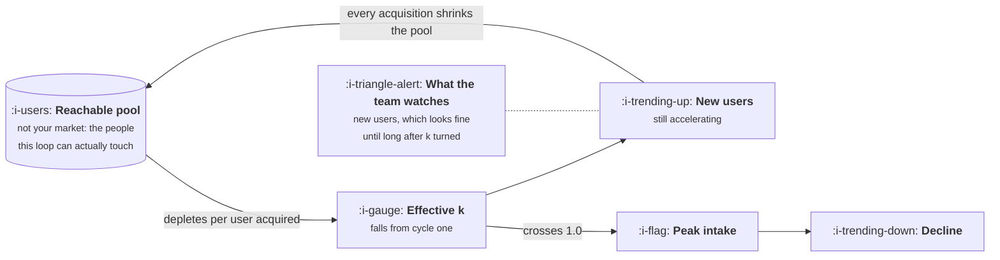

# Why Most Loops Die

```text
Level: Foundations
Prerequisites: Loop Speed and Loop Strength
Estimated difficulty: 3/5 | Estimated time: 40 min
```

## The idea in one minute

A loop almost never stops because the product got worse. It stops because the pool it was reaching
ran out, and the pool that matters is not your market: it is the much smaller set of people your
particular loop can actually touch. The important and counterintuitive part is the timing. The
loop factor begins falling from the very first cycle, because every user acquired removes somebody
from the pool, while absolute growth keeps accelerating for a long time afterwards. So the number
that predicts the stall is already deteriorating during the months everybody is celebrating, and
it is invisible to anyone watching new users per month. There is a way to see it early, and it
requires plotting the loop factor against cumulative users rather than against time.

## A picture



Two numbers move in opposite directions for most of the loop's life. The one everybody watches is
the one that tells you last.

## How it really works

### The reachable pool is not your market

Every loop runs against a finite set of people, and that set is almost always far smaller than the
addressable market, because the loop reaches people through a specific mechanism with its own
boundary.

A collaboration loop reaches the colleagues of your users, not everyone who could use the product.
A content loop reaches people who search for the particular queries your artifacts rank on. A
referral loop reaches the people your users would plausibly recommend something to, which is a
small subset of the people they know.

So the first diagnostic question is not how big the market is. It is how many people this
mechanism can touch, which is the number that goes into the arithmetic and the number nobody has
written down. A company with a ten million person market and a loop that reaches the twelve
colleagues of each user has a reachable pool in the low hundreds of thousands, and it will stall
there while every slide still says ten million.

### Why the stall is invisible until it is not

The effective loop factor is the nominal factor multiplied by the share of the pool still
unreached. That means it starts declining immediately, from the first user you acquire.

But new users per month is the effective factor multiplied by last month's new users, and for a
long time the growth in that second term more than compensates for the decline in the first. The
result is a product that grows faster every month while the thing causing the growth gets weaker
every month, and the two curves only cross when the effective factor passes 1.0.

That crossing is the peak. After it, intake falls absolutely, and the fall is roughly as steep as
the rise was. Teams experience this as a sudden inexplicable collapse, and look for a cause in
whatever shipped that month, because the actual cause has been operating steadily since the
beginning and never appeared on a dashboard.

### Reading the decline early

Here is the practical technique, and it is the most useful thing in this lesson.

Plotting the effective loop factor against time looks nearly flat in the early months and
extrapolates to a stall years away. That extrapolation is badly wrong, because the pool depletes
per user acquired rather than per month that passes, and users are arriving at an accelerating
rate.

Plot it against cumulative users instead and it is a straight line. Two measurements then give you
everything: the slope and the intercept of that line recover both the nominal loop factor and the
size of the reachable pool, and setting the line equal to 1.0 gives you the number of total users
at which intake will peak. The program below does this from four months of data and recovers the
true pool size almost exactly.

This is worth building once, as a standing chart. It is the only early warning available, and the
input is data you already have.

### The other four ways a loop dies

Pool exhaustion is the most common and the most predictable. Four others are worth naming because
they look the same from the dashboard and have different fixes.

**The invitation stops being welcome.** Acceptance falls because recipients have seen it before,
from you or from the eleven products that copied you. The pool is intact and the reinvestment term
has decayed. The tell is that acceptance falls while invitations sent holds steady.

**The platform changes.** Search ranking, feed distribution or an API permission moves, and a
content or exposure loop loses most of its output overnight. The tell is a step change rather
than a curve, and the date usually matches somebody else's release notes.

**The output stops being distinctive.** Mostly a content loop problem, and the sharpest version of
it is recent: when everybody can produce the artifact, the artifact stops earning attention. The
tell is that output volume rises while acceptance per unit of output falls, so k stays flat while
the cost of maintaining it climbs.

**The loop is cannibalised by a channel.** A paid channel starts buying the users who would have
arrived through the loop anyway. Nothing breaks, total growth looks fine, and the loop factor
falls because the people it would have recruited are already customers. This one is invisible
without a holdout and it is the reason the paid team and the loop team should not be graded
separately.

### What you can do about it

Pool exhaustion has three answers and only three. Find a new pool, which means a new segment or a
new geography, and the loop restarts at full strength. Change the mechanism so it reaches a
different pool, which is usually a product change rather than a growth change. Or accept the
ceiling and build the next loop before you hit it, which is what the companies that have managed
several growth eras actually did.

What does not work is optimising the existing loop harder. At eighty percent pool depletion a
twenty percent improvement in the nominal factor buys you very little, because it is being
multiplied by a number that is heading to zero.

### What fills the box in 2026

The standing chart described above is a warehouse query and a line graph, and the reason it is
rare is not tooling. It is that the chart looks boring and slightly alarming for the entire period
in which the company feels successful, which is a hard thing to keep on a dashboard. Build it
before the growth starts, not after it stops.

## Run the numbers

A loop with a nominal factor of 1.40 against a reachable pool of half a million, and the early
warning computed two ways.

```go
// saturation.go: the loop was never getting weaker. The pool was getting smaller.
package main

import "fmt"

func main() {
	const (
		reachable = 500_000.0 // people the loop can actually reach, not the market
		nominalK  = 1.40      // loop factor against a fresh pool
		months    = 18
	)

	total := 1_000.0
	newUsers := 1_000.0

	fmt.Printf("reachable pool %.0f, loop factor %.2f against a fresh pool\n\n",
		reachable, nominalK)
	fmt.Printf("%6s %12s %12s %10s %12s %12s\n",
		"month", "new", "total", "pool left", "effective k", "growth")

	var peak int
	var peakNew float64
	prev := newUsers
	for m := 1; m <= months; m++ {
		left := (reachable - total) / reachable
		effK := nominalK * left
		growth := newUsers/prev - 1
		if newUsers > peakNew {
			peakNew, peak = newUsers, m
		}
		if m <= 12 || m%2 == 0 {
			fmt.Printf("%6d %12.0f %12.0f %9.0f%% %12.2f %11.0f%%\n",
				m, newUsers, total, 100*left, effK, 100*growth)
		}
		prev = newUsers
		newUsers = effK * newUsers
		total += newUsers
	}

	fmt.Printf("\nintake peaks in month %d at %.0f and falls from there\n", peak, peakNew)

	fmt.Println("\nthe early warning, using only the first four months:")
	total, newUsers = 1_000.0, 1_000.0
	var t2, k2, t4, k4 float64
	for m := 1; m <= 4; m++ {
		effK := nominalK * (reachable - total) / reachable
		switch m {
		case 2:
			t2, k2 = total, effK
		case 4:
			t4, k4 = total, effK
		}
		newUsers = effK * newUsers
		total += newUsers
	}

	// Wrong: k is not linear in time, so extrapolating against months
	// pushes the peak far into the future.
	perMonth := (k2 - k4) / 2
	fmt.Printf("  against time:  k fell %.4f a month, so k = 1.0 in %.0f more months\n",
		perMonth, (k4-1)/perMonth)

	// Right: k is linear in cumulative users, because the pool depletes
	// with every user acquired rather than with every month that passes.
	slope := (k2 - k4) / (t4 - t2)
	intercept := k2 + slope*t2
	fmt.Printf("  against users: k = %.3f minus %.8f per user acquired\n", intercept, slope)
	fmt.Printf("                 implied reachable pool  %.0f\n", intercept/slope)
	peakTotal := (intercept - 1) / slope
	fmt.Printf("                 implied peak at a total of %.0f users\n", peakTotal)

	total, newUsers = 1_000.0, 1_000.0
	predicted := 0
	for m := 1; m <= 60; m++ {
		if total >= peakTotal {
			predicted = m
			break
		}
		newUsers = nominalK * (reachable - total) / reachable * newUsers
		total += newUsers
	}
	fmt.Printf("                 which the simulation reaches in month %d\n", predicted)

	fmt.Printf("\nThe real peak was month %d. Extrapolating k against time misses it\n", peak)
	fmt.Println("by years, because a pool depletes per user acquired, not per month.")
	fmt.Println("Plot the loop factor against cumulative users and it is a straight")
	fmt.Println("line whose intercept is your reachable pool.")
}
```

Read the growth column down. It is 40, 39, 39, 38, 37, 36 percent through month six, which is the
profile of a product that is working, and anybody reporting it monthly is reporting good news.
Now read the effective k column over the same rows: 1.40, 1.39, 1.39, 1.38, 1.37, 1.36. The decay
has been running since month one.

New users keep climbing to month 14, peaking at 26,285, and then fall away: 23,035 by month 16 and
15,080 by month 18. The decline from the peak is faster than the climb to it. Nothing changed in
month 14. The product shipped nothing, the market did nothing, and the effective factor simply
crossed 1.0 on a trajectory it had been on from the beginning.

The early warning section is the part to take away. Using only months two and four, extrapolating
the loop factor against time says the stall is 58 months off, which is comfortably beyond any
planning horizon and would reassure everybody. Extrapolating the same two measurements against
cumulative users instead recovers a reachable pool of 500,000, which is exactly right, and puts
the peak at 142,857 total users, which the simulation reaches in month 14, which is exactly right.

Same two data points. One method is off by four years and the other is correct to the month, and
the difference is only which axis you plotted against.

## The AI layer

The third death in the list above is the one that has changed character since 2023, and it
deserves the specific treatment.

When producing a loop artifact was expensive, the artifact earned attention partly because it was
scarce. Generated content has removed the scarcity without removing the need for attention, so the
acceptance term in content loops has been falling across the board for reasons that have nothing
to do with any individual company's execution. Teams experience this as their own content loop
decaying and respond by producing more, which lowers acceptance further and raises cost while k
stays roughly flat. The tell to watch for is specific: output volume rising, acceptance per unit
falling, k unchanged, cost per acquired user climbing steadily.

There is a second effect that is harder to see and more serious. A content loop that reaches
people through search is now partly reaching a model that summarises the artifact rather than a
person who visits it. The output still exists, the reach is arguably intact, and the reinvestment
step is broken because nobody arrives. For any loop whose acceptance depends on a click, the
pool has not changed and the mechanism has, which is the second death in the list wearing the
clothes of the third.

The useful response is to measure acceptance per unit of output as a standing metric rather than
only measuring k. The two move together when the loop is healthy, and they separate in exactly
this failure, which is how you tell it apart from pool exhaustion.

## Sector lens

| Sector | How the loop usually dies |
|---|---|
| [Enterprise B2B SaaS](../../product-management/product-by-sector/01-enterprise-b2b-saas.md) | Pool exhaustion inside each account, repeatedly. The account saturates at forty seats and the loop restarts only when you sell a new account |
| [Fintech](../../product-management/product-by-sector/02-fintech.md) | Slowly, because the pool renews: people keep needing to pay new counterparties. One of the few genuinely durable loops |
| [Ecommerce and D2C](../../product-management/product-by-sector/03-ecommerce-and-d2c.md) | Cannibalisation by paid, usually. The loop was small and the paid channel bought its pool out from under it |
| [Marketplaces](../../product-management/product-by-sector/04-marketplaces.md) | One side exhausts first and caps the other. The binding pool is almost always supply, and almost always discovered late |
| [Devtools and Infra](../../product-management/product-by-sector/05-devtools-and-infrastructure.md) | Platform change and loss of distinctiveness. The artifacts persist, which disguises the decline for a year or more |
| [Healthtech](../../product-management/product-by-sector/06-healthtech-and-regulated-care.md) | The pool is bounded by referral networks that are small and slow to change, so saturation arrives early and permanently |
| [Vertical SaaS](../../product-management/product-by-sector/07-vertical-saas.md) | Pool exhaustion, fast and total. A few thousand firms in the trade, a high loop factor, and a visible ceiling within two years |

## Remember this

* Loops die because the reachable pool runs out, and the reachable pool is much smaller than the
  market because the mechanism has a boundary.
* The effective loop factor falls from the first user acquired, while new users keep accelerating.
  The two only cross at the peak.
* Intake peaks when effective k passes 1.0, and the decline afterwards is about as steep as the
  rise.
* Extrapolating k against time is wrong and comfortingly so. Plot it against cumulative users,
  where it is a straight line whose intercept is your reachable pool.
* Four other deaths look identical on a dashboard: the invitation stops being welcome, the
  platform changes, the output stops being distinctive, and a paid channel eats the pool.
* Acceptance per unit of output is the metric that separates those from saturation. Track it
  alongside k.
* Optimising a loop at eighty percent depletion does almost nothing. Find a new pool, change the
  mechanism, or build the next loop.

## Try it

1. Run `saturation.go`, then change `reachable` to 5,000,000 and see how much later the peak
   arrives. The pool size is the single input that matters, and it is the one nobody estimates.
2. Estimate your own reachable pool from the mechanism rather than the market: how many people can
   one user actually touch through this loop, multiplied by how many users you can have. Compare
   it with the number in your plan.
3. Build the standing chart: effective loop factor on the vertical axis, cumulative users on the
   horizontal. Fit a line. Where does it cross 1.0, and how many users away is that?

## Check yourself

1. Why does new users per month keep rising for months after the loop factor has started falling,
   and what does that imply about which number belongs on the weekly dashboard?
2. Extrapolating k against time said 58 months, against cumulative users said 14. Both used the
   same two measurements. Explain the discrepancy in one sentence.
3. Your acceptance rate is falling while invitations sent holds steady and the pool is 30 percent
   depleted. Which death is this, and what would you check to confirm it?
