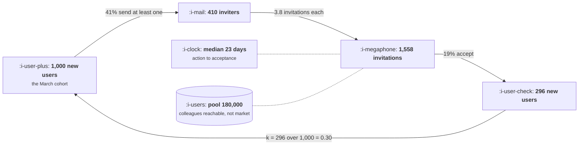

# Drawing Your Own Loop

```text
Level: Foundations
Prerequisites: Why Most Loops Die
Estimated difficulty: 2/5 | Estimated time: 35 min
```

## The idea in one minute

The distance between "we get a lot of word of mouth" and a loop you can forecast is six numbers,
and the work is almost entirely in refusing to move on until each one is measured rather than
estimated. Most loop diagrams fail for the same reason: they draw the story rather than the
mechanism, so every box is a noun that sounds important and no edge has a number on it. A drawn
loop is finished when a person who was not in the room can multiply the edges together, get your
loop factor, and tell you what your channels are worth. Anything short of that is a picture of an
intention.

## A picture



This is the finished state to aim at. Every edge carries a measured number, the cycle time and the
reachable pool are annotated because they are not edges, and the loop factor is arithmetic rather
than assertion.

## How it really works

### The six numbers

In order, because each one is harder to get than the last and there is no point estimating the
fourth while the first is still a guess.

1. **The cohort.** How many users arrived in a period, from anywhere. Pick a month that is old
   enough for most of the loop activity to have happened, which you will only know after you have
   number five.
2. **The action rate.** What share of that cohort took the visible action at least once. Not the
   average number of actions. The share of people.
3. **The output per actor.** How much output each of those people produced. Look at the
   distribution before you use the mean, because this term has a long tail in nearly every loop.
4. **The acceptance rate.** What share of that output became a new user. This is the term you will
   probably have to estimate or bound, and lesson 03 lists the three honest ways to do it.
5. **The cycle time.** The median days from action to acceptance. This tells you whether your
   cohort in step one was old enough, which is why the list loops back.
6. **The reachable pool.** How many people this mechanism can touch. Derived from the mechanism,
   never from the market.

Multiply two, three and four and you have k. Numbers five and six do not enter the loop factor and
they decide everything about what it is worth over time.

### How to get from a story to the numbers

Start with the sentence somebody said, which is usually a story about users telling other users,
and ask four questions in order.

**What exactly does the user do?** Not "they recommend us". A specific logged event. If no event
exists, that is the finding, and the loop cannot be measured until it does. Half the work of this
exercise is discovering that the mechanism everybody believes in is not instrumented.

**Who sees it, and how many of them?** The answer has to be a count that could in principle be
queried. "Their network" is not a count.

**What do those people have to do to become users?** Walk the steps. Each step is a multiplier
below one, and loops die in the steps nobody draws, such as a recipient needing an account before
they can view the thing they were sent.

**What would make this stop?** Usually the pool. Sometimes the platform. The answer belongs on the
diagram, because a loop drawn without its constraint will be forecast without one.

### The five ways a loop diagram goes wrong

| The error | What it looks like | Why it matters |
|---|---|---|
| A funnel drawn in a circle | Stages with drop off, and a cosmetic arrow from the end to the start | The return arrow has no mechanism, so the picture promises compounding the business does not have |
| No store | Every box is an activity, nothing accumulates | Without a store nothing is reinvested, and what you have is a channel |
| Aspiration | Boxes labelled with what you want to be true, such as delight or advocacy | Unmeasurable boxes cannot carry numbers, so the diagram can never be finished |
| Several loops at once | Eight boxes, crossing arrows, a legend | Each loop has its own factor, cycle and pool. Combined, none of them can be computed |
| A flywheel with no numbers | Four words in a circle, usually in a strategy deck | It is a slogan. It cannot be wrong, which means it cannot be used |

The last is worth being blunt about because it is so common. A circle of four nouns is compatible
with every possible set of numbers, including the ones where the loop does not work, so it cannot
inform a decision. If the diagram would look the same whether k is 0.02 or 2.0, it is not telling
you anything.

### Validating what you drew

Four checks before you rely on it.

**Does the arithmetic reproduce something you already know?** Multiply through and compare your
predicted loop signups against the actual count from a source you did not use to build the model.
If they disagree by more than about twenty percent, one of your terms is measuring something other
than what you labelled it.

**Does a term move when you expect it to?** Find a past change that should have moved one of the
three terms and check that it did. A model that did not respond to a change you know happened is
not measuring the mechanism.

**Is the pool defensible?** Say the derivation out loud: this many users, each reaching this many
people, minus overlap. If the answer is within an order of magnitude of your total market, you
have almost certainly used the market.

**Would a sceptic get the same number?** Hand the six inputs to somebody who disagrees with you
and see whether they produce your k. Disagreement about the inputs is productive. Disagreement
about what the inputs mean is the signal that the diagram is not finished.

### What fills the box in 2026

Draw it in whatever your team already reads, and keep it in the repository next to the query that
computes it rather than in a slide, because the numbers go stale within a quarter and a stale loop
diagram is worse than none. The one tooling opinion worth holding: the query that produces the six
numbers should be a single scheduled job with the definitions written in comments, so that the
next person to ask gets the same answer rather than a fresh derivation.

## Run the numbers

This takes the six numbers for three loop shapes and produces everything the topic has computed:
the loop factor, the ceiling, the steady state, how long it takes to arrive, and what a ten
percent error in any term costs.

```go
// looplint.go: six numbers in, a forecastable loop out. Change these to your own.
package main

import "fmt"

type loop struct {
	name       string
	cohort     float64 // users in the measured cohort
	actRate    float64 // share of them who take the visible action
	perActor   float64 // output each acting user produces
	accept     float64 // share of that output which becomes a user
	cycleDays  float64 // median days from action to acceptance
	reachable  float64 // people this mechanism can touch, not the market
	channelPer float64 // users a month bought from channels
}

func (l loop) k() float64       { return l.actRate * l.perActor * l.accept }
func (l loop) ceiling() float64 { return 1 / (1 - l.k()) }

// cyclesTo90 is how many turns before the loop reaches 90% of its ceiling.
func (l loop) cyclesTo90() int {
	share, term, k := 0.0, 1.0, l.k()
	for n := 1; n <= 1000; n++ {
		share += term
		term *= k
		if share/l.ceiling() >= 0.90 {
			return n
		}
	}
	return 1000
}

// usersAtPeak is where intake turns over, if the loop sustains itself at all.
func (l loop) usersAtPeak() (float64, bool) {
	if l.k() <= 1 {
		return 0, false
	}
	return l.reachable * (1 - 1/l.k()), true
}

func main() {
	loops := []loop{
		{"collaboration, B2B", 1_000, 0.41, 3.8, 0.19, 23, 180_000, 4_000},
		{"incentive referral", 1_000, 0.06, 2.1, 0.11, 9, 900_000, 4_000},
		{"user made content", 1_000, 0.22, 1.4, 0.40, 95, 2_400_000, 4_000},
	}

	for _, l := range loops {
		k := l.k()
		fmt.Printf("%s\n", l.name)
		fmt.Printf("  %.0f users, %.0f%% act, %.1f each, %.0f%% accept\n",
			l.cohort, 100*l.actRate, l.perActor, 100*l.accept)
		fmt.Printf("  k            %.3f\n", k)
		if k >= 1 {
			at, _ := l.usersAtPeak()
			fmt.Printf("  sustains itself, intake peaks near %.0f total users\n", at)
		} else {
			fmt.Printf("  ceiling      %.2fx on every channel\n", l.ceiling())
			fmt.Printf("  steady state %.0f users a month, from %.0f bought\n",
				l.channelPer*l.ceiling(), l.channelPer)
			fmt.Printf("  gets there   %d cycles, about %.0f days\n",
				l.cyclesTo90(), float64(l.cyclesTo90())*l.cycleDays)
		}

		// All three terms are multiplied together, so a proportional error
		// in any one of them moves k by the same amount. Show it rather
		// than assert it.
		for _, t := range []string{"act rate", "output each", "acceptance"} {
			b := l
			switch t {
			case "act rate":
				b.actRate *= 1.1
			case "output each":
				b.perActor *= 1.1
			case "acceptance":
				b.accept *= 1.1
			}
			fmt.Printf("  10%% better %-12s k %.3f, ceiling %.2fx\n", t, b.k(), b.ceiling())
		}
		fmt.Println()
	}
	fmt.Println("All three terms are multiplied, so a 10% error anywhere costs the same.")
	fmt.Println("Measure the one you are least sure of, not the one that is lowest.")
}
```

The three loops are deliberately chosen to look similar in a slide and behave nothing alike.

The collaboration loop is the strong one, at a k of 0.296 and a ceiling of 1.42x, turning the
4,000 users a month you buy into a steady 5,682. It reaches that in about 46 days, which means the
quarter you measure it in shows you most of what it is worth.

The incentive referral loop is the honest reason lesson 02 was rude about referral programmes.
Six percent of users send 2.1 invitations each at eleven percent acceptance, which is a k of 0.014
and a ceiling of 1.01x. It converts 4,000 bought users into 4,056. Every one of those component
numbers would read as acceptable in a report, and the programme is worth 56 users a month.

The user made content loop has a reasonable k of 0.123 and takes about 190 days to reach its
ceiling, which is the pattern from lesson 04: it will look like a failure for two quarters and
then be worth 1.14x forever. Judged quarterly it gets cut in month four.

The last block in each case prints the same k and the same ceiling three times. That is not a bug.
The three terms are multiplied, so a ten percent improvement in any one is worth exactly a ten
percent improvement in any other, which settles a common argument before it starts: work on the
term you can move most cheaply, or the one you are least sure you have measured correctly, and
ignore entirely the fact that one of them looks low.

## The AI layer

The first of the four questions above, what exactly does the user do, is where a model earns its
place in this exercise. The usual blocker is that the mechanism is real and unlogged: users are
sharing something, and the only evidence is in support conversations, sales call notes and free
text. Reading several thousand of those to find the sentence that describes the actual mechanism
is a few pounds of inference and was previously a fortnight nobody authorised.

Two cautions that follow directly from the rest of this lesson.

A model asked to draw your growth loop will produce a plausible one, because loop diagrams are
abundant in its training data and the genre has a shape. What comes back will be competent,
generic, and indistinguishable from the flywheel in the table above, since it has no access to
your event data and no way to signal that absence. The output of this exercise is six measured
numbers, and a model can help you find out what to measure while contributing nothing to the
measuring.

The second is the pool. Asked how many people a mechanism can reach, a model will reason from
market size, because that is what published analyses do. That is precisely the error lesson 05
warns about, arriving with more confidence than a person would have used.

## Sector lens

| Sector | What is hardest to draw |
|---|---|
| [Enterprise B2B SaaS](../../product-management/product-by-sector/01-enterprise-b2b-saas.md) | The cohort, because the right unit is the account and the loop inside an account differs from the loop between them. Draw two diagrams |
| [Fintech](../../product-management/product-by-sector/02-fintech.md) | Nothing, relatively. Every edge is a logged transaction, which makes this the easiest sector to complete the exercise in |
| [Ecommerce and D2C](../../product-management/product-by-sector/03-ecommerce-and-d2c.md) | Acceptance, because the recipient of a recommendation arrives through a channel that claims them. The holdout is the only clean answer |
| [Marketplaces](../../product-management/product-by-sector/04-marketplaces.md) | The shape itself. Two loops feeding each other cannot be drawn as one, and the attempt is the fourth error in the table |
| [Devtools and Infra](../../product-management/product-by-sector/05-devtools-and-infrastructure.md) | Output and acceptance both, since the artifacts are public and the readers never touch your systems. Expect to bound rather than measure |
| [Healthtech](../../product-management/product-by-sector/06-healthtech-and-regulated-care.md) | The action, because the thing users do may not be loggable for privacy reasons. Sometimes the honest diagram has a question mark in it |
| [Vertical SaaS](../../product-management/product-by-sector/07-vertical-saas.md) | The pool, and it is the one that matters most here. Count the firms in the trade. It is usually a four figure number |

## Remember this

* Six numbers: cohort, action rate, output per actor, acceptance, cycle time, reachable pool. The
  first four give you k, the last two give you what it is worth.
* Measure the share of people who act separately from how much each one produces.
* Start from the logged event. Discovering the mechanism is not instrumented is the most common
  outcome of this exercise and a legitimate result.
* Five ways it goes wrong: a funnel in a circle, no store, aspirational boxes, several loops at
  once, and a flywheel with no numbers.
* If the diagram would look identical whether k is 0.02 or 2.0, it cannot inform a decision.
* Validate by reproducing a number you did not use to build it, and by handing the inputs to
  somebody who disagrees with you.
* All three terms are multiplied, so a proportional improvement in any of them is worth the same.
  Work on the cheapest to move, not the one that looks lowest.

## Try it

1. Run `looplint.go` with your own six numbers. If you cannot fill all six, the missing one is
   your next piece of work and the output is not yet a forecast.
2. Draw your loop in the style of the diagram above, with a number on every edge. Show it to
   somebody in engineering and ask which numbers they could query today. The gap is the
   instrumentation backlog.
3. Take the most recent flywheel diagram in your company's strategy material. Write the six
   numbers next to it, or write down which of them cannot be known. Either outcome is more useful
   than the diagram.

## Check yourself

1. What is the difference between a funnel drawn in a circle and a loop, in terms of what is on
   the return arrow?
2. Your three terms are an 8 percent action rate, 11 outputs each, and a 31 percent acceptance
   rate. A colleague wants to work on the action rate because 8 percent looks poor. What is wrong
   with that reasoning, and what is the right basis for choosing?
3. You estimate your reachable pool at 4 million against a market of 6 million. What has almost
   certainly gone wrong, and how would you redo the derivation?
