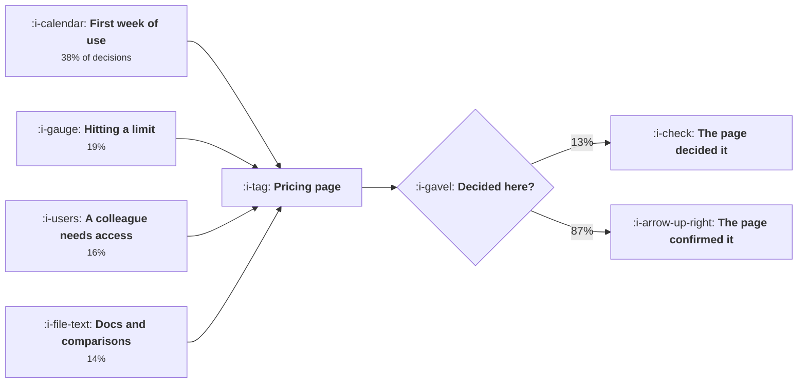

# Where the Paying Decision Happens

```text
Level: Intermediate
Prerequisites: What Activation Means Here
Estimated difficulty: 3/5 | Estimated time: 35 min
```

## The idea in one minute

By the time somebody opens your pricing page, two thirds of them have already decided. A fifth
arrive intending to buy and convert at 82 percent whatever the page says; nearly half arrive
having decided against and are checking the number before leaving. The page can only change the
outcome for the third who are genuinely undecided, which means a perfect pricing page is worth
about 37 percent more buyers and that is the entire ceiling. Meanwhile 38 percent of paying
decisions are made during the first week of use, a surface the conversion team usually does not
own. Conversion work is misallocated almost everywhere, and the misallocation follows the
organisation chart rather than the evidence.

## A picture



Four surfaces decide, one surface records. Conversion teams are usually staffed against the box on
the right.

## How it really works

### Split your pricing page traffic by what they came to do

Three states, and they need separating because they respond to completely different things.

**Already decided.** They want the price confirmed and a path to checkout. They convert at over 80
percent and the only thing a page can do for them is get out of the way. Every additional element,
comparison table or lead capture form costs some of them.

**Decided against.** They are checking the number out of curiosity or to complete a comparison. They
convert at two percent and nothing on the page moves them, because the decision was made by the
product or by a competitor.

**Genuinely undecided.** A third of traffic, converting at 19 percent, and this is the only
population a pricing page can serve. Doubling their conversion rate is a legitimate and large
achievement, and it moves overall conversion from 24.4 percent to 33.5.

The practical instruction: measure the split before investing. Entry source, prior session count
and whether they have reached your activation event will separate the three states well enough to
act on.

### The ceiling, stated plainly

A perfect pricing page is worth 908 extra buyers out of 10,000 visitors in the worked case, which
is 37 percent more. That is genuinely worth having. It is also the maximum, and a team that has
already done the obvious work on their pricing page is operating inside a much smaller remaining
margin while treating it as the main lever.

### Where the decisions actually get made

Ask a sample of new payers when they decided, and the answers cluster in four places upstream of
the page. In the worked distribution: 38 percent during the first week of use, 19 percent when a
limit was hit, 16 percent when a colleague needed access, 14 percent in the documentation or a
comparison article, and 13 percent on the pricing page.

Multiply those shares by a notional 10 percent improvement to each surface and the first week is
worth 2.9 times the pricing page. Hitting a limit is worth 1.5 times. These are the surfaces to
staff, and they belong to onboarding, to the product, and to whoever writes the documentation.

### Why the work goes to the wrong place anyway

Three reasons, all organisational rather than analytical.

The pricing page is owned by one team and is easy to change. The first week of use is owned by
product and requires their roadmap. So the available work is on the page.

The pricing page has clean attribution. A test on it produces a number in a week. The first week of
use produces a number in a quarter, which is the measurement problem in
[Measuring an Onboarding Change](../activation-and-onboarding/07-measuring-an-onboarding-change.md).

And conversion rate is defined with the pricing page as the denominator in most analytics setups,
which makes upstream improvements invisible or, worse, make the metric fall: improving the product
so that more undecided users reach the page lowers pricing page conversion while raising revenue.

### Ask the question that fixes this

One question to every new payer, in the receipt or the welcome email: when did you decide to pay?
Free text, a few hundred responses, classified. It takes a fortnight and it reallocates a year of
work. Most companies have never asked it, and the distribution is reliably different from what the
team assumed.

### What fills the box in 2026

Self serve pricing pages have converged on a common pattern and there is very little differentiated
advantage left in the layout, which reinforces the argument above: the remaining variance is
upstream. The one genuine change is that buyers increasingly arrive having read a comparison
written by somebody else, including machine generated ones, so the fourth surface in the list is
less under your control than it was. That is the subject of
[Search Inside Answer Engines](../content-and-search/06-search-inside-answer-engines.md).

## Run the numbers

Bound the pricing page, then rank the surfaces that are not the pricing page.

```go
// payingdecision.go: how much of the decision is left by the time somebody
// reaches the pricing page.
package main

import "fmt"

// Users arrive at the pricing page in one of three states. The page can only
// change the outcome for one of them, which bounds what any amount of pricing
// page work is worth.
type state struct {
	name  string
	share float64 // share of pricing page visitors in this state
	conv  float64 // chance they buy, with the page as it is
	best  float64 // chance they buy, with a perfect page
}

func main() {
	visitors := 10_000.0
	states := []state{
		{"already decided to buy", 0.21, 0.82, 0.91},
		{"decided against, checking the price", 0.46, 0.02, 0.04},
		{"genuinely undecided", 0.33, 0.19, 0.38},
	}

	fmt.Printf("%.0f pricing page visitors\n\n", visitors)
	fmt.Printf("%-38s %9s %10s %12s %12s\n",
		"state on arrival", "share", "converts", "buyers", "ceiling")
	now, ceiling := 0.0, 0.0
	for _, s := range states {
		n := visitors * s.share
		now += n * s.conv
		ceiling += n * s.best
		fmt.Printf("%-38s %8.0f%% %9.0f%% %12.0f %12.0f\n",
			s.name, 100*s.share, 100*s.conv, n*s.conv, n*s.best)
	}
	fmt.Printf("\n%-38s %9s %10s %12.0f %12.0f\n", "total", "", "", now, ceiling)
	fmt.Printf("%-38s %33.1f%% %11.1f%%\n", "conversion", 100*now/visitors,
		100*ceiling/visitors)
	fmt.Printf("\na perfect pricing page is worth %.0f extra buyers, %.0f%% more\n",
		ceiling-now, 100*(ceiling/now-1))

	fmt.Println("\nwhere those decisions were actually made:")
	earlier := []struct {
		where string
		share float64
	}{
		{"during the first week of use", 0.38},
		{"when a limit was hit", 0.19},
		{"when a colleague needed access", 0.16},
		{"reading the docs or a comparison", 0.14},
		{"on the pricing page itself", 0.13},
	}
	for _, e := range earlier {
		fmt.Printf("%-38s %8.0f%%\n", e.where, 100*e.share)
	}

	fmt.Println("\nwhat a 10% improvement is worth, by surface:")
	fmt.Printf("%-38s %16s %14s\n", "improve this by 10%", "extra buyers", "vs pricing page")
	// a 10% improvement to a surface lifts the decisions made there, in
	// proportion to how many decisions that surface carries
	const pageShare = 0.13
	for _, e := range earlier {
		gain := 0.10 * now * e.share
		fmt.Printf("%-38s %16.0f %13.1fx\n", e.where, gain, e.share/pageShare)
	}

	fmt.Println("\nThe first week of use carries three times the weight of the pricing")
	fmt.Println("page, and it is where almost no conversion work happens, because the")
	fmt.Println("team that owns conversion does not own the first week.")
}
```

The first table is the ceiling. The decided buyers contribute 1,722 now and 1,911 at best, so 189
buyers are available from a group that is already converting at 82 percent. The decided against
contribute 92 and could contribute 184, which is 92 buyers from nearly half your traffic. The
undecided contribute 627 and could contribute 1,254.

So 627 of the 908 available buyers, about two thirds, come from one third of the traffic. That is
where any pricing page work should be aimed, and it is an argument for segmenting the page by
arrival state rather than optimising one page for three audiences with opposite needs.

The surface table is the reallocation argument. A 10 percent improvement to the first week of use
is worth 93 extra buyers against 32 for the same improvement to the pricing page. The ratio column
is the thing to put in a planning document, because it is a statement about where to spend people
rather than about any individual change.

Replace the `earlier` shares with your own survey results. If you do not have them, the honest
version of this analysis is to run the survey first, because the shares are the input everything
else depends on and they vary enormously by product.

## The AI layer

Two applications, one small and one that changes the first table.

The small one is classifying the free text survey responses that produce the surface distribution.
A few hundred answers, a stable set of categories, and a model does it in minutes for pennies. This
is the cheapest useful thing in the lesson and it unblocks everything else.

The larger one is segmenting the pricing page by arrival state. The three states in the first table
respond to opposite things: the decided want fewer elements, the undecided want more explanation.
Serving different pages to different states requires classifying the visitor, which is a small
prediction over session history and referrer, and it is the one intervention that can approach the
ceiling rather than averaging across the three groups. Cost is negligible.

What a model should not do is write the pricing page. The constraint is not language, it is that
two thirds of the audience has already decided, and no amount of copy addresses that.

The failure mode worth naming: personalised pricing presentation drifts into personalised pricing,
where different visitors see different numbers based on inferred willingness to pay. That is a
different decision with legal, trust and reputational consequences that have nothing to do with
conversion optimisation, and it should be made deliberately by somebody senior rather than arrived
at incrementally by a model optimising a conversion metric.

## Sector lens

| Sector | Where the decision is really made here |
|---|---|
| [Enterprise B2B SaaS](../../product-management/product-by-sector/01-enterprise-b2b-saas.md) | In a meeting you are not in, weeks before anybody visits pricing. The page exists to survive procurement, not to persuade |
| [Fintech](../../product-management/product-by-sector/02-fintech.md) | At the moment of a transaction, where the fee is compared against the alternative. Pricing is encountered in context, not on a page |
| [Ecommerce and D2C](../../product-management/product-by-sector/03-ecommerce-and-d2c.md) | On the product page and at the delivery estimate. The pricing page equivalent is the basket, and it mostly loses people |
| [Marketplaces](../../product-management/product-by-sector/04-marketplaces.md) | Supply side decides on take rate against earnings; demand side rarely sees a pricing page at all |
| [Devtools and Infra](../../product-management/product-by-sector/05-devtools-and-infrastructure.md) | In the documentation and at the free tier limit. Developers price you from the docs long before the pricing page |
| [Healthtech](../../product-management/product-by-sector/06-healthtech-and-regulated-care.md) | In a procurement process with a committee. Published pricing is often a liability rather than an asset |
| [Vertical SaaS](../../product-management/product-by-sector/07-vertical-saas.md) | In a demo with a salesperson or a peer recommendation at a trade event. The page is a formality |

## Remember this

* Pricing page visitors arrive in three states, and the page can only change the outcome for the
  undecided third.
* A perfect pricing page is worth about 37 percent more buyers. That is the ceiling, not the
  starting point.
* Two thirds of the available gain comes from one third of the traffic, which argues for segmenting
  the page rather than averaging it.
* Thirty eight percent of decisions are made during the first week of use, which is worth 2.9 times
  the pricing page for the same relative improvement.
* The work goes to the page because the page is owned by one team, changes fast, and has clean
  attribution.
* Improving upstream surfaces can lower pricing page conversion while raising revenue, which
  punishes the right work if the metric is defined badly.
* Ask every new payer when they decided. A fortnight of survey work reallocates a year of
  roadmap.
* A model is useful for classifying those responses and for segmenting the page by arrival state,
  and should not be allowed to drift into personalised prices.

## Try it

1. Split your pricing page traffic into the three states using entry source and prior sessions, and
   compute conversion for each. Then compute your own ceiling with `payingdecision.go`.
2. Send the one question survey to every new payer for a month and classify the answers. Compare
   the distribution with where your conversion work actually went last quarter.
3. Check how conversion rate is defined in your analytics. If the denominator is pricing page
   visitors, propose the version with signups as the denominator and see which upstream projects
   change rank.

## Check yourself

1. Your pricing page converts at 19 percent and you believe a redesign could reach 26. What do you
   need to know about the traffic before believing that, and what is the most likely ceiling?
2. Why can improving onboarding make pricing page conversion fall while revenue rises, and what
   does that imply about which metric to put on a dashboard?
3. A team proposes a six week pricing page project and a two week survey of new payers. Which goes
   first and why?
