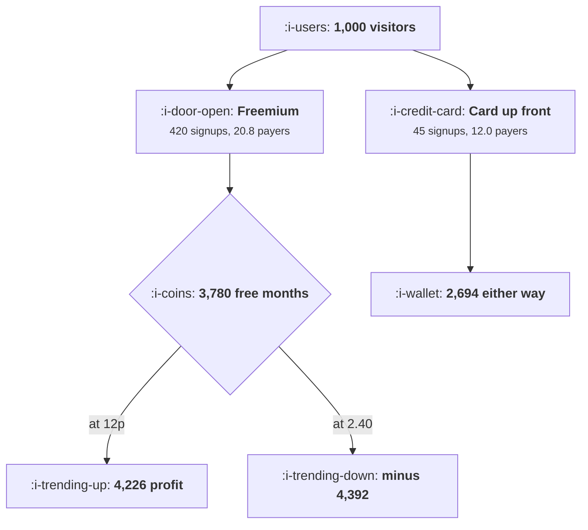

# Trial, Freemium or Reverse Trial

```text
Level: Intermediate
Prerequisites: Where the Paying Decision Happens
Estimated difficulty: 4/5 | Estimated time: 40 min
```

## The idea in one minute

The choice between a trial, freemium and a reverse trial is usually argued as a philosophy and it
is decided by one number: what it costs to serve a free user for a month. At twelve pence,
freemium earns 4,226 per thousand visitors and a card up front trial earns 2,694, so freemium wins
by more than half. At 2.40, which is an ordinary figure for a product with a model in it, freemium
loses 4,392 and the card up front trial wins by admitting a ninth as many people. The crossover
for freemium in the worked case is 53 pence a month. Compute your own cost to serve, compare it
with your crossover, and the argument is over.

## A picture



Freemium produces nearly twice the payers in both worlds. What changes is the bill underneath it.

## How it really works

### What each option selects for

**A trial with a card up front.** Admits the fewest people and the best ones: 46 percent of those
who reach value convert, because asking for a card is the friction that filters for intent, which
is the arithmetic in
[Friction Worth Keeping](../activation-and-onboarding/04-friction-worth-keeping.md). Almost no
free serving cost. The weakness is that the funnel is narrow, so it caps how much the product can
be discovered.

**A trial with no card.** Four times the signups and a third of the conversion rate, and it ends
up producing slightly fewer payers than the card version while costing four times as much to
serve. In the worked table it is beaten by the card version at any serving cost, which is a
genuine finding rather than a quirk of the inputs: if you are going to run a time limited trial,
asking for the card is usually right, and the common instinct to remove it trades conversion for
signups at a bad rate.

**Freemium.** The largest funnel and the largest payer count, because users convert over months
rather than at a deadline, and a free tier is a permanent acquisition surface. The cost is that
you are running infrastructure for people who will never pay, forever, and that cost is the whole
risk.

**A reverse trial.** Full features for a period, then a downgrade to a free tier rather than a
wall. Reaches value at the highest rate in the table, 47 percent, because the user sees the real
product. Produces nearly as many payers as freemium with a third less free serving cost, which
makes it the robust middle option and the one to default to when the serving cost is uncertain.

### The number that decides it

Cost to serve a free user for a month. Not your average cost per user, which is dominated by
payers, but the marginal cost of one more free account: storage, compute, support contacts, third
party per seat costs, and for a product with a model in it, inference.

For a traditional SaaS product this is usually between five and thirty pence. For a product where
every use costs money it is routinely between one and five pounds, and it is the single number
that invalidates most received wisdom about packaging, which was formed when the number was
negligible.

### Reading the crossover

The crossover is where a packaging option stops beating the strictest alternative. Freemium's is
53 pence a month in the worked case and the reverse trial's is 70 pence.

Those figures move with your conversion rate and your price, which is why the program is more
useful than the numbers. A product with a high price and good free to paid conversion can afford
an expensive free tier; a cheap product with weak conversion cannot afford any free tier at all,
and that combination is more common than the literature suggests.

### Limiting the free tier properly

If the serving cost says freemium is marginal, the answer is usually not to abandon it but to
bound it. Three ways, in order of how well they work.

* **Limit by consumption, not by features.** The cost is driven by use, so cap use. This also makes
  the upgrade trigger legible, which is the subject of
  [Paywalls](03-paywalls.md).
* **Limit by time since last activity.** Dormant free accounts cost money and never convert. A
  hibernation policy after some months of inactivity removes most of the cost and almost none of
  the conversion.
* **Limit by features.** Works least well, because the features that cost you money are rarely the
  features that would persuade somebody to pay, so you end up giving away the expensive half.

### What fills the box in 2026

The reverse trial has become the default for new products and the reason is the one above: it
reaches value at trial rates while capping exposure at freemium rates. Separately, free tiers in
products with a model inside them have been quietly shrinking since 2023, with usage caps
replacing feature caps almost everywhere, which is exactly what the arithmetic predicts. A free
tier defined in features and launched before the inference bill was understood is the single most
common structural mistake in this category.

## Run the numbers

Compute payers, then subtract the cost of everybody who is not one.

```go
// packaging.go: what each way of giving the product away selects for, and
// what it costs to run.
package main

import "fmt"

// Four ways to let somebody try the product. Each one trades signup volume
// against the quality of the people it admits, and each one leaves a
// different number of non paying users on your infrastructure.
type model struct {
	name      string
	signups   float64 // per 1000 visitors
	reach     float64 // share who reach the product's value
	convert   float64 // share of those who then pay
	freeMnths float64 // months of free service per signup, over a year
}

const (
	visitors = 1000.0
	arpu     = 24.0 // monthly revenue per payer
	margin   = 0.78 // gross margin on a payer
)

func (m model) payers() float64 { return m.signups * m.reach * m.convert }

func (m model) annualProfit(serveCost float64) float64 {
	revenue := m.payers() * arpu * 12 * margin
	free := m.signups * m.freeMnths * serveCost
	return revenue - free
}

func main() {
	models := []model{
		{"14 day trial, card up front", 45, 0.58, 0.46, 0.5},
		{"14 day trial, no card", 170, 0.36, 0.19, 0.5},
		{"freemium, no time limit", 420, 0.31, 0.16, 9.0},
		{"reverse trial, then free tier", 290, 0.47, 0.14, 8.0},
	}

	fmt.Printf("per %.0f visitors, payer worth %.0f a month at %.0f%% margin\n\n",
		visitors, arpu, 100*margin)
	fmt.Printf("%-32s %9s %9s %10s %10s %14s\n",
		"packaging", "signups", "reach", "convert", "payers", "free months")
	for _, m := range models {
		fmt.Printf("%-32s %9.0f %8.0f%% %9.1f%% %10.1f %14.0f\n",
			m.name, m.signups, 100*m.reach, 100*m.convert, m.payers(),
			m.signups*m.freeMnths)
	}

	for _, sc := range []float64{0.12, 2.40} {
		fmt.Printf("\nannual gross profit per %.0f visitors, free user costs %.2f a month:\n",
			visitors, sc)
		fmt.Printf("%-32s %14s %14s %14s\n",
			"packaging", "revenue", "free cost", "profit")
		best, bestP := "", -1e18
		for _, m := range models {
			rev := m.payers() * arpu * 12 * margin
			free := m.signups * m.freeMnths * sc
			p := rev - free
			if p > bestP {
				best, bestP = m.name, p
			}
			fmt.Printf("%-32s %14.0f %14.0f %14.0f\n", m.name, rev, free, p)
		}
		fmt.Printf("%-32s %44s\n", "best", best)
	}

	fmt.Println("\nThe ranking inverts. At 12p a month to serve a free user, freemium")
	fmt.Println("earns the most and the reverse trial is second. At 2.40, which is an")
	fmt.Println("ordinary figure once a model is in the product, both are heavily loss")
	fmt.Println("making and the winner is a trial that asks for a card and admits a")
	fmt.Println("ninth as many people.")

	fmt.Println("\nthe serving cost at which each option stops winning:")
	fmt.Printf("%-32s %22s\n", "packaging", "beaten above a cost of")
	for _, m := range models[1:] {
		found := false
		for c := 0.0; c < 20; c += 0.01 {
			if models[0].annualProfit(c) > m.annualProfit(c) {
				if c == 0 {
					fmt.Printf("%-32s %21s\n", m.name, "at any cost")
				} else {
					fmt.Printf("%-32s %21.2f\n", m.name, c)
				}
				found = true
				break
			}
		}
		if !found {
			fmt.Printf("%-32s %21s\n", m.name, "never")
		}
	}
	fmt.Println("\nCompare the crossover figures against your own cost to serve a free")
	fmt.Println("user for a month. That one number decides the packaging, and most")
	fmt.Println("teams have never computed it.")
}
```

The first table is the funnel comparison and it is the one most packaging decisions are made on.
Freemium produces 20.8 payers per thousand visitors against 12.0 for a card up front trial, which
looks decisive.

The free months column is the part that is usually missing: 3,780 against 22. That is a ratio of
172, and it is why the second number in the comparison can swamp the first.

The two profit tables are the same product under two cost structures. At 12 pence freemium earns
4,226 and the trial earns 2,694. At 2.40 freemium loses 4,392 and the trial earns 2,643, barely
changed, because it has almost no free users to pay for. Note how stable the trial options are
across the two tables: a narrow funnel is also an insulated one.

The crossover table is the output to act on. Measure your marginal cost to serve a free user for a
month, compare it with 0.53 and 0.70, and the decision is made. If your cost is near a crossover,
the reverse trial is the safer choice because its crossover is higher and its downside at high cost
is a third of freemium's.

## The AI layer

This is the lesson where the model is not an addendum, because inference cost is the variable the
whole decision turns on, and it has moved packaging practice more than any pricing idea of the last
decade.

A free user of a product with a model inside it costs real money every time they use it, and the
cost scales with engagement rather than with revenue, which inverts the usual logic: your most
active free users are your most expensive liability rather than your best prospects. The specific
consequence is that a free tier must be capped in units of model work, not in features, and the cap
has to be set from the crossover arithmetic above rather than from what feels generous.

Three practices that follow. Meter the free tier in a unit the user understands and you can price,
such as messages, documents or runs. Route free tier work to your cheapest acceptable model, which
can change the serving cost by a factor of five or more and is invisible to most users. And set a
hibernation policy, because an abandoned free account with a connected data source can keep costing
money indefinitely.

The failure mode is launching a feature limited free tier and discovering the bill a quarter later,
by which point the cap cannot be tightened without a public argument. The detail that makes this
worse than it sounds: the users who will object loudest are the heaviest free users, who are the
ones the arithmetic says you cannot afford, so the political cost of fixing it is highest exactly
where the financial need is greatest. Set the cap conservatively at launch and loosen it later,
which is a move you can make and its reverse is not.

## Sector lens

| Sector | What decides the packaging here |
|---|---|
| [Enterprise B2B SaaS](../../product-management/product-by-sector/01-enterprise-b2b-saas.md) | A free tier exists to get in the door before procurement. Its cost is a sales expense, so the crossover is higher than the arithmetic suggests |
| [Fintech](../../product-management/product-by-sector/02-fintech.md) | Onboarding a free user costs a verification fee, which is a real per signup cost rather than a monthly one. Card up front is usual |
| [Ecommerce and D2C](../../product-management/product-by-sector/03-ecommerce-and-d2c.md) | No trial exists. The equivalent decision is returns policy, and the arithmetic is the same shape |
| [Marketplaces](../../product-management/product-by-sector/04-marketplaces.md) | Free supply is the inventory, so serving cost is an acquisition cost. Never cap the side that creates the liquidity |
| [Devtools and Infra](../../product-management/product-by-sector/05-devtools-and-infrastructure.md) | A generous free tier is the distribution strategy, and serving cost is genuinely low for small workloads. Meter by usage from day one |
| [Healthtech](../../product-management/product-by-sector/06-healthtech-and-regulated-care.md) | Free accounts carry the same compliance and data retention obligations as paid ones, which is a cost nobody models |
| [Vertical SaaS](../../product-management/product-by-sector/07-vertical-saas.md) | Too few possible customers to give the product away. A guided trial with a human is the usual and correct answer |

## Remember this

* The choice is decided by the marginal cost to serve a free user for a month, not by philosophy.
* At twelve pence freemium wins by half; at 2.40 it loses heavily and a card up front trial wins.
* Freemium's crossover in the worked case is 53 pence a month and the reverse trial's is 70.
* A no card trial is beaten by a card up front trial at any serving cost. Removing the card trades
  conversion for signups at a bad rate.
* A reverse trial reaches value at the highest rate and caps exposure, which makes it the robust
  default when serving cost is uncertain.
* Trial options are insulated: their profit barely moves between the two cost worlds.
* Bound a free tier by consumption first, by inactivity second, and by features last.
* With a model in the product, your heaviest free users are your largest liability, so meter in
  units of model work.
* Set the free cap conservatively at launch. Loosening is available later and tightening is not.

## Try it

1. Compute your marginal cost to serve a free user for a month, including inference, storage,
   support and per seat third party costs. Most teams do not have this number.
2. Run `packaging.go` with your own signup, reach and conversion figures, and find your crossovers.
   Compare them with the number from step one.
3. Measure the cost of your dormant free accounts, those with no activity for six months. Price a
   hibernation policy against the conversions it would lose.

## Check yourself

1. Your free tier costs 1.80 a month per user to serve and freemium's crossover for your product is
   0.90. What are your options, and which would you try first?
2. Why does a no card trial usually produce fewer payers than a card up front trial despite four
   times the signups?
3. You are launching a product with a model in it and have not measured serving cost. What
   packaging do you choose, and what do you commit to revisiting?
