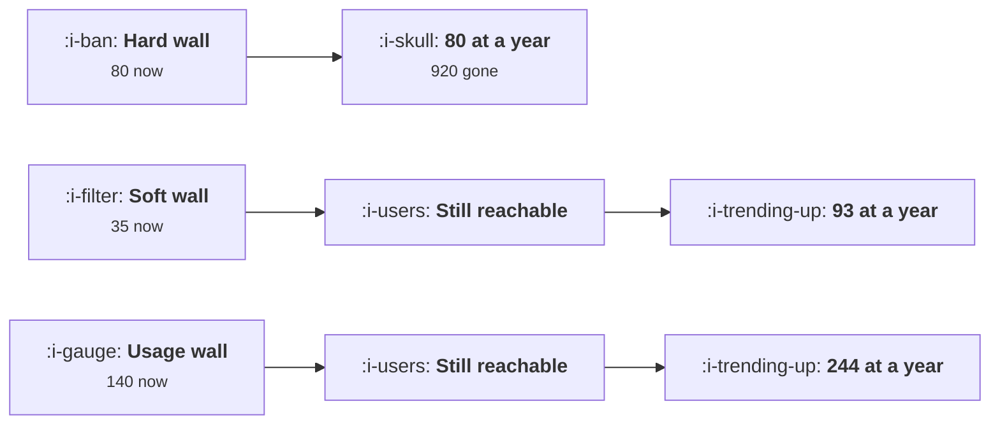

# Paywalls

```text
Level: Intermediate
Prerequisites: Trial, Freemium or Reverse Trial
Estimated difficulty: 3/5 | Estimated time: 35 min
```

## The idea in one minute

A paywall does two things and every paywall test measures one of them. It converts some people at
the moment they hit it, and it decides what happens to everybody else, which is the larger effect
and takes months to appear. A hard wall converts 80 users out of a thousand on the day and finishes
the year at 80, because the other 920 are gone. A usage based wall converts 140 on the day and
finishes at 244, because the people who do not pay are still there next month. Read at four weeks a
hard wall looks competitive; read at a year it has to convert a quarter of everybody it blocks just
to draw level, which almost nothing does.

## A picture



Three walls, one cohort. The month zero column would pick the left one.

## How it really works

### A wall teaches something, and the lesson persists

**A hard wall teaches that the product is not for you.** The user did not get to the thing they
were trying to do, and they leave with no relationship and no reason to come back. The 920 in the
worked case are not dormant, they are gone, and no win back programme reaches somebody who never
got in.

**A soft wall teaches that the product is useful and bounded.** Reduced access continues, so the
user keeps a relationship, keeps getting value, and converts later when the need grows. It
converts fewest on the day, 35 of a thousand, and passes the hard wall in month 7.

**A usage wall teaches that the product is working and they are using it a lot.** This is the
strongest position, because the user crossed the line themselves through their own activity, so
the wall arrives as a consequence of success rather than as an obstruction. It converts 140 on the
day, nearly twice the hard wall, and keeps 75 percent of the rest reachable.

### Why the usage wall converts best at the moment of impact

The user who hits a usage limit has demonstrated, to themselves, that the product is worth
something. Nobody hits a monthly document limit without having written documents. So the wall is
encountered by a self selected population with evidence of value in hand, which is a completely
different audience from everybody who tried to open the product.

That is also why the limit's unit matters. A limit in a unit the user recognises as their own work,
documents, projects, team members, runs, converts far better than a limit on something abstract
like API calls or storage, because the first is a measure of their success and the second is a
measure of your costs.

### What a test at four weeks does to the decision

The cumulative table makes the measurement problem concrete. At month zero the ordering is usage,
hard, soft. At month twelve it is usage, soft, hard. A test read at four weeks gives the hard wall
its best possible showing and the soft wall its worst.

So paywall tests need the same treatment as onboarding tests in
[Measuring an Onboarding Change](../activation-and-onboarding/07-measuring-an-onboarding-change.md):
either run them long enough to see the later conversions, or read them on a surrogate whose
relationship to the twelve month number you have established once, and say which you did.

### When a hard wall is right

Three cases. When the product cannot be partially delivered, which is rare and usually an
engineering choice rather than a fact. When the free experience damages the brand, for example an
output quality floor you will not go below. And when serving a non paying user is genuinely
expensive, which is the crossover arithmetic from
[Trial, Freemium or Reverse Trial](02-trial-freemium-or-reverse-trial.md) and is the honest
argument for hard walls in products with a model inside them.

Outside those, the last table is the test: your hard wall needs to convert 24 percent of everybody
it blocks to match a usage wall over a year. Measure your actual rate. If it is under ten percent,
which is typical, the wall is costing you two thirds of the available payers.

### Designing the limit

Four rules that hold across products.

* **Make the limit visible before it is reached.** A user at 80 percent of their limit who can see
  it converts far better than one who is stopped without warning, because the decision is made with
  time rather than under frustration.
* **Never destroy work at the wall.** Whatever they made stays theirs and stays visible. Deleting or
  locking existing work converts a conversion moment into a complaint.
* **Let them continue degraded rather than stop.** Slower, smaller, fewer, but not nothing.
* **Price the next tier against the limit they hit.** If the wall is documents, the upgrade is more
  documents, stated in the same unit.

### What fills the box in 2026

Usage based limits have become the standard in products where consumption drives cost, which is
most new software, and the tooling for metering and displaying them is now routine rather than
bespoke. The practice that has not caught up is measurement: paywall experiments are still
commonly read on first month conversion, because that is what the experimentation platform
defaults to, and the default is wrong by the margin in the table below.

## Run the numbers

Run the cohort forward rather than reading the first month.

```go
// paywalls.go: what each kind of wall converts now, and what it leaves behind.
package main

import "fmt"

// A wall does two things: it converts some people immediately and it decides
// what happens to everybody else. The second effect is larger over a year and
// is absent from every paywall A/B test, which reads the first month.
type wall struct {
	name      string
	nowConv   float64 // convert at the moment they hit it
	stays     float64 // of the rest, the share still reachable next month
	laterConv float64 // of those remaining, the share converting each month
	attrition float64 // of those remaining, the share lost each month
}

func (w wall) run(cohort float64, months int) (payers, remaining float64) {
	payers = cohort * w.nowConv
	remaining = (cohort - payers) * w.stays
	for m := 1; m <= months; m++ {
		c := remaining * w.laterConv
		payers += c
		remaining = (remaining - c) * (1 - w.attrition)
	}
	return payers, remaining
}

func main() {
	const cohort = 1000.0
	walls := []wall{
		{"hard: no access without paying", 0.080, 0.00, 0.000, 0.00},
		{"soft: reduced access continues", 0.035, 0.55, 0.018, 0.12},
		{"usage: the wall is a limit they chose to cross", 0.140, 0.75, 0.025, 0.10},
	}

	fmt.Printf("%.0f users reach the wall in month 0\n\n", cohort)
	fmt.Printf("%-48s %10s %12s %12s\n",
		"wall", "month 0", "12 months", "still free")
	for _, w := range walls {
		p0, _ := w.run(cohort, 0)
		p12, rem := w.run(cohort, 12)
		fmt.Printf("%-48s %10.0f %12.0f %12.0f\n", w.name, p0, p12, rem)
	}

	fmt.Println("\nThe hard wall wins the month and loses the year to the usage wall")
	fmt.Println("by a wide margin, and the soft wall, which converts fewest on the")
	fmt.Println("day, finishes ahead of it too.")

	fmt.Println("\ncumulative payers, month by month:")
	fmt.Printf("%-48s", "wall")
	for _, m := range []int{0, 1, 3, 6, 12, 24} {
		fmt.Printf(" %7d", m)
	}
	fmt.Println()
	for _, w := range walls {
		fmt.Printf("%-48s", w.name)
		for _, m := range []int{0, 1, 3, 6, 12, 24} {
			p, _ := w.run(cohort, m)
			fmt.Printf(" %7.0f", p)
		}
		fmt.Println()
	}

	// when does the soft wall pass the hard one
	cross := 0
	for m := 0; m < 60; m++ {
		sp, _ := walls[1].run(cohort, m)
		hp, _ := walls[0].run(cohort, m)
		if sp > hp {
			cross = m
			break
		}
	}
	fmt.Printf("\nThe usage wall is ahead from the first day. The soft wall, which\n")
	fmt.Printf("converts fewer than half as many on the day, passes the hard wall in\n")
	fmt.Printf("month %d. A paywall test read at four weeks picks the hard wall every\n", cross)
	fmt.Println("time, and in two of these three comparisons it is wrong.")

	fmt.Println("\nwhat the hard wall needs to be right:")
	fmt.Printf("%-24s %16s %16s\n", "hard wall converts", "12 month payers", "beats usage wall")
	for _, c := range []float64{0.08, 0.15, 0.22, 0.25, 0.30} {
		h := wall{"", c, 0, 0, 0}
		p, _ := h.run(cohort, 12)
		u, _ := walls[2].run(cohort, 12)
		verdict := "no"
		if p > u {
			verdict = "yes"
		}
		fmt.Printf("%23.0f%% %16.0f %16s\n", 100*c, p, verdict)
	}
	u12, _ := walls[2].run(cohort, 12)
	fmt.Printf("\nA hard wall has to convert %.0f%% of everybody who hits it to beat a\n",
		100*u12/cohort)
	fmt.Println("usage wall over a year. Few products convert a quarter of the people")
	fmt.Println("they block, which is the honest test of whether to use one.")
}
```

The first table is the summary: 80, 93 and 244 payers at twelve months from the same thousand
users. The "still free" column matters too, because those 134 remaining usage wall users are next
year's conversions and the hard wall has none.

The monthly table shows how the ordering changes. The hard wall is a flat line at 80, which is the
whole point: it has no future. The soft wall crosses it in month 7 and keeps climbing. The usage
wall is never behind.

The last table prices the hard wall honestly. At its worked conversion of 8 percent it produces a
third of what the usage wall produces. It would need 24 percent to draw level. The question to ask
your own team is what share of users who hit your hard wall actually pay, and the answer is usually
available and usually under ten.

Change `stays` and `attrition` to your own measured figures, which you can get from users who hit
the wall and did not pay: what share were still active a month later, and how fast did the rest
decay. Those two inputs matter more than the conversion rates and are almost never measured.

## The AI layer

Usage walls and model costs fit together, which is why nearly every product with a model inside it
has converged on one, and there are two specifics worth getting right.

Meter in a unit the user understands rather than in the unit you are billed in. Tokens are your
cost structure and mean nothing to a user; messages, documents, runs or hours of audio are their
work. The translation between the two is your margin problem rather than theirs, and exposing it
makes the limit feel arbitrary, which lowers conversion at the wall.

Degrade rather than stop, which a model makes genuinely possible for the first time. A free user
over their limit can be served by a smaller, cheaper model instead of being blocked: they keep
working, they experience the quality difference, and the upgrade argument is made by the product
rather than by a message. That is the most effective soft wall available in this category, and it
costs a fraction of what serving them at full quality would.

The failure mode is a limit that moves. Teams under cost pressure quietly tighten free tier limits,
and users notice immediately because the limit is the thing they are measured against. The right
version is to announce a change with notice and grandfather existing users for a period; the common
version is a silent reduction, which produces a disproportionate reaction and is the most reliable
way to turn a free user base into a hostile one.

## Sector lens

| Sector | What the wall should be here |
|---|---|
| [Enterprise B2B SaaS](../../product-management/product-by-sector/01-enterprise-b2b-saas.md) | Seats, which are the unit the buyer already thinks in. Never block an admin from seeing data they have put in |
| [Fintech](../../product-management/product-by-sector/02-fintech.md) | Transaction volume or value. Blocking access to somebody's own money is not a paywall, it is a regulatory problem |
| [Ecommerce and D2C](../../product-management/product-by-sector/03-ecommerce-and-d2c.md) | No paywall exists. The equivalent is a minimum order value, and the same visibility rule applies |
| [Marketplaces](../../product-management/product-by-sector/04-marketplaces.md) | Contacts or listings. Wall the demand side gently and the supply side almost never |
| [Devtools and Infra](../../product-management/product-by-sector/05-devtools-and-infrastructure.md) | Requests, builds or environments, metered and visible in the product and the API. Hard walls here break production and are remembered |
| [Healthtech](../../product-management/product-by-sector/06-healthtech-and-regulated-care.md) | Access to clinical records cannot be walled. Wall administrative and analytical features only |
| [Vertical SaaS](../../product-management/product-by-sector/07-vertical-saas.md) | Locations, vehicles or staff, the units the business is measured in. The limit should map to the customer growing |

## Remember this

* A paywall converts some people now and decides what happens to everybody else. Tests measure the
  first and the second is larger.
* Hard 80, soft 93, usage 244 payers at a year from the same thousand users.
* A hard wall is a flat line: the people it blocks are gone, not dormant, and no win back reaches
  them.
* A usage wall converts best at impact because it is hit by people who have already demonstrated
  value to themselves.
* A test read at four weeks picks the hard wall and is wrong. The soft wall only passes it in month
  7.
* Your hard wall needs to convert 24 percent of those it blocks to match a usage wall. Measure your
  real rate; it is usually under ten.
* Meter in the user's unit, not your cost unit. Show the limit before it is reached, never destroy
  work, and degrade rather than stop.
* With a model in the product, degrade by routing to a cheaper model. It is the best soft wall
  available and it lowers cost at the same time.
* Never tighten a free limit silently. Announce, give notice, and grandfather.

## Try it

1. Measure, for users who hit your wall and did not pay, what share were still active 30 days later
   and the monthly decay after that. Put those into `paywalls.go`.
2. Compute what share of users who hit your hard wall eventually pay, and compare it with the
   breakeven in the last table.
3. Design the degraded version of your product for users over their limit, and estimate its serving
   cost against the conversions it would add in months 2 to 12.

## Check yourself

1. Your paywall test shows the hard variant converting 9 percent and the soft variant 4 percent
   after four weeks. What do you not yet know, and when would you read it again?
2. Why does a usage limit convert better at the moment of impact than a feature wall, even when
   both block the same action?
3. You need to reduce free tier costs by 40 percent. Rank your options, and say which one you would
   not do at any price.
