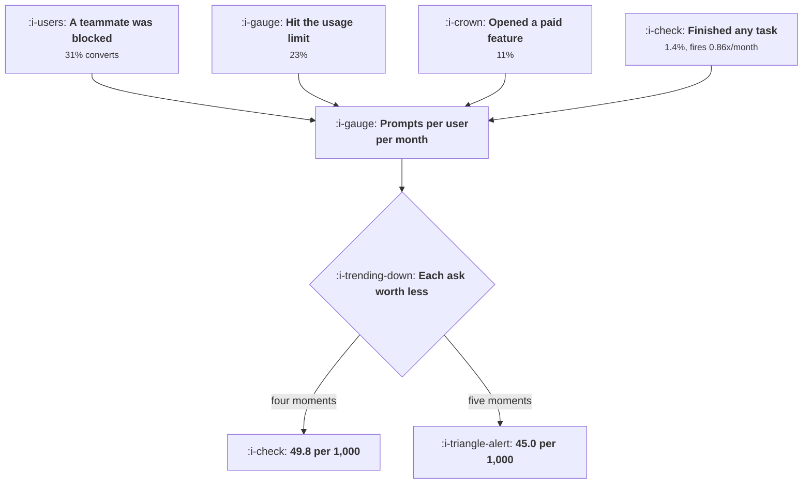

# The Upgrade Moment

```text
Level: Intermediate
Prerequisites: Paywalls
Estimated difficulty: 3/5 | Estimated time: 35 min
```

## The idea in one minute

The best moment to ask somebody to pay is the moment they have just proved to themselves that the
product works, and the rates are not close: a prompt shown when a teammate was blocked converts at
31 percent, one shown after any successful task converts at 1.4. But the ranking by conversion is
not the whole decision, because prompts compete with each other. Adding a fifth trigger that fires
after every completed task adds 7.5 upgrades per thousand users and removes 12.2 from the four
that were already working, so the total falls. The right set of moments is smaller than the list
of moments that individually work, and the stopping rule is arithmetic rather than taste.

## A picture



The fifth box looks like the others and fires twenty times as often, which is what makes it
expensive.

## How it really works

### Rank the moments by what just happened

Conversion at a prompt is almost entirely determined by the state the user is in when it appears,
and the states that work share a property: the user has just encountered the boundary of what the
free product can do, in the course of doing something they wanted.

In the worked table, ordered by conversion: a teammate blocked by a limit at 31 percent, hitting
the usage limit at 23, opening a paid only feature at 11, reaching day fourteen at 3.5, finishing
any task at 1.4. The always present upgrade button in the navigation converts at 0.4 percent and
is at the bottom, which is the correct place for it and is not an argument for removing it,
because it interrupts nothing.

Note that the top three are all consequences of the user's own activity and the bottom two are
consequences of the calendar or of the product's ordinary operation. That is the dividing line.

### Frequency and conversion pull in opposite directions

The highest converting moments are rare. A blocked teammate happens 0.04 times per user per month;
finishing a task happens 0.86 times. So the per thousand figures are closer than the conversion
rates: 12.4, 20.7, 18.7, 2.5 and 12.0.

A naive reading of that column says include everything, because every row produces upgrades. That
reading is wrong for the same reason the send queue in
[What Not to Send](../engagement-and-resurrection/06-what-not-to-send.md) is wrong: it ignores
what each addition does to the others.

### The fatigue term and the stopping rule

Each additional prompt a user sees lowers the value of every other prompt, because attention is
finite and because repeated asking converts a request into background noise. The model below uses
a simple decay in the number of prompts per user per month; the exact form does not matter, the
existence of the term does.

With that term, adding moments in order of conversion gives 16.2, 35.1, 49.0, 49.8 and then 45.0
upgrades per thousand. The peak is at four, and the fifth moment, which looks positive on its own
row, takes the total down.

The stopping rule: add moments in descending order of conversion rate and stop when the total
falls. It is three lines of arithmetic and it settles an argument that otherwise runs for a
quarter.

### Measure the fatigue term rather than assuming it

The decay is the one input here that is usually guessed. Measure it by comparing conversion at your
highest value moment for users who have seen zero, one, two and three other prompts in the last
month. If conversion at that moment is flat across those groups, you have no fatigue and should add
everything; if it halves, the stopping rule bites early. Both outcomes occur in practice and the
difference is a property of your users rather than of the prompts.

### What the prompt should say

Short, because the moment does the work. Name what just happened, state what the upgrade changes
about it specifically, and give one action. A prompt at the limit moment that describes your
pricing tiers has replaced a specific answer with a general one and will convert like the
navigation button.

The second rule: never interrupt the thing that created the moment. A user whose teammate is
blocked is trying to unblock them, and the prompt belongs in that flow rather than in front of it,
which is the placement arithmetic in
[In Product Messaging](../lifecycle-messaging/04-in-product-messaging.md).

### What fills the box in 2026

Pricing and packaging tools now make trigger based upgrade prompts easy to configure, with the
consequence that most products have accumulated more of them than the arithmetic supports, added
one at a time by people who each measured their own. The audit worth doing: list every upgrade
prompt in your product, count how often each fires per user per month, and run the table. Teams
routinely find they are at the equivalent of the fifth or sixth row.

## Run the numbers

Rank the moments, then find where adding another one starts costing you.

```go
// upgrademoment.go: which moments to ask at, and when to stop adding them.
package main

import (
	"fmt"
	"sort"
)

// A prompt converts at a rate set by what just happened to the user. Prompts
// also compete with each other: the more often a user is asked, the less any
// one ask is worth, so the right set is smaller than the list of moments that
// individually work.
type moment struct {
	name string
	freq float64 // times this happens per user per month
	conv float64 // conversion when asked at this moment, in isolation
}

const users = 1000.0

// asking often makes each ask worth less
func fatigue(prompts float64) float64 { return 1 / (1 + prompts/2) }

func main() {
	// always present, interrupts nothing, converts almost nobody
	const navBar = 0.004

	ms := []moment{
		{"a teammate was blocked by a limit", 0.04, 0.31},
		{"hit the monthly usage limit", 0.09, 0.23},
		{"opened a paid only feature", 0.17, 0.11},
		{"reached day 14 of continuous use", 0.07, 0.035},
		{"finished a task successfully", 0.86, 0.014},
	}

	fmt.Printf("%-38s %10s %10s %16s\n",
		"moment", "per month", "converts", "per 1000 users")
	fmt.Printf("%-38s %10.2f %9.1f%% %16.1f\n",
		"upgrade button in the navigation", 1.00, 100*navBar, users*navBar)
	for _, m := range ms {
		fmt.Printf("%-38s %10.2f %9.1f%% %16.1f\n",
			m.name, m.freq, 100*m.conv, users*m.freq*m.conv)
	}

	sort.Slice(ms, func(i, j int) bool { return ms[i].conv > ms[j].conv })

	fmt.Println("\nadding moments in order of how well each converts:")
	fmt.Printf("%-38s %12s %12s %14s\n",
		"after adding", "prompts/user", "each worth", "upgrades/1000")
	best, bestN, bestV := 0, 0.0, 0.0
	for k := 1; k <= len(ms); k++ {
		p, total := 0.0, users*navBar
		for _, m := range ms[:k] {
			p += m.freq
		}
		f := fatigue(p)
		for _, m := range ms[:k] {
			total += users * m.freq * m.conv * f
		}
		if total > bestV {
			best, bestN, bestV = k, p, total
		}
		fmt.Printf("%-38s %12.2f %11.0f%% %14.1f\n", ms[k-1].name, p, 100*f, total)
	}

	fmt.Printf("\nthe best set is the first %d moments: %.2f prompts a month and %.1f\n",
		best, bestN, bestV)
	fmt.Println("upgrades per thousand users. Adding the fifth moment, which happens")
	fmt.Println("after every successful task, nearly triples the prompt volume and")
	fmt.Println("lowers the total.")

	fmt.Println("\nwhat the fifth moment does to the other four:")
	p4, p5 := 0.0, 0.0
	for _, m := range ms[:4] {
		p4 += m.freq
	}
	for _, m := range ms {
		p5 += m.freq
	}
	fmt.Printf("%-38s %14s %14s\n", "moment", "in the set of 4", "in the set of 5")
	for _, m := range ms[:4] {
		fmt.Printf("%-38s %14.1f %14.1f\n", m.name,
			users*m.freq*m.conv*fatigue(p4), users*m.freq*m.conv*fatigue(p5))
	}
	fifth := users * ms[4].freq * ms[4].conv * fatigue(p5)
	var lost float64
	for _, m := range ms[:4] {
		lost += users * m.freq * m.conv * (fatigue(p4) - fatigue(p5))
	}
	fmt.Printf("\nThe fifth prompt adds %.1f upgrades of its own and removes %.1f from\n",
		fifth, lost)
	fmt.Println("the four that were already working. That is the shape of every")
	fmt.Println("argument for one more upgrade prompt.")
}
```

The first table separates the two inputs. Read the conversion column and the frequency column
together: the two best converting moments produce 12.4 and 20.7 upgrades per thousand because they
are rare, while the worst converting moment produces 12.0 because it fires constantly. On the per
thousand column alone, finishing a task looks as good as a blocked teammate.

The second table applies the fatigue term and the ordering settles it. The totals go 16.2, 35.1,
49.0, 49.8, 45.0. The fourth moment adds almost nothing, 0.8, and the fifth subtracts 4.8.

The last table attributes that loss. The fifth prompt adds 7.5 upgrades and takes 12.2 from the
other four, with the largest single loss on the usage limit moment, which falls from 17.5 to 12.8.
That is the cost of the new prompt and it appears on somebody else's report.

Set `fatigue` to a constant 1 and run it again to see the version of this analysis that most teams
are implicitly using: every moment is additive, more prompts are always better, and the answer is
to add all five. Then measure your own decay before believing either version.

## The AI layer

Selection is the fit here, and it is a better fit than in most of the places it gets proposed.

The arithmetic above assumes every eligible user sees every prompt at every moment. A model that
predicts, for a given user at a given moment, whether this prompt is worth spending, converts the
flat allocation into a targeted one: the rare high converting moments fire for everybody, and the
frequent low converting moment fires only for the users it is likely to work on. That lifts the
effective conversion of the frequent moment and cuts its contribution to fatigue at the same time,
which is the only way to make the fifth row pay.

It costs almost nothing, the features are ones you already have, and the objective is clean if and
only if it is trained on incremental conversion rather than attributed conversion, for the reason
in [Measuring a Campaign Honestly](../lifecycle-messaging/06-measuring-a-campaign-honestly.md). A
model trained on attributed upgrades learns to prompt people who were about to upgrade anyway,
which raises the reported number and lowers the real one.

The failure mode is a system that learns to prompt the most engaged users most often, because they
convert best per prompt. Those are the users whose fatigue is most expensive and whose departure
costs most, and the aggregate conversion rate will look excellent while the heaviest users are
being worn down. Constrain prompts per user per month explicitly, and check conversion at your best
moment by prompt exposure quarterly.

## Sector lens

| Sector | The moment that works here |
|---|---|
| [Enterprise B2B SaaS](../../product-management/product-by-sector/01-enterprise-b2b-saas.md) | Somebody who is not on the contract tries to join. The prompt goes to the admin, not to the person blocked |
| [Fintech](../../product-management/product-by-sector/02-fintech.md) | A transaction that exceeds a limit, where the upgrade removes a real constraint on their money today |
| [Ecommerce and D2C](../../product-management/product-by-sector/03-ecommerce-and-d2c.md) | At the delivery threshold in the basket. The moment is the shortfall, and the prompt is arithmetic rather than persuasion |
| [Marketplaces](../../product-management/product-by-sector/04-marketplaces.md) | Supply side: a job they could not accept. Demand side: a listing they could not contact |
| [Devtools and Infra](../../product-management/product-by-sector/05-devtools-and-infrastructure.md) | A rate limit hit in a log or a response header. The prompt belongs in the error payload, not in an email |
| [Healthtech](../../product-management/product-by-sector/06-healthtech-and-regulated-care.md) | An administrative limit only. Never prompt inside a clinical workflow, whatever it converts at |
| [Vertical SaaS](../../product-management/product-by-sector/07-vertical-saas.md) | A second location, vehicle or member of staff. The moment is the business growing, which is also the best conversation to have |

## Remember this

* Conversion at a prompt is set by the state the user is in. A blocked teammate converts at 31
  percent, a finished task at 1.4.
* The moments that work are consequences of the user's own activity hitting a boundary. Calendar
  based moments do not work.
* The best converting moments are rare and the worst are frequent, so the per thousand column is
  much flatter than the conversion column.
* Prompts compete. Add them in descending order of conversion rate and stop when the total falls.
* In the worked case the peak is four moments at 49.8 per thousand; the fifth takes it to 45.0.
* The fifth prompt adds 7.5 and removes 12.2, and the loss appears on somebody else's report.
* Measure your fatigue decay by comparing conversion at your best moment across users with
  different prompt exposure. It may be zero.
* Name what just happened, say what the upgrade changes about that specifically, give one action,
  and never interrupt the thing that created the moment.
* A model should target the frequent low converting moments, trained on incremental rather than
  attributed upgrades, with a hard cap on prompts per user.

## Try it

1. List every upgrade prompt in your product with its real firing frequency per user per month and
   its conversion. Run `upgrademoment.go` and find your peak.
2. Measure your fatigue decay: conversion at your best moment for users who saw zero, one, two and
   three other prompts last month.
3. Take the prompt that fires most often and either target it or remove it. Measure the effect on
   the conversion of your best moment, not on its own conversion.

## Check yourself

1. Prompt A fires 0.05 times per user per month and converts at 28 percent; prompt B fires 0.9
   times and converts at 2 percent. Which produces more upgrades, and which would you add first?
2. Why can adding a prompt that demonstrably produces upgrades lower your total upgrades, and what
   would you measure to find out whether it has?
3. Your targeting model raised upgrades per prompt by 30 percent while total upgrades were flat.
   What has it most likely learned, and how would you check?
