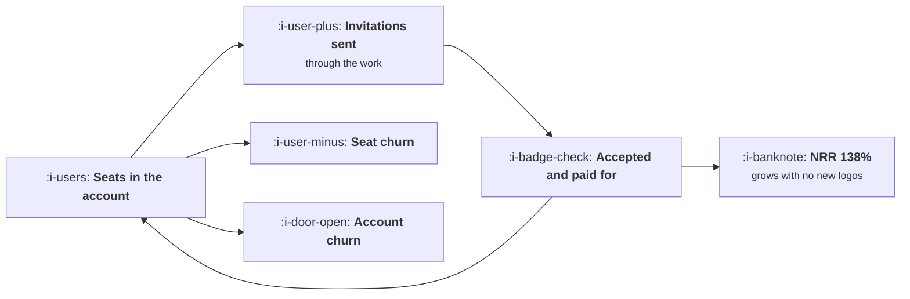

# Expansion as a Loop

```text
Level: Intermediate
Prerequisites: The Upgrade Moment
Estimated difficulty: 4/5 | Estimated time: 40 min
```

## The idea in one minute

Expansion inside an account is not an upsell campaign, it is a loop with three rates: how often
existing seats bring in new ones, what share of those stick, and what leaves. Set those rates and
the cohort's future is determined. Three products with the same price and churn within a point of
each other produce net revenue retention of 73, 94 and 138 percent, and after three years with
nothing new sold the same starting cohort is worth two fifths, four fifths or 2.6 times what it
started at. The lever that matters is the invite rate, which multiplies, and it is usually nobody's
job while retention programmes get the headcount.

## A picture



The cycle on the left is the whole business after the first sale. The two red boxes are what most
of the effort is aimed at.

## How it really works

### Three rates, and only one of them compounds

**The invite rate.** Invitations sent per seat per month, through the ordinary operation of the
product. This is the term that compounds, because each new seat invites too.

**The acceptance rate.** What share of those invitations become paying seats. It multiplies with
the invite rate into a single growth term, which is why the two are worth exactly the same in the
sensitivity table: a tenth more invitations and a tenth better acceptance produce identical
outcomes.

**The two churns.** Seats leaving accounts and accounts leaving entirely. They subtract rather than
divide, so improving them is linear where improving the loop is exponential.

Net revenue retention is the twelve month summary of all three, and the threshold at 100 percent
is the thing to notice. Above it, a cohort grows forever with no sales effort; below it, every
quarter's new business is partly replacing the last one.

### Why the invite rate is a product decision, not a campaign

An invitation sent because the product needed somebody else involved converts at a different rate
from an invitation prompted by a banner, and it happens at a different frequency. The three
products in the worked table differ almost entirely in whether the work itself requires another
person: 0.010, 0.055 and 0.110 invitations per seat per month.

That rate is set by what the product is for. A document that is reviewed, a task that is assigned,
a dashboard that is presented, a build that somebody is notified about. Every one of those is a
product decision made long before anybody thought about expansion, and it is the subject of
[Collaboration Loops](../virality-and-referral/03-collaboration-loops.md).

The growth work available is at the margins of that: removing the friction in the invitation,
making the recipient's first experience good, and letting somebody participate before they have an
account. Those are real and they operate on a rate the product set.

### Seat based pricing makes the loop visible and it is not the only option

If you charge per seat, expansion is automatic once the loop turns. If you charge per usage, the
loop still exists but the unit is different: more people using it produces more usage, and the
same arithmetic applies to consumption rather than to seats.

What breaks the loop is a flat price per account, because then an extra person is a cost with no
revenue and the product team quietly stops encouraging invitations. If your pricing is flat per
account and you want expansion, that is the first thing to change, and the definitions for the
decision are in
[Pricing and Packaging](../../product-management/pricing-and-packaging/README.md).

### Reading NRR honestly

Three cautions, because NRR is the most misreported metric in software.

It is usually quoted for a selected population, such as accounts above a certain size or accounts
that did not churn, and both exclusions inflate it substantially. State the denominator.

It mixes price increases with genuine expansion. A cohort whose NRR is 112 percent because prices
rose 10 percent is not the same business as one at 112 percent from seat growth, and only the
second compounds.

And it is a trailing twelve month figure, so it tells you about the cohort you sold two years ago
rather than the one you are selling now. Compute it per cohort, not in aggregate, or a change in
the product's loop takes two years to appear.

### What fills the box in 2026

Usage based and hybrid pricing have spread, partly because products with a model inside them have
costs that scale with use, and the effect on expansion arithmetic is that the loop's output is
consumption rather than seats. That is generally favourable, because consumption grows within a
seat as well as across seats, but it makes NRR noisier and more sensitive to a single large
customer's behaviour. Report expansion separately from price and separately from a handful of
largest accounts, or the number means nothing.

## Run the numbers

Set the three rates and let the cohort run with no new sales.

```go
// expansion.go: what a cohort does for three years after you stop selling.
package main

import "fmt"

// Expansion inside an account is a loop: existing seats bring in new seats
// through the work, some seats leave, and some accounts leave entirely. The
// three rates decide whether a cohort grows or decays without any new sales.
type product struct {
	name      string
	invites   float64 // invitations sent per seat per month
	accept    float64 // share of invitations that become a paying seat
	seatChurn float64 // share of seats lost per month
	acctChurn float64 // share of accounts lost per month
}

const (
	accounts = 100.0
	seats0   = 6.0
	perSeat  = 18.0 // monthly price per seat
)

// one month of the loop, returning seats per surviving account
func (p product) step(seats float64) float64 {
	added := seats * p.invites * p.accept
	lost := seats * p.seatChurn
	return seats + added - lost
}

func (p product) run(months int) (revenue, nrr float64) {
	acct, seats := accounts, seats0
	start := acct * seats * perSeat
	for m := 0; m < months; m++ {
		seats = p.step(seats)
		acct *= 1 - p.acctChurn
	}
	revenue = acct * seats * perSeat
	// net revenue retention over the first twelve months
	a12, s12 := accounts, seats0
	for m := 0; m < 12; m++ {
		s12 = p.step(s12)
		a12 *= 1 - p.acctChurn
	}
	return revenue, a12 * s12 * perSeat / start
}

func main() {
	ps := []product{
		{"sharing is not part of the work", 0.010, 0.30, 0.019, 0.010},
		{"sharing happens occasionally", 0.055, 0.34, 0.016, 0.008},
		{"the work itself requires sharing", 0.110, 0.42, 0.013, 0.006},
	}

	start := accounts * seats0 * perSeat
	fmt.Printf("%.0f accounts, %.0f seats each, %.0f a seat a month: %.0f to begin\n\n",
		accounts, seats0, perSeat, start)

	fmt.Printf("%-36s %9s %9s %8s %10s\n",
		"product", "invites", "accept", "NRR", "seats y3")
	for _, p := range ps {
		_, nrr := p.run(12)
		s := seats0
		for m := 0; m < 36; m++ {
			s = p.step(s)
		}
		fmt.Printf("%-36s %9.3f %8.0f%% %7.0f%% %10.1f\n",
			p.name, p.invites, 100*p.accept, 100*nrr, s)
	}

	fmt.Println("\nmonthly revenue from the same cohort, selling nothing new:")
	fmt.Printf("%-36s %9s %9s %9s %9s\n", "product", "month 0", "year 1", "year 2", "year 3")
	for _, p := range ps {
		fmt.Printf("%-36s %9.0f", p.name, start)
		for _, m := range []int{12, 24, 36} {
			r, _ := p.run(m)
			fmt.Printf(" %9.0f", r)
		}
		fmt.Println()
	}

	fmt.Println("\nThe third cohort is worth 2.6 times its starting value after three")
	fmt.Println("years with nothing new sold. The first is worth two fifths. Same")
	fmt.Println("price, churn within a point of each other, different loop.")

	fmt.Println("\nwhat each input is worth, from the middle product:")
	base := ps[1]
	br, _ := base.run(36)
	fmt.Printf("%-40s %14s %12s\n", "change", "year 3 revenue", "vs base")
	type tweak struct {
		name string
		p    product
	}
	tweaks := []tweak{
		{"invites per seat up a tenth", product{"", base.invites * 1.1, base.accept, base.seatChurn, base.acctChurn}},
		{"acceptance up a tenth", product{"", base.invites, base.accept * 1.1, base.seatChurn, base.acctChurn}},
		{"seat churn down a tenth", product{"", base.invites, base.accept, base.seatChurn * 0.9, base.acctChurn}},
		{"account churn down a tenth", product{"", base.invites, base.accept, base.seatChurn, base.acctChurn * 0.9}},
	}
	for _, t := range tweaks {
		r, _ := t.p.run(36)
		fmt.Printf("%-40s %14.0f %11.1f%%\n", t.name, r, 100*(r/br-1))
	}
	fmt.Println("\nInvites and acceptance are worth exactly the same, because they")
	fmt.Println("multiply into one term. Seat churn is worth six sevenths as much and")
	fmt.Println("account churn two fifths, which is the reverse of where the effort")
	fmt.Println("usually goes: retention programmes get the headcount and the invite")
	fmt.Println("rate is nobody's job.")
}
```

The first table is the summary. NRR of 73, 94 and 138 percent, and seats per account after three
years of 3.4, 6.6 and 19.4. The inputs that differ are the invite rate and the acceptance rate,
with churn differing by less than a point in each case.

The revenue table is the consequence. From the same 10,800 a month, the three cohorts reach 4,208,
8,913 and 28,182 after three years with nothing sold. A company built on the third product can
miss its new business target for a year and still grow; a company built on the first is running to
stand still, and no sales execution fixes that.

The sensitivity table is where to spend. A tenth more invitations and a tenth better acceptance are
worth 6.9 percent each on year three revenue, identically, because they multiply into one term. A
tenth less seat churn is worth 5.9 percent and a tenth less account churn 2.9 percent.

Put your own rates in, measured per cohort. The invite rate in particular is usually available and
rarely looked at: invitations sent per active seat per month, from your own events.

## The AI layer

Two effects, one on the loop and one on the unit it is measured in.

The loop effect is that a model can make an invitation worth accepting. The weakest point in most
expansion loops is not the invitation, it is the recipient's first ten minutes: they arrive at an
empty product with no context about why they were invited. A model that produces a relevant
starting state from the inviting context, the document they were asked to review, the project they
were added to, raises acceptance, which multiplies with the invite rate and is therefore worth as
much as any invitation work. The arithmetic for that first experience is in
[Empty States and First Run](../activation-and-onboarding/05-empty-states-and-first-run.md).

The unit effect is larger and less comfortable. When consumption drives both revenue and cost,
expansion raises both, and an account whose usage doubled is not necessarily worth twice as much.
NRR computed on revenue can rise while gross profit per account falls, which is the pattern in
[Usage Growth That Destroys Margin](../growth-for-ai-products/README.md). Compute expansion on
gross profit as well as on revenue, per cohort, and if the two diverge, believe the second.

The failure mode specific to this topic: a model driven feature that increases usage per seat is
reported as expansion and is sometimes a cost increase wearing expansion's clothes. The test is
whether the account's gross profit grew, and the frequency with which teams cannot answer that
question is the reason to ask it early.

## Sector lens

| Sector | What expansion is made of here |
|---|---|
| [Enterprise B2B SaaS](../../product-management/product-by-sector/01-enterprise-b2b-saas.md) | Seats and departments. The loop runs across teams, and a single internal advocate moving department is worth more than any campaign |
| [Fintech](../../product-management/product-by-sector/02-fintech.md) | Volume and additional products. Expansion is cross sell into adjacent money movement rather than seats |
| [Ecommerce and D2C](../../product-management/product-by-sector/03-ecommerce-and-d2c.md) | Repeat purchase and basket size. The loop equivalent is replenishment, and NRR is cohort revenue over time |
| [Marketplaces](../../product-management/product-by-sector/04-marketplaces.md) | Frequency on both sides. Expansion on the supply side is more listings, on the demand side more transactions |
| [Devtools and Infra](../../product-management/product-by-sector/05-devtools-and-infrastructure.md) | Usage, then teams, then the whole engineering organisation. The strongest expansion loops in software, and almost entirely product driven |
| [Healthtech](../../product-management/product-by-sector/06-healthtech-and-regulated-care.md) | Additional sites and specialties, gated by procurement each time. The loop is slow and the acceptance step involves a committee |
| [Vertical SaaS](../../product-management/product-by-sector/07-vertical-saas.md) | Locations and modules. Expansion tracks the customer's own growth, so your NRR is partly their industry's |

## Remember this

* Expansion is a loop with three rates: invites per seat, acceptance, and the two churns. Only the
  first two compound.
* Invite rate and acceptance rate multiply into one term, so a tenth more of either is worth the
  same.
* NRR of 73, 94 and 138 percent from the same price and nearly the same churn. The difference is
  whether the work requires another person.
* Above 100 percent NRR a cohort grows with no sales effort. Below it, new business replaces old
  business.
* The invite rate is set by what the product is for, which is a product decision made long before
  anybody thought about expansion.
* A flat price per account breaks the loop, because an extra person is a cost with no revenue.
* Report NRR per cohort, with the denominator stated, and separate price increases from genuine
  expansion.
* A model's best contribution is the invited person's first ten minutes, which raises acceptance
  and therefore compounds.
* When consumption drives cost, compute expansion on gross profit as well as revenue. If they
  diverge, believe the second.

## Try it

1. Measure invitations sent per active seat per month and the share that become paying seats, per
   cohort. Run `expansion.go` with those and your real churn rates.
2. Compute your NRR two ways: including and excluding price increases. Report the second one
   internally from now on.
3. Find the three places in your product where the work naturally involves another person. For each,
   count how many invitations it actually generates, and fix the cheapest gap.

## Check yourself

1. Your NRR is 104 percent, of which 7 points came from a price rise. What is your real expansion
   rate, and what does that imply about the cohort in three years?
2. Why are the invite rate and the acceptance rate worth exactly the same, when one is a product
   behaviour and the other is an onboarding outcome?
3. An account's usage doubled and its revenue rose 60 percent. What else do you need to know before
   calling that expansion?
