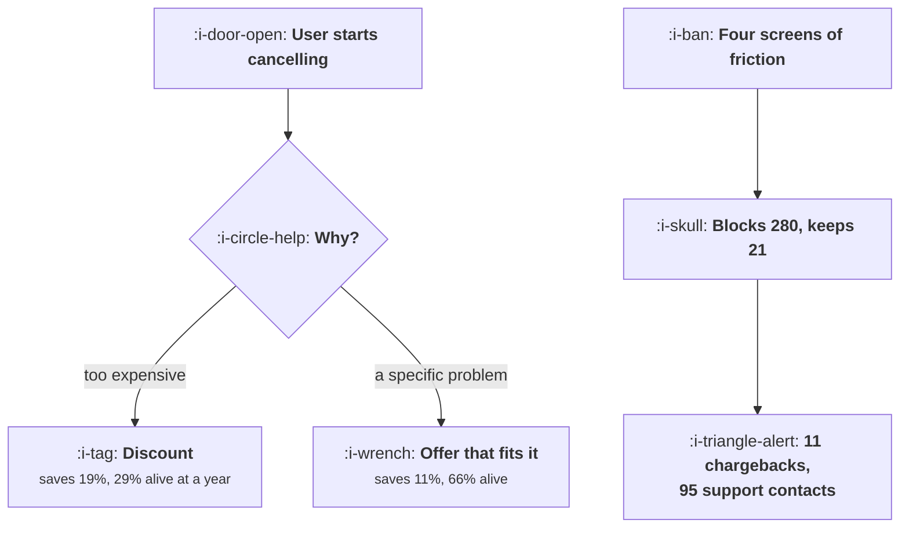

# Cancel Flows and Saves

```text
Level: Intermediate
Prerequisites: Expansion as a Loop
Estimated difficulty: 3/5 | Estimated time: 35 min
```

## The idea in one minute

A cancel flow is the one place where the short and long term answers diverge so sharply that the
usual argument is unnecessary: the obstructive version loses on its own numbers before anybody
mentions regulation or reputation. Four screens of friction blocks 280 of a thousand cancellations
and genuinely keeps 21 of them, producing 9,491 of twelve month value. One honest question
followed by an offer that addresses the answer keeps 108 and produces 25,632. The discount save,
the most popular intervention in the field, saves nearly twice as many people on the day as the
fitted offer and collects under half the revenue, because it selects for price sensitivity and
defers the decision instead of changing it.

## A picture



Two of these three paths are popular. The middle one is the one that works.

## How it really works

### Score the flow over a year, not on the day

The metric most cancel flows are optimised against is save rate on the day, and it is the wrong
one in two directions. It counts users who were merely delayed, and it counts saves that will not
last.

The honest calculation has four terms: revenue from users held back a month who then leave anyway,
revenue from users genuinely saved for as long as they stay, the cost of the chargebacks friction
produces, and the support cost of everybody who had to contact you to leave. In the worked model
the last two are small and the first two are where the decision lives.

### Friction loses on its own numbers

Blocking a cancellation does not prevent it, it moves it. Of the 280 users the obstructive flow
stops, 88 percent cancel again within three months, so the flow has bought one month of revenue
from most of them. The genuine save rate, the share it keeps for a year, is 2.1 percent, the worst
in the table.

Against that it generates 11 chargebacks, which cost fees and handling and damage your payment
processing reputation, and 95 support contacts, which are the most expensive kind of contact
because the person is already annoyed.

The result: 9,491 against 25,632 for the honest flow, a gap of 16,141 per thousand cancellations.
That gap exists before anybody mentions complaints, consumer protection regulation, or the fact
that a user who had to fight to leave will tell people. Those arguments are real and they are not
needed.

### Ask one question and answer it

The flow that works is short: one screen, one question about why, and an offer that follows from
the answer.

The question has to be answerable in one click with a free text box underneath, and the options
have to include the real reasons, which usually means "I am not using it", "it is missing
something", "it costs too much", "a specific problem", and "the project ended". The last of those
has no save and should be let through immediately, which is most of the reason a short flow
outperforms: it stops wasting effort on users who cannot be saved.

Then the offer addresses the answer. Missing something means a route to the roadmap or to a person.
A specific problem means support, now, with the cancellation paused rather than prevented. Not
using it means a pause rather than a cancellation. Too expensive means a smaller plan rather than a
discount on the same one.

### Why the discount save underperforms

It saves more people on the day, 18.6 percent against 10.8, which is why it is popular. Then 71
percent of them leave within the year, because the discount addressed a symptom and the price was
not the real reason for most of them. And the ones who stay pay less.

Two paying users at a year, 54 against 71, and under half the revenue. The discount also teaches
the remaining users that cancelling produces a discount, which is a lesson that propagates.

Where a discount is right: when the user genuinely cannot afford the product at its current price
and would be a good customer at a lower one. That is what a smaller plan is for, permanently,
rather than a temporary discount on a plan they cannot sustain.

### The exit question is an asset

Whatever else the flow does, it should capture why. That answer feeds
[Winning Back the Dormant](../engagement-and-resurrection/05-winning-back-the-dormant.md), where
the only message with a real restick rate is the one naming a fixed reason, and it feeds the
product roadmap with the most honest feedback you will ever receive.

Classify it, count it monthly, and report the top three reasons alongside the churn number. A churn
rate with no reasons attached is a number nobody can act on.

### What fills the box in 2026

Consumer protection regulators in several jurisdictions have moved on cancellation friction
specifically, with rules of the general shape that cancelling must be as easy as subscribing and
in the same channel. The practical position for a product team is that an obstructive cancel flow
is now a compliance exposure as well as a bad trade, and that the design of the flow may need legal
review rather than only product judgement. Check the rules for the markets you sell in; they
differ, and the strictest one governs if you run one flow globally.

## Run the numbers

Score four flows over a year and notice which one the day one metric would choose.

```go
// cancelflow.go: what a save is worth, and what a trap costs.
package main

import "fmt"

// A cancel flow is scored over a year, not on the day. A user who was
// prevented from cancelling mostly cancels next month, often through their
// bank, and the costs of that arrive later and land somewhere else.
type flow struct {
	name       string
	blocked    float64 // share who fail to complete the cancellation this month
	returns    float64 // of those, the share who cancel again within three months
	saved      float64 // share genuinely retained by the flow
	stillHere  float64 // of those saved, the share present a year later
	discount   float64 // revenue multiplier on saved users
	chargeback float64 // share of the blocked who dispute with their bank
	support    float64 // support contacts per hundred users in the flow
}

const (
	cohort  = 1000.0
	monthly = 29.0
	cbCost  = 22.0 // fee and handling per chargeback
	scCost  = 6.50 // cost of one support contact
)

func (f flow) year() (revenue, costs, net float64) {
	// users held one extra month by friction, who then leave
	heldBack := cohort * f.blocked * f.returns
	revenue += heldBack * monthly
	// users genuinely saved, paying for a year at whatever rate they agreed
	saved := cohort * f.saved
	revenue += saved * f.stillHere * monthly * 12 * f.discount
	costs += cohort * f.blocked * f.chargeback * cbCost
	costs += cohort * f.support / 100 * scCost
	return revenue, costs, revenue - costs
}

func main() {
	flows := []flow{
		{"four screens, retention offers, phone call", 0.28, 0.88, 0.021, 0.44, 1.00, 0.041, 9.5},
		{"one screen, one question, no offer", 0.03, 0.90, 0.034, 0.71, 1.00, 0.004, 1.2},
		{"one question, then an offer that fits it", 0.04, 0.89, 0.108, 0.66, 1.00, 0.005, 3.1},
		{"one question, then half price for six months", 0.04, 0.89, 0.186, 0.29, 0.62, 0.006, 3.4},
	}

	fmt.Printf("%.0f users begin cancelling, each paying %.0f a month\n\n", cohort, monthly)
	fmt.Printf("%-44s %9s %8s %11s %12s\n",
		"flow", "blocked", "saved", "alive at 1y", "chargebacks")
	for _, f := range flows {
		fmt.Printf("%-44s %8.0f%% %7.1f%% %10.0f%% %12.0f\n",
			f.name, 100*f.blocked, 100*f.saved, 100*f.stillHere,
			cohort*f.blocked*f.chargeback)
	}

	fmt.Println("\ntwelve month value per 1,000 cancelling users:")
	fmt.Printf("%-44s %12s %12s %12s\n", "flow", "revenue", "costs", "net")
	for _, f := range flows {
		r, c, n := f.year()
		fmt.Printf("%-44s %12.0f %12.0f %12.0f\n", f.name, r, c, n)
	}

	fmt.Println("\nThe four screen flow blocks 280 users and genuinely keeps 21 of")
	fmt.Println("them, the worst return in the table. It produces 11 chargebacks and")
	fmt.Println("95 support contacts, and it finishes next to last, beating only the")
	fmt.Println("flow that makes no attempt to save anybody at all.")

	fmt.Println("\nwhat the discount save actually buys:")
	d := flows[3]
	o := flows[2]
	fmt.Printf("%-34s %14s %14s\n", "", "fitted offer", "half price")
	fmt.Printf("%-34s %13.1f%% %13.1f%%\n", "saved on the day", 100*o.saved, 100*d.saved)
	fmt.Printf("%-34s %13.0f%% %13.0f%%\n", "of those, alive at a year",
		100*o.stillHere, 100*d.stillHere)
	fmt.Printf("%-34s %14.0f %14.0f\n", "paying users at a year",
		cohort*o.saved*o.stillHere, cohort*d.saved*d.stillHere)
	fmt.Printf("%-34s %14.0f %14.0f\n", "revenue from them",
		cohort*o.saved*o.stillHere*monthly*12*o.discount,
		cohort*d.saved*d.stillHere*monthly*12*d.discount)
	fmt.Println("\nThe discount saves nearly twice as many people on the day, ends the")
	fmt.Println("year with fewer of them still paying, and collects under half the")
	fmt.Println("revenue, because it selects for price sensitivity and defers the")
	fmt.Println("decision rather than changing it.")

	fmt.Println("\nthe case for friction, if you wanted to make it:")
	hard, fair := flows[0], flows[2]
	hr, _, hn := hard.year()
	fr, _, fn := fair.year()
	fmt.Printf("%-34s %14.0f %14.0f\n", "revenue", hr, fr)
	fmt.Printf("%-34s %14.0f %14.0f\n", "net", hn, fn)
	fmt.Printf("\nThe friction flow is behind by %.0f per thousand cancellations before\n", fn-hn)
	fmt.Println("anything is counted for the complaints, the regulatory exposure or")
	fmt.Println("the people who will not come back. It does not need those arguments")
	fmt.Println("to lose.")
}
```

The first table shows what each flow does mechanically. The obstructive flow is the only one with a
meaningful blocked column and the only one with chargebacks, and its genuine save rate is the
lowest of the four.

The twelve month table is the decision. Net values of 9,491, 9,103, 25,632 and 12,444. The fitted
offer is worth 2.7 times the obstructive flow and twice the discount, and it is the cheapest of the
three to build.

The discount comparison is the part worth showing to whoever proposes one. It saves 186 users to
the fitted offer's 108, and finishes the year with 54 still paying to the fitted offer's 71. Every
number in the discount's favour is a day one number, and every number against it is a twelve month
number.

Change `stillHere` on the discount row to your own measured figure, which you can get by following
a past cohort of discount saves. Teams who measure it for the first time usually find it lower than
the table's 29 percent, not higher.

## The AI layer

The useful application is matching the offer to the reason, which is the step the whole lesson
turns on.

A free text cancellation reason is the richest signal you will get from a departing user, and it
arrives unstructured at a moment when a response has to be immediate. Classifying it and selecting
the right response is a small, well defined task: cheap, accurate enough, and it turns a generic
offer into a fitted one. In the worked table that distinction is worth 13,000 per thousand
cancellations.

Two constraints. The response must be a real option, not a generated reassurance: if the user says
a feature is missing, the flow should route to a person or to a roadmap commitment, not to a
sentence saying it is coming. And the classification should be visible to the product team in
aggregate, because its main value is the monthly report of why people leave rather than the save
itself.

The failure mode to refuse outright is a generated retention conversation designed to be hard to
exit. An interactive agent that keeps finding one more thing to offer is the four screen flow with
better manners, it has the same arithmetic, and it is more likely to attract regulatory attention
rather than less because the obstruction is harder for the user to characterise. If you build an
agent into the cancel flow, give it one turn.

## Sector lens

| Sector | What the cancel flow has to handle here |
|---|---|
| [Enterprise B2B SaaS](../../product-management/product-by-sector/01-enterprise-b2b-saas.md) | Cancellation is a renewal conversation with notice periods, so the flow is a contract process. The in product equivalent is seat removal |
| [Fintech](../../product-management/product-by-sector/02-fintech.md) | Account closure is regulated and must be straightforward. Funds must be returnable without friction, and delay is a complaint to the regulator |
| [Ecommerce and D2C](../../product-management/product-by-sector/03-ecommerce-and-d2c.md) | Subscription boxes, where pause is the save that works and skipping a delivery outperforms any discount |
| [Marketplaces](../../product-management/product-by-sector/04-marketplaces.md) | Supply side leaving is a liquidity event. Ask why immediately, because the answer is usually about earnings and is fixable |
| [Devtools and Infra](../../product-management/product-by-sector/05-devtools-and-infrastructure.md) | Cancellation happens by deleting an account in an API. Any friction will be routed around and then written about publicly |
| [Healthtech](../../product-management/product-by-sector/06-healthtech-and-regulated-care.md) | Continuity of care and data export obligations govern. The flow must offer records, not offers |
| [Vertical SaaS](../../product-management/product-by-sector/07-vertical-saas.md) | A phone call, usually, and the save is a person solving the actual problem. Small enough markets that a bad exit is known to everyone |

## Remember this

* Score the flow over twelve months. The day one save rate counts delays as saves and short lived
  saves as permanent.
* Friction moves cancellations rather than preventing them: 88 percent of blocked users leave
  within three months.
* The obstructive flow genuinely keeps 2.1 percent and produces chargebacks and expensive support
  contacts. It loses by 16,141 per thousand before any other argument.
* One screen, one question, and an offer that follows from the answer produces 2.7 times the value.
* Let the unsaveable reasons through immediately. Not wasting effort on them is much of why the
  short flow wins.
* The discount save wins every day one number and loses every twelve month one, because it selects
  for price sensitivity.
* A smaller plan, permanently, beats a temporary discount on a plan the user cannot sustain.
* Capture and classify the reason. It feeds win back, the roadmap, and a churn number somebody can
  act on.
* Cancellation friction is now a regulatory exposure in several markets, and the strictest rule
  governs a single global flow.
* A model should classify the reason and pick a real offer. An agent that keeps offering one more
  thing is the obstructive flow with better manners.

## Try it

1. Score your current cancel flow with `cancelflow.go`, using your measured share of blocked users
   who return to cancel within three months. Most teams have never computed that figure.
2. Follow a past cohort of discount saves and measure how many are still paying a year later. Put
   that number into the table and see whether the discount still pays.
3. Add the one question if it is missing, classify a month of answers, and report the top three
   reasons next to the churn number at the next review.

## Check yourself

1. Your cancel flow saves 24 percent of users on the day. What three further numbers do you need
   before knowing whether it is a good flow?
2. Why does a discount save more users on the day and produce less revenue over a year than an
   offer that addresses the stated reason?
3. A proposal adds a required phone call to cancel an online subscription. Give the argument
   against it that does not rely on ethics or regulation.
