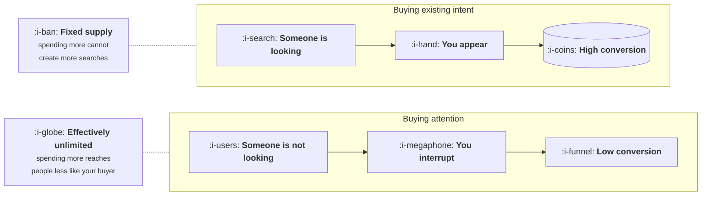

# What You Are Actually Buying

```text
Level: Basic
Prerequisites: Search Inside Answer Engines
Estimated difficulty: 2/5 | Estimated time: 30 min
```

## The idea in one minute

Paid acquisition buys one of two completely different things, and most of the confusion in the
discipline comes from treating them as one. Search advertising buys **existing intent**: somebody
has decided they want something and you are paying to be in front of them at that moment. Feed
advertising buys **attention from people who were not thinking about you at all**. The first is
limited in quantity and cannot be grown by spending more. The second is effectively unlimited and
converts at a fraction of the rate. Knowing which you are buying determines what good looks like,
what a sensible cost is, what creative has to do, and which half of the advice you read applies
to you.

## A picture



Two products sold through similar looking interfaces, with opposite constraints. Almost every
mistake in paid comes from applying one's rules to the other.

## How it really works

### Intent has a fixed supply

If four thousand people a month search for what you sell, that is the entire market available to
you through search advertising this month. You can win more of those four thousand by bidding
more or being more relevant, and you cannot make the number five thousand.

This has three consequences that distinguish search from everything else.

It saturates hard rather than gradually. Once you hold most of the available impressions for the
queries that matter, additional budget buys either worse queries or nothing, and the returns
curve bends sharply rather than tapering. That is the low exponent case in
[Saturation and the Ceiling](../acquisition-channels/04-saturation-and-the-ceiling.md).

The ceiling moves only when the market does. Category demand growing, a competitor leaving, a
new product category being created. None of these are things a budget decision can cause.

And it is the most defensible channel you can hold, because the same fixed supply that caps you
caps everyone else, and relevance advantages persist.

### Attention has no such limit

Feed advertising is the opposite. You can always buy more impressions. What you cannot do is keep
buying impressions of the same quality, because the platform shows your advertisement to the
people most likely to respond first and works outwards from there.

So the constraint is not supply, it is that every additional pound reaches somebody slightly less
likely to care. This is a smooth diminishing returns curve rather than a wall, which is why feed
channels can absorb large budgets and why their average cost deteriorates steadily rather than
suddenly.

The practical difference: a search channel tells you it is finished and a feed channel does not.
You have to compute the marginal cost yourself, which is the entire argument of that earlier
lesson and matters more here than anywhere else.

### What this changes about the job

| | Buying intent | Buying attention |
|---|---|---|
| The job of creative | Confirm you are the right answer | Create the interest from nothing |
| Why cost rises | Competitors bid on the same fixed queries | You have exhausted the responsive audience |
| What more budget buys | Nothing, past a point | Progressively worse prospects |
| What a good cost looks like | Close to your bar, because conversion is high | Well under your bar on first purchase, because many will not convert |
| The main failure | Bidding on queries whose intent is not what you sell | Measuring the channel on a window too short to contain its conversions |
| How fast you learn | Days | Weeks, because the conversions arrive late |

The bottom row is why the two channels need different measurement, and it is lesson 05.

### Buying your own brand

A category of its own and the most argued about line in most paid budgets. You are paying for
people who typed your name, which is to say people who had already decided.

Two honest positions, and which applies is an empirical question rather than a matter of
principle. If competitors bid on your name and appear above your own result, the spend is
defensive and buys back traffic you would otherwise lose. If nobody is bidding and your organic
result is first, you are paying for clicks you would have received for nothing.

The measurement that settles it is a holdout: switch brand bidding off in some regions for a
month and compare total conversions, not paid conversions. It is cheap, it takes a month, and
most companies have an opinion about this question and no measurement.

### The third thing you can buy

Worth naming because it does not fit either category: placements where somebody else's audience
is being recommended something, such as comparison sites, review directories and marketplace
promotions. These buy intent that somebody else created, they usually convert well, their supply
is fixed by the size of that partner, and they are frequently the best value in a paid portfolio
because fewer teams think to look there.

### What fills the box in 2026

The interfaces have converged on automation: you supply a target cost, a budget and a set of
creative assets, and the platform decides placement, audience and bid. This is genuinely better
than most manual management and it changes where your leverage is. You no longer control
targeting in any detailed sense, which is lesson 03, and you do control the objective you set and
the creative you supply.

The one setting worth understanding properly is the target you give the platform. Automated
bidding optimises towards it faithfully, including past the point where the next customer costs
more than you can afford, so the number you supply should be your marginal bar rather than your
average cost.

## Sector lens

| Sector | Which you are mostly buying |
|---|---|
| [Enterprise B2B SaaS](../../product-management/product-by-sector/01-enterprise-b2b-saas.md) | Intent, in tiny quantities at very high cost per click. The whole channel may be forty queries |
| [Fintech](../../product-management/product-by-sector/02-fintech.md) | Intent, heavily contested and among the most expensive clicks sold. Comparison placements often beat direct bidding |
| [Ecommerce and D2C](../../product-management/product-by-sector/03-ecommerce-and-d2c.md) | Attention, mostly, with product search as the intent half. The sector where feed advertising genuinely scales |
| [Marketplaces](../../product-management/product-by-sector/04-marketplaces.md) | Both, on two sides, and the supply side usually responds to attention while demand responds to intent |
| [Devtools and Infra](../../product-management/product-by-sector/05-devtools-and-infrastructure.md) | Neither, usually. Developers block advertising and respond to documentation. Paid is a small supporting channel at best |
| [Healthtech](../../product-management/product-by-sector/06-healthtech-and-regulated-care.md) | Restricted on both counts. Advertising policy for health claims limits what can be said, which caps creative quality |
| [Vertical SaaS](../../product-management/product-by-sector/07-vertical-saas.md) | Intent, at almost no volume. Trade publications and events are the real paid channels |

## Remember this

* Two different products: existing intent, which has fixed supply, and attention, which does not.
* Intent saturates hard and the ceiling moves only when the market moves. No budget decision
  raises it.
* Attention has a smooth decline in quality, so a feed channel never tells you it is finished.
  You must compute the marginal cost yourself.
* Creative confirms in an intent channel and creates interest in an attention channel. Different
  jobs, different skill.
* An attention channel's conversions arrive late, so it needs a longer measurement window than
  an intent channel.
* Brand bidding is defensive if competitors appear above you and wasteful otherwise. A regional
  holdout settles it in a month.
* Placements on somebody else's audience buy intent a third party created, and are frequently
  the best value in the portfolio.
* Give automated bidding your marginal bar, not your average cost.

## Try it

1. Split your paid spend into intent, attention and third party placements. Compute cost per
   customer for each group separately. Most companies report one blended figure that describes
   nothing.
2. For your intent channels, find the total monthly search volume of the queries worth having.
   That number, times a realistic share, is the channel's ceiling, and it is knowable in advance.
3. Design the brand holdout: which regions, for how long, measuring total conversions rather
   than paid ones. Then find out whether anybody has ever run it.

## Check yourself

1. Why can a search channel not be grown by increasing the budget, when a feed channel can?
2. Your feed channel's cost per customer has risen 30 percent over six months with no change in
   bidding. What is the most likely explanation, and what would confirm it?
3. Why should the target you give an automated bidding system be lower than the amount you are
   actually willing to pay for a customer?
