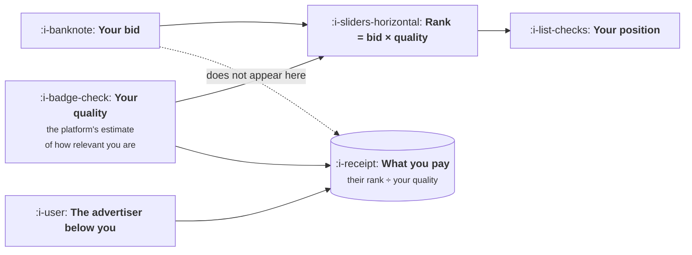

# The Auction in Plain Words

```text
Level: Basic
Prerequisites: What You Are Actually Buying
Estimated difficulty: 2/5 | Estimated time: 30 min
```

## The idea in one minute

Your bid decides whether you win. Somebody else decides what you pay. Every major advertising
auction ranks advertisers by their bid multiplied by an estimate of how relevant they are, and
then charges the winner just enough to have beaten the advertiser below them, divided by their
own relevance. Two consequences follow and both are counterintuitive. You can bid far more than
a competitor, rank below them and pay more per click than anyone in the auction. And improving
relevance moves you up the page and down in price simultaneously, which bidding cannot do. The
lever worth pulling is almost never the bid.

## A picture



Trace the two arrows into the price. Your quality is in it and your bid is not.

## How it really works

### The two rules

**Rule one: rank is bid times quality.** Each advertiser gets a score, and positions are
allocated in score order. Quality is the platform's prediction of how well your advertisement
and landing page will serve this particular person, assembled mostly from how often people
click your advertisement relative to expectation, and how they behave when they arrive.

**Rule two: you pay what you needed to have beaten the next advertiser, adjusted for your own
quality.** This is a second price auction. If the advertiser below you has a score of 24 and your
quality is 6, you pay about 4.00, regardless of whether you bid 4.50 or 40.00.

This is why bidding aggressively is less dangerous than it feels and less useful than it looks.
Raising your bid mostly changes which auctions you win rather than what you pay in the ones you
were already winning.

### What the program shows

Run it and look at the careless newcomer. They bid 9.00 against the incumbent's 3.00, which is
three times as much. They rank fourth and the incumbent ranks first, because the incumbent's
quality is nine against their two. Then the newcomer pays 8.81 per click, the highest price in
the auction, for the worst position in it.

That row is not a contrived example. It is the normal experience of a well funded new entrant
who assumes the auction is a bidding war, and it persists until somebody works out that the
quality term exists.

The second table changes only quality, holding the bid at 4.00 throughout. At a quality of 3 you
do not place meaningfully. At 6 you are third, paying 3.01. At 10 you are first, paying 2.71.
Better position and lower price, from the same bid.

### The non monotonic bit, which is real

Look carefully at that second table and quality 8 pays 3.38 while quality 6 pays 3.01. Moving up
cost more.

This is correct and worth understanding rather than treating as an error. The price you pay is
set by whoever is immediately below you, so when improved quality lifts you past a competitor,
the advertiser setting your price changes to a different, higher ranked one. You can genuinely
pay more per click in a better position.

What this means practically: position and price do not move together in any simple way, and
chasing a specific position is therefore a poor objective. The objective is cost per customer,
and the route to it runs through quality and through conversion rate rather than through where
you appear.

### Where quality actually comes from

Three inputs, in roughly descending weight, and only the first is about the advertisement.

**Expected click through rate** relative to other advertisers in the same slot for the same
query. The platform is predicting whether people will choose you, and the largest input is how
often they have in the past.

**Relevance of the advertisement to the query.** Whether what you say matches what they asked
for. This is why tightly grouped campaigns outperform broad ones: a single advertisement cannot
be highly relevant to forty different queries.

**Landing page experience.** Whether the page matches the promise, loads, works on a phone, and
does not immediately send people back. This is lesson 04, and it is the part most often owned by
nobody.

Notice that all three are measurements of whether you were a good answer. The quality score is
not a separate thing to optimise; it is the platform's estimate of the thing you were supposed
to be doing anyway.

### What to do with this

Four things, in order of return.

Tighten the match between query, advertisement and page. The single largest quality improvement
available to most accounts, and it is structural rather than creative.

Fix the worst performers rather than raising bids on the best. A low quality advertisement is
expensive in a compounding way: it costs more per click and gets fewer impressions.

Treat cost per click as an output rather than an input. It is set by your quality and your
competitors, and the number you control directly is what you are willing to pay for a customer.

And ignore position as a goal. It is not monotonically related to price and it is not related to
profit at all.

### What fills the box in 2026

Most of the manual controls this lesson describes have been abstracted away behind automated
bidding, and the mechanism underneath is unchanged. You now express your bid as a target cost per
acquisition and the system bids on your behalf, but rank is still bid times quality, you are
still charged based on the advertiser below you, and quality still does both jobs at once.

What this changes is that the quality lever has become relatively more important, because it is
one of the few things you still control directly. The other is creative, which is lesson 03.

## Run the numbers

Five advertisers, one auction, and what happens when only quality changes.

```go
// auction.go: your bid decides whether you win. Somebody else decides what you pay.
package main

import (
	"fmt"
	"sort"
)

const reserve = 0.30 // the floor the platform will not sell below

type bidder struct {
	name    string
	bid     float64 // most you are willing to pay for a click
	quality float64 // the platform's estimate of your relevance, roughly 1 to 10
}

func (b bidder) rank() float64 { return b.bid * b.quality }

func main() {
	bidders := []bidder{
		{"you", 4.00, 6},
		{"a rival outbidding you", 6.50, 4},
		{"the incumbent", 3.00, 9},
		{"a careless newcomer", 9.00, 2},
		{"a narrow specialist", 2.20, 8},
	}

	sort.Slice(bidders, func(i, j int) bool { return bidders[i].rank() > bidders[j].rank() })

	fmt.Printf("%-26s %7s %9s %8s %10s %10s\n",
		"advertiser", "bid", "quality", "rank", "position", "pays")
	for i, b := range bidders {
		// a second price auction: you pay just enough to have beaten the
		// advertiser below you, discounted by your own quality. The last
		// slot has nobody below it and pays the reserve.
		pays := reserve
		if i+1 < len(bidders) {
			pays = bidders[i+1].rank()/b.quality + 0.01
		}
		if pays > b.bid {
			pays = b.bid
		}
		fmt.Printf("%-26s %7.2f %9.0f %8.1f %10d %10.2f\n",
			b.name, b.bid, b.quality, b.rank(), i+1, pays)
	}

	fmt.Println("\nthe careless newcomer bids more than twice what the incumbent bids")
	fmt.Println("and ranks below them, then pays the most per click of anyone.")

	fmt.Println("\nwhat happens if you only change your quality, bid unchanged at 4.00:")
	fmt.Printf("  %-9s %8s %10s %10s\n", "quality", "rank", "position", "pays")
	for _, q := range []float64{3, 5, 6, 8, 10} {
		me := bidder{"you", 4.00, q}
		field := []bidder{}
		for _, b := range bidders {
			if b.name != "you" {
				field = append(field, b)
			}
		}
		field = append(field, me)
		sort.Slice(field, func(i, j int) bool { return field[i].rank() > field[j].rank() })
		for i, b := range field {
			if b.name != "you" {
				continue
			}
			pays := reserve
			if i+1 < len(field) {
				pays = field[i+1].rank()/b.quality + 0.01
			}
			if pays > b.bid {
				pays = b.bid
			}
			fmt.Printf("  %-9.0f %8.1f %10d %10.2f\n", q, b.rank(), i+1, pays)
		}
	}

	fmt.Println("\nQuality moves you up the page and down in price at the same time.")
	fmt.Println("Bidding moves you up the page and up in price. They are not")
	fmt.Println("alternatives of equal standing, which is why the lever worth")
	fmt.Println("pulling is almost never the bid.")
}
```

The first table ranks five advertisers and the ordering has almost nothing to do with the bid
column. The incumbent bids least of the top four and ranks first. The newcomer bids most of
everyone and ranks fourth, paying 8.81 against the incumbent's 2.90, which is three times the
price for a worse slot.

The second table is the argument for where to spend your effort. Holding the bid at exactly 4.00
and moving quality from 3 to 10 takes you from unplaced to first and from nothing to 2.71 a
click. No budget change, no bidding strategy, no new campaign structure.

The 8 to 10 rows also show the non monotonicity described above, and it is worth running the
program and seeing it rather than taking it on trust, because it is the clearest demonstration
that position is the wrong thing to manage.

Try changing the incumbent's quality from 9 to 5 and rerunning. Your price falls without you
doing anything, which is the other half of the lesson: a meaningful part of what you pay is
determined by how good your competitors are, and is outside your control entirely.

## The AI layer

Quality is estimated largely from predicted click through rate, and the cost of producing many
advertisements has collapsed, so the obvious move is to generate a large number and let the
platform find the ones with high predicted response. This works, within limits worth stating.

The limit is that quality is estimated per advertisement with enough data, and a hundred variants
split the same traffic a hundred ways, so each accumulates evidence slowly and the platform's
estimate for each stays uncertain for longer. You can end up with a hundred advertisements none
of which has a confident quality estimate, performing worse than five that do. The arithmetic is
the same as
[Testing a Channel Properly](../acquisition-channels/03-testing-a-channel-properly.md) and the
practical rule is the same: fewer variants with enough data each.

The second thing worth knowing is that relevance to the query is now assessed semantically rather
than by matching words, so the old practice of generating one advertisement per keyword variant
buys nothing. One well matched advertisement covers a family of related queries, which is the
same shift that happened in organic search.

Where generation genuinely helps is the tightening described above: producing a specific
advertisement and a matching page for each real intent group, which was previously too laborious
to do properly and is the largest quality lever in the lesson.

## Sector lens

| Sector | What the auction looks like |
|---|---|
| [Enterprise B2B SaaS](../../product-management/product-by-sector/01-enterprise-b2b-saas.md) | Few competitors, very high prices, and quality differences are large because most entrants do not bother. Good conditions |
| [Fintech](../../product-management/product-by-sector/02-fintech.md) | Among the most expensive auctions anywhere, with well funded competitors who have optimised quality already |
| [Ecommerce and D2C](../../product-management/product-by-sector/03-ecommerce-and-d2c.md) | Product feed quality matters more than advertisement text, and the data in the feed is the quality lever |
| [Marketplaces](../../product-management/product-by-sector/04-marketplaces.md) | You bid against your own suppliers for the same queries, which raises everyone's price including yours |
| [Devtools and Infra](../../product-management/product-by-sector/05-devtools-and-infrastructure.md) | Low volume and poor click through, because the audience is advertisement averse. Quality scores run low for structural reasons |
| [Healthtech](../../product-management/product-by-sector/06-healthtech-and-regulated-care.md) | Advertising policy restricts what you may claim, which caps the relevance you can express and therefore caps quality |
| [Vertical SaaS](../../product-management/product-by-sector/07-vertical-saas.md) | Thin auctions with two or three bidders, where the reserve price often sets what you pay rather than a competitor |

## Remember this

* Rank is bid times quality. You pay what you needed to beat the advertiser below you, divided by
  your own quality.
* Your bid is not in the price formula. It decides which auctions you win, not what you pay in
  them.
* An advertiser can bid three times as much, rank lower and pay more. That is the normal
  experience of a new entrant who thinks it is a bidding war.
* Quality moves you up the page and down in price at once. Bidding cannot do both.
* Position and price are not monotonically related, because moving up changes who sets your
  price. Do not manage to position.
* Quality comes from predicted click through, relevance to the query, and the landing page. All
  three measure whether you were a good answer.
* Part of your price is set by how good your competitors are, and is outside your control.
* Many generated variants split your traffic and leave every one of them with an uncertain
  quality estimate. Fewer, with enough data each.

## Try it

1. Run `auction.go`, then raise your own bid from 4.00 to 8.00 and see what changes about the
   price you pay. Then raise quality from 6 to 8 instead and compare.
2. Pull your own quality scores by advertisement group. The lowest few are costing you more per
   click and fewer impressions at once, which is the compounding part.
3. Pick your worst scoring group and rebuild it as one tight query set with one matching
   advertisement and one matching page. Measure the quality score four weeks later.

## Check yourself

1. Why does raising your bid usually not change what you pay in the auctions you were already
   winning?
2. Explain how improving your quality score can increase the price you pay per click, and why
   this is not an argument against improving it.
3. A competitor with a much larger budget enters your category. What actually happens to your
   cost per click, and which part of it can you do something about?
