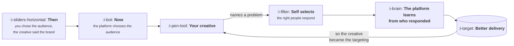

# Creative Is the Targeting

```text
Level: Basic
Prerequisites: The Auction in Plain Words
Estimated difficulty: 2/5 | Estimated time: 30 min
```

## The idea in one minute

Audience targeting used to be the skill in paid acquisition and it has largely been automated
away. What remains under your control is what the advertisement says and shows, and that turns
out to be where most of the variance was all along: in the model below, the spread between the
worst and best creative is 4.4 times while the spread between the worst and best audience is 1.5.
The deeper point is that a creative does the targeting now. An advertisement that opens by naming
a specific problem is self selecting, attracting the people who have that problem and repelling
everyone else more precisely than any audience setting could, and the platform then learns from
who responded.

## A picture



A loop, and the only box in it you control is the creative.

## How it really works

### Where the variance went

For about a decade the advantage in paid acquisition was knowing which audience to buy. Detailed
interest targeting, custom segments, layered exclusions. That advantage has largely disappeared
for two reasons: privacy changes removed much of the data the detailed options were built on, and
automated delivery became better at finding responsive people than manual segmentation was.

What is left is the creative, and the arithmetic in the program says that was always the larger
term. Holding the audience still, moving from the worst creative to the best changes cost per
customer by 4.4 times. Holding the creative still and moving across every audience option
available changes it by 1.5.

A team that spends its week on audience configuration is working on the smaller term with the
less durable advantage.

### How a creative targets

This is the mechanism and it is worth being precise about, because "creative is targeting" is
otherwise just a slogan.

An advertisement that says "project management software" is shown to a broad audience, and people
who have any interest in the category might click. An advertisement that opens "your build takes
forty minutes and nobody will own the problem" is shown to the same broad audience and is ignored
by everyone except the people for whom that sentence is a description of their Tuesday.

The second advertisement has a lower click through rate and a much higher conversion rate, and
critically it teaches the platform something. The delivery system observes who responded, builds
its model of your buyer from those people, and finds more of them. You have specified an audience
through the copy, in a vocabulary the targeting interface could never have expressed.

The implication is that a specific, slightly off putting, problem naming advertisement often
outperforms a broad appealing one, and will look worse on every upper funnel metric while doing
it.

### The trap in the last table

Run the program and look at the final comparison. A bad creative paired with your best audience
costs 420 per customer, which sits just under a bar of 421. It survives review. It looks like a
functioning campaign.

The best creative on the broadest audience costs 147. It is almost three times cheaper, reaches
a far larger pool of people, and does not exhaust itself in three weeks the way a small
retargeting audience does.

The first arrangement is the one that occurs naturally, because retargeting always performs best
on a report and so attracts budget, and a mediocre creative on a warm audience is the easiest
thing in the world to keep running. It is the arrangement that caps your channel at the size of
your existing traffic.

### What makes a creative work

Four things, consistently, across categories.

**It names the problem in the audience's own words.** Not the solution, not the category, the
problem. This is the self selecting mechanism above.

**It shows the thing working.** Demonstration beats description reliably, which is why the best
entry in the program's table is the one showing the product actually doing something.

**It is specific enough to be falsifiable.** A specific number, a specific situation, a specific
before and after. Vague claims are ignored because everyone makes them.

**It survives being seen without sound, at small size, in a hurry.** Most of the audience never
reads the second sentence.

What does not work, consistently: feature lists, generic product photography, and anything whose
main message is that your company exists.

### Fatigue, and why volume still matters

Creative decays. The same advertisement shown repeatedly to the same audience performs worse over
weeks, which is why the exponent in
[Saturation and the Ceiling](../acquisition-channels/04-saturation-and-the-ceiling.md) falls as
a channel runs.

So you need both: a small number of genuinely strong concepts, and enough variations of each to
keep the channel fresh. The failure mode is confusing the two, and producing forty variations of
a weak concept, which refreshes nothing because the concept was the problem.

The useful discipline is to separate concept testing from variation production. Concepts are few,
tested properly, and most of them fail. Variations are many, cheap, and only worth making for
concepts that have already won.

### What fills the box in 2026

Every major platform now takes a set of assets and assembles them, which means you are supplying
raw material rather than finished advertisements. This makes the concept the unit of work and
removes most of the layout decisions from your control.

The reporting consequence is awkward and worth planning for: when the platform assembles
combinations dynamically, attributing performance to any individual asset becomes difficult, and
the platform's own asset level reporting is thin. Keeping a small number of clearly distinct
concepts running, rather than many similar ones, is partly a measurement decision.

## Run the numbers

Five creatives, four audiences, and where the variance actually is.

```go
// creative.go: where the variance actually is, and therefore where the work goes.
package main

import "fmt"

// Cost per customer for one pairing is a base cost divided by how well the
// creative works and how well the audience matches. Both multiply; they do
// not have the same spread.
const base = 300.0

func main() {
	creatives := []struct {
		name string
		lift float64
	}{
		{"generic product shot", 0.55},
		{"feature list", 0.70},
		{"testimonial", 1.00},
		{"problem, stated plainly", 1.60},
		{"the thing actually working", 2.40},
	}
	audiences := []struct {
		name string
		lift float64
	}{
		{"broad", 0.85},
		{"interest based", 1.00},
		{"lookalike of customers", 1.15},
		{"retargeting site visitors", 1.30},
	}

	cac := func(c, a float64) float64 { return base / (c * a) }

	fmt.Printf("%-28s", "cost per customer")
	for _, a := range audiences {
		fmt.Printf("%12s", a.name[:min(11, len(a.name))])
	}
	fmt.Println()
	for _, c := range creatives {
		fmt.Printf("%-28s", c.name)
		for _, a := range audiences {
			fmt.Printf("%12.0f", cac(c.lift, a.lift))
		}
		fmt.Println()
	}

	// How much does each choice move the answer, holding the other still?
	cSpread := cac(creatives[0].lift, 1) / cac(creatives[len(creatives)-1].lift, 1)
	aSpread := cac(1, audiences[0].lift) / cac(1, audiences[len(audiences)-1].lift)

	fmt.Printf("\nworst to best creative, audience held still: %.1fx\n", cSpread)
	fmt.Printf("worst to best audience, creative held still: %.1fx\n", aSpread)

	fmt.Println("\nwhat each search finds, starting from the middle of the other:")
	fmt.Printf("  tune the audience with a mediocre creative: %.0f down to %.0f\n",
		cac(0.70, 0.85), cac(0.70, 1.30))
	fmt.Printf("  tune the creative with a mediocre audience: %.0f down to %.0f\n",
		cac(0.55, 1.00), cac(2.40, 1.00))

	fmt.Println("\nthe trap: a good audience makes a bad creative look survivable")
	fmt.Printf("  bad creative, best audience:   %.0f\n", cac(0.55, 1.30))
	fmt.Printf("  best creative, broad audience: %.0f\n", cac(2.40, 0.85))
	fmt.Println("\nThe second pairing is cheaper, reaches far more people, and")
	fmt.Println("does not exhaust itself in three weeks.")
}

func min(a, b int) int {
	if a < b {
		return a
	}
	return b
}
```

The two spread figures are the whole argument: 4.4 times from the creative axis against 1.5 from
the audience axis. If you can only work on one, the choice is not close.

The middle block makes it concrete in terms of a quarter's work. Spending the quarter tuning
audiences with a mediocre creative takes you from 504 to 330. Spending it on creative with a
mediocre audience takes you from 545 to 125. Both are real improvements and one is four times
larger.

The last block is the trap and it is the common case. 420 against a bar of 421 passes. It is also
the most expensive entry in the entire table that still passes, it is running on your smallest
audience, and it has nowhere to grow. The alternative at 147 looks less impressive on a
retargeting report and is a channel rather than a line item.

Put your own numbers in by measuring one creative across two audiences and one audience across
two creatives. Four cells is enough to estimate both spreads, and knowing which is larger for
your product decides where a quarter goes.

## The AI layer

Production cost for creative has collapsed, and the two consequences point in different
directions.

**The good one is concept exploration.** The expensive part of creative was never the final
asset, it was discovering which framing of the problem resonates, and that previously cost a
production cycle per attempt. Generating twenty distinct problem framings as rough assets and
putting them in front of real people is now cheap, and the concept is the term with the 4.4
times spread in it.

**The bad one is variation without concept.** It is equally cheap to produce two hundred
variations of a weak idea, and the arithmetic from the previous lesson applies: each variant
accumulates evidence slowly, none gets a confident quality estimate, and the channel performs
worse than it would with five strong ones. Cheap production rewards the discipline of testing
concepts properly and punishes the instinct to fill the account.

There is a third effect that is harder to price. Generated creative tends towards the
conventional, because conventional is what it has seen most of, and the winning entry in the
table above is the one that is specific, slightly awkward and true to one person's actual
experience. That remains the thing to find, and finding it still involves talking to customers
rather than generating options.

The practical arrangement that works: use generation to produce many rough concepts for
evaluation, pick the few that are specific and true, and produce those properly.

## Sector lens

| Sector | What the creative has to do |
|---|---|
| [Enterprise B2B SaaS](../../product-management/product-by-sector/01-enterprise-b2b-saas.md) | Name the role and the specific failure that role is accountable for. Self selection matters more here because the audience is tiny |
| [Fintech](../../product-management/product-by-sector/02-fintech.md) | Establish trust within two seconds, and survive review. Approved claims are an asset and testing them is slow |
| [Ecommerce and D2C](../../product-management/product-by-sector/03-ecommerce-and-d2c.md) | Show the product in use. The sector where creative volume genuinely is the job, and fatigue is measured in weeks |
| [Marketplaces](../../product-management/product-by-sector/04-marketplaces.md) | Show real inventory, because supply is the proof. Generic creative underperforms a screenshot of actual listings |
| [Devtools and Infra](../../product-management/product-by-sector/05-devtools-and-infrastructure.md) | Show code or output. Any marketing register is punished, and the self selecting advertisement is almost the only thing that works |
| [Healthtech](../../product-management/product-by-sector/06-healthtech-and-regulated-care.md) | Work within claim restrictions, which rules out most of the specificity that makes creative effective |
| [Vertical SaaS](../../product-management/product-by-sector/07-vertical-saas.md) | Use the trade's own vocabulary, which is the strongest self selection available and invisible to outsiders |

## Remember this

* Audience targeting has been automated. Creative is what remains under your control and it was
  always the larger term.
* Worst to best creative is 4.4 times in the model. Worst to best audience is 1.5.
* A specific advertisement self selects its audience and teaches the delivery system who your
  buyer is, more precisely than any targeting interface.
* A problem naming advertisement has lower click through and higher conversion, and looks worse
  on every upper funnel metric while working better.
* A mediocre creative on your best audience survives review and caps your channel at the size of
  your existing traffic.
* What works: the problem in their words, the thing demonstrated, specificity, and surviving
  being half seen.
* Separate concept testing from variation production. Forty variations of a weak concept refresh
  nothing.
* Generated creative tends to the conventional. The winner is usually specific, awkward and true.

## Try it

1. Run `creative.go`, then measure your own two spreads with four real cells: two creatives
   across two audiences. That is a fortnight of spend and it settles where your quarter goes.
2. Find your best performing campaign and check whether it is the trap: a weak creative on a
   small warm audience. If the audience is under a certain size, your channel has no headroom
   regardless of its cost per customer.
3. Write three advertisements that name a specific problem in a customer's own words, taken from
   support tickets or call transcripts rather than from your own description of the product.

## Check yourself

1. Explain the mechanism by which a creative performs targeting, rather than merely being shown
   to a target.
2. A campaign costs 420 against a bar of 421 and the team wants to scale it. What two questions
   do you ask before agreeing?
3. Why does producing two hundred variations often perform worse than producing five, when
   production is nearly free?
