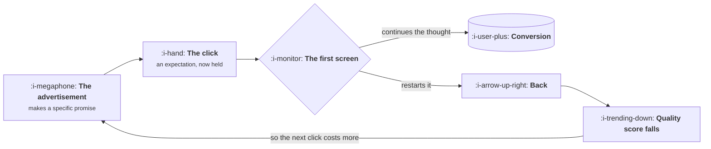

# Landing Page and Offer Fit

```text
Level: Basic
Prerequisites: Creative Is the Targeting
Estimated difficulty: 2/5 | Estimated time: 30 min
```

## The idea in one minute

A paid click arrives carrying an expectation that the advertisement created, and the page either
continues that thought or restarts it. Most paid landing pages restart it, because they are the
site's general purpose pages written for somebody who arrived knowing who you are. The resulting
loss is large, it is invisible in the advertising report because the click was still bought and
counted, and it feeds back into the auction through the quality term so you pay more for the
next one. The useful framing is not conversion rate optimisation, it is continuity: the page's
first screen should answer the promise the advertisement made, in the same words, before it does
anything else.

## A picture



The loop at the bottom is why this is not merely a conversion problem. A page that breaks
continuity raises the price of every click that follows it.

## How it really works

### The expectation is the asset

Somebody who clicks has done something slightly unusual: they interrupted what they were doing
because a sentence described their situation. For a few seconds they are holding a specific
expectation, and that expectation is the most valuable thing you will have from them.

Three things spend it immediately.

**Different words.** The advertisement said "cut your build time", the page says "the modern
developer productivity platform". The visitor has to translate, and translation is the moment
most of them leave.

**A general purpose page.** Your home page is written for somebody who arrived knowing who you
are and wants to see everything. A paid visitor arrived knowing one thing and wants that one
thing confirmed.

**Asking before giving.** A form, a login wall or a cookie negotiation before the visitor has
seen anything that confirms they are in the right place.

### Continuity, in practice

The test is mechanical and takes ten seconds per page. Put the advertisement and the first screen
of the page side by side. Does the page's headline contain the advertisement's main noun and verb?
If not, you have a translation step, and you will lose a substantial share of the traffic there.

This sounds trivially obvious and is routinely not done, for a structural reason: the
advertisement is owned by whoever buys media and the page is owned by whoever owns the website,
and nobody owns the join. It is the seam from
[Growth, Marketing and Product](../the-growth-function/02-growth-marketing-and-product.md)
appearing at the level of a single click.

### What the first screen needs

Four things, in this order, and nothing else above the fold.

**The promise restated.** The same claim the advertisement made, in the same vocabulary.
**Proof it is true.** A screenshot of the thing working, a number, a name the visitor recognises.
**What happens next.** One action, stated plainly, with the cost of taking it made obvious.
**A reason the cost is low.** No card, two minutes, cancel whenever, or whatever is true.

Everything else belongs below. The second screen can introduce the company, the third can list
features, and most visitors will never see either, which is correct.

### Offer fit, which is the larger half

The page is the smaller problem. The offer is what you are asking somebody to do, and the usual
mistake is asking for a step that is too large for how warm the traffic is.

A visitor from a brand search is close to deciding and can be asked to start a trial. A visitor
from a cold feed advertisement has known you for nine seconds and being asked for a credit card
is why they left. The fix is not a better page, it is a smaller ask: see the thing work, read the
comparison, get the number, try one feature without an account.

The arithmetic matters here and is worth doing rather than assuming. A smaller ask converts more
people into a weaker commitment, so the question is whether the extra volume survives the lower
quality. Build the two stage version in the funnel arithmetic from
[Funnels Leak, Loops Compound](../loops-and-compounding/01-funnels-leak-loops-compound.md)
and compare the end to end rate rather than the first step.

### The quality feedback loop

A paid landing page is not only converting, it is being assessed. Landing page experience is one
of the three inputs to the quality term in the previous lesson, which means a page that people
bounce off raises your cost per click as well as lowering your conversion rate.

The two effects multiply, which is why landing page work has an unusually good return in paid
and an unusually poor one in organic, where there is no auction to feed back into.

### What fills the box in 2026

Page builders have made producing a dedicated page per campaign cheap enough that there is no
longer an excuse for sending paid traffic to the home page. The constraint that remains is
ownership: somebody has to be responsible for the join between advertisement and page, and in
most companies that is still nobody, which is why the cheap fix stays undone.

The second practical note is measurement. If pages are built outside your main application, the
analytics are frequently not joined to the rest of your funnel, so you will know the signup rate
and not the activation rate of the people those pages produce, which is exactly the number that
distinguishes a good channel from a cheap one. Join it before you build many of them.

## Sector lens

| Sector | Where the click gets lost |
|---|---|
| [Enterprise B2B SaaS](../../product-management/product-by-sector/01-enterprise-b2b-saas.md) | The ask is a demo, which is enormous for cold traffic. A smaller first step is nearly always available and nearly never offered |
| [Fintech](../../product-management/product-by-sector/02-fintech.md) | Required disclosures crowd the first screen, and verification is a large ask. Sequence the ask so the value lands before the identity check |
| [Ecommerce and D2C](../../product-management/product-by-sector/03-ecommerce-and-d2c.md) | Sending traffic to a category page rather than the exact product in the advertisement. The commonest continuity break in the sector |
| [Marketplaces](../../product-management/product-by-sector/04-marketplaces.md) | Landing on empty or irrelevant results, which proves the opposite of the advertisement's promise |
| [Devtools and Infra](../../product-management/product-by-sector/05-devtools-and-infrastructure.md) | Marketing copy where the visitor expected documentation. Send paid traffic to the docs and watch what happens |
| [Healthtech](../../product-management/product-by-sector/06-healthtech-and-regulated-care.md) | Compliance language above the fold displaces the promise. The page can be correct and communicate nothing |
| [Vertical SaaS](../../product-management/product-by-sector/07-vertical-saas.md) | Generic software language where the trade expects its own vocabulary. The visitor concludes you do not know their business |

## Remember this

* The click arrives carrying an expectation the advertisement created. That expectation is the
  asset and three things spend it: different words, a general page, and asking before giving.
* The test: does the page headline contain the advertisement's main noun and verb? Ten seconds
  per page.
* Nobody owns the join between advertisement and page, which is why the cheapest fix in paid
  acquisition stays undone.
* First screen: the promise restated, proof, what happens next, and why the next step is cheap.
  Everything else below.
* Offer fit is the larger half. Match the size of the ask to how warm the traffic is.
* Compare offers on the end to end rate, not the first step. A smaller ask trades commitment for
  volume and the trade is not always good.
* A bad landing page lowers conversion and raises cost per click at the same time, through the
  quality term.

## Try it

1. Put your five highest spending advertisements next to the first screen of the page each one
   sends to. Count how many share their main noun and verb. The usual answer is one or none.
2. For your coldest traffic source, write down the smallest useful thing a visitor could do that
   is not signing up. Then check whether that option exists anywhere on the page.
3. Check whether your paid landing pages report activation, not just signup. If they do not, you
   cannot tell a cheap channel from a good one, which is the distinction that matters.

## Check yourself

1. Why does a landing page problem raise your cost per click as well as lowering your conversion
   rate, and why does the same not apply to an organic landing page?
2. Your advertisement promises a specific outcome and the page leads with your company's
   positioning statement. Describe what the visitor has to do in that moment, and why most do
   not.
3. A smaller ask raises the first step conversion rate by 60 percent. What do you need to know
   before concluding it is an improvement?
