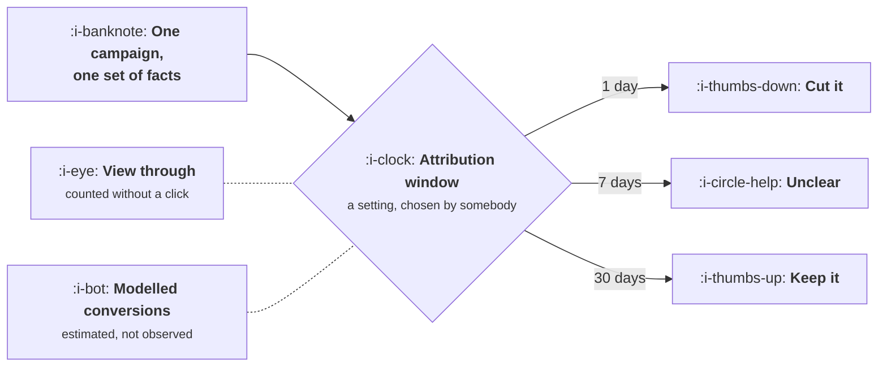

# Reading a Paid Report

```text
Level: Basic
Prerequisites: Landing Page and Offer Fit
Estimated difficulty: 3/5 | Estimated time: 35 min
```

## The idea in one minute

A paid report is produced by the party being evaluated, under settings somebody chose, and the
most consequential of those settings is usually invisible on the page. The attribution window
decides how long after a click a conversion still counts, and changing it from one day to thirty
can reverse the verdict on a channel without anything in the world changing. Fast converting
channels look good under every window; slow ones look terrible under short ones, which is the
mechanism by which a working channel gets cut. Three other columns mislead reliably, and knowing
which four numbers to read first makes a paid report usable rather than persuasive.

## A picture



Three verdicts, one campaign, and the only thing that differs is a dropdown.

## How it really works

### The window is a decision, not a fact

A conversion that happens eleven days after a click is counted if your window is thirty days and
not if it is seven. Both reports are internally consistent and neither is wrong, and the company
will act on whichever one it happens to be looking at.

The program below runs four channels through one day, seven day and thirty day windows.
Retargeting and brand search barely move, because almost all their conversions happen
immediately. Cold paid social goes from 727 per customer to 131. Comparison placements go from
962 to 139.

Against a bar of 421, that is two channels that read as obvious failures under a one day window
and obvious successes under a thirty day one. They are the same two channels either way.

### Why the slow channels are the ones at risk

This is not symmetric, and the asymmetry is the practical danger. Channels that create demand
have long gaps between the click and the purchase, because the person was not shopping when they
saw you. Channels that capture existing demand convert immediately.

So a short window systematically understates exactly the channels that do the upstream work, and
systematically flatters the ones that harvest. A company that standardises on a short window will
gradually defund demand creation and conclude that only retargeting and brand work, which is the
same conclusion that last touch attribution reaches by a different route.

Both errors have the same shape and the same correction: measure over a window at least as long
as your actual purchase cycle, which you can read directly off your own conversion lag data.

### The other three columns that mislead

**View through conversions.** Somebody saw the advertisement, did not click, and converted
later. Platforms count these and the counting is defensible, since advertisements do work without
being clicked. It is also unverifiable by you, it inflates performance by an amount nobody can
check, and it is enabled by default in several places. Report with and without it, and make
budget decisions on the without.

**Modelled conversions.** Where tracking is blocked, the platform estimates what it cannot see.
The estimates are produced using real data and reasonable methods, by the party whose performance
is being assessed. Use them operationally and never for allocating budget between platforms,
which is the one decision where the conflict matters.

**Blended cost per customer.** Total spend divided by total new customers, including everyone
who arrived organically. This is a useful business number and it is not a channel number, and
quoting it in a channel conversation makes paid look better than it is by exactly the proportion
of your growth that is not paid. The definitional work on this is in
[Revenue and Efficiency](../../product-management/revenue-and-efficiency/README.md).

### The four numbers to read first

In this order, before anything else on the page.

**What window is this.** Written down, compared against your real conversion lag.
**Is view through included.** If yes, ask for the version without.
**What share is modelled.** If a large share, the report is an estimate wearing the clothes of a
measurement.
**Cost per customer, not per click or per signup.** The definition of a conversion is the other
setting people change without saying.

Four questions, about two minutes, and they determine whether the rest of the numbers mean
anything.

### Reconciling with your own data

Platform numbers and your own analytics will never agree, and chasing exact agreement is a waste
of a quarter. What is worth doing is establishing the ratio between them and watching that ratio
rather than the absolute numbers.

If the platform reports 1.4 times what your own system does, and that ratio is stable, you have a
usable instrument. When the ratio moves, something changed in tracking, in the window, or in the
mix of modelled conversions, and that movement is the signal worth investigating. Most teams
compare absolute numbers, find they disagree, and give up.

### What fills the box in 2026

Server side conversion reporting has become the standard response to tracking restrictions, and
it genuinely improves the data flowing back to platforms. It also means the platform is now
scoring itself using data you supplied, which does not reduce the conflict in the modelled
conversion column.

The one practice that settles all of this is the one from
[Attribution](../acquisition-channels/06-attribution.md): a geographic holdout on your largest
paid channel, once a year. Every number discussed in this lesson is a convention or an estimate
except that one.

## Run the numbers

Four channels, three windows, and the verdicts that follow.

```go
// window.go: the same campaign, three attribution windows, three verdicts.
package main

import "fmt"

type channel struct {
	name  string
	spend float64
	// conversions by the day they happened, relative to the click
	byDay map[int]float64
}

func (c channel) within(days int) float64 {
	t := 0.0
	for d, n := range c.byDay {
		if d <= days {
			t += n
		}
	}
	return t
}

func main() {
	channels := []channel{
		{"retargeting", 20_000, map[int]float64{0: 180, 1: 40, 3: 20, 7: 10, 14: 6, 30: 4}},
		{"brand search", 15_000, map[int]float64{0: 150, 1: 30, 3: 14, 7: 8, 14: 4, 30: 2}},
		{"paid social, cold", 40_000, map[int]float64{0: 30, 1: 25, 3: 40, 7: 55, 14: 70, 30: 85}},
		{"comparison placements", 25_000, map[int]float64{0: 14, 1: 12, 3: 22, 7: 38, 14: 44, 30: 50}},
	}

	windows := []int{1, 7, 30}
	fmt.Printf("%-24s %9s", "channel", "spend")
	for _, w := range windows {
		fmt.Printf("%16s", fmt.Sprintf("%d day cost", w))
	}
	fmt.Println()
	for _, c := range channels {
		fmt.Printf("%-24s %9.0f", c.name, c.spend)
		for _, w := range windows {
			n := c.within(w)
			if n == 0 {
				fmt.Printf("%16s", "no data")
				continue
			}
			fmt.Printf("%16.0f", c.spend/n)
		}
		fmt.Println()
	}

	const bar = 421.0
	fmt.Printf("\nverdict against a bar of %.0f:\n", bar)
	fmt.Printf("%-24s", "channel")
	for _, w := range windows {
		fmt.Printf("%14s", fmt.Sprintf("%d day", w))
	}
	fmt.Println()
	for _, c := range channels {
		fmt.Printf("%-24s", c.name)
		for _, w := range windows {
			v := "keep"
			if c.spend/c.within(w) > bar {
				v = "cut"
			}
			fmt.Printf("%14s", v)
		}
		fmt.Println()
	}

	fmt.Println("\nTwo channels change verdict depending only on the window, and the")
	fmt.Println("window is a setting somebody chose, often the platform's default.")
	fmt.Println("Fast converting channels look good under every window. Slow ones")
	fmt.Println("look bad under short ones, which is how a working channel gets cut.")
}
```

Retargeting costs 91 at one day and 77 at thirty. Brand search costs 83 and 72. Those two are
stable because their conversions arrive immediately, and any window gives roughly the same
answer.

Cold paid social costs 727 at one day and 131 at thirty. That is not a small discrepancy, it is
a factor of five and a half, and it flips the channel from the worst in the table to the second
best. Comparison placements do the same thing, from 962 to 139.

The verdict table makes the consequence plain: under a one day window you cut two channels, under
seven or thirty you keep all four. Nothing about the channels differs between those three
columns.

Change the `byDay` maps to your own conversion lag, which you can pull from your own data by
recording days between first click and purchase. The shape of that distribution tells you the
shortest window you can honestly use, and if most of your conversions arrive after day seven then
a seven day report is not a report about your business.

## The AI layer

Two things, one measurement and one economic.

The measurement one is that conversion lag has lengthened for products where people now compare
options by asking a model rather than by browsing. Somebody encounters you, researches elsewhere,
and arrives days later through a route that carries no attribution at all. This stretches the
window you need and increases the share of conversions that appear to come from nowhere, which
in most reporting setups lands in direct or organic and quietly understates paid.

The economic one is specific to products with usage based cost. A paid report shows revenue or
conversions and not margin, so two campaigns with identical cost per customer can have quite
different value if one of them brings heavier users. Where inference cost is a real line item
this is not a rounding difference, and the correction is to report cost per customer alongside
the gross margin of the cohort each channel delivers. The arithmetic is in
[AI Cost and Margin](../../product-management/ai-cost-and-margin/README.md).

A model is useful for one thing here: reconciling two systems that disagree, by matching records
and explaining where the gap arises. That is a data task on data you hold, which is the category
where it works well.

## Sector lens

| Sector | What the report gets wrong here |
|---|---|
| [Enterprise B2B SaaS](../../product-management/product-by-sector/01-enterprise-b2b-saas.md) | Every window is too short. The cycle is months, so platform reports show almost nothing and pipeline is the only usable measure |
| [Fintech](../../product-management/product-by-sector/02-fintech.md) | Verification delay sits between click and customer, so conversions land outside standard windows and paid looks worse than it is |
| [Ecommerce and D2C](../../product-management/product-by-sector/03-ecommerce-and-d2c.md) | View through inclusion is the big distortion, and the one most likely to be on by default |
| [Marketplaces](../../product-management/product-by-sector/04-marketplaces.md) | Supply side spend produces demand side revenue, which no paid report connects at all |
| [Devtools and Infra](../../product-management/product-by-sector/05-devtools-and-infrastructure.md) | Adoption is months after first contact and often by a colleague, so attribution data covers a fraction of reality |
| [Healthtech](../../product-management/product-by-sector/06-healthtech-and-regulated-care.md) | Tracking restrictions mean a large modelled share, so most of the report is estimate rather than observation |
| [Vertical SaaS](../../product-management/product-by-sector/07-vertical-saas.md) | Conversion counts are small enough that any window produces noise. Read the named accounts, not the rates |

## Remember this

* The attribution window is a setting somebody chose, and it can reverse the verdict on a channel
  with nothing else changing.
* Short windows systematically understate demand creation and flatter demand harvesting, the same
  error last touch attribution makes by another route.
* Set the window from your own conversion lag distribution, not from the platform default.
* View through conversions are unverifiable by you. Report with and without, decide on without.
* Modelled conversions are estimates from the party being evaluated. Operations yes, budget
  allocation between platforms no.
* Blended cost per customer is a business number, not a channel number.
* Read four things first: the window, view through, the modelled share, and whether a conversion
  means a customer.
* Do not chase exact agreement between platform and internal numbers. Establish the ratio and
  watch it for changes.

## Try it

1. Run `window.go` with your own conversion lag data. The share of conversions arriving after
   day seven is the single number that tells you whether your current reporting is usable.
2. Open your main paid report and answer the four questions. If you cannot answer all four in two
   minutes, that is the first thing to fix.
3. Compute the ratio between platform reported conversions and your own for the last six months.
   A stable ratio is a working instrument; a moving one is an investigation.

## Check yourself

1. Why does a short attribution window systematically disadvantage demand creation channels
   rather than affecting all channels equally?
2. A platform reports 4,000 conversions, of which 900 are view through and 600 modelled. What is
   the number you would take into a budget meeting, and what would you say about the rest?
3. Your platform reports 1.4 times your internal number every month for a year, then 2.1 times
   this month. What changed, and which three things would you check?
