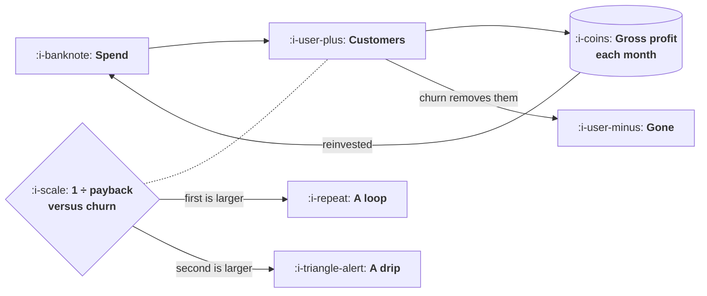

# When Paid Is a Loop

```text
Level: Basic
Prerequisites: Reading a Paid Report
Estimated difficulty: 3/5 | Estimated time: 35 min
```

## The idea in one minute

Paid acquisition is called a growth loop constantly and usually is not one, and the difference
has a one line test. If you reinvest every pound of gross profit into acquisition, your customer
base compounds at one divided by your payback period and decays at your churn rate, so paid
compounds when one over payback exceeds churn and otherwise merely runs while the money lasts.
That test resolves an argument that is normally conducted on vocabulary, and it has an
uncomfortable corollary: at eight percent monthly churn, a payback period over about twelve and
a half months means your paid channel is not a loop at any level of spend or execution.

## A picture



Two flows out of the customer box. The loop turns only when the one going right is faster than
the one going down.

## How it really works

### The test

Reinvest all gross profit. Each month your customers produce some money, that money buys more
customers, and meanwhile some customers leave.

The rate at which reinvestment adds customers is the gross profit per customer per month divided
by the cost of acquiring one, which is one over the payback period. The rate at which they leave
is the churn rate. The loop turns at the difference.

**Paid compounds when one over payback exceeds churn.**

That is the whole criterion, and the numbers are easy to carry: a six month payback gives 16.7
percent a month of compounding, an eighteen month payback gives 5.6 percent, and you lose your
churn rate from both.

### What the four cases look like

The program runs four setups and the interesting thing is which ones match.

Fast payback with low churn compounds at 13.7 percent a month and turns 30,000 of seed spend
into 95,177 of monthly spend by month twenty four. That is a genuine loop and it is what people
have in mind when they use the phrase.

Fast payback with high churn and slow payback with low churn both land at about 2.6 percent a
month, from completely different causes. The first has excellent unit economics and a leaky
bucket; the second has a durable customer and ties up cash for a year and a half. Both are
technically loops and both compound so slowly that financing them matters more than the loop
does.

Slow payback with high churn is negative. Reinvesting all profit, the channel shrinks. This is
the case that gets described as a loop in planning documents, and the growth model then forecasts
acceleration that is not structurally available.

### Why this matters beyond vocabulary

[The Four Loop Types](../loops-and-compounding/02-the-four-loop-types.md) made the point that a
loop term and a channel term forecast completely differently. A loop compounds and needs a
ceiling. A channel is linear in spend and needs a budget.

Getting this wrong in the growth model produces a specific and expensive error: the plan promises
acceleration from a channel that can only ever be proportional to the money put in, the company
hires against the promise, and the gap appears two quarters later when the acceleration does not
arrive. By then the spending commitments are made.

The test above takes two numbers you already have and prevents it.

### Nobody actually reinvests everything

Worth saying, because the model is deliberately idealised. Real companies spend gross profit on
salaries, product and rent, so the reinvestment rate is a fraction of what the program assumes
and the real compounding rate is correspondingly lower.

This does not weaken the test, it strengthens it. The criterion is the best case: if one over
payback does not exceed churn when reinvesting everything, nothing about a more realistic
allocation will help. Treat it as a necessary condition rather than a prediction.

### What to do when the answer is drip

Three moves, and the first is the one people skip.

**Accept it, and model it as a channel.** A drip is a perfectly good way to acquire customers. It
is linear in spend, it stops when you stop, and a growth model that says so is more useful than
one that pretends otherwise. Most paid channels at most companies are this, and the harm comes
from the mislabelling rather than from the channel.

**Shorten the payback.** Raise price, improve margin, or move revenue earlier through annual
plans or upfront commitments. Annual billing is the most direct available lever on this number
and it is usually a pricing conversation rather than a growth one.

**Cut churn.** The table at the end of the program inverts the criterion: at two percent monthly
churn you can afford a fifty month payback, at eight percent twelve and a half, at fourteen
percent about seven. Churn does not merely reduce lifetime value, it determines whether your
acquisition channel can compound at all.

### What fills the box in 2026

Nothing tooling related. The one practice worth adopting is putting the two numbers, one over
payback and monthly churn, next to each other on whatever page your paid spend is reviewed on.
They are both already computed somewhere and they are almost never shown together, which is why
the question gets argued rather than read.

## Run the numbers

Four setups, the same seed, and the test applied.

```go
// paidloop.go: paid is a loop only if the money comes back faster than the customers leave.
package main

import "fmt"

type setup struct {
	name   string
	cac    float64 // cost to acquire one customer
	margin float64 // gross profit per customer per month
	churn  float64 // monthly
}

func (s setup) payback() float64 { return s.cac / s.margin }

// Reinvest every pound of gross profit into acquisition. Customers compound
// at 1/payback and decay at the churn rate, so the loop turns only when the
// first exceeds the second.
func (s setup) rate() float64 { return 1/s.payback() - s.churn }

func (s setup) run(seed float64, months int) (spend, customers float64) {
	customers = seed / s.cac
	spend = seed
	for m := 0; m < months; m++ {
		spend = customers * s.margin
		customers = customers*(1-s.churn) + spend/s.cac
	}
	return
}

func main() {
	setups := []setup{
		{"fast payback, low churn", 300, 50.0, 0.030},
		{"fast payback, high churn", 300, 50.0, 0.140},
		{"slow payback, low churn", 900, 50.0, 0.030},
		{"slow payback, high churn", 900, 50.0, 0.060},
	}

	fmt.Printf("%-26s %9s %10s %11s %12s\n",
		"setup", "payback", "1/payback", "churn", "net rate")
	for _, s := range setups {
		fmt.Printf("%-26s %8.1fm %9.1f%% %10.1f%% %11.1f%%\n",
			s.name, s.payback(), 100/s.payback(), 100*s.churn, 100*s.rate())
	}

	fmt.Println("\nreinvesting all gross profit, starting from 30,000 of spend:")
	fmt.Printf("%-26s %14s %14s %14s\n",
		"setup", "month 12 spend", "month 24 spend", "verdict")
	for _, s := range setups {
		_, _ = s.run(30_000, 0)
		s12, _ := s.run(30_000, 12)
		s24, _ := s.run(30_000, 24)
		v := "a loop"
		if s.rate() <= 0 {
			v = "a drip"
		}
		fmt.Printf("%-26s %14.0f %14.0f %14s\n", s.name, s12, s24, v)
	}

	fmt.Println("\nthe test, in one line:")
	fmt.Println("  paid compounds when 1/payback exceeds churn, and otherwise it is")
	fmt.Println("  a channel that stops the day the money stops. Both are legitimate.")
	fmt.Println("  Only one of them belongs in the growth model as a loop.")

	fmt.Println("\nhow much payback you can afford at a given churn:")
	fmt.Printf("  %-12s %18s\n", "churn", "payback must be under")
	for _, c := range []float64{0.02, 0.04, 0.08, 0.14} {
		fmt.Printf("  %11.0f%% %17.1f months\n", 100*c, 1/c)
	}
}
```

The first table is the test and takes ten seconds to read. Three positive rates and one negative.

The second table shows what those rates do over two years. Note that every row dips below the
30,000 seed at month twelve, including the best one at 20,461. That is correct and worth
expecting: in the first year the channel is funded by the gross profit of a customer base that
is still small, so a self funding paid loop always shrinks before it grows. A company that seeds
a paid loop and judges it at month twelve will conclude it is failing in every case, including
the case where it turns 30,000 into 95,177 by month twenty four.

The two middle rows are the ones to sit with, because they land within a tenth of a percent of
each other from opposite problems. One has a six month payback and loses customers almost as
fast as it buys them. The other keeps its customers and takes eighteen months to see its money.
Identical compounding, and completely different fixes: the first is a retention project and the
second is a pricing project. The net rate tells you the speed and not which half to work on.

The final table is the one to put on a wall. At eight percent monthly churn your payback must be
under 12.5 months for paid to compound at all. Compare that with your own two numbers before the
next planning cycle.

## The AI layer

Two effects on the two inputs of the test, pointing in opposite directions.

**Margin is lower and variable where inference costs money,** which lengthens payback directly.
A product whose gross profit per customer per month falls from 50 to 38 because of model costs
moves from a six month payback to just under eight, and loses about four points of monthly
compounding. This is the clearest growth consequence of inference cost and it rarely appears in
the discussion, which tends to focus on gross margin as a reporting line rather than on what it
does to whether acquisition compounds.

**Churn may be higher early on,** because a product whose output quality varies gives people a
reason to leave that a deterministic product does not. Both inputs therefore move the wrong way
at once, and they multiply rather than add in their effect on the criterion.

Working the other way, usage based pricing can shorten payback considerably, because revenue
arrives in proportion to use rather than on a monthly schedule, and heavy users pay sooner. For
some products this more than offsets the margin effect, and whether it does is an arithmetic
question your own numbers answer in five minutes.

The practical instruction: run the test with margin net of inference cost rather than with
headline gross margin. A channel that compounds on the headline number and drips on the real one
is a common and expensive situation to be in without knowing.

## Sector lens

| Sector | Whether paid can compound |
|---|---|
| [Enterprise B2B SaaS](../../product-management/product-by-sector/01-enterprise-b2b-saas.md) | Rarely through paid, since payback runs to a year or more, but churn is low enough that the criterion can still pass. Check rather than assume |
| [Fintech](../../product-management/product-by-sector/02-fintech.md) | Often yes, because revenue per customer compounds with their activity, which shortens effective payback after the first months |
| [Ecommerce and D2C](../../product-management/product-by-sector/03-ecommerce-and-d2c.md) | Depends entirely on repeat purchase. Single purchase businesses are structurally a drip and should plan as one |
| [Marketplaces](../../product-management/product-by-sector/04-marketplaces.md) | Acquiring one side raises retention on the other, so the simple test understates it. Model the sides together |
| [Devtools and Infra](../../product-management/product-by-sector/05-devtools-and-infrastructure.md) | Expansion within accounts shortens effective payback dramatically. Run the test on account revenue, not on first seat |
| [Healthtech](../../product-management/product-by-sector/06-healthtech-and-regulated-care.md) | Very low churn and very long payback, which often passes the test while being impossible to finance |
| [Vertical SaaS](../../product-management/product-by-sector/07-vertical-saas.md) | Passes the test comfortably on churn, and is capped by the number of firms long before compounding matters |

## Remember this

* Paid compounds when one over payback exceeds churn. That is the whole test.
* A six month payback compounds at 16.7 percent a month before churn; eighteen months gives 5.6.
* Two very different problems produce the same net rate, so the rate tells you the speed and not
  which half to fix.
* A self funding paid loop shrinks before it grows. Judging it at month twelve condemns the good
  cases along with the bad.
* Nobody reinvests everything, so the test is a necessary condition rather than a forecast.
* When the answer is drip, model it as a channel. The harm is in the mislabelling, not the
  channel.
* At eight percent monthly churn your payback must be under 12.5 months. Churn decides whether
  acquisition can compound at all, not just what a customer is worth.
* Run the test on margin net of inference cost, not on headline gross margin.

## Try it

1. Run `paidloop.go` with your own three numbers. If the net rate is negative, the useful next
   step is to change your growth model rather than your campaigns.
2. Put one over payback and monthly churn next to each other on your paid review page. Both are
   already computed and almost nobody shows them together.
3. Work out what annual billing would do to your payback period, then rerun the test. For many
   companies this single change moves a drip into a loop.

## Check yourself

1. Derive the test. Why is the compounding rate one over the payback period, and why does churn
   subtract from it directly?
2. Two channels both compound at 2.6 percent a month. One has a six month payback and 14 percent
   churn, the other eighteen months and 3 percent. What is the right project for each?
3. Your paid channel is described as a loop in the growth plan and the test says it is a drip.
   What specifically will go wrong, and when?
