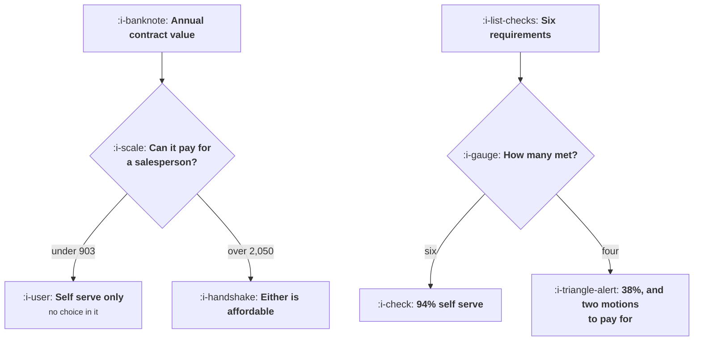

# What PLG Actually Requires

```text
Level: Expert
Prerequisites: Where the Paying Decision Happens
Estimated difficulty: 3/5 | Estimated time: 35 min
```

## The idea in one minute

Whether a product can be sold without a salesperson is two separate questions, and both have
arithmetic answers. The first is affordability: eleven hours of a person's time at 78 an hour is
858 a close, which needs about 903 of annual contract value to pay back inside fifteen months, so
below that nothing can be sold with help however good the seller. The second is whether the buyer
can get there alone, which comes down to six requirements, and the honest reading of four out of
six is not a product led business. It is 38 percent of revenue arriving without help and 62 percent
needing a motion you have not built, which is the most expensive position available.

## A picture



Two independent gates. Most arguments about PLG are really disagreements about which gate the
product fails.

## How it really works

### The affordability floor

A sales close costs the seller's time: call it eleven hours including the discovery call, the demo,
the follow ups, the security questionnaire and the internal paperwork. At a loaded 78 an hour that
is 858.

Set that against the gross profit the contract produces and a payback limit, which for most
companies is twelve to eighteen months. At fifteen months and a 76 percent margin, a contract needs
to be about 903 a year to carry a single close.

Below that there is no sales motion at any quality. A product priced at 240 a year cannot be sold by
a person, and the common response of hiring a cheaper salesperson moves the floor by a few hundred
rather than by the order of magnitude required.

Above about 2,050 the self serve acquisition budget exceeds the cost of a close, so both are
affordable and the choice becomes a question about the buyer rather than about your margins. That
band, roughly 900 to 2,000, is where the arithmetic actually forces the answer.

### The six requirements

Whether a buyer can get to value alone.

* **Time to first value under an hour.** Nobody evaluates an unfamiliar product unassisted for a
  week. The arithmetic of this is in
  [Time to Value](../activation-and-onboarding/03-time-to-value.md).
* **One user is enough.** If the product needs a whole team present to do anything, somebody has to
  coordinate them and that somebody is a salesperson.
* **No data migration.** A migration is a project with a plan and an owner. Inferring or seeding the
  data moves this requirement from failed to met, which is why it is one of the highest value things
  a model does for a PLG product.
* **No approvals before use.** A security review, a legal review or a procurement process is a human
  process with humans on the other side of it.
* **Defaults that work.** If the product needs configuring before it does anything, the
  configuration is the sale.
* **A price one person can approve.** Under a corporate card limit, or it enters a budget cycle and
  needs a champion.

### Reading the score honestly

Six of six is a self serve business. Five is self serve with a help channel, which is the most
common successful shape. Four is a hybrid and the funnel has to split, which is a real amount of
work.

Three or fewer is a sales led business with a free trial attached, and that is a legitimate and
common choice. The error is calling it product led, because the label determines what gets built
and measured: a sales led company that believes it is product led under invests in sales enablement
and over invests in onboarding, and both halves underperform.

### The expensive middle

Four out of six is the worst place to be and the easiest place to end up, because it is where a
product arrives naturally as it moves upmarket. You are paying for a self serve funnel that converts
38 percent of the revenue and for a sales team handling the rest without the tools a sales led
company would have built.

The resolution is to pick, explicitly, for a defined segment: self serve below a size threshold and
sales above it, with the threshold written down and the routing automatic. That is
[Self Serve, Sales Assist, Hybrid](02-self-serve-sales-assist-hybrid.md), and the thing that makes
it work is that it is a decision rather than a drift.

### What to do if you fail a requirement

Each has a known remedy and they are not equally available.

Time to value is usually fixable by product work. Users needed is sometimes fixable by making the
product useful to one person first, which is a significant product decision. Migration is
increasingly fixable. Approvals are not fixable by you: they are a property of your buyer, and the
only move is to sell to a buyer who does not need them, which means a different segment.

### What fills the box in 2026

Two requirements have moved. Data migration has become much more tractable, which has opened self
serve to a category of product that could not do it before. And the approvals requirement has gone
the other way: security review thresholds in mid sized companies have fallen, so products that used
to be bought on a card now trigger a review at a lower contract value. The net effect is that the
affordability band and the capability band have both shifted, and a judgement made before 2023
about which motion a product needs is worth redoing.

## Run the numbers

Find your floor, then score the six requirements.

```go
// plgband.go: which products can be sold without a salesperson, and which
// cannot be sold with one.
package main

import "fmt"

// A self serve motion has to pay for itself out of a small contract, and a
// sales assisted motion has to cover a person's time. Those two constraints
// leave a band of contract values where each works, and products outside
// their band do not have a growth problem, they have an arithmetic one.
const (
	salesHours   = 11.0 // hours of a person's time to close one deal
	hourCost     = 78.0 // fully loaded cost of that hour
	selfServeCAC = 0.42 // share of first year revenue a self serve motion can spend
	paybackCap   = 15.0 // months of gross profit you are willing to spend
	margin       = 0.76
)

func salesCost() float64 { return salesHours * hourCost }

// the smallest contract that can carry a salesperson, at this payback limit
func salesFloor() float64 {
	// monthly gross profit times the payback cap must cover the sales cost
	return salesCost() / (paybackCap * margin) * 12
}

func main() {
	fmt.Printf("one sales close costs %.0f of somebody's time\n", salesCost())
	fmt.Printf("at a %.0f month payback and %.0f%% margin, sales needs %.0f of annual contract\n\n",
		paybackCap, 100*margin, salesFloor())

	fmt.Printf("%-16s %16s %16s %16s %s\n",
		"annual contract", "self serve can pay", "sales cost", "sales affordable", "verdict")
	for _, acv := range []float64{60, 240, 900, 2_400, 9_000, 40_000, 150_000} {
		ss := acv * selfServeCAC
		sc := salesCost()
		ok := acv >= salesFloor()
		verdict := "self serve only"
		switch {
		case ok && ss > sc:
			verdict = "either works"
		case ok:
			verdict = "sales only"
		}
		yes := "no"
		if ok {
			yes = "yes"
		}
		fmt.Printf("%16.0f %16.0f %16.0f %16s %s\n", acv, ss, sc, yes, verdict)
	}
	fmt.Println("\nBelow 903 a year a salesperson cannot be paid for out of the")
	fmt.Println("contract, however good they are. Above about 2,050 the self serve")
	fmt.Println("budget exceeds a sales close, so both motions are affordable and the")
	fmt.Println("choice is about what the buyer needs rather than what you can pay.")

	fmt.Println("\nthe other half: can the product be bought without help?")
	fmt.Printf("%-34s %-20s %-18s %s\n",
		"requirement", "typical", "disqualifies", "why")
	for _, r := range []struct{ name, typ, dq, why string }{
		{"time to first value", "under an hour", "over a week", "nobody evaluates for a week unassisted"},
		{"users needed before it works", "one", "a whole team", "coordination needs a person"},
		{"data the product must be given", "none or inferred", "a migration", "migration is a project, not a signup"},
		{"approvals before use", "none", "security review", "procurement is a human process"},
		{"configuration before value", "defaults work", "a consultant", "configuration is the sale"},
		{"price the buyer can approve alone", "under a card limit", "a budget cycle", "a budget cycle needs a champion"},
	} {
		fmt.Printf("%-34s %-20s %-18s %s\n", r.name, r.typ, r.dq, r.why)
	}

	fmt.Println("\nhow many of the six you need:")
	fmt.Printf("%-18s %18s  %s\n", "requirements met", "self serve share", "what it means")
	for _, m := range []struct {
		n     int
		share float64
		note  string
	}{
		{6, 0.94, "pure self serve"},
		{5, 0.71, "self serve with a help channel"},
		{4, 0.38, "hybrid, and the funnel must split"},
		{3, 0.12, "sales led with a free trial attached"},
		{2, 0.02, "sales led; the free tier is marketing"},
	} {
		fmt.Printf("%18d %17.0f%%  %s\n", m.n, 100*m.share, m.note)
	}
	fmt.Println("\nThe common error is reading four out of six as a product led")
	fmt.Println("business. At four, 38% of revenue arrives without help and the other")
	fmt.Println("62% needs a motion you have not built, which is the most expensive")
	fmt.Println("place to be because you are paying for both and neither works.")
}
```

The first table is the affordability gate. At 60, 240 and 900 a year, the self serve budget is 25,
101 and 378 against a sales close of 858: there is no sales motion available at any of them. From
2,400 upwards both are affordable.

Put your own numbers in and be honest about `salesHours`. Teams underestimate it by excluding the
security questionnaire, the procurement forms and the deals that did not close, and including
those typically doubles it, which doubles the floor.

The requirements table is the capability gate and is a scoring exercise rather than a computation.
Score it with the people who actually talk to customers, because engineering and sales routinely
give different answers for the approvals row and sales is right.

The last table converts the score into an expectation. The four out of six row is the one to read
carefully: 38 percent self serve means the majority of revenue needs a motion, and a company whose
plan assumes product led growth at that score has a plan that does not describe the business.

## The AI layer

A model moves two of the six requirements, and that is a genuine change in which products can run a
self serve motion rather than an improvement in how well they run it.

Data migration is the big one. The requirement failed historically because mapping a customer's
existing data into your schema needed a human who understood both. Where a model can do that from
a sample, a product that required an implementation project becomes one somebody can sign up for,
and the whole affordability calculation changes because you are no longer paying for the
implementation.

Configuration is the second. A product that needed a consultant to set up can often be configured
from a description of what the customer does, which turns the configuration step from a sale into
an onboarding step with a correction rate to watch, as in
[Time to Value](../activation-and-onboarding/03-time-to-value.md).

Two things it does not move. Approvals are a property of your buyer's organisation and no product
change affects them. And users needed before it works is a product design question about whether one
person can get value alone, which is upstream of anything a model does.

The cost side matters here: a product that inferred its way past the migration requirement is paying
inference costs on every signup including the ones that never convert, which is the arithmetic in
[Trial, Freemium or Reverse Trial](../monetisation-and-conversion/02-trial-freemium-or-reverse-trial.md)
and can move the self serve budget enough to matter at low contract values.

## Sector lens

| Sector | Which gate usually fails here |
|---|---|
| [Enterprise B2B SaaS](../../product-management/product-by-sector/01-enterprise-b2b-saas.md) | Approvals, always. Self serve exists to get a champion started, and the revenue arrives through procurement regardless |
| [Fintech](../../product-management/product-by-sector/02-fintech.md) | Approvals and verification. Consumer fintech is self serve by necessity; business fintech is not |
| [Ecommerce and D2C](../../product-management/product-by-sector/03-ecommerce-and-d2c.md) | Neither. There is no sales motion to choose, so the question does not arise |
| [Marketplaces](../../product-management/product-by-sector/04-marketplaces.md) | Supply side often needs help and demand side never does, so the two sides are different businesses on this test |
| [Devtools and Infra](../../product-management/product-by-sector/05-devtools-and-infrastructure.md) | Usually passes all six at the bottom and fails approvals at the top, which is exactly the enterprise ceiling |
| [Healthtech](../../product-management/product-by-sector/06-healthtech-and-regulated-care.md) | Approvals and configuration both fail hard. Self serve is not available for anything touching care |
| [Vertical SaaS](../../product-management/product-by-sector/07-vertical-saas.md) | Migration and configuration. The customer's existing spreadsheets are the product's starting state |

## Remember this

* Two independent gates: can the contract pay for a seller, and can the buyer get to value alone.
* A close costs about eleven hours of somebody's time, so sales needs roughly 900 of annual contract
  at a fifteen month payback.
* Below that floor there is no sales motion at any quality, and a cheaper seller does not fix it.
* Above about 2,050 both motions are affordable and the choice is about the buyer, not the margin.
* Six requirements: under an hour to value, one user enough, no migration, no approvals, defaults
  work, a price one person can approve.
* Six is self serve, five is self serve with help, four is a hybrid that must split the funnel,
  three or fewer is sales led with a trial attached.
* Four out of six is the most expensive position: 38 percent self serve revenue and two motions to
  pay for.
* Calling a sales led business product led causes under investment in sales and over investment in
  onboarding.
* Approvals are a property of your buyer and cannot be fixed by product work. The only move is a
  different segment.
* A model moves migration and configuration, which changes which products can run the motion, and
  adds inference cost on every non converting signup.

## Try it

1. Compute your own sales floor with honest hours, including the questionnaires and the deals that
   did not close. Compare it with your lowest priced paid plan.
2. Score the six requirements with somebody from sales in the room, and write the score down. Expect
   disagreement on approvals and defer to the people who talk to buyers.
3. If you score four, write the segment threshold above which a deal goes to sales, and make the
   routing automatic rather than a judgement.

## Check yourself

1. Your product is 480 a year and the team wants to add two salespeople to grow faster. What is the
   arithmetic objection?
2. You score five out of six, failing only on approvals. What does that tell you about where your
   revenue will come from, and what should you build?
3. A model now handles your data migration. Which requirements change, which do not, and what new
   cost appears?
