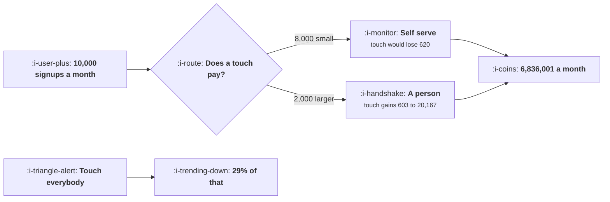

# Self Serve, Sales Assist, Hybrid

```text
Level: Expert
Prerequisites: What PLG Actually Requires
Estimated difficulty: 4/5 | Estimated time: 40 min
```

## The idea in one minute

Three motions do not share a funnel, they share a routing rule, and the rule is one comparison per
signup: does a sales touch add more than it costs. At 640 a touch, an individual signup worth 180 a
year loses 620 by being touched, and a 23,000 account gains 5,086 by being touched. Routing on that
comparison uses 2,000 touches a month rather than 10,000 and returns four times what touching
everybody or nobody returns. The number of sellers you need then falls out of the rule rather than
out of a revenue target, which is the only version of a hiring plan that survives the funnel
changing.

## A picture



One comparison per signup. Everything else about motion design follows from where the line lands.

## How it really works

### The comparison, per band

For a signup of a given size, self serve profit is the unaided conversion rate times the contract
times the years retained times the margin. Sales profit is the aided conversion rate times the same,
minus the cost of the touch, which is paid whether or not the deal closes.

The worked bands make the shape clear. Individuals convert at 4.1 percent unaided and 5.5 percent
aided, and the 1.4 point gain on a 180 contract is worth 20, against 640 for the touch. Companies
of 50 to 500 convert at 2.2 percent unaided and 14.8 percent aided on a 23,000 contract, which is
worth 5,086 net.

Note that the unaided conversion rate falls as accounts get larger: 4.1, 5.8, 4.7, 2.2, 0.6
percent. That is the approvals requirement from
[What PLG Actually Requires](01-what-plg-actually-requires.md) showing up in the data, and it is
what makes the touch valuable at the top.

### Routing beats both extremes by a lot

Four policies: self serve everything returns 24 percent of the best, touch everything returns 29
percent, route by the comparison returns 100 percent, and the common heuristic of touching anybody
who asks for a demo returns 81 percent.

The demo heuristic is worth noting because it is what most companies actually do and it is not bad:
81 percent of the available profit with no analysis at all. The remaining 19 percent is worth having
and the bigger argument for the explicit rule is that it tells you how many sellers to hire.

### The sellers number comes from the rule

Two thousand touches a month is 24,000 a year, and at 420 productive touches per seller per year
that is 57 sellers. That is a hiring plan derived from the funnel.

The alternative, deriving headcount from a revenue target divided by quota, produces a number that
is right only if the funnel happens to supply the right mix of accounts. When it does not, the
sellers spend their time on accounts below the line, where each touch loses money, and the quota is
missed for a reason nobody can see in a dashboard.

### Where the line should actually sit, and why it drifts

The comparison says route on expected deal size, which you have to predict at signup time from
whatever you know: the email domain, the company size, the stated use case, the self reported team
size. That prediction is the real engineering work in a hybrid motion, and it is the subject of
[Product Qualified Leads](03-product-qualified-leads.md).

Two drifts to watch. Sellers will pull accounts below the line towards themselves, because a touch
on a smaller account is easier than a touch on a larger one and the quota counts deals rather than
profit. And product will push accounts above the line towards self serve, because self serve is
their surface. Both pressures are constant, so the line needs an owner and a monthly audit of what
was actually routed where.

### What the three motions mean operationally

**Self serve** means the product closes. No human in the path, and anything that needs a human is a
product defect for that segment.

**Sales assist** means a person helps a buyer who found you through the product. The seller does not
prospect; the funnel supplies the leads. This is the motion the arithmetic above describes.

**Sales led** means prospecting: a seller finds a buyer who was not in your funnel. That is a
different business with a different cost structure, and mixing it into the same team is how a
sales assist motion quietly becomes an expensive outbound motion with a free trial attached.

### What fills the box in 2026

The touch cost is the number that has moved. Research, personalisation, follow up drafting and
scheduling can each be substantially automated, which lowers the cost of a touch and therefore
moves the routing line down: at 320 a touch rather than 640, the teams under ten band becomes
worth touching in the worked example. That is a real expansion of the addressable middle, and it is
the main practical consequence of model assisted selling for growth teams. Recompute your line
against your current touch cost rather than last year's.

## Run the numbers

Compute the comparison per band, then price four routing policies.

```go
// routing.go: which signups go to a person, and what mis-routing costs.
package main

import "fmt"

// A signup can be left to buy on its own or handed to a salesperson. Sales
// raises the chance of a deal and costs a fixed amount of somebody's time, so
// the right choice depends entirely on how large the deal would be.
type band struct {
	name      string
	share     float64 // share of signups in this band
	acv       float64 // annual contract value if they buy
	selfConv  float64 // share who buy unaided
	salesConv float64 // share who buy with a person involved
}

const (
	margin    = 0.76
	years     = 2.6      // expected years retained
	touchCost = 640.0    // cost of a sales touch, successful or not
	signups   = 10_000.0 // a month
)

func (b band) selfProfit() float64 {
	return b.selfConv * b.acv * years * margin
}

func (b band) salesProfit() float64 {
	return b.salesConv*b.acv*years*margin - touchCost
}

func main() {
	bands := []band{
		{"individuals", 0.56, 180, 0.041, 0.055},
		{"teams under 10", 0.24, 1_100, 0.058, 0.102},
		{"teams 10 to 50", 0.13, 4_800, 0.047, 0.131},
		{"companies 50 to 500", 0.06, 23_000, 0.022, 0.148},
		{"over 500", 0.01, 90_000, 0.006, 0.117},
	}

	fmt.Printf("%.0f signups a month, a sales touch costs %.0f whether it closes\n",
		signups, touchCost)
	fmt.Printf("or not, and a customer is kept %.1f years at %.0f%% margin\n\n",
		years, 100*margin)
	fmt.Printf("%-24s %9s %10s %10s %12s %12s %s\n",
		"band", "share", "contract", "self conv", "self profit", "sales profit", "route to")
	for _, b := range bands {
		route := "self serve"
		if b.salesProfit() > b.selfProfit() {
			route = "a person"
		}
		fmt.Printf("%-24s %8.0f%% %10.0f %9.1f%% %12.0f %12.0f %s\n",
			b.name, 100*b.share, b.acv, 100*b.selfConv,
			b.selfProfit(), b.salesProfit(), route)
	}

	fmt.Println("\nThe crossover is between teams under ten and teams of ten to fifty.")
	fmt.Println("Below it a sales touch costs more than the extra conversion is")
	fmt.Println("worth; above it the gap is large and grows with the contract.")

	fmt.Println("\nwhat each routing policy returns, per month of signups:")
	fmt.Printf("%-34s %16s %14s %10s\n",
		"policy", "profit", "touches", "of best")
	type pol struct {
		name  string
		sales func(b band) bool
	}
	pols := []pol{
		{"everything self serve", func(b band) bool { return false }},
		{"everything to a person", func(b band) bool { return true }},
		{"route by whichever pays more", func(b band) bool {
			return b.salesProfit() > b.selfProfit()
		}},
		{"anybody who asks for a demo", func(b band) bool { return b.acv > 900 }},
	}
	score := func(p pol) (profit, touches float64) {
		for _, b := range bands {
			n := signups * b.share
			if p.sales(b) {
				profit += n * b.salesProfit()
				touches += n
			} else {
				profit += n * b.selfProfit()
			}
		}
		return profit, touches
	}
	var best float64
	for _, p := range pols {
		if v, _ := score(p); v > best {
			best = v
		}
	}
	for _, p := range pols {
		profit, touches := score(p)
		fmt.Printf("%-34s %16.0f %14.0f %9.0f%%\n",
			p.name, profit, touches, 100*profit/best)
	}

	fmt.Println("\nTouching everybody returns 29% of what routing returns, because")
	fmt.Println("56% of signups are individuals whose whole contract is 180 a year")
	fmt.Println("and each touch on them loses 620. Touching nobody returns 24%,")
	fmt.Println("because the large accounts are left on a 2.2% conversion rate.")
	fmt.Println("Routing by the arithmetic uses 2,000 touches instead of 10,000 and")
	fmt.Println("returns four times as much as either.")

	fmt.Println("\nhow many sellers the right policy needs:")
	const perSellerYear = 420.0 // touches one person can make in a year
	var touches float64
	for _, b := range bands {
		if b.salesProfit() > b.selfProfit() {
			touches += signups * b.share
		}
	}
	fmt.Printf("touches a year at this signup rate: %.0f\n", touches*12)
	_ = perSellerYear
	fmt.Printf("sellers needed: %.1f\n", touches*12/perSellerYear)
	fmt.Println("\nThat number is the one to take to a hiring plan, and it is derived")
	fmt.Println("from the routing rule rather than from a revenue target, which is")
	fmt.Println("the only way it stays honest when the funnel changes.")
}
```

The band table is the core of it. Read the last two columns together: self profit of 15, 126, 446,
1,000 and 1,067 against sales profit of minus 620, minus 418, 603, 6,086 and 20,167. The crossover
sits between the second and third bands.

The policy table is the decision. 24 percent, 29 percent, 100 percent and 81 percent of the best
available profit. Two things to notice: touching everybody is barely better than touching nobody,
despite costing 10,000 touches a month, and the demo heuristic gets most of the way there for free.

The sellers calculation at the end is the output that changes a plan. Fifty seven sellers, derived
from 2,000 touches a month. Put your own signup volume and band distribution in; the band shares are
usually available from your signup form or your email domains and are rarely looked at this way.

Then change `touchCost` to half its value and watch the line move down a band. That sensitivity is
the whole reason to keep the rule in a spreadsheet rather than in a policy document.

## The AI layer

Two effects, and the first is larger than it first appears.

Lowering the touch cost moves the routing line, which expands the band of accounts worth a human.
Research before a call, drafting the follow up, summarising the account's product usage, preparing
the security questionnaire response: each is a real fraction of the eleven hours in
[What PLG Actually Requires](01-what-plg-actually-requires.md). Halving the cost of a touch in the
worked example brings the teams under ten band above the line, which is 24 percent of signups moving
from self serve to assisted, and that is a strategy change rather than an efficiency gain.

The second is predicting deal size at signup, which is what the routing rule needs and which is a
small supervised problem over firmographic and behavioural features. Done well it raises the
accuracy of the routing, which is worth the difference between the demo heuristic's 81 percent and
the rule's 100.

Two cautions. A model that automates the touch itself, as opposed to preparing it, turns sales
assist into automated outbound, which is a different motion with the equilibrium problem described
in [AI Outbound and the Spam Equilibrium](../ai-in-growth/README.md). And a routing model trained
on which accounts sellers closed learns the sellers' existing preferences, including the drift
towards easier small accounts, so train it on deal size rather than on outcome.

## Sector lens

| Sector | How the three motions divide here |
|---|---|
| [Enterprise B2B SaaS](../../product-management/product-by-sector/01-enterprise-b2b-saas.md) | Self serve is the top of the funnel and sales closes everything. The routing line sits very low |
| [Fintech](../../product-management/product-by-sector/02-fintech.md) | Regulatory onboarding forces a touch above a transaction threshold, so the line is set by compliance rather than by profit |
| [Ecommerce and D2C](../../product-management/product-by-sector/03-ecommerce-and-d2c.md) | No sales motion for consumers. The equivalent split is between self service support and a human one |
| [Marketplaces](../../product-management/product-by-sector/04-marketplaces.md) | Supply side above a size threshold gets an account manager; demand side never does. Two separate lines |
| [Devtools and Infra](../../product-management/product-by-sector/05-devtools-and-infrastructure.md) | Self serve to a usage threshold, then a conversation about committed spend. The usage data makes the routing prediction unusually accurate |
| [Healthtech](../../product-management/product-by-sector/06-healthtech-and-regulated-care.md) | Everything is touched, because procurement requires it. Self serve exists to produce an internal champion |
| [Vertical SaaS](../../product-management/product-by-sector/07-vertical-saas.md) | Almost everything is touched, because the migration is the sale and contract values support it |

## Remember this

* Three motions share a routing rule, not a funnel. The rule is one comparison per signup.
* Self serve profit against sales profit minus the touch cost, which is paid whether or not the deal
  closes.
* Unaided conversion falls as accounts get larger, which is approvals showing up in the data and is
  what makes a touch valuable at the top.
* Routing returns four times what touching everybody or nobody returns, using a fifth of the
  touches.
* Touching everybody is barely better than touching nobody, which is worth knowing before hiring.
* The demo heuristic gets 81 percent of the available profit for free; the rule's advantage is that
  it sizes the team.
* Derive sellers from touches needed, not from a revenue target divided by quota.
* The line drifts: sellers pull small accounts up, product pushes large accounts down. Audit the
  routing monthly.
* Sales assist is not sales led. Prospecting is a different business and mixing them hides the cost.
* A lower touch cost moves the line down a band, which is a strategy change. Recompute it when the
  cost moves.

## Try it

1. Build your band table from your signup data: share, contract value, and conversion with and
   without a touch. The last column usually requires looking at historical touched versus untouched
   cohorts.
2. Compute your routing line and compare it with where your sellers actually spend their time. The
   gap is the drift, and it is usually downwards.
3. Derive your sellers number from touches needed and compare it with your current headcount plan.

## Check yourself

1. A band converts at 3 percent unaided and 9 percent with a touch, on a 1,400 contract kept two
   years at 70 percent margin. At 500 a touch, should it be routed to a person?
2. Why is touching every signup only slightly better than touching none, when touching clearly helps
   every band's conversion rate?
3. Your touch cost halves. What happens to the routing line, your seller count, and your self serve
   conversion rate?
