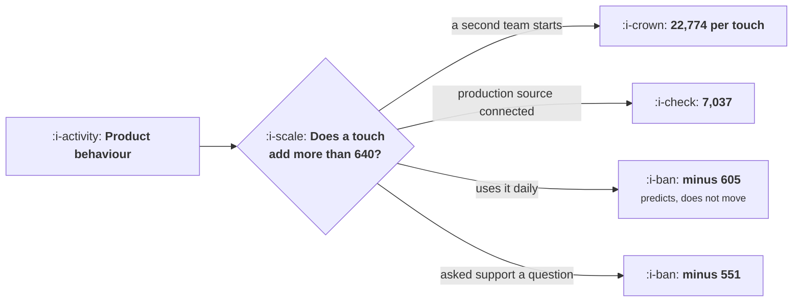

# Product Qualified Leads

```text
Level: Expert
Prerequisites: Self Serve, Sales Assist, Hybrid
Estimated difficulty: 3/5 | Estimated time: 35 min
```

## The idea in one minute

A product qualified lead is not a signal that predicts conversion, it is a signal that a touch will
pay, and the two are routinely confused. Daily use and asking a support question both predict
conversion and both lose money when touched, because the conversion they add is small and the
contracts are small. A second team starting a workspace returns 22,774 per touch. Rank candidate
signals by what a touch on each returns, and the shape is always the same: the top two signals are
15 percent of the touches and 64 percent of the money, which is why a capacity limit of 300 touches
captures 76 percent of what 860 would.

## A picture



The bottom two rows correlate with conversion as strongly as the top two. The difference is whether
a touch changes anything.

## How it really works

### Predicts is not the same as moves

The error that defines this topic. A signal that correlates with conversion identifies accounts that
were going to buy, and touching them adds the difference between their aided and unaided conversion
rate, which may be nothing.

Daily use in the worked table goes from 4.7 to 5.8 percent with a touch, a 1.1 point lift on a
1,600 contract, which is worth 35 against a 640 touch. The signal is genuinely predictive and
genuinely not a lead.

This is the selection problem from
[Finding the Aha Moment](../activation-and-onboarding/02-finding-the-aha-moment.md) arriving in a
commercial setting, and it has the same resolution: the quantity you need is the effect of the
intervention, not the correlation.

### What makes a signal movable

The signals with large lifts share a property: the account has encountered something a person can
resolve. A second team starting a workspace raises a question about consolidation, billing and
administration that a seller can answer. A production data source connected raises security,
support and reliability questions. Hitting a plan limit raises a pricing question.

Signals with small lifts are ones where the user already knows what they want and is doing it. Daily
use needs no explanation; a support question has already been answered by support.

So the heuristic that generalises: a signal is a lead when it implies a question the buyer cannot
answer alone and a seller can.

### Company size is a legitimate signal and a different kind

Over 500 employees has an unaided conversion rate of 0.9 percent and an aided rate of 4.4, on a
36,000 contract, which nets 1,850 per touch. It is firmographic rather than behavioural, and it
earns its place.

The thing to notice is why the lift is large: the unaided rate is tiny because of the approvals
requirement. Big companies cannot buy unaided, so almost any touch helps. That is a different
mechanism from the behavioural signals and it means the two kinds should be combined rather than
chosen between: behaviour tells you the account is engaged, firmographics tell you it cannot
self serve.

### Capacity changes the ordering question, not the answer

With unlimited touches, take every signal with a positive net. With a limit, rank by net per touch
and fill the capacity, which is what the second table does.

The useful property is how little the limit costs: 300 touches of a possible 860 capture 76 percent
of the value, because the distribution of net per touch is so skewed. That means a small sales team
with a correct ranking outperforms a large one with a poor ranking, and it is the strongest argument
for doing this arithmetic before hiring.

### Composite scores, and why to resist them

The temptation is to combine signals into a score out of a hundred. Resist it for the reasons in
[Scoring Ideas](../growth-process-and-cadence/03-scoring-ideas.md): the score cannot be acted on,
the weights become an argument, and the thing you need is a routing decision rather than a ranking.

The version that works is a small set of named signals, each with its own measured net per touch,
and a rule that any one of them routes the account. Sellers can then tell you which signals produce
good conversations, which is information a score destroys.

### Measuring the lift honestly

The aided conversion rate has to come from a comparison, not from history, because accounts that
got touched were selected for touching. The cheapest honest method is a holdout: for each signal,
leave a random tenth untouched for a quarter and compare. It is uncomfortable to propose and it is
the only way these numbers mean anything, and it is the same argument as
[Measuring a Campaign Honestly](../lifecycle-messaging/06-measuring-a-campaign-honestly.md).

### What fills the box in 2026

Lead scoring models are standard in every revenue platform and they are trained on historical
conversion, which means they predict rather than identify movable accounts. That is the flaw in the
default: the model will rank your daily active users highly and your sellers will spend time on
accounts that were going to convert anyway, and attributed revenue will look excellent. If you use
one, train it on the lift against a holdout rather than on conversion, which almost nobody does and
which is the difference between a scoring model and a routing model.

## Run the numbers

Rank the signals by what a touch on each returns, then apply your capacity.

```go
// pql.go: which product signals are worth a salesperson's hour.
package main

import (
	"fmt"
	"sort"
)

// A product qualified lead is a signal that a touch will pay. The test is the
// same comparison every time: the extra conversion the touch buys, times the
// contract, against the cost of the touch. A signal that predicts conversion
// without raising it is not a lead, it is a forecast.
type signal struct {
	name    string
	fires   float64 // per 1,000 signups a month
	convNo  float64 // conversion with no touch
	convYes float64 // conversion with a touch
	acv     float64 // contract value if they buy
}

const (
	touchCost = 640.0
	margin    = 0.76
	years     = 2.6
	signups   = 20_000.0 // a month
)

func (s signal) lift() float64 { return s.convYes - s.convNo }
func (s signal) net() float64 {
	return s.lift()*s.acv*years*margin - touchCost
}
func (s signal) volume() float64 { return signups / 1000 * s.fires }

func main() {
	sigs := []signal{
		{"invited 5 or more teammates", 7.2, 0.071, 0.231, 7_400},
		{"hit the plan limit twice", 11.4, 0.096, 0.187, 3_900},
		{"connected a production data source", 4.1, 0.054, 0.264, 18_500},
		{"opened the pricing page three times", 26.0, 0.038, 0.061, 2_200},
		{"a second team started a workspace", 2.3, 0.102, 0.391, 41_000},
		{"company has over 500 employees", 18.0, 0.009, 0.044, 36_000},
		{"used the product on 10 of 14 days", 31.0, 0.047, 0.058, 1_600},
		{"asked a question in support", 44.0, 0.033, 0.049, 2_800},
	}

	fmt.Printf("%.0f signups a month, a touch costs %.0f\n\n", signups, touchCost)
	fmt.Printf("%-38s %8s %9s %9s %10s %12s %s\n",
		"signal", "per 1k", "no touch", "touched", "contract", "net/touch", "verdict")
	for _, s := range sigs {
		v := "not a lead"
		if s.net() > 0 {
			v = "a lead"
		}
		fmt.Printf("%-38s %8.1f %8.1f%% %8.1f%% %10.0f %12.0f %s\n",
			s.name, s.fires, 100*s.convNo, 100*s.convYes, s.acv, s.net(), v)
	}

	fmt.Println("\nThe last two rows are the trap. Daily use and asking a support")
	fmt.Println("question both predict conversion, and a touch on either returns")
	fmt.Println("less than it costs, because the extra conversion is small and the")
	fmt.Println("contracts are too. A signal that predicts without being movable is")
	fmt.Println("a forecast, not a lead.")

	fmt.Println("\nwhat the whole programme returns, with a capacity limit:")
	ranked := append([]signal{}, sigs...)
	sort.Slice(ranked, func(i, j int) bool { return ranked[i].net() > ranked[j].net() })
	fmt.Printf("%-38s %12s %14s %16s\n",
		"add this signal", "touches/mo", "net added", "cumulative")
	cum, used := 0.0, 0.0
	for _, s := range ranked {
		if s.net() <= 0 {
			break
		}
		cum += s.net() * s.volume()
		used += s.volume()
		fmt.Printf("%-38s %12.0f %14.0f %16.0f\n",
			s.name, s.volume(), s.net()*s.volume(), cum)
	}
	fmt.Printf("\n%.0f touches a month, %.0f of net value, %.1f sellers at 35 a month\n",
		used, cum, used/35)

	fmt.Println("\nwhat happens if you only have 300 touches a month:")
	fmt.Printf("%-38s %12s %14s %16s\n",
		"signal", "touches", "net added", "cumulative")
	budget, cum2 := 300.0, 0.0
	// rank by net per touch, which is what a capacity limit makes the right order
	for _, s := range ranked {
		if s.net() <= 0 || budget <= 0 {
			break
		}
		take := s.volume()
		if take > budget {
			take = budget
		}
		budget -= take
		cum2 += s.net() * take
		fmt.Printf("%-38s %12.0f %14.0f %16.0f\n", s.name, take, s.net()*take, cum2)
	}
	fmt.Printf("\n300 touches capture %.0f%% of the value that %.0f touches capture,\n",
		100*cum2/cum, used)
	fmt.Println("because the signals are ordered by what each touch returns. The")
	fmt.Println("first two signals are 15% of the touches and 64% of the money,")
	fmt.Println("which is the shape every signal list has and the reason a capacity")
	fmt.Println("limit costs much less than it looks like it should.")
}
```

The first table is the test applied to eight candidates. Five pay and three do not, and the three
that do not are the three most commonly used as product qualified leads in practice: pricing page
visits, daily usage and support contact.

The ranked programme shows where the money is: a second team starting a workspace at 46 touches a
month and 1,047,587, then production data sources at 82 touches and 577,014. The plan limit signal
contributes 13,972 across 228 touches, which is 27 percent of the touches for half a percent of the
value, and is a candidate for dropping entirely.

The capacity table is the practical version. Three hundred touches against 860 captures 76 percent.
Put your own capacity in and find the signals that fit inside it.

Replace the `convYes` column with holdout measured figures. Without a holdout those numbers are
historical conversion among touched accounts, which is selection, and the whole table becomes a
ranking of which accounts your sellers already liked.

## The AI layer

Three things, and the ordering matters because the first one is where the money is and the third is
what tools default to.

Predicting deal size and self serve likelihood at signup is the input the routing rule needs, and
it is a clean supervised problem. The target should be the contract value and the unaided
conversion rate, not whether the account closed, for the reason above.

Preparing the touch is the second and it is where the touch cost falls. A seller who arrives knowing
what the account has built, which limit they hit, who else at the company has signed up and what
similar accounts asked about is a much shorter conversation, and the cost per touch is the
denominator of every number in this lesson.

Scoring leads on historical conversion is the third and is what most platforms do by default. It
produces a ranking that correlates with conversion and does not identify movable accounts, and the
measurable signature is a sales team with excellent attributed conversion and a flat incremental
contribution against a holdout. If you adopt a lead model, the first thing to check is what it was
trained to predict.

## Sector lens

| Sector | What the movable signal is here |
|---|---|
| [Enterprise B2B SaaS](../../product-management/product-by-sector/01-enterprise-b2b-saas.md) | A second department appearing, which raises consolidation and billing questions only a person can resolve |
| [Fintech](../../product-management/product-by-sector/02-fintech.md) | A transaction volume threshold that triggers a different compliance tier, which the customer cannot navigate alone |
| [Ecommerce and D2C](../../product-management/product-by-sector/03-ecommerce-and-d2c.md) | No sales motion for buyers. For merchant platforms, a merchant approaching a plan boundary |
| [Marketplaces](../../product-management/product-by-sector/04-marketplaces.md) | Supply side approaching a capacity or earnings threshold, where an account manager can unlock more volume |
| [Devtools and Infra](../../product-management/product-by-sector/05-devtools-and-infrastructure.md) | Production traffic appearing, and a second project or environment. Both imply questions about support and commitments |
| [Healthtech](../../product-management/product-by-sector/06-healthtech-and-regulated-care.md) | A second site or a request for an integration, both of which require contracts a user cannot sign |
| [Vertical SaaS](../../product-management/product-by-sector/07-vertical-saas.md) | A second location or vehicle, which is the customer's business growing and is the best conversation available |

## Remember this

* A product qualified lead is a signal that a touch will pay, not a signal that predicts
  conversion.
* Daily use and support contact predict conversion and lose money when touched.
* The quantity needed is the lift from the touch, which must be measured against a holdout rather
  than taken from history.
* A signal is movable when it implies a question the buyer cannot answer alone and a seller can.
* Firmographic size signals work for a different reason: large accounts cannot self serve, so almost
  any touch helps.
* Combine behavioural and firmographic signals rather than choosing, since they carry different
  information.
* Rank by net per touch. The distribution is skewed, so 300 touches of 860 capture 76 percent of the
  value.
* A small team with the right ranking beats a large team with a poor one, which is the argument for
  doing this before hiring.
* Resist composite scores. Use named signals with measured nets and a rule that any one routes the
  account.
* Default lead scoring models are trained on conversion, so they predict rather than route. Check
  what yours was trained on.

## Try it

1. List your candidate signals with their fire rates, contract values, and conversion with and
   without a touch. Mark which conversion figures are from a holdout and which are historical.
2. Set up one holdout: for your most used signal, leave a random tenth untouched this quarter.
3. Rank by net per touch and compare the ranking against what your sellers currently work. The
   signals they ignore and the signals they chase are both informative.

## Check yourself

1. A signal fires for 2 percent of accounts and those accounts convert at four times the base rate.
   Is it a lead? What else do you need?
2. Why do firmographic signals and behavioural signals carry different information, and what happens
   if you use only one kind?
3. Your lead model has excellent precision on conversion and your sellers' incremental contribution
   against a holdout is flat. What has happened?
