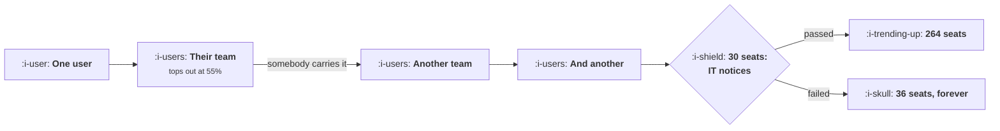

# Bottom Up Inside a Company

```text
Level: Expert
Prerequisites: Product Qualified Leads
Estimated difficulty: 4/5 | Estimated time: 40 min
```

## The idea in one minute

Adoption inside a company has two mechanics and only one of them is about your product. Within a
team it spreads easily, because people see each other work, and it tops out around half the team.
Across teams it spreads only when somebody carries it, which is rare, and that crossing rate
decides everything: the same product reaches 22 seats with no crossing and 264 seats when sharing
is part of the work. Then there is a wall at about 30 seats, where IT and procurement notice. One
review decides 38,292 of annual revenue in a single account, and it arrives long before the motion
has produced an account large enough to justify building for it.

## A picture



The chain on the left is the loop. The gate on the right decides whether any of it was worth
building.

## How it really works

### Within a team is easy and bounded

People in a team share documents, assign each other work and sit in the same meetings, so a product
one person uses becomes visible to the rest without any effort on your part. That spread is fast
and it stops: in the worked model a team tops out at 55 percent adoption, because some people have
no need for it.

The consequence is that within team adoption is not the lever. It happens, it saturates in a couple
of quarters, and the ceiling is a property of the job rather than of your onboarding.

### Across teams is the whole game

Crossing a team boundary requires a person to bring it to people who do not already see their work.
That happens when the work itself crosses the boundary, and almost never otherwise.

Three crossing rates in the table: 0, 0.12 and 0.38 per adopting team per quarter. They produce 22,
86 and 264 seats at twelve quarters, which is 5, 18 and 55 percent of the company. The product is
identical.

So the design question for a bottom up motion is not how to make the product more useful, it is
which cross team workflows the product should sit in: review, approval, handover, reporting to
somebody else. That is the same mechanism as
[Collaboration Loops](../virality-and-referral/03-collaboration-loops.md), applied inside one
customer.

### The wall at thirty seats

Somewhere around twenty to forty seats, a company notices: an IT asset report, a finance query about
repeated card charges, a security team audit, or a request for single sign on. Call it the review.

In the worked model a failed review freezes the account at 36 seats rather than 264, and the
difference is 38,292 of annual revenue in one account. At any meaningful number of accounts, that is
the largest single number in a bottom up motion.

The uncomfortable part is the timing. The review arrives when the account is small, so the work to
pass it has to be done before any account is large enough to justify it. A compliance pack, an
identity integration, an account level administration view and the ability to send an invoice are
all prerequisites rather than consequences, and the common failure is to treat them as things to
build when enterprise demand appears.

### The six places an account stops

* **Nobody carries it to another team.** Ceiling: one team. Fix it in the product by making the work
  cross team.
* **No admin can see the whole account.** Ceiling: three to five teams, because nobody can
  consolidate what they cannot see. Fix: an account view and consolidated billing.
* **Security review not passed.** Stalls at the review. Fix: a compliance pack that exists before it
  is asked for.
* **No way to buy at this size.** Stalls at the card limit. Fix: invoicing and a contract.
* **Single sign on required.** Stalls at the IT review. Fix: an identity integration.
* **The champion left.** Decays to zero, which is the only one that goes backwards. Fix: more than
  one champion per account, which means instrumenting how many you have.

That last one deserves attention because it is the most common cause of a bottom up account
disappearing without any complaint. An account with one engaged user is a single point of failure,
and the share of your accounts in that state is a measurable number almost nobody computes.

### What to measure

Four numbers, per account, and none of them are in a standard dashboard. Teams reached, seats per
team, the crossing rate implied by how teams were added, and the count of engaged users. The third
is the one that predicts the account's future and the fourth is the one that predicts its
disappearance.

### What fills the box in 2026

Single sign on and directory integration have moved from an enterprise feature to a mid market
expectation, and the review threshold has come down with them: products that used to reach a hundred
seats on cards now hit a review at thirty. Two consequences. The prerequisites above are needed
earlier in a company's life than they used to be. And charging extra for single sign on, which was
common practice, now gates the wall you most need to pass, so it is worth checking what it costs you
in stalled accounts before treating it as an upsell.

## Run the numbers

Change the crossing rate and watch the account's ceiling move.

```go
// bottomup.go: how one user becomes forty, and where it stops.
package main

import "fmt"

// Adoption inside a company has two different mechanics. Within a team it
// spreads easily, because people see each other work. Across teams it only
// spreads when somebody carries it, which happens rarely, so penetration is
// decided almost entirely by the crossing rate rather than by the product.
const (
	departments = 12.0
	perDept     = 40.0
	deptCeiling = 0.55 // share of a team that ends up using it
	withinRate  = 0.62 // quarterly approach to that ceiling
	reviewAt    = 30.0 // seats at which IT and procurement notice
)

type world struct {
	name      string
	crossRate float64 // chance an adopting team seeds another in a quarter
	blocked   float64 // share of the review that stops adoption dead
}

// seats and departments reached after n quarters
func (w world) run(quarters int) (seats, reached float64, stalled bool) {
	reached = 1.0
	share := 0.02 // share of the first team using it
	for q := 1; q <= quarters; q++ {
		share += (deptCeiling - share) * withinRate
		newDepts := reached * w.crossRate
		if reached+newDepts > departments {
			newDepts = departments - reached
		}
		reached += newDepts
		seats = reached * perDept * share
		if seats > reviewAt && !stalled {
			// the review happens once; sometimes it ends the motion
			if w.blocked > 0.5 {
				stalled = true
			}
		}
		if stalled {
			return seats, reached, true
		}
	}
	return seats, reached, false
}

func main() {
	fmt.Printf("a company of %.0f people in %.0f teams; a team tops out at %.0f%% adoption\n",
		departments*perDept, departments, 100*deptCeiling)
	fmt.Printf("IT notices at %.0f seats\n\n", reviewAt)

	worlds := []world{
		{"nothing carries it across teams", 0.00, 0.0},
		{"occasionally somebody carries it", 0.12, 0.0},
		{"sharing is part of the work", 0.38, 0.0},
		{"sharing is part of the work, review blocks", 0.38, 1.0},
	}

	fmt.Printf("%-44s %9s %9s %9s %12s\n",
		"world", "q4", "q8", "q12", "penetration")
	for _, w := range worlds {
		fmt.Printf("%-44s", w.name)
		var last float64
		for _, q := range []int{4, 8, 12} {
			s, _, st := w.run(q)
			last = s
			cell := fmt.Sprintf("%.0f", s)
			if st {
				cell += "*"
			}
			fmt.Printf(" %9s", cell)
		}
		fmt.Printf(" %11.0f%%\n", 100*last/(departments*perDept))
	}
	fmt.Println("\n* stalled at the review")
	fmt.Println("\nWith no crossing, one team adopts and the account tops out at 22")
	fmt.Println("seats, under 5% of the company. With sharing built into the work,")
	fmt.Println("the same product reaches 264 seats and 55% penetration. The product")
	fmt.Println("is identical in both rows; the difference is whether using it")
	fmt.Println("involves somebody in another team.")

	fmt.Println("\nwhere the account stops, by cause:")
	fmt.Printf("%-40s %-26s %s\n", "cause", "typical ceiling", "what unlocks it")
	for _, r := range []struct{ cause, ceil, fix string }{
		{"nobody carries it to another team", "one team", "make the work cross team"},
		{"no admin can see the whole account", "3 to 5 teams", "an account view and consolidated billing"},
		{"security review not passed", "stalls at 30 seats", "a compliance pack, before it is asked for"},
		{"no way to buy at this size", "stalls at the card limit", "an invoice and a contract"},
		{"single sign on required", "stalls at the IT review", "an identity integration"},
		{"the champion left", "decays to zero", "more than one champion per account"},
	} {
		fmt.Printf("%-40s %-26s %s\n", r.cause, r.ceil, r.fix)
	}

	fmt.Println("\nwhat the review is worth getting right:")
	const seatPrice = 14.0 * 12
	passed, _, _ := worlds[2].run(12)
	stalledSeats, _, _ := worlds[3].run(12)
	fmt.Printf("%-34s %14s %16s\n", "outcome of the IT review", "seats at q12", "annual revenue")
	fmt.Printf("%-34s %14.0f %16.0f\n", "passed", passed, passed*seatPrice)
	fmt.Printf("%-34s %14.0f %16.0f\n", "failed", stalledSeats, stalledSeats*seatPrice)
	fmt.Printf("\nOne review decides %.0f of annual revenue in a single account, and\n",
		(passed-stalledSeats)*seatPrice)
	fmt.Println("it arrives at 30 seats, which is early. The compliance pack, the")
	fmt.Println("identity integration and the invoice have to exist before the")
	fmt.Println("motion produces an account big enough to need them.")
}
```

The world table is the main result: 22, 86, 264 seats at twelve quarters for crossing rates of 0,
0.12 and 0.38. Penetration of 5, 18 and 55 percent. Then the fourth row, with the same crossing
rate as the third and a failed review, freezing at 36.

Note that the third row reaches its ceiling by quarter eight and stops, because every team has been
reached. That is the honest ceiling of a bottom up motion in one account: roughly the share of
people whose job involves the product, and no amount of further effort exceeds it.

The causes table is a diagnostic. For your largest bottom up accounts, work out which of the six
each one hit, and the distribution tells you what to build.

The review arithmetic at the end is the number to take to a roadmap discussion. Put your own seat
price and your own review threshold in; the threshold is observable from your accounts, as the seat
count where growth stops.

## The AI layer

Two uses, and the second one is specific to this lesson.

Identifying accounts in one of the six stall states, from your own usage data, is a clean
classification task over signals you hold: teams reached, seats per team, whether an admin exists,
whether identity is integrated, how many engaged users. A monthly list of accounts by stall cause,
with the fix each needs, is a better input to a sales assist team than a lead score, because it says
what to do rather than who to call.

The second is the champion risk calculation. An account with one engaged user is fragile, and
whether a user is still engaged is a judgement over behaviour rather than a login count. Producing a
ranked list of accounts with a single point of failure, so that somebody can cultivate a second
champion, addresses the one stall cause that goes backwards, and nobody does it because the list
has never existed.

What to be careful about: both of these produce lists of accounts for humans to act on, and the
actions are conversations with real customers. A generated outreach based on detailed observation of
an account's internal adoption pattern reads as surveillance, which is the failure mode from
[Spotting Users About to Leave](../engagement-and-resurrection/04-spotting-users-about-to-leave.md).
Keep the specificity in what you offer and not in what you reveal you noticed.

## Sector lens

| Sector | What the crossing and the wall look like here |
|---|---|
| [Enterprise B2B SaaS](../../product-management/product-by-sector/01-enterprise-b2b-saas.md) | The canonical case. The wall is a formal procurement process and the prerequisites are a published security posture and an invoice |
| [Fintech](../../product-management/product-by-sector/02-fintech.md) | Crossing is rare because finance teams are small and separate. The wall is a vendor risk assessment and arrives immediately |
| [Ecommerce and D2C](../../product-management/product-by-sector/03-ecommerce-and-d2c.md) | No internal spread for consumers. For merchant tools, crossing is between stores rather than teams |
| [Marketplaces](../../product-management/product-by-sector/04-marketplaces.md) | Crossing happens between locations or branches of one supplier, which is a different boundary and easier to cross |
| [Devtools and Infra](../../product-management/product-by-sector/05-devtools-and-infrastructure.md) | Crossing is fast because engineers share tools readily. The wall is a platform team standardisation review, which is severe |
| [Healthtech](../../product-management/product-by-sector/06-healthtech-and-regulated-care.md) | Crossing between departments requires governance each time, so there is a wall at every boundary rather than one at thirty seats |
| [Vertical SaaS](../../product-management/product-by-sector/07-vertical-saas.md) | Companies are small, so one team is the whole company and the wall is the owner's decision rather than a review |

## Remember this

* Within a team adoption is easy, fast and bounded at about half the team. It is not the lever.
* Across teams, adoption needs somebody to carry it, and the crossing rate decides the account's
  ceiling: 22, 86 or 264 seats for rates of 0, 0.12 and 0.38.
* So the design question is which cross team workflows the product sits in, not how useful it is to
  one person.
* A review arrives at roughly thirty seats and decides the account. A failed one froze 264 seats at
  36.
* The work to pass the review has to exist before any account is large enough to justify it.
* Six stall causes: nothing carries it, no account view, security review, no way to buy, single
  sign on, the champion left.
* The champion leaving is the only cause that goes backwards, and accounts with one engaged user are
  a measurable risk nobody measures.
* Measure teams reached, seats per team, the implied crossing rate and engaged user count per
  account.
* Review thresholds have fallen with identity integration expectations, so the prerequisites are
  needed earlier than they used to be.
* Check what charging extra for single sign on costs you in stalled accounts before treating it as
  an upsell.

## Try it

1. For your ten largest bottom up accounts, count teams reached and seats per team, and compute the
   implied crossing rate. Compare the accounts that grew with the ones that did not.
2. Find the seat count at which your accounts stop growing. That is your review threshold, and it is
   probably lower than you assume.
3. Count the accounts with exactly one engaged user. That number is your champion risk, and the list
   is this quarter's most valuable outreach.

## Check yourself

1. Two accounts both have 40 seats. One is 40 seats in one team and the other is 8 seats in five
   teams. Which is worth more, and why?
2. Why do the prerequisites for passing a company review have to be built before any account needs
   them?
3. Your single sign on integration is on your highest plan only. What might that be costing you,
   and how would you measure it?
