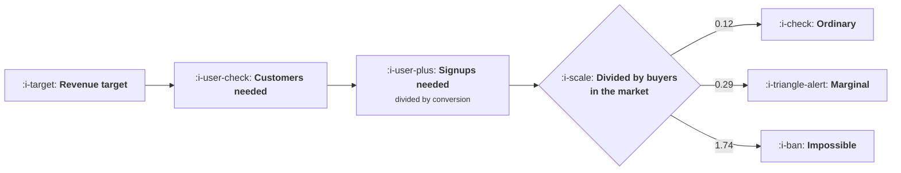

# When PLG Is the Wrong Answer

```text
Level: Expert
Prerequisites: Bottom Up Inside a Company
Estimated difficulty: 3/5 | Estimated time: 35 min
```

## The idea in one minute

The decisive disqualifier is arithmetic and takes two minutes to check. Run a revenue target
backwards through a self serve conversion rate and you get the signups the plan requires; divide
that by the number of companies that could ever buy and you get signups per possible buyer. A small
business tool needs 0.12 of them, which is ordinary. An enterprise system aiming at the same revenue
needs 1.74 signups from every company in its market, which is not a marketing problem and cannot be
fixed by a better funnel. The pattern is structural: the better the contract value, the fewer buyers
exist, and self serve runs on volume.

## A picture



One division. It settles more arguments about motion than any amount of discussion about product
quality.

## How it really works

### The signups per buyer test

Target revenue divided by contract value gives customers. Customers divided by the self serve
conversion rate gives signups. Signups divided by the number of companies that could plausibly buy
gives the number to look at.

Rules of thumb for reading it: under 0.2 is ordinary, 0.2 to 0.3 is demanding and achievable in a
market that searches for what you do, above 0.3 means a large share of your entire market must sign
up for a free product, and above 1.0 is arithmetically impossible.

The worked rows give 0.12, 0.15, 0.29 and 1.74 for the same five million of target revenue at
contract values of 600, 3,600, 24,000 and 180,000.

### Why it is structural rather than bad luck

Conversion rates fall as contract values rise, because larger purchases need approvals, and the
number of buyers falls faster still. Both effects push the same way, so the ratio deteriorates at
both ends of the division.

The practical consequence is that there is no self serve motion for high value markets at any level
of execution. The upper bound in the last table makes this concrete: at a strong 15 percent signup
coverage, the small business tool can reach 6.3 million of self serve revenue and the enterprise
system can reach 432,000. The enterprise business is not smaller, it is differently shaped.

### The other four disqualifiers

**The buyer is not the user.** Test: can the person who would use it approve the price alone. If
not, your self serve funnel produces champions rather than customers, which is a legitimate purpose
and a different metric.

**Value needs a project.** Test: days from signup to first real output using the customer's own
data. Over about a week and nobody completes it unaided, which is the arithmetic in
[What PLG Actually Requires](01-what-plg-actually-requires.md).

**Procurement is compulsory.** Test: the share of your closed deals that skipped it. If that share
is near zero, procurement is not an obstacle to route around, it is the channel.

**The market does not search.** Test: search volume for the problem you solve, not for your
category name. This is the quietest disqualifier and the hardest to accept, because in some markets
nobody looks for software to solve the problem, having never considered that software could. No
funnel work reaches people who are not looking.

### What to do instead, and what to keep

Failing the test does not mean abandoning everything product led. It means the free product is a
demand generation and qualification mechanism rather than a revenue channel, and the metrics should
say so.

Three things that remain worth building. A free tier that produces champions inside target accounts,
measured on accounts reached rather than on revenue. A product qualified lead pipeline, which is
[Product Qualified Leads](03-product-qualified-leads.md) and is more valuable in a sales led
business than in a self serve one. And a trial that shortens a sales cycle, measured in days
removed from the cycle rather than in conversions.

What to stop: counting self serve revenue as a growth metric, hiring a growth team whose target is
self serve conversion, and building a pricing page intended to close deals that will be closed in a
meeting.

### Reading your own numbers honestly

The input people get wrong is the buyer count. The temptation is to use the whole market rather than
the companies that could plausibly buy at your price with your product, and inflating it by ten
times makes an impossible plan look merely ambitious.

Build it from a list: the named companies in the segment, counted. For most business products aimed
at mid market and above, the honest number is in the thousands or tens of thousands, not millions,
and writing it down is often the moment the motion question resolves itself.

### What fills the box in 2026

The conversion rates in the top two rows have been improving, because the capability gates in
lesson 01 have moved: products that needed a migration or a configuration consultant can now be
self served. That lowers the signups per buyer requirement for mid market products and has moved
some rows from marginal to plausible. The bottom row has not moved, because its binding constraint
is the number of buyers and the approvals process, neither of which any product change affects.

## Run the numbers

Divide the signups your plan needs by the buyers who exist.

```go
// plgwrong.go: when the self serve funnel a target implies is larger than the
// market it is aimed at.
package main

import "fmt"

// A self serve motion converts signups into customers at some rate. Run that
// backwards from a revenue target and you get the number of signups the plan
// requires. Compare it against how many potential buyers exist and some plans
// turn out to need more signups than there are companies.
type market struct {
	name       string
	acv        float64 // annual contract value
	conv       float64 // signup to paying, self serve
	buyers     float64 // companies that could ever buy
	target     float64 // annual revenue wanted from this motion
	signupRate float64 // visitors who sign up
}

func (m market) customers() float64 { return m.target / m.acv }
func (m market) signups() float64   { return m.customers() / m.conv }
func (m market) visitors() float64  { return m.signups() / m.signupRate }
func (m market) coverage() float64  { return m.signups() / m.buyers }

func main() {
	markets := []market{
		{"small business tool", 600, 0.035, 2_000_000, 5_000_000, 0.021},
		{"team product", 3_600, 0.022, 420_000, 5_000_000, 0.019},
		{"mid market platform", 24_000, 0.012, 60_000, 5_000_000, 0.016},
		{"enterprise system", 180_000, 0.004, 4_000, 5_000_000, 0.011},
	}

	fmt.Printf("every row aims at %.0f of annual revenue from self serve\n\n",
		markets[0].target)
	fmt.Printf("%-24s %10s %9s %12s %13s %14s\n",
		"market", "contract", "conv", "customers", "signups", "signups/buyer")
	for _, m := range markets {
		fmt.Printf("%-24s %10.0f %8.1f%% %12.0f %13.0f %13.2f\n",
			m.name, m.acv, 100*m.conv, m.customers(), m.signups(), m.coverage())
	}
	fmt.Println("\nThe last column is the test. A small business tool needs 12% of its")
	fmt.Println("possible buyers to sign up, which is ordinary. An enterprise system")
	fmt.Println("needs 1.74 signups from every company that could ever buy it, which")
	fmt.Println("is not a marketing problem.")

	fmt.Println("\nand the traffic each one implies:")
	fmt.Printf("%-24s %14s %16s %s\n",
		"market", "visitors/year", "visitors/month", "verdict")
	for _, m := range markets {
		v := "plausible"
		switch {
		case m.coverage() > 1.0:
			v = "needs more signups than buyers exist"
		case m.coverage() > 0.25:
			v = "needs a quarter of the market to sign up"
		}
		fmt.Printf("%-24s %14.0f %16.0f %s\n",
			m.name, m.visitors(), m.visitors()/12, v)
	}
	fmt.Println("\nThe bottom row is arithmetically impossible and the row above it is")
	fmt.Println("marginal, and they are the two with the attractive contract values.")
	fmt.Println("That is the shape of the disqualification: the better the deal, the")
	fmt.Println("fewer buyers exist, and self serve runs on volume.")

	fmt.Println("\nwhat revenue each motion can actually reach at a plausible funnel:")
	fmt.Printf("%-24s %16s %16s %14s\n",
		"market", "signups at 15%", "customers", "revenue")
	for _, m := range markets {
		// a strong self serve motion gets 15% of its possible buyers to sign up
		s := m.buyers * 0.15
		c := s * m.conv
		fmt.Printf("%-24s %16.0f %16.0f %14.0f\n", m.name, s, c, c*m.acv)
	}
	fmt.Println("\nAt a strong 15% signup coverage, the small business tool reaches")
	fmt.Println("6.3m of self serve revenue and the enterprise system reaches")
	fmt.Println("432,000. The enterprise row is not a small business; it is a large")
	fmt.Println("one whose revenue has to arrive another way.")

	fmt.Println("\nthe five honest disqualifiers, and the test for each:")
	for _, r := range []struct{ dq, test string }{
		{"too few possible buyers", "signups needed divided by buyers, above about 0.3"},
		{"the buyer is not the user", "can the user approve the price alone"},
		{"value needs a project", "days from signup to first real output"},
		{"procurement is compulsory", "share of closed deals that skipped it"},
		{"the market does not search", "search volume for the problem you solve"},
	} {
		fmt.Printf("  %-32s %s\n", r.dq, r.test)
	}
	fmt.Println("\nThe last one is the quietest. A self serve motion needs people to")
	fmt.Println("be looking for you, and in some markets nobody searches for the")
	fmt.Println("problem because they have never considered that software might")
	fmt.Println("solve it, which no amount of funnel work fixes.")
}
```

The first table is the test. Read the last column: 0.12, 0.15, 0.29, 1.74. The visitors column in
the second table is a useful sanity check in its own right, since 944,822 visitors a month is a
real content and paid programme and 52,609 is not the constraint.

The last table is the version to put in a strategy document, because it states the ceiling rather
than the requirement. Self serve revenue available: 6.3 million, 5.0 million, 2.6 million and
432,000. If your plan needs more self serve revenue than your row's ceiling, the plan is wrong
regardless of execution.

Replace `buyers` with a counted list rather than a market size estimate. That substitution alone
changes the answer in most companies, and it is the input the whole analysis rests on.

## The AI layer

Two effects, and they pull in opposite directions, which is worth setting out plainly.

Conversion rates in the self serve rows have risen, for the reasons in lesson 01: migrations and
configuration are now tractable without a person. That lowers the signups needed and moves marginal
rows towards plausible. A mid market product at 0.29 today may have been at 0.45 three years ago,
which is the difference between a motion and a dead end.

Against that, the market does not search disqualifier has got harder rather than easier. A growing
share of discovery happens through answer engines that summarise rather than link, which is
[Search Inside Answer Engines](../content-and-search/06-search-inside-answer-engines.md), and the
visitors column in the second table assumes a traffic acquisition model that is less reliable than
it was. A plan that needs a million visitors a month should be stress tested against a world where
the top of the funnel is smaller.

The thing to refuse is the argument that a model powered product changes the buyer count or the
approvals requirement. Neither is a product property. A product that infers its way past
configuration still cannot be bought by somebody who needs a procurement process, and the number of
companies in a market does not change because your onboarding improved.

## Sector lens

| Sector | Where the test usually lands |
|---|---|
| [Enterprise B2B SaaS](../../product-management/product-by-sector/01-enterprise-b2b-saas.md) | Fails on buyer count and on procurement. The free tier produces champions, which is its correct purpose |
| [Fintech](../../product-management/product-by-sector/02-fintech.md) | Consumer passes easily; business fails on approvals and verification. Two different companies in one |
| [Ecommerce and D2C](../../product-management/product-by-sector/03-ecommerce-and-d2c.md) | Passes trivially, because the buyer count is the population and the price is a card transaction |
| [Marketplaces](../../product-management/product-by-sector/04-marketplaces.md) | Demand side passes; supply side depends on how many suppliers exist, which is often a few thousand |
| [Devtools and Infra](../../product-management/product-by-sector/05-devtools-and-infrastructure.md) | Passes at the bottom and fails at the top, which is why almost every devtool runs both motions |
| [Healthtech](../../product-management/product-by-sector/06-healthtech-and-regulated-care.md) | Fails on every disqualifier at once. Self serve is for individual practitioners only |
| [Vertical SaaS](../../product-management/product-by-sector/07-vertical-saas.md) | Usually fails on buyer count and on the market not searching, which is the quieter and more decisive of the two |

## Remember this

* The test: target revenue over contract value, over conversion rate, over buyers in the market.
* Under 0.2 is ordinary, 0.2 to 0.3 demanding, over 0.3 means most of the market must sign up, over
  1.0 is impossible.
* Conversion falls and buyer counts fall as contract values rise, so the ratio deteriorates at both
  ends.
* State the ceiling rather than the requirement: self serve revenue available was 6.3 million at
  the bottom of the market and 432,000 at the top.
* Four more disqualifiers: the buyer is not the user, value needs a project, procurement is
  compulsory, and the market does not search.
* The market does not search is the quietest and the hardest to fix, because no funnel reaches people
  who are not looking.
* Failing the test means the free product is demand generation and qualification, not a revenue
  channel. Change the metrics to say so.
* Keep a champion producing free tier, a product qualified lead pipeline, and a trial that shortens
  the sales cycle.
* Count buyers from a named list. Using total market size makes an impossible plan look ambitious.
* A model raises conversion in the self serve rows and changes neither the buyer count nor the
  approvals requirement.

## Try it

1. Count the companies that could plausibly buy at your price, from a named list rather than a market
   report. Run `plgwrong.go` with that number.
2. Compute your signups per buyer for this year's plan. If it is over 0.3, take the number to
   whoever set the plan before the quarter starts.
3. Check the search volume for the problem you solve rather than for your category. If it is small,
   write down what your free tier is actually for.

## Check yourself

1. Your plan needs 40,000 self serve signups and there are 9,000 companies in your segment. What do
   you conclude, and what is the one input worth re checking first?
2. Why does the signups per buyer ratio get worse at both ends of the division as contract values
   rise?
3. Your market does not search for the problem you solve. What does that rule out, and what is still
   worth building?
