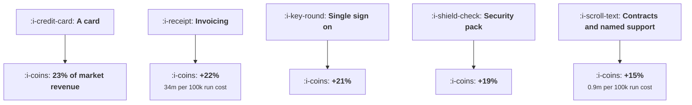

# The Enterprise Ceiling

```text
Level: Expert
Prerequisites: When PLG Is the Wrong Answer
Estimated difficulty: 4/5 | Estimated time: 40 min
```

## The idea in one minute

A self serve motion stops at a size, and the size is set by missing capabilities rather than by
product quality. In the worked market, accounts buyable on a card alone hold 23 percent of the
revenue; the other 77 percent sits behind an invoice, a single sign on integration, a security
review pack and a set of contracts. Every one of those unlocks pays for itself in the first year,
and they differ enormously in return per unit of permanent operating cost: invoicing returns 34
million of reachable revenue per 100,000 of annual running cost, and contracts with legal and named
support return 0.9 million. The ceiling is not that the revenue is unreachable. It is that reaching
the top of it converts your company into a different one.

## A picture



Each step up is worth roughly the same in revenue and costs far more to operate. That gradient is
the whole decision.

## How it really works

### The ceiling is a list of missing capabilities

Not a product limitation. In the worked tiers, the gates are: nothing for individuals and small
teams, an invoice for departments, single sign on for multi department accounts, a security review
pack for whole company deals, and contracts with named support for regulated or global ones.

Those are process and infrastructure capabilities, and each one is a known, boundable project. The
reason they feel like a wall is that none of them is a product feature, so none of them appears
naturally on a product roadmap, and the revenue they gate is invisible until somebody computes it.

### Revenue is concentrated above the ceiling

The market in the table has 240,000 individual accounts worth 69.6 million and 140 regulated
accounts worth 103.6 million. The count falls by three orders of magnitude and the revenue rises.

This is the normal shape, and it means a self serve motion that is winning in its segment is
addressing a minority of the available money. Twenty three percent in the worked case, which is
typical for business software.

### Every unlock pays, and that is not the decision

At 4 percent penetration of every reachable tier, the unlocks add 6.16, 5.95, 5.21 and 4.14 million
of revenue against first year costs of 58,000, 144,000, 355,000 and 1,000,000. All four are
obviously worth doing on a one year view.

The decision is not whether, it is in what order and at what pace, because the costs that matter are
the permanent ones. Return per 100,000 of annual running cost: 34 million for invoicing, 24.8
million for single sign on, 5.5 million for the security pack, 0.9 million for contracts and named
support. A ratio of nearly forty between the first and the last.

### What each unlock does to the company

This is the part the revenue table does not show and the reason the last row is genuinely a
different decision.

* **Invoicing** adds a finance process and days sales outstanding. You are now extending credit.
* **Single sign on** adds an identity surface that must keep working forever, with a support
  obligation when a customer's directory changes.
* **A security pack** adds an annual audit, a named owner, and a queue of customer questionnaires.
* **Contracts** add legal review on every deal and negotiated terms, which means each customer's
  agreement differs and your product commitments become per customer.
* **Named support** adds a support organisation with response commitments, which is a hiring and
  scheduling problem rather than a software one.

The last two are the ones that change the company. A business with negotiated contracts and response
commitments cannot ship the way a self serve business ships, and that cost does not appear in any
revenue model.

### The sequence, and where to stop

Build in order of return per unit of running cost, which is also roughly the order from least to
most disruptive: invoicing, single sign on, security pack, then contracts and named support.

Stopping is a legitimate choice. A company that builds the first three and declines the fourth has
access to 85 percent of the market revenue in the worked table and remains a product company.
Companies that take the last step and do not restructure to match it end up with enterprise
obligations and a self serve operating model, which is the worst combination available and the
specific failure the phrase enterprise ceiling usually describes.

### Build these before you need them

The timing problem from
[Bottom Up Inside a Company](04-bottom-up-inside-a-company.md) applies at the company level too. An
account hits the single sign on gate at about thirty seats, long before your business has enough
such accounts to justify the integration. So the first three unlocks are bets made on the basis of
this table rather than on the basis of demand, and a company that waits for demand loses the
accounts that generated it.

### What fills the box in 2026

Two of the unlocks have got cheaper and one has got more expensive. Single sign on and directory
sync are now largely a bought component rather than a build, which lowers the first year cost
substantially. Security review packs have become more standardised, with recognised frameworks and
automated evidence collection reducing the audit burden. Against that, customer expectations around
data handling, subprocessor disclosure and incident notification have risen, which raises the
running cost of the security row rather than its build cost. Recompute the table with current prices
rather than inherited assumptions.

## Run the numbers

Compute how much of your market sits above each gate.

```go
// ceiling.go: how much revenue sits above what a self serve motion can reach,
// and what each unlock is worth.
package main

import "fmt"

// Accounts are not spread evenly: there are many small ones and a few large
// ones, and most of the revenue is in the few. A self serve motion can reach
// accounts up to whatever size its missing capabilities allow, so the ceiling
// is a revenue question rather than a product one.
type tier struct {
	name     string
	accounts float64 // reachable accounts in the market
	acv      float64
	needs    string // the capability that gates this tier
}

var tiers = []tier{
	{"individuals and pairs", 240_000, 290, "nothing"},
	{"small teams", 46_000, 1_900, "nothing"},
	{"departments", 11_000, 14_000, "an invoice"},
	{"multi department", 2_400, 62_000, "single sign on"},
	{"whole company", 620, 210_000, "a security review pack"},
	{"regulated or global", 140, 740_000, "contracts and a named owner"},
}

// capabilities, in the order they are usually needed
var unlocks = []struct {
	name  string
	tiers int     // tiers reachable once this exists
	cost  float64 // one off engineering and process cost
	run   float64 // annual cost of operating it
}{
	{"nothing beyond a card", 2, 0, 0},
	{"invoicing and purchase orders", 3, 40_000, 18_000},
	{"single sign on and directory sync", 4, 120_000, 24_000},
	{"a security review pack and audit", 5, 260_000, 95_000},
	{"contracts, legal and named support", 6, 520_000, 480_000},
}

func revenue(upto int, penetration float64) float64 {
	t := 0.0
	for i := 0; i < upto; i++ {
		t += tiers[i].accounts * tiers[i].acv * penetration
	}
	return t
}

func main() {
	fmt.Printf("%-24s %12s %12s %16s %s\n",
		"tier", "accounts", "contract", "market revenue", "gated by")
	total := 0.0
	for _, t := range tiers {
		r := t.accounts * t.acv
		total += r
		fmt.Printf("%-24s %12.0f %12.0f %16.0f %s\n",
			t.name, t.accounts, t.acv, r, t.needs)
	}
	fmt.Printf("\ntotal market revenue: %.0f\n", total)
	below := tiers[0].accounts*tiers[0].acv + tiers[1].accounts*tiers[1].acv
	fmt.Printf("reachable with a card alone: %.0f, which is %.0f%% of it\n\n",
		below, 100*below/total)

	const pen = 0.04 // share of each tier you win
	fmt.Printf("at %.0f%% penetration of every tier you can reach:\n", 100*pen)
	fmt.Printf("%-36s %16s %14s %16s %s\n",
		"capability", "revenue", "added", "cost year one", "worth it")
	prev := 0.0
	for _, u := range unlocks {
		r := revenue(u.tiers, pen)
		added := r - prev
		c := u.cost + u.run
		v := "no"
		if added > c {
			v = "yes"
		}
		if u.cost == 0 {
			v = ""
		}
		fmt.Printf("%-36s %16.0f %14.0f %16.0f %s\n", u.name, r, added, c, v)
		prev = r
	}

	fmt.Println("\nEvery unlock pays for itself in the first year, and the last one")
	fmt.Println("pays by the smallest margin while costing the most to operate")
	fmt.Println("forever. That is the enterprise ceiling in one table: it is not")
	fmt.Println("that the revenue is unreachable, it is that reaching it converts")
	fmt.Println("your company into a different one.")

	fmt.Println("\nwhat each unlock does to the business, beyond the money:")
	for _, r := range []struct{ cap, cost string }{
		{"invoicing", "a finance process and days sales outstanding"},
		{"single sign on", "an identity surface you must keep working forever"},
		{"security pack", "an annual audit and a person who owns it"},
		{"contracts", "legal review on every deal, and negotiated terms"},
		{"named support", "a support organisation with response commitments"},
	} {
		fmt.Printf("  %-18s %s\n", r.cap, r.cost)
	}

	fmt.Println("\nthe honest sequencing question:")
	fmt.Printf("%-36s %16s %16s\n", "capability", "revenue added", "added per 100k run cost")
	prev = 0.0
	for _, u := range unlocks[1:] {
		r := revenue(u.tiers, pen)
		added := r - prev
		if prev == 0 {
			prev = revenue(2, pen)
			added = r - prev
		}
		per := added / (u.run / 100_000)
		fmt.Printf("%-36s %16.0f %16.0f\n", u.name, added, per)
		prev = r
	}
	fmt.Println("\nInvoicing returns 34m of revenue for every 100k of annual running")
	fmt.Println("cost and contracts return 0.9m, a ratio of forty. Build them in")
	fmt.Println("that order, which is also the order from cheapest to most")
	fmt.Println("disruptive, and the sequence stops being argued about once the")
	fmt.Println("table exists.")
}
```

The tier table is the exercise worth doing with real numbers. Account counts per tier are
estimable from your market, and the gate column is answerable by asking sales what stopped the last
ten deals of each size.

The unlock table shows the one year case, and every row passes. That is why these projects get
approved and also why they get approved in the wrong order: a one year view cannot distinguish
between them.

The sequencing table is the one that decides. Returns per 100,000 of annual running cost of 34
million, 24.8 million, 5.5 million and 0.9 million. Put your own running costs in, and be
particularly honest about the last row, where the real cost is a legal function and a support
organisation rather than a line item.

Change `pen` to your own penetration. The ordering is insensitive to it, which is useful: you do not
need to forecast market share to get the sequence right.

## The AI layer

Three effects, two helpful and one that needs watching.

Security questionnaires and vendor assessments are a large share of the running cost of the security
row, and they are a document to document mapping task over material you already hold. Automating the
first draft of a response, from your own policy documents and previous answers, reduces that cost
substantially and is one of the clearest wins available in this area. The review still needs a
person who is accountable for the answer.

Contract review is similar but more constrained. Comparing a customer's proposed terms against your
standard positions and flagging the deviations is useful triage; deciding which deviations are
acceptable is a legal judgement that has to stay with a person, because the cost of being wrong is
a commitment you cannot withdraw.

The one to watch is that model features raise the bar on the security row rather than lowering it.
Enterprise buyers now ask about training data use, subprocessor relationships with model providers,
data residency for inference, and retention inside those providers. Those are new questionnaire
sections, and a product that added a model without updating its security posture will discover it
at the worst possible moment, which is in the review of a large deal. Treat the security pack as
something that has to be revised when a model is added, not as a one off project.

## Sector lens

| Sector | Where the ceiling sits here |
|---|---|
| [Enterprise B2B SaaS](../../product-management/product-by-sector/01-enterprise-b2b-saas.md) | All four unlocks are table stakes and the only question is sequencing. Most revenue is above all of them |
| [Fintech](../../product-management/product-by-sector/02-fintech.md) | Regulatory approval is a fifth unlock, more expensive than the other four combined, and it is binary |
| [Ecommerce and D2C](../../product-management/product-by-sector/03-ecommerce-and-d2c.md) | No ceiling for consumer sales. For merchant platforms the ceiling is payment and settlement capability |
| [Marketplaces](../../product-management/product-by-sector/04-marketplaces.md) | The ceiling is on the supply side: large suppliers need contracts, invoicing and integration |
| [Devtools and Infra](../../product-management/product-by-sector/05-devtools-and-infrastructure.md) | Single sign on and the security pack are the binding gates, and both arrive early because the buyers are technical |
| [Healthtech](../../product-management/product-by-sector/06-healthtech-and-regulated-care.md) | Governance, data processing agreements and clinical validation sit above everything else. The ceiling is very low without them |
| [Vertical SaaS](../../product-management/product-by-sector/07-vertical-saas.md) | Contracts and support arrive at modest contract values because the customer's business depends on the product |

## Remember this

* The ceiling is a list of missing capabilities, not a product limitation, and none of them appears
  naturally on a product roadmap.
* Accounts buyable on a card held 23 percent of the market revenue; the rest sits behind four
  unlocks.
* Revenue is concentrated in the few large accounts, so a self serve motion winning its segment is
  addressing a minority of the money.
* Every unlock pays for itself in year one, so a one year view cannot order them.
* Order by return per unit of permanent running cost: 34 million, 24.8 million, 5.5 million, 0.9
  million per 100,000 a year.
* That order is also least to most disruptive, which is why the sequence stops being argued about
  once the table exists.
* The last unlock changes the company: negotiated contracts and response commitments break a self
  serve operating model.
* Stopping after three is a legitimate choice worth 85 percent of the market revenue.
* Build the first three before demand arrives, because accounts hit the gates before you have enough
  of them to justify the work.
* Adding a model to the product reopens the security pack, with new questions about training data,
  subprocessors and residency.

## Try it

1. Build your tier table with real account counts and ask sales what gated the last ten deals in
   each tier. Compute the share of market revenue reachable today.
2. Compute return per 100,000 of annual running cost for each unlock you have not built, using
   honest operating costs rather than build estimates.
3. Decide explicitly where you intend to stop, write it down, and check that your support and legal
   commitments match that decision.

## Check yourself

1. Two unlocks each add about 5 million of reachable revenue. One costs 20,000 a year to run and the
   other 400,000. How do you decide, and what else do you need to know?
2. Why does waiting for enterprise demand before building single sign on lose you the accounts that
   would have generated the demand?
3. Your company has negotiated contracts and 24 hour response commitments, and ships to production
   twice a day with no release notes. What is going to happen?
