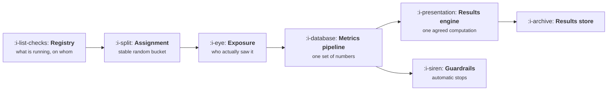

# What an Experimentation Platform Does

```text
Level: Advanced
Prerequisites: The Tracking Plan as a Contract
Estimated difficulty: 3/5 | Estimated time: 35 min
```

## The idea in one minute

An experimentation platform is six mechanisms, and missing one does not stop you experimenting, it
taxes every test and invalidates a share of results. From the same engineering capacity, a team
with none of them runs 19 experiments a year of which 6 can be believed, and a team with all of
them runs 40 of which 40 can. Most of that gap is not the setup days, it is that two thirds of what
the first team runs cannot be trusted and nobody can tell which third is sound. Build assignment
first, then the metrics pipeline, then the results engine; guardrails come last on a throughput
ranking and are the part that stops you shipping a disaster.

## A picture



Six boxes. A team with the first three and not the rest runs experiments and argues about them.

## How it really works

### Assignment: one stable random bucket per unit

A function from a unit identifier to a variant, deterministic, uniformly distributed, independent
across experiments, and stable over time. That is the whole requirement and every word of it
matters.

Deterministic so the same user gets the same variant on every request and every device. Uniform so
the arms are comparable. Independent so two concurrent experiments do not correlate. Stable so a
user does not switch variants mid experiment, which is the most common home made implementation
bug and it corrupts the result silently.

Without it, 34 percent of results are wrong in the worked model, the highest of any missing part,
and it is also the cheapest to build correctly: a hash of the unit identifier and the experiment
name, taken modulo the number of buckets.

### Exposure: who actually saw it

Assignment says which variant a user would get. Exposure says that they reached the thing that
differed. These are different populations and the gap is usually large: most assigned users never
visit the page you changed.

Analysing on assignment rather than exposure dilutes the effect towards zero by the share of
assigned users who never saw anything. It is the reason a real 8 percent improvement on a page can
read as 0.4 percent, and it is covered in
[Assignment and Exposure](03-assignment-and-exposure.md).

### Metrics pipeline: the same numbers for everybody

One definition of each metric, computed one way, used by the results engine and the dashboards and
the weekly review. Without it the experiment's lift is computed from one definition and the
business case from another, and the review becomes a reconciliation meeting.

This is where [Instrumentation and the Event Model](../instrumentation-and-the-event-model/README.md)
meets this topic, and it is the part most often owned by nobody because it sits between two teams.

### Results engine: one agreed computation

Given the arms, the exposures and the metrics, produce the effect, the interval and the decision,
by a method agreed in advance. The value is not statistical sophistication, it is that nobody
recomputes the result by hand in a spreadsheet, which is how an experiment programme loses its
authority.

### Guardrails: automatic stops

Metrics that stop an experiment without a human deciding. Worth almost nothing for throughput,
which is why it ranks last below, and worth a great deal the one time a variant breaks checkout.
See [Guardrails and Automatic Stops](04-guardrails-and-automatic-stops.md).

### Registry: what is running, on whom, since when

A list of live experiments with their populations and start dates. Without it, overlapping
experiments are discovered after the fact, nobody can tell which change caused a metric to move,
and the results store has no index.

The registry plus the results store is also the institutional memory that stops a team rerunning
the same test in two years, which is
[Writing Down What You Learned](../growth-process-and-cadence/README.md).

### What fills the box in 2026

All six parts are available as commodity products, and the practical build or buy line sits in a
predictable place: buy assignment, flags and the results engine, build the metrics pipeline,
because it has to agree with your warehouse and no vendor can do that for you. The common failure
is buying a platform and letting it compute metrics from its own event collection, which produces
a second set of numbers that disagrees with the warehouse, and then the results engine's authority
is gone.

## Run the numbers

Price each missing part in trustworthy experiments a year.

```go
// platform.go: what each part of an experimentation platform is worth, in
// valid experiments a year.
package main

import "fmt"

// A platform is six mechanisms. Missing one does not stop you experimenting;
// it costs setup days on every test and invalidates a share of results, and
// both effects multiply through the year.
type part struct {
	name    string
	days    float64 // extra days per experiment when this is missing
	invalid float64 // share of results that are wrong when this is missing
}

var parts = []part{
	{"assignment: one stable random bucket per unit", 1.5, 0.34},
	{"exposure logging: who actually saw it", 0.5, 0.22},
	{"metrics pipeline: the same numbers for everyone", 2.0, 0.18},
	{"guardrail monitor: automatic stops", 0.0, 0.06},
	{"results engine: one agreed computation", 1.5, 0.14},
	{"registry: what is running, on whom, since when", 1.0, 0.11},
}

const (
	capacityDays = 240.0 // engineering days a year available for experiments
	baseDays     = 6.0   // days to build and ship one experiment with a full platform
)

// experiments a year and how many of them are trustworthy
func run(missing map[string]bool) (count, valid float64) {
	extra, bad := 0.0, 0.0
	for _, p := range parts {
		if missing[p.name] {
			extra += p.days
			// each missing part independently risks the result
			bad = bad + (1-bad)*p.invalid
		}
	}
	count = capacityDays / (baseDays + extra)
	return count, count * (1 - bad)
}

func main() {
	all := map[string]bool{}
	for _, p := range parts {
		all[p.name] = true
	}
	none := map[string]bool{}

	fmt.Printf("%.0f engineering days a year, %.0f days per experiment when complete\n\n",
		capacityDays, baseDays)

	fmt.Printf("%-48s %10s %12s\n", "part", "days if gone", "wrong if gone")
	for _, p := range parts {
		fmt.Printf("%-48s %10.1f %11.0f%%\n", p.name, p.days, 100*p.invalid)
	}

	fmt.Println("\nwhat you get at three levels of platform:")
	fmt.Printf("%-40s %14s %14s %12s\n",
		"configuration", "experiments/yr", "trustworthy", "wasted")
	configs := []struct {
		name string
		m    map[string]bool
	}{
		{"nothing: every test built by hand", all},
		{"assignment and flags only", map[string]bool{
			parts[1].name: true, parts[2].name: true,
			parts[3].name: true, parts[4].name: true}},
		{"everything", none},
	}
	for _, c := range configs {
		n, v := run(c.m)
		fmt.Printf("%-40s %14.0f %14.0f %12.0f\n", c.name, n, v, n-v)
	}

	fmt.Println("\nThe difference between nothing and everything is 40 trustworthy")
	fmt.Println("experiments a year against 6, from the same engineering capacity.")
	fmt.Println("Most of the loss is not the days, it is that two thirds of what you")
	fmt.Println("run cannot be believed.")

	fmt.Println("\nwhat to build first, from nothing:")
	fmt.Printf("%-48s %16s %12s\n", "add this part", "trustworthy/yr", "gain")
	base := map[string]bool{}
	for k := range all {
		base[k] = true
	}
	_, start := run(base)
	fmt.Printf("%-48s %16.1f %12s\n", "starting point", start, "")
	type cand struct {
		name string
		v    float64
	}
	for len(base) > 0 {
		best, bestV := "", -1.0
		for _, p := range parts {
			if !base[p.name] {
				continue
			}
			trial := map[string]bool{}
			for k, v := range base {
				trial[k] = v
			}
			delete(trial, p.name)
			if _, v := run(trial); v > bestV {
				best, bestV = p.name, v
			}
		}
		_, before := run(base)
		delete(base, best)
		fmt.Printf("%-48s %16.1f %11.1f\n", best, bestV, bestV-before)
	}
	fmt.Println("\nAssignment first, then the metrics pipeline, then the results")
	fmt.Println("engine. Guardrails come last on a throughput ranking and are the one")
	fmt.Println("part whose value is not throughput at all, which is why they are")
	fmt.Println("ranked separately in lesson four.")
}
```

The first table is the inputs, and the split between the two columns is the useful part. Guardrails
cost zero setup days and invalidate 6 percent; the metrics pipeline costs two days and invalidates
18 percent. They are different kinds of problem and a plan that treats platform work as one project
gets the order wrong.

The three configurations show 19, 24 and 40 experiments a year, and 6, 12 and 40 trustworthy ones.
Note the middle row, which is where most companies actually are: assignment and feature flags in
place, everything else manual. It produces 24 experiments of which half cannot be believed, and
that is the configuration that generates the most organisational damage, because the programme has
enough output to be taken seriously and not enough rigour to be right.

The build order table is the plan. Assignment, metrics pipeline, results engine, exposure logging,
registry, guardrails, with gains of 4.2, 4.9, 5.9, 7.8, 8.9 and 2.4 trustworthy experiments a year.
The gains rise as you go because the parts compound, which is an argument against stopping halfway.

Change `capacityDays` and `baseDays` to your own figures. If your experiments take twenty days each
rather than six, the whole table shrinks by a factor of three and the ranking does not move.

## The AI layer

Two real applications and one caution specific to this topic.

Building the variant is the part a model genuinely accelerates. A large share of the `baseDays`
figure is implementing the change twice, once behind a flag and once as the control path, plus the
instrumentation. That work is mechanical and well specified, and halving it raises experiment count
proportionally, which by the arithmetic in
[Experiment Velocity](05-experiment-velocity.md) is the input that matters most.

Writing the result memo is the second, and it is covered in
[Writing the Result](07-writing-the-result.md).

The caution: a model will happily analyse an experiment from raw data on request, which bypasses
the results engine and reintroduces the problem the results engine exists to solve. Two people
asking the same question get two numbers, computed by methods neither can inspect. If you let a
model answer experiment questions, wire it to the results engine's output rather than to the
warehouse, so there is still one computation and the model is reading it rather than redoing it.

## Sector lens

| Sector | What the platform has to handle here |
|---|---|
| [Enterprise B2B SaaS](../../product-management/product-by-sector/01-enterprise-b2b-saas.md) | Assignment by account, not user, and a registry that can exclude named customers from any test |
| [Fintech](../../product-management/product-by-sector/02-fintech.md) | Experiments touching regulated flows need an audit trail of who saw what, which makes the registry a compliance artefact |
| [Ecommerce and D2C](../../product-management/product-by-sector/03-ecommerce-and-d2c.md) | High volume and fast cycles, so the results engine and guardrails matter most. Revenue guardrails are not optional |
| [Marketplaces](../../product-management/product-by-sector/04-marketplaces.md) | Assignment by market or geography because user level arms interfere, which changes the whole analysis layer |
| [Devtools and Infra](../../product-management/product-by-sector/05-devtools-and-infrastructure.md) | Assignment by API key or project, and exposure often happens outside your interface entirely |
| [Healthtech](../../product-management/product-by-sector/06-healthtech-and-regulated-care.md) | Experiments on clinical pathways need governance approval, so the registry holds approvals as well as configuration |
| [Vertical SaaS](../../product-management/product-by-sector/07-vertical-saas.md) | Too few units for statistics, so the platform's value is flags and staged rollout rather than inference |

## Remember this

* Six parts: assignment, exposure, metrics pipeline, results engine, guardrails, registry.
* Missing parts cost setup days and invalidate results, and the two effects are separate problems
  with different fixes.
* Nothing gives 19 experiments a year and 6 trustworthy; everything gives 40 and 40.
* Assignment must be deterministic, uniform, independent across experiments and stable over time.
  It is the cheapest part to get right and the most damaging to get wrong.
* Assignment is not exposure. Analysing on assignment dilutes every effect towards zero.
* The most damaging configuration is assignment and flags with nothing else, because the output is
  taken seriously and half of it is wrong.
* Build order: assignment, metrics pipeline, results engine, exposure, registry, guardrails.
* Buy assignment, flags and results; build the metrics pipeline, because it must agree with your
  warehouse.
* Never let the platform compute metrics from its own collection, or you have two sets of numbers
  and no authority.
* A model should build variants, not analyse experiments. Point it at the results engine's output,
  not the warehouse.

## Try it

1. Score your own platform against the six parts, marking each as present, partial or absent. Run
   `platform.go` with your real capacity and days per experiment.
2. Verify your assignment function on all four properties: deterministic, uniform, independent and
   stable. The stability check is to look for users who changed variant mid experiment.
3. Check whether your experiment results and your dashboards compute the same metric the same way.
   If not, that is the next project regardless of what the table says.

## Check yourself

1. Your team has flags and assignment and analyses results in spreadsheets. How many of your
   experiments would you expect to be trustworthy, and what would you build next?
2. Why does analysing on assignment rather than exposure bias an effect towards zero rather than in
   a random direction?
3. Your experiment platform reports a 3 percent lift and your warehouse dashboard shows the metric
   flat. Name the two most likely causes and which one you would check first.
