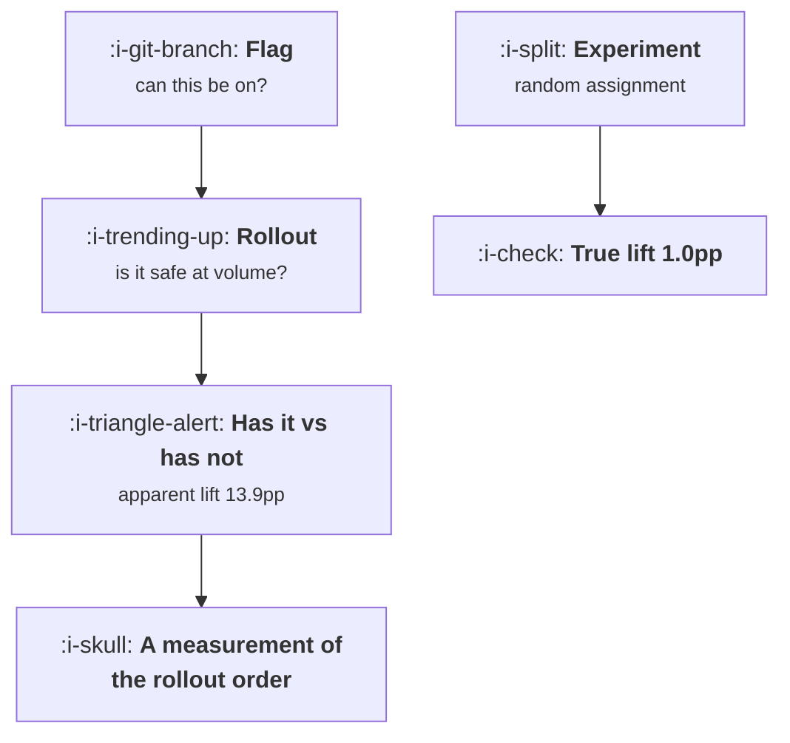

# Flags, Rollouts and Experiments

```text
Level: Advanced
Prerequisites: What an Experimentation Platform Does
Estimated difficulty: 3/5 | Estimated time: 35 min
```

## The idea in one minute

Three different things share one switch and the confusion is expensive in a specific way. A flag
answers whether a code path can be on. A rollout answers whether it is safe at this volume, and
its order is deliberately biased because you reach your keenest users first. An experiment answers
whether it is better, and only it has random assignment. Compare the users who have a change
against the users who do not during a rollout and you get an apparent lift between 7 and 14 points
for a change worth 1, wandering as the rollout proceeds, because the comparison is measuring your
rollout order. The same switch would report a large win for a change that did nothing.

## A picture



The left path is safety engineering and the right path is inference. The error is using the left
one to answer the right one's question.

## How it really works

### The three tools and what each guarantees

**A flag** is a switch with a name. It guarantees that a code path can be enabled or disabled
without a deploy, and nothing at all about who gets it or why. Its purpose is decoupling release
from deploy.

**A rollout** is a flag turned on for an increasing share of users, in an order chosen for safety.
That order is intentionally not random: internal users, then beta volunteers, then your most
engaged, then everybody. Its purpose is to limit the blast radius of a mistake, and it succeeds at
that.

**An experiment** is a flag turned on for a random share, with the remainder held as a control, and
a measurement plan agreed in advance. Its purpose is inference and it is the only one of the three
that supports any.

### Why rollout comparisons are so badly wrong

The tiers in the worked model convert at 22, 16, 9 and 4 percent before any change, and they are
reached in that order, because the order is keenness and keenness predicts conversion.

So at 4 percent rolled out, the treated group is your beta volunteers at 22 percent and the control
is everybody else at 9. The apparent lift is 13.9 points. At 74 percent it is 8.6. The true effect
is 1.0 point at every stage.

Two things to notice. The apparent lift is an order of magnitude too large, so this error produces
false positives rather than false negatives, which is why it survives: the numbers confirm what the
team hoped. And it wanders as the rollout proceeds, which means a team watching the dashboard sees
the lift decay and concludes the effect is wearing off, when what is happening is that the
comparison population is changing.

### The rule

Never compute a lift from a rollout. If you want to know whether a change is better, hold back a
random control, which is compatible with a staged rollout: within each stage, randomise.

That pattern, a staged rollout where each stage splits randomly between the change and the control,
gives you safety and inference at once, and it costs nothing beyond deciding to do it. It is the
default worth adopting for anything that matters.

### Where a rollout is the right instrument

When the question is operational rather than comparative. Does this change break at ten times the
load, does it error on unusual account configurations, does support volume rise. Those are
answerable from a rollout, because the comparison is against a threshold rather than against a
population.

Guardrail metrics during a rollout are therefore legitimate and useful, which is
[Guardrails and Automatic Stops](04-guardrails-and-automatic-stops.md), as long as nobody reads
them as effect sizes.

### Flag debt is a safety problem, not a tidiness problem

Flags accumulate because removing one requires deciding the change is permanent, which nobody is
keen to do. Each live flag doubles the number of configurations your product can be in: 16
combinations at four flags, 65,536 at sixteen, a billion at thirty. A team verifies a few dozen
before a release.

So at thirty flags, the share of your product's possible configurations that anybody has checked is
effectively zero, and the configurations users are actually in are decided by the overlapping
rollout percentages of thirty independent switches.

The practical rule: a flag gets a removal date when it is created, the registry from lesson 01
tracks it, and an expired flag is a defect with an owner. The alternative is finding out which
combination breaks from a user.

### What fills the box in 2026

Feature flag platforms almost all offer experimentation on the same flag, which is a genuine
convenience and the source of the confusion in this lesson: the interface for "roll out to 10
percent" and "experiment on 10 percent" is one control with a different setting, and the difference
is whether the 10 percent is random. Check which mode your flags are in. Teams routinely discover
that a long running experiment was configured as a progressive rollout and that every result from it
is a measurement of the rollout order.

## Run the numbers

Simulate the rollout comparison and watch it report a win that is not there.

```go
// flags.go: what a rollout tells you, which is not what an experiment tells
// you.
package main

import "fmt"

// A staged rollout reaches the keenest users first, by design. Comparing the
// users who have it against the users who do not is therefore a comparison
// between two different populations, and the difference it reports has almost
// nothing to do with the change.
type tier struct {
	name string
	size float64 // share of the user base
	conv float64 // their conversion rate before any change
}

// ordered the way rollouts actually go
var tiers = []tier{
	{"internal and beta opt in", 0.04, 0.22},
	{"most active fifth", 0.20, 0.16},
	{"the middle half", 0.50, 0.09},
	{"least active third", 0.26, 0.04},
}

const trueLift = 0.010

// everybody up to the rollout share has the change; the rest do not
func rolloutComparison(reached float64) (treated, control, exposed float64) {
	var tn, tc, cn, cc float64
	left := reached
	for _, t := range tiers {
		in := t.size
		if in > left {
			in = left
		}
		out := t.size - in
		left -= in
		tn += in
		tc += in * (t.conv + trueLift)
		cn += out
		cc += out * t.conv
	}
	if cn == 0 {
		return tc / tn, 0, tn
	}
	return tc / tn, cc / cn, tn
}

func main() {
	fmt.Printf("true effect of the change: %.1f points for everybody\n\n", 100*trueLift)
	fmt.Printf("%-28s %10s %12s\n", "tier, in rollout order", "size", "converts")
	for _, t := range tiers {
		fmt.Printf("%-28s %9.0f%% %11.0f%%\n", t.name, 100*t.size, 100*t.conv)
	}

	fmt.Println("\nwhat a rollout reports if you compare has against has not:")
	fmt.Printf("%-16s %12s %12s %14s %12s\n",
		"rolled out to", "treated", "control", "apparent lift", "truth")
	for _, r := range []float64{0.04, 0.10, 0.24, 0.50, 0.74} {
		tr, ct, _ := rolloutComparison(r)
		fmt.Printf("%15.0f%% %11.1f%% %11.1f%% %13.1fpp %11.1fpp\n",
			100*r, 100*tr, 100*ct, 100*(tr-ct), 100*trueLift)
	}
	fmt.Println("\nThe apparent lift runs between 7 and 14 points and wanders as the")
	fmt.Println("rollout proceeds. The change is worth 1 point throughout. What the")
	fmt.Println("comparison measures is the rollout order, and it would report a")
	fmt.Println("large win for a change that did nothing at all.")

	fmt.Println("\nthree things on one switch:")
	rows := []struct{ tool, question, guarantees string }{
		{"flag", "can this code path be turned on?", "nothing about who or why"},
		{"rollout", "is it safe at this volume?", "order, which is deliberately biased"},
		{"experiment", "is it better?", "random assignment and a control"},
	}
	for _, r := range rows {
		fmt.Printf("  %-12s %-36s %s\n", r.tool, r.question, r.guarantees)
	}

	fmt.Println("\nwhat flags cost if nobody removes them:")
	fmt.Printf("%-14s %18s %20s\n", "live flags", "combinations", "share verified")
	// a team can reasonably verify a few dozen combinations before a release
	const tested = 40.0
	for _, f := range []float64{4, 8, 16, 30} {
		paths := 1.0
		for i := 0.0; i < f; i++ {
			paths *= 2
		}
		share := tested / paths
		if share > 1 {
			share = 1
		}
		fmt.Printf("%13.0f %18.4g %19.4g%%\n", f, paths, 100*share)
	}
	fmt.Println("\nThirty live flags is a billion combinations, of which a team")
	fmt.Println("verifies a few dozen. This is why a flag needs a removal date when")
	fmt.Println("it is created, and not for tidiness:")
	fmt.Println("the unverified surface is where the next incident comes from.")
}
```

The tier table is the setup and the thing to argue with. If your rollout order is uncorrelated with
your conversion rate, this problem does not arise; if it is correlated, and every safety ordering
is, the bias follows. Put your own tiers in and the magnitude will differ while the direction will
not.

The comparison table is the result: apparent lifts of 13.9, 10.8, 10.7, 7.4 and 8.6 points against
a true 1.0. The decay from 13.9 to 7.4 is the pattern that gets misread as an effect fading.

The flag table is a different argument and worth taking to an engineering planning meeting. Sixteen
flags is 65,536 combinations, of which a team verifies about forty, so 0.06 percent. That figure is
the honest answer to the question of whether flag cleanup is worth prioritising.

## The AI layer

The useful application is flag hygiene, which is unglamorous and is where the recurring cost is.

A model reading your flag registry, your code and your deploy history can identify flags whose
branches are now identical, flags whose rollout has been at 100 percent for months, and flags
referenced in code that no longer exists. That is the removal list, it is tedious to produce by
hand, and it is the work that keeps the combination count down.

A second application is detecting the configuration error described above: given a flag's
configuration history, say whether its population was assigned randomly or progressively. That is a
check somebody should run across every live experiment, and finding one misconfigured experiment
pays for the exercise.

The thing to be careful about is a model asked to interpret a rollout's metrics, because it will
produce a confident lift estimate from whatever data it is given, and the data from a rollout
contains no valid lift. Unless the tool knows that assignment was non random, it cannot warn you,
and it will not ask. The protection is structural: if your results engine can tell a rollout from
an experiment, it should refuse to report a lift for the former.

## Sector lens

| Sector | What the rollout order correlates with here |
|---|---|
| [Enterprise B2B SaaS](../../product-management/product-by-sector/01-enterprise-b2b-saas.md) | Account size and relationship. Rolling out to friendly accounts first makes every comparison flattering |
| [Fintech](../../product-management/product-by-sector/02-fintech.md) | Risk tier, so the early population differs in creditworthiness as well as keenness |
| [Ecommerce and D2C](../../product-management/product-by-sector/03-ecommerce-and-d2c.md) | Geography and device, both of which predict conversion strongly. Rollout by region is the worst case |
| [Marketplaces](../../product-management/product-by-sector/04-marketplaces.md) | Market maturity. Rolling out in your best cities first compares a liquid market against an illiquid one |
| [Devtools and Infra](../../product-management/product-by-sector/05-devtools-and-infrastructure.md) | Client library version, which users upgrade at a rate that tracks their engineering maturity |
| [Healthtech](../../product-management/product-by-sector/06-healthtech-and-regulated-care.md) | Site readiness and training, so the early sites differ in competence. Staged by site is the only option and needs a difference in differences analysis |
| [Vertical SaaS](../../product-management/product-by-sector/07-vertical-saas.md) | Customer enthusiasm, in a base small enough that the first few accounts are not a sample of anything |

## Remember this

* Three tools, three questions. A flag asks whether a path can be on, a rollout whether it is safe,
  an experiment whether it is better.
* Only an experiment has random assignment, and only random assignment supports a lift.
* A rollout's order is deliberately biased towards your keenest users, because that is what makes
  it safe.
* Comparing has against has not during a rollout gave 13.9 points for a change worth 1.0, and would
  report a win for a change worth nothing.
* The bias produces false positives, which is why it survives, and it decays as the rollout
  proceeds, which gets misread as the effect fading.
* Randomise within each rollout stage. That gives safety and inference together at no extra cost.
* Rollouts are the right instrument for operational questions measured against a threshold, which
  includes guardrails.
* Each live flag doubles the configurations your product can be in: a billion at thirty flags, of
  which forty are verified.
* Give every flag a removal date at creation and treat an expired flag as a defect with an owner.
* Check whether your long running experiments are configured as random splits or progressive
  rollouts. This is a common and silent misconfiguration.

## Try it

1. Put your real rollout tiers and their baseline conversion rates into `flags.go` and compute the
   apparent lift your last rollout would have reported.
2. List every live flag with its creation date and current rollout percentage. Count the ones above
   99 percent for more than a month; those are your removal list.
3. Check the configuration of every experiment currently running and confirm the split is random
   rather than progressive. Expect to find at least one that is not.

## Check yourself

1. Your rollout is at 15 percent and the metric is 40 percent higher for users who have the change.
   What can you conclude, and what would you have to do to conclude anything?
2. Why does the apparent lift from a rollout comparison shrink as the rollout proceeds, and why is
   that pattern dangerous rather than merely wrong?
3. You have 22 live flags and an incident caused by an unexpected combination. What is the argument
   for flag cleanup, stated in a number?
