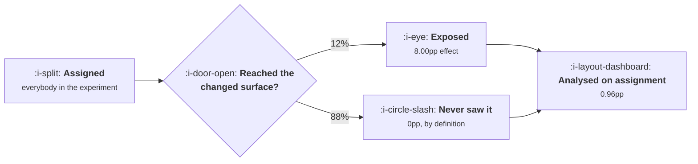

# Assignment and Exposure

```text
Level: Advanced
Prerequisites: Flags, Rollouts and Experiments
Estimated difficulty: 4/5 | Estimated time: 40 min
```

## The idea in one minute

Two silent bugs live here and both are arithmetic rather than mysterious. The first is dilution:
analysing on assignment rather than exposure includes every user who never saw the change, so an 8
point effect on the page you changed reads as 0.96 points when 12 percent of assigned users reach
that page, and confirming it takes 64 times as many users. Most experiments that run out of time
are diluted rather than underpowered. The second is a sample ratio mismatch, where a split that
looks fine is not: at a million users, 50.16 against 49.84 is not chance, and whatever is dropping
users is dropping the ones who were struggling, which makes every result flattering.

## A picture



The 88 percent cannot have been affected, and including them does not add noise, it multiplies the
effect by 0.12.

## How it really works

### Dilution is a multiplication, not a loss of precision

Users who never saw the change have an effect of exactly zero, by construction. So the average
effect across assigned users is the exposed effect multiplied by the exposed share. That is a
deterministic shrinkage, not extra variance.

And because sample size scales with the inverse square of the effect, the cost compounds brutally.
At 30 percent exposure you need 10 times the users; at 12 percent, 64 times; at 4 percent, 568
times. A team that sized its experiment for the exposed effect and analysed on assignment will run
out of calendar before it runs out of hope.

### Log exposure at the moment of difference

The fix is one event: fire an exposure event at the point where the code path diverges, carrying
the experiment name and the variant. Not when the user enters the experiment, not on page load,
exactly where the difference happens.

Two details that matter. The event must fire in both arms, including the control, or you have
exposures for the variant only and no comparison. And it must fire on the server side if the
difference is server side, or you inherit the client loss from
[Client, Server or Both](../instrumentation-and-the-event-model/05-client-server-or-both.md).

### When assignment is the right denominator

Three cases, and they are not edge cases.

When the change affects whether somebody arrives at all. A new notification, a changed email, an
entry point moved: the treatment is partly the arrival, so conditioning on arrival throws away the
effect.

When the change is upstream of the surface. If the variant makes more users reach a page, analysing
only exposed users compares two differently selected populations and produces a textbook
collider bias.

When exposure is itself the treatment. A new section of the product that only the variant has.
There is no control exposure to compare against, so the population is everybody assigned.

In all three, dilution is the question rather than a bug, and the experiment must be sized for the
diluted effect from the start. The error is not choosing assignment, it is choosing assignment and
then sizing for the exposed effect.

### Sample ratio mismatch and why it is never trivial

Compare observed arm sizes against the intended split with a chi square test. Flag anything beyond
roughly a one in a thousand chance. The thresholds are tighter than intuition: 51.65 against 48.35
at ten thousand users, 50.52 at a hundred thousand, 50.16 at a million, 50.05 at ten million.

A mismatch means users are being dropped or misassigned somewhere, and the mechanisms are not
random: a variant that is slower loses the users on poor connections, a variant that errors loses
the users whose configuration triggers it, a filter that removes bot traffic removes differently
from each arm.

The last table prices it. Losing a random one percent of an arm costs nothing. Losing the one
percent who convert worst turns an 8.00 point effect into 8.27, and losing the one percent who
bounced before the logging ran turns it into 8.32. Every mechanism flatters the arm that lost them,
because what drops users is users having a bad time.

So a sample ratio mismatch is not a small inaccuracy to note in a footnote. It is evidence that the
arms are not comparable, and the result should be discarded rather than caveated.

### The assignment bugs that produce it

* **Assignment computed before the identifier is stable.** A user assigned anonymously and then
  reassigned on login appears in both arms and is counted in whichever fires last.
* **Assignment on each request rather than once.** Any non deterministic input, a timestamp, a
  random seed, a load balanced service with its own state, reshuffles users between arms.
* **A filter applied after assignment.** Excluding internal users, bots or a region after the split
  removes them unevenly if the exclusion correlates with anything.
* **One arm failing to log.** The commonest of all, and it looks exactly like a mismatch while
  being a logging bug.
* **Overlapping experiments with correlated assignment.** Two experiments whose hash functions share
  a seed assign users in step, so each becomes a confound for the other.

### What fills the box in 2026

Every mature platform runs a sample ratio check automatically and most teams have never looked at
where the result is displayed. Find it, and find out what threshold it uses, because a check at the
five percent level will flag a tenth of healthy experiments and get ignored, and a check at one in
a thousand will flag real bugs and should block the result. The other thing worth verifying is
whether your platform computes exposure based results at all, since several default to assignment
and label it as the intent to treat analysis without saying that your effect has been multiplied by
your exposure rate.

## Run the numbers

Price the dilution, then find out how small an imbalance matters.

```go
// exposure.go: what analysing the wrong population costs, and how small an
// imbalance is still a bug.
package main

import (
	"fmt"
	"math"
)

// Assignment says which variant a user would get. Exposure says they reached
// the thing that differed. Analysing on assignment includes everybody who
// never saw the change, and they can only dilute the effect.
const trueEffect = 0.080 // effect among users who actually saw the change

// users per arm to detect an absolute effect at 80% power, 95% two sided
func perArm(base, effect float64) float64 {
	p := base + effect/2
	return 15.7 * p * (1 - p) / (effect * effect)
}

func main() {
	const base = 0.240
	fmt.Printf("the change is worth %.1f points to anybody who sees it\n\n", 100*trueEffect)
	fmt.Printf("%-22s %16s %16s %18s\n",
		"share who see it", "effect measured", "users per arm", "vs exposed only")
	exposedN := perArm(base, trueEffect)
	for _, s := range []float64{1.00, 0.60, 0.30, 0.12, 0.04} {
		diluted := s * trueEffect
		n := perArm(base, diluted)
		fmt.Printf("%21.0f%% %15.2fpp %16.0f %17.1fx\n",
			100*s, 100*diluted, n, n/exposedN)
	}
	fmt.Println("\nIf 12% of assigned users reach the page you changed, the effect")
	fmt.Println("reads as 0.96 points instead of 8, and confirming it takes 64 times")
	fmt.Println("as many users. Most experiments that run out of time are not")
	fmt.Println("underpowered, they are diluted.")

	fmt.Println("\nwhen you must analyse on assignment:")
	fmt.Println("  the change affects whether somebody arrives at all")
	fmt.Println("  the change is upstream of the surface, such as a notification")
	fmt.Println("  exposure itself is part of the treatment, such as a new entry point")
	fmt.Println("In those cases dilution is not a bug, it is the question: you are")
	fmt.Println("asking what the change is worth across everybody, and the sample")
	fmt.Println("has to be sized for that.")

	fmt.Println("\nhow unbalanced a split has to be before it is a bug:")
	fmt.Printf("%-16s %16s %18s %16s\n",
		"users", "smallest gap", "as a split", "if you see this")
	for _, n := range []float64{10_000, 100_000, 1_000_000, 10_000_000} {
		// chi square on a 50/50 expectation: (a-b)^2/n, flagged above 10.83
		gap := math.Sqrt(10.83 * n)
		share := 50 + 100*gap/(2*n)
		fmt.Printf("%16.0f %16.0f %12.2f/%.2f %16s\n",
			n, gap, share, 100-share, "stop and fix it")
	}
	fmt.Println("\nAt a million users a 50.16 to 49.84 split is not chance. It means")
	fmt.Println("the assignment, the logging or the filtering is dropping users, and")
	fmt.Println("whatever drops them is unlikely to drop them at random.")

	fmt.Println("\nwhat a small imbalance does to the result:")
	fmt.Printf("%-34s %14s %16s\n", "who is missing from one arm", "share lost", "effect reported")
	cases := []struct {
		who   string
		share float64
		conv  float64 // what the missing users would have converted at
	}{
		{"nobody", 0.000, base + trueEffect},
		{"a random 1%", 0.010, base + trueEffect},
		{"the slowest 1%, who convert worst", 0.010, 0.05},
		{"the 1% on the oldest app version", 0.010, 0.09},
		{"the 1% who bounced before logging", 0.010, 0.00},
	}
	for _, c := range cases {
		// the arm that lost them looks better than it is
		arm := (base + trueEffect - c.share*c.conv) / (1 - c.share)
		fmt.Printf("%-34s %13.1f%% %15.2fpp\n",
			c.who, 100*c.share, 100*(arm-base))
	}
	fmt.Println("\nLosing one percent of one arm at random costs nothing. Losing the")
	fmt.Println("one percent who convert worst turns an 8 point effect into 8.3, and")
	fmt.Println("the direction is always flattering, because whatever drops users")
	fmt.Println("drops the ones who were struggling. That is why a sample ratio")
	fmt.Println("mismatch is never the only thing wrong with a result.")
}
```

The first table is the one to put in a test plan. Exposure shares of 100, 60, 30, 12 and 4 percent
give effects of 8.00, 4.80, 2.40, 0.96 and 0.32 points, and sample requirements of 495, 1,324,
5,138, 31,494 and 280,928 per arm. The right hand column, the multiplier against the exposed case,
is the number that decides whether the experiment is feasible.

The mismatch thresholds are the second half. Note how the tolerable gap shrinks in absolute percent
as the sample grows: a 50.5 against 49.5 split is unremarkable at ten thousand users and a serious
bug at a million. Teams that use a fixed percentage tolerance get this backwards.

The imbalance table is the argument for discarding rather than caveating. Every row with a non
random mechanism reports an effect larger than the truth, between 8.23 and 8.32 against 8.00, and
those are from losing one percent. At five percent the distortion is five times larger and still
looks like a small imbalance in a dashboard.

Put your own exposure rate in, measured from your exposure events. If you do not have exposure
events, that is the single highest value thing to add to your platform, and it is one event.

## The AI layer

The diagnosis of a mismatch is where a model earns its place, because the task is correlating a
discrepancy against many candidate causes and most of them are boring.

Given the arm sizes, the exposure logs, the deploy timeline, the error rates per arm and the user
agent mix, a model can propose which of the five bugs above is most consistent with what is
observed, and it will do it faster than a person working through them in order. That is a real
saving on a task that happens often and is nobody's favourite.

Two cautions specific to this lesson. First, a model asked to adjust for an imbalance will offer to
reweight the arms, and reweighting a non random loss does not fix it: you can only reweight on
characteristics you observed, and the users who vanished before logging are unobserved by
definition. Reweighting produces a number that looks corrected and is not. Second, a model given
raw experiment data will default to whatever population the data contains, which is usually
assignment, and will not tell you the effect has been diluted unless asked. The question to put in
the prompt, always, is which population this effect is for.

The structural protection is the same as in lesson 01: let the results engine define the population
and the computation, and let the model read and explain, not recompute.

## Sector lens

| Sector | What complicates assignment here |
|---|---|
| [Enterprise B2B SaaS](../../product-management/product-by-sector/01-enterprise-b2b-saas.md) | Assign by account or every user in a company sees a different product. Exposure then varies hugely by account size |
| [Fintech](../../product-management/product-by-sector/02-fintech.md) | Verification drops users between assignment and exposure at a rate that differs by variant, which looks like a mismatch and is one |
| [Ecommerce and D2C](../../product-management/product-by-sector/03-ecommerce-and-d2c.md) | Guest checkout breaks identifier stability, so assignment must be cookie based and reassignment on login is the classic bug |
| [Marketplaces](../../product-management/product-by-sector/04-marketplaces.md) | User level arms interfere through the market, so assignment is by geography and the unit count collapses |
| [Devtools and Infra](../../product-management/product-by-sector/05-devtools-and-infrastructure.md) | Assignment by key or project, and exposure happens in the customer's code where you cannot log it. Server side response headers are the workaround |
| [Healthtech](../../product-management/product-by-sector/06-healthtech-and-regulated-care.md) | Assignment by site, because randomising clinicians within a site contaminates both arms through conversation |
| [Vertical SaaS](../../product-management/product-by-sector/07-vertical-saas.md) | So few units that a mismatch is undetectable and assignment imbalance is guaranteed. Use matched pairs rather than randomisation |

## Remember this

* Analysing on assignment multiplies the effect by the exposed share. It is a deterministic
  shrinkage, not added noise.
* At 12 percent exposure, an 8 point effect reads as 0.96 and needs 64 times the users.
* Log one exposure event at the point the code paths diverge, in both arms, on the side where the
  difference happens.
* Assignment is the right denominator when the change affects arrival, is upstream of the surface,
  or is the surface. Then size for the diluted effect.
* Sample ratio thresholds tighten with sample size: 51.65 at ten thousand users, 50.16 at a
  million.
* A mismatch means non random dropping, and the mechanisms always flatter the arm that lost users.
* So discard a mismatched result rather than caveating it.
* The five causes: unstable identifiers, non deterministic assignment, filters applied after the
  split, one arm not logging, and correlated hash seeds across experiments.
* Check what threshold your platform's ratio test uses. Five percent gets ignored; one in a
  thousand should block.
* Reweighting cannot fix a non random loss, because the users who vanished before logging are
  unobserved.

## Try it

1. Measure your exposure rate for the last three experiments and recompute what effect each one was
   actually powered to detect. Compare that with the effect each was planned around.
2. Find where your platform reports the sample ratio test and what threshold it uses. Run the check
   by hand on your last five experiments if it does not.
3. Add an exposure event to one experiment at the exact point of divergence, in both arms, and
   compare the exposure based result with the assignment based one.

## Check yourself

1. An experiment on a settings page shows a 0.3 point lift with a wide interval. Twenty percent of
   assigned users visit settings. What is the likely true effect and what was the planning error?
2. Your arms are 50.4 and 49.6 percent on 600,000 users. Is that a problem, and what would you do
   before reading the result?
3. Why does a non random loss of users from one arm reliably make the result look better rather
   than worse?
